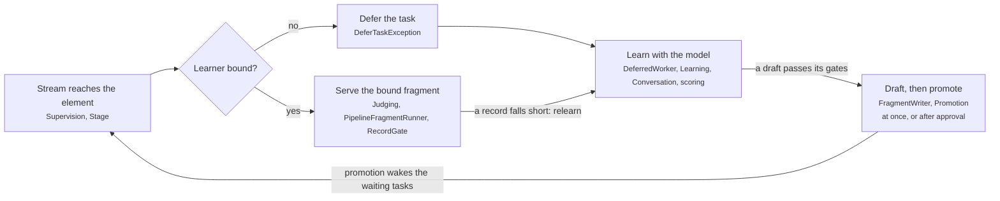

# Learning Flow: code structure

*24 November 2026 · branch `ai_translations_server` at `404b1916fb` · a copy of the Claude Doc
[Learning Flow: code structure](https://claude.ai/artifact/6QsukD4W52MmWPQhZJvczN), written for a review of the code*

## Scope and how to read

This covers the Learning Flow code on branch `ai_translations_server` as committed at `404b1916fb` (24 November 2026), about 580 Java files across six Gradle modules. It does not cover the rest of Stroom, except where this branch changed it.

- **Learning Flow** is the document type: it says how a pipeline element learns a translation from a model.
- **Smart Pipelines** is the feature, and a pipeline holding the *Smart Pipeline* element.
- Older names still appear in comments and docs: *Shapeshifter AI* and *AI Translations*. The code was renamed on 23 November.

A suggested review order, following how data moves:

1. The shared document and REST interfaces (`stroom-core-shared`, `stroom.learningflow.shared`).
2. The pipeline element and supervision (`element`).
3. One learning run: `stage`, then `learning`, then `scoring`.
4. Running and serving fragments (`fragment`, `extraction`, `transformation`).
5. Persistence (`stroom-learning-flow-impl-db`).
6. The client screens (`stroom-core-client`).

## Module map

The server logic lives in one module, `stroom-learning-flow`, with its database code split into `-impl-db`. The rest sits in Stroom's existing shared, client, app and workbench modules. Main code totals about 63,000 lines, and tests about 38,000.

| Module | Package | Purpose | Main code | Tests |
| --- | --- | --- | --- | --- |
| `stroom-learning-flow:stroom-learning-flow` | `stroom.learningflow` | All server logic: the pipeline element, learning runs, scoring, promotion, serving, the Supervisor and QA services, REST resources | 168 files, 28,073 lines | 119 files, 21,915 lines, plus 33 test-fixture files (4,505 lines) |
| `stroom-learning-flow:stroom-learning-flow-impl-db` | `stroom.learningflow.impl.db` | MySQL persistence through jOOQ: the DAOs behind the server module's row interfaces, and the Flyway migrations | 43 files, 9,432 lines | 11 files, 2,254 lines |
| `stroom-core-shared` | `stroom.learningflow.shared` | What client and server share: `LearningFlowDoc`, the REST resource interfaces, and the DTOs the screens show | 71 files, 7,891 lines | — |
| `stroom-core-client` | `stroom.learningflow.client` | The GWT screens: the Learning Flow editor, the Supervisor, Learning Status and the Smart Pipeline QA tab | 77 Java files, 14,609 lines, plus 26 UiBinder and CSS files | — |
| `stroom-gwt:stroom-gwt-workbench` | `…workbench.client.app.learningflow` | Workbench stories and fixtures for those screens | 8 files, 2,958 lines | Run as stories |
| `stroom-app` | `stroom.learningflow` (test) | Integration tests against a real node: Guice wiring, the pipeline pool, the database | — | 24 files, 6,327 lines |

`stroom-app` also binds the module into the application, in `AppModule`, `CoreModule` and `DbConnectionsModule`.

## The server module's packages

`stroom-learning-flow` has ten packages under `stroom.learningflow`. `stage` and `learning` hold the core: the decision a stage makes on each stream, and the conversation with the model. The others plug that core into Stroom's pipelines, storage and screens.

| Package | Files, lines | Purpose | Classes to start with |
| --- | --- | --- | --- |
| `element` | 24, 3,699 | The Smart Pipeline element in a real pipeline: parsing the element's properties, supervising each stream, running candidate steps through the real XSLT pool, Guice wiring, and the scheduled jobs | `LearningFlowParser`, `Supervision`, `StageFactory`, `PipelineStepRunner`, `LearningFlowElementModule` |
| `stage` | 39, 7,223 | What a stage decides for a stream: serve with the bound fragment, defer, or learn. Also learning runs, promotion, the corpus and regression set, spend, and the row interfaces the database implements | `Stage`, `Learning`, `Judging`, `Promotion`, `Sessions`, `Attempts`, `DeferredWorker` |
| `learning` | 27, 5,545 | The conversation with the model: questions, their wording, prompt templates, replies, the target schema and why a run stopped | `Conversation`, `Question`, `QuestionText`, `Templates`, `TargetChecks`, `StopReports` |
| `scoring` | 22, 3,252 | The checks a candidate is judged by: compile, schema conformance, completeness, yield, times, literals, the allow-list (`PermittedScorer`) and others, combined into a scorecard | `Scorer`, `Scorecard`, `Verdict`, `PermittedScorer`, `SchemaConformanceScorer` |
| `fragment` | 22, 3,006 | A *fragment* is the small pipeline a learner is served by. Writing fragments as Stroom documents, running them as pipelines, and gating each served record | `FragmentWriter`, `PipelineFragmentRunner`, `RecordGate`, `ServedStream` |
| `extraction` | 11, 1,382 | The parser end of a chain: Data Splitter, JSON and XML-fragment steps, and splitting and joining records the way the fragment's `SplitFilter` does | `DataSplitterStep`, `JsonStep`, `RecordSplit`, `RecordJoin` |
| `transformation` | 8, 1,691 | The XSLT end: the stand-in XSLT runner, the allow-list of what a learned stylesheet may use, and the static check against it | `XsltStep`, `AiXsltAllowList`, `LearnedStylesheetCheck`, `StylesheetScan`, `StroomStandIns` |
| `doc` | 9, 1,708 | The Learning Flow document type and the REST resources: the document store, the Supervisor service and the QA resource | `LearningFlowStoreImpl`, `SupervisorService`, `SupervisorResourceImpl`, `LearnerAccess` |
| `quality` | 2, 264 | What a Smart Pipeline's Quality Assurance tab reads and records | `QualityService`, `Volumes` |
| `cache` | 3, 330 | Caches in front of the learner bindings and learner state rows, which the serving path reads on every stream | `CachedLearnerBindings`, `CachedLearnerStates` |

The package root holds `LearningFlowConfig`, the node-level settings: where runtime state is kept, caches, and the spend ceilings.

**One stream through a learner, in short:**

1. A pipeline reaches a Smart Pipeline element. `Supervision` hands the stream to a `Stage` built by `StageFactory`.
2. **If the learner has a binding**, `Judging` runs the bound fragment through `PipelineFragmentRunner`. `RecordGate` holds each output record to the bar. A shortfall can open a relearn.
3. **If it has no binding**, the stream is deferred: its processor task waits. A learning attempt is opened and parked at its first question.
4. `DeferredWorker`, a scheduled job, carries waiting attempts on. `Learning` drives a `Conversation`, which asks the model questions in the order the document's flow sets. Each candidate is run and scored, by the stand-in runners or `PipelineStepRunner`.
5. A result is written as a draft fragment (`FragmentWriter`). `Promotion` makes it serve: at once on an automatic flow, or after a person approves it on a review flow.
6. Promotion wakes the deferred tasks (`Wake`, `TaskWake`), and the waiting streams are processed again, now served.

Serving is the everyday path: a bound learner serves each stream through its fragment. The rest of the flow happens only while a learner has nothing that serves, or after a record falls short.

## Persistence

All runtime state is in 11 MySQL tables, created by one Flyway migration, `V08_00_00_001__learning_flow.sql` (349 lines). The server module declares a row interface for each concern, mostly in `stage`. `stroom-learning-flow-impl-db` implements each as a jOOQ DAO, following Stroom's service-then-DAO layering. The jOOQ classes under `db/jooq` (27 files) are generated, so don't review them by hand.

| Table | DAO | Interface it implements | What a row is |
| --- | --- | --- | --- |
| `learning_flow_learner_state` | `LearnerStatesDao`, `LearnersDao` | `LearnerStates`, `Learners` | One learner (a pipeline and element): given up, marked to relearn, awaiting review, and its rolling score |
| `learning_flow_binding` | `LearnerBindingsDao` | `LearnerBindings` | The fragment that serves a learner, and any draft awaiting review |
| `learning_flow_spend` | `SpendDao` | `Spend` | What a document has spent on its model, across the cluster |
| `learning_flow_attempt` | `AttemptsDao` (759 lines, the largest) | `Attempts` | One learning session. While open, it is the learner's claim |
| `learning_flow_turn` | `AttemptsDao` | `Attempts` | One question of a session and its answer |
| `learning_flow_output` | `OutputsDao`, `VolumesDao` | `Outputs`, `Volumes` | What a binding produced from each stream, for reprocessing and the QA volumes |
| `learning_flow_guidance` | `GuidanceDao` | `Guidance` | What a person told a learner, fed into every later question |
| `learning_flow_deferral` | `DeferralsDao` | `Deferrals` | A stream waiting for its learner |
| `learning_flow_corpus` | `CorpusIndexDao` | `CorpusIndex` | One corpus entry: the stream and segment holding a record and its accepted output |
| `learning_flow_snapshot` | `SnapshotsDao` | `Snapshots` | A fragment's configuration at one promotion |
| `learning_flow_deleted_pipeline` | `DeletedPipelinesDao` | `DeletedPipelines`, `KeptLearning` | The learning of a deleted pipeline, kept until it ages out |

`LearningPipelinesDao` implements `LearningPipelines`, the Supervisor's cross-learner list. It reads several of these tables and owns none. `LearningFlowDbModule`, `LearningFlowDaoModule` and `LearningFlowDbConnProvider` wire the connection pool and bind the DAOs. Corpus records themselves are not in these tables: they are stored as streams on the source feed (`StoredRegressionSet`), and the table only indexes them.

## Shared model and REST

`stroom.learningflow.shared` in `stroom-core-shared` (71 files) holds the document, the three REST interfaces and the DTOs they carry. GWT compiles it into the client, so it can only use what GWT can translate.

| Group | Classes | Purpose |
| --- | --- | --- |
| The document | `LearningFlowDoc` (680 lines), `LearningFlow`, `FlowStep`, `Transition`, `StepGuard`, `QuestionKind`, `ConfigureRole`, `LearningMode`, `PromotionMode`, `Template` | A Learning Flow: the model to ask, the target schema, budgets, mode, and the flow. The flow is a graph of question steps and transitions taken on each outcome |
| Checks | `Check`, `CheckSetting`, `CheckSettings`, `CheckState`, `CheckPreset`, `CheckResult`, and the `*Parameters` classes | The one model of checks: each check is Off, Advice or Gate on a document, with a threshold and its own parameters |
| Built-in setups | `BuiltInFlow`, `BuiltInTemplates`, `FlowExample` | The default flows (Direct, Target first, Escalating) and prompt templates the Setup tab starts from |
| Flow validation and words | `FlowProblem`, `FlowPath`, `FlowWords`, `FlowExit`, `StepOutcome` | What is wrong with a flow, the path an attempt took through it, and the words screens use |
| Supervisor | `SupervisorResource`, `SupervisorAttempt`, `SupervisorTurn`, `SupervisorLearner`, `SupervisorGuidance`, `AttemptCriteria`, `AttemptStatus`, `LearnerCriteria`, `LearnerRef`, `LearnerState`, `BacklogStream`, `Binding`, `RebuiltPrompt`, and the `*Request` classes | Runs, turns, learners, the backlog, guidance, and what a person does: approve, reject, grant, exhaust, improve, retract, relearn, give up |
| Why a run stopped | `StopReport`, `StopCause`, `Suggestion`, `SuggestionAction` | An error line, details, and suggestions a screen can offer as buttons |
| Quality | `QualityResource`, `QualityReport`, `QualitySample`, `VolumeDay`, `RecordKind` | A Smart Pipeline's QA tab: volumes, and sample records beside what they became |
| Records and scores | `RecordBoundary`, `ReplayUnit`, `LearnedUnknown`, `StageScore`, `StageVerdict`, `TurnScore`, `TimeZoneSource`, `TargetSchemaSummary` | What one record is, how a candidate scored, and facts the Setup and Learning Status tabs show |

**REST endpoints.** The server implementations are in the server module's `doc` package.

- `LearningFlowResource` (5 endpoints): read and write a document; its templates, flow examples and target schema summary.
- `SupervisorResource` (22 endpoints): attempts and their turns, rebuilt prompts, approve, reject, grant, exhaust, the backlog, improve and retract a binding, guidance, and the learners list with relearn and give up.
- `QualityResource` (2 endpoints): one Smart Pipeline element's report and its samples.

## The client

`stroom.learningflow.client` in `stroom-core-client` holds 77 Java files and 26 UiBinder templates. They follow the UI guide's pattern: each screen or dialog is a dumb component (`X.java` + `X.ui.xml`) and an `XController` that wires it. The screens are reached from five places.

| Screen | Where it opens | Main classes |
| --- | --- | --- |
| Learning Flow editor | Opening a Learning Flow document. Tabs: Feeds (shown as Pipelines), Setup | `LearningFlowEditor`, `LearningFlowPlugin`, `FeedsTab`, `SetupTab` and `SetupTabController`, `ReadinessBanner` |
| Setup tab: the approach and checks | Inside the editor. A route map down the side, and the chosen section or flow step beside it | `RouteMap`, `RouteMapDrawing`, `ApproachSectionController` (731 lines), `ApproachFlow` (761), `StepCard`, `RuleRow`, `CheckList`, `CheckEditor`, `XPathAssertionList` |
| Smart Pipelines screen (the Supervisor) | Monitoring menu | `LearningFlowSupervisorPlugin`, `SupervisorController`, `FeedList` and `FeedListController` |
| Learning Status for one Smart Pipeline | From the Supervisor or a document's Pipelines tab | `FeedDetail` and `FeedDetailController` (657 lines), `FeedSituation` (609), `FeedProgress`, `ConversationList`, `Evidence`, `WaitingStreamList`, and dialogs for grant, guidance, reasons, answering a turn and showing its prompt |
| A pipeline's tabs | Pipeline editor: the AI Translation tab, the Quality Assurance tab, and the Structure tab when a Smart Pipeline element is selected | `PipelineAiTab`, `QualityTab`, `QualityFigures`, `VolumeChart`, `LearnedTranslation`, `LearnedParts` |
| Stepper stage pane | Stepping a pipeline with a Smart Pipeline element, in place of the code pane | `StageDecisionPane` and its controller |

`PlainWords` and `FlowWords` (shared) hold the wording the screens use in place of engine names. `gin/LearningFlowModule` registers the two plugins.

**Workbench stories** (`stroom-gwt-workbench`, 8 files, 2,958 lines) cover each screen with fixtures, per `WRITING-STORIES.md`. They are `LearningFlowEditorStories`, `SupervisorStories`, `PipelineAiTranslationStories`, `PipelineQualityStories`, `LearningFlowStopReportStories` and `StageDecisionPaneStories`, with fixtures in `LearningFlowFixtures` and `AiPipelines`.

## Where it touches the rest of Stroom

The branch changes about 94 Java files outside the Learning Flow packages, compared with gchq master. These are the riskiest part to review, because they change behaviour every Stroom pipeline shares. There are four groups:

| Area | What changed | Files to read |
| --- | --- | --- |
| **Deferred processor tasks** (`stroom-processor`, `stroom-core`) | A third task outcome besides done and failed. An element throws `DeferTaskException`, and the task goes back to `CREATED` after a delay, or sooner when woken. Adds the `DEFERRED` task status, `wakeDeferredTasks` on `ProcessorTaskService`, and changes to the task creator, reaper and claim | `DeferTaskException`, `TaskStatus`, `AbstractProcessorTaskExecutor` (69 lines changed), `ProcessorTaskDaoImpl` (86), `ProcessorTaskCreatorImpl`, `ProcessorTaskReaper`, `ProcessorConfig` |
| **Running a pipeline without a stepping session** (`stroom-pipeline`) | `InjectedCode` (new, pipeline-scoped) lets a caller run elements with code that isn't stored: the stepper's edits, or a candidate being judged. `HeadlessCapture` (270 lines) captures each element's output with no stepping session | `InjectedCode`, `XsltFilter`, `PipelineFactory` (119), `HeadlessCapture`, `PipelineCapture`, `HasStepDetails`, and the parsers' record-detector changes |
| **Stepping and the pipeline editor** (`stroom-core-client`, `stroom-core-shared`) | Stepping into a Smart Pipeline element's nested fragment pipeline, and showing the stage pane in place of the code pane | `SteppingScreenController` (129), `NestedPipelineTreeBuilder` (95), `ElementStepDetailsPaneRegistry`, `PipelineEditor` (89), `NestedElementData`, `ElementStepDetails` |
| **Registration and config** | The document type, the app permission for automatic approval, stream type names, Guice and GIN bindings, `LearningFlowConfig` in `AppConfig`, and Gradle module wiring | `DocumentTypeRegistry`, `AppPermission`, `StreamTypeNames`, `AppModule`, `CoreModule`, `DbConnectionsModule`, `AppConfig`, `ConfigProvidersModule`, `settings.gradle` |

Two smaller changes are in `stroom-ai`: the model client's timeout handling (`AiServiceImpl`), and `MetaServiceConfig`. The 24 November XSLT sandbox came from gchq master, not this branch, so it is not listed.

## Tests and fixtures

Tests sit at three levels. Unit tests mirror the server packages, a scenario suite drives whole learning runs against stand-ins, and `stroom-app` tests run the real node.

| Level | Where | What it covers |
| --- | --- | --- |
| Unit tests | `stroom-learning-flow/src/test`, 119 files. The largest groups are `learning` (12), `scoring` (11), `element` (10), `stage` (10) | One class or package each, with Mockito where needed |
| Scenario suite | `src/test/.../scenario` (48 files), with fixtures in `src/testFixtures/.../scenario` (8 Java files; 82 resources, including OTEL sample data) | Whole runs end to end, with a scripted model and the stand-in runners. The fixture stylesheets are also what `TestLearnedStylesheetCheck` holds the allow-list to |
| In-memory state | `src/testFixtures/.../state` (20 files) | In-memory versions of the row interfaces, so the server module tests without a database |
| Database | `stroom-learning-flow-impl-db/src/test`, 11 files | The DAOs against a real MySQL |
| Node integration | `stroom-app/src/test/java/stroom/learningflow`, 24 files | The real pipeline, pool, Guice wiring and database. Covers scenarios run in a pipeline, deferred tasks, stepping into a fragment, both modes, and the demo pack import |
| Shared and client | `stroom-core-shared/src/test` (9 files), `stroom-core-client/src/test` (23 files) | The document model, checks and flow words, and the client's pure logic such as `FeedSituation` and `RouteMapDrawing` |
| Screens | Workbench stories (see *The client*) | Each screen's states, with the leak check |

**Demo content pack.** `TestDemoContentPack` (in `src/test/.../pack`, with fixtures in `testFixtures/.../pack`) checks the committed zip is the one the code writes. The commit still holds the old `shapeshifter-ai-demo-v1.0.zip`. Its replacement, `smart-pipelines-demo-v1.0.zip`, is not yet tracked by git.

**Disabled security tests.** Five tests are `@Disabled` until Track 3 task 1: four bypasses of the stylesheet check in `TestLearnedStylesheetCheck`, and a refused `stroom:` function on the real node path in `TestPipelineStepRunner`. They are the definition of done for that task.

## Uncommitted work

Only one file is new since the merge commit, and the review can leave it out: `transformation/XPathCalls.java`. It is the start of Track 3 task 1, and nothing calls it yet. It reads the function calls in an XPath with Saxon's own parser, replacing the regular-expression scan in `LearnedStylesheetCheck`. Work on it is paused until this review is done.

Also uncommitted: the updated work-in-progress notes (`docs/learning-flow-work-in-progress.md`), `ProcessorTaskRecoveryImpl` and its test, and the untracked demo pack zip.
