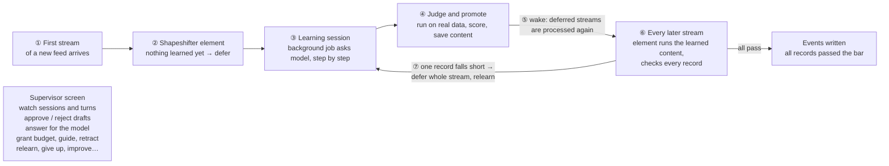
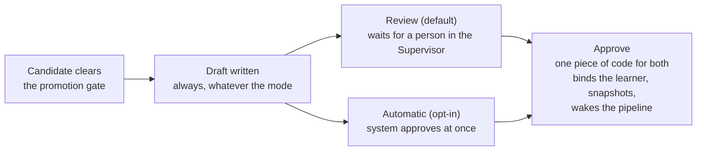

# Shapeshifter AI: options for simplifying the server side

*Server-side review · options paper*

Branch `ai_translations` · revised 12 November 2026 · Companion to the server-side inventory document. Written for readers who don't know the system: no Shapeshifter knowledge assumed, some Stroom knowledge helpful.

> **What this document is for.** The Shapeshifter AI code on this branch was generated by AI as a prototype. It works and is carefully designed, but it is large: about 24,000 lines of server code, 56 shared types, 11 database tables, 21 REST endpoints, and a change to Stroom's core processor. Before we spend effort making it production-ready, we should decide how much of it production actually needs.
>
> **The scenario this revision assumes.** The product must offer *autonomous* learning, where the system learns, promotes and relearns with nobody involved. But it ships with **review as the default**: nothing the model writes goes live until a person approves it, unless a document has been switched to automatic. Automatic is enabled feed by feed, after a trial on real data.
>
> Sections 1 and 2 explain the system using one worked example. Section 3 sets out the options, each with what it is today, what we'd change, what we'd lose, and a recommendation. Section 4 brings them together, and section 6 lists the decisions we need.

> **Update, 18 November 2026.** The agreed UI ([ui-design.md](ui-design.md)) keeps editable flows, every Supervisor action and per-document question texts. So options B, D and E are off the table as UI changes: the screens would have to be rebuilt to remove what they offer. The other options stand as written.

## Contents

1. [The problem Shapeshifter solves](#1-the-problem-shapeshifter-solves)
2. [How it works today, by example](#2-how-it-works-today-by-example)
3. [The options](#3-the-options)
   - A. [One promotion path, review by default](#a-one-promotion-path-review-by-default)
   - B. [A fixed learning recipe instead of an editable one](#b-a-fixed-learning-recipe-instead-of-an-editable-one)
   - C. [No provisional bindings](#c-no-provisional-bindings)
   - D. [A smaller Supervisor](#d-a-smaller-supervisor)
   - E. [Prompts in code, not in documents](#e-prompts-in-code-not-in-documents)
   - F. [Remove the unfinished and unused parts](#f-remove-the-unfinished-and-unused-parts)
   - G. [Drop the Pipeline Factory](#g-drop-the-pipeline-factory)
   - H. [Drop the worker-claiming requirement](#h-drop-the-worker-claiming-requirement)
   - I. [Not pursued: learned pipelines becoming ordinary pipelines](#i-not-pursued-learned-pipelines-becoming-ordinary-pipelines)
   - i. [Judge with the same code that serves](#i-judge-with-the-same-code-that-serves)
   - ii. [Fewer, bigger storage interfaces](#ii-fewer-bigger-storage-interfaces)
   - iii. [Break up the central class](#iii-break-up-the-central-class)
   - iv. [Take test code out of the product](#iv-take-test-code-out-of-the-product)
4. [Putting it together](#4-putting-it-together)
5. [What must exist before any feed runs automatically](#5-what-must-exist-before-any-feed-runs-automatically)
6. [Decisions needed](#6-decisions-needed)

---

## 1. The problem Shapeshifter solves

Stroom receives logs in whatever format the source system writes. Before they're useful, each log record must be turned into an **event**: an XML document that follows the organisation's event schema. Here's a real line from a firewall (one of the test fixtures on this branch):

```text
Oct 19 09:00:03 fw01 kernel: [1393970.694408] FW-IN-DROP: IN=eth0 OUT= MAC=00:16:3e:… SRC=198.51.100.23 DST=203.0.113.2 LEN=60 … PROTO=TCP SPT=51544 DPT=22 … SYN …
```

and roughly what it needs to become (shortened, for illustration):

```xml
<Event>
  <EventTime><TimeCreated>2026-10-19T09:00:03.000Z</TimeCreated></EventTime>
  <EventSource><Device><HostName>fw01</HostName></Device></EventSource>
  <EventDetail>
    <TypeId>FW-IN-DROP</TypeId>
    <Network>
      <Source><IPAddress>198.51.100.23</IPAddress><Port>51544</Port></Source>
      <Destination><IPAddress>203.0.113.2</IPAddress><Port>22</Port></Destination>
      <Outcome><Success>false</Success><Description>Dropped</Description></Outcome>
    </Network>
  </EventDetail>
</Event>
```

Today a specialist does this by writing two pieces of Stroom content and joining them in a **pipeline**:

1. A **Data Splitter** configuration (a parser). It cuts the raw text into records and names the fields: "each line is a record; the word after the time is the host; `SRC=` is followed by the source address…"
2. An **XSLT** stylesheet (a transform). It turns each parsed record into an event like the one above.

For a complex feed the XSLT can run to thousands of lines, and every new feed needs its own. That's the cost Shapeshifter is meant to remove: **a language model writes the Data Splitter configuration and the XSLT, and Stroom checks the result**.

> ✅ **A principle worth keeping whatever we decide:** the model writes *configuration*, never events. Once a configuration is accepted, every later record runs through ordinary Stroom content at normal speed, with no model involved. The model's own opinion of its work counts for nothing. Every answer is run on real data and scored by Stroom's validators.

---

## 2. How it works today, by example

Follow the firewall feed through the system. The words in **bold** are the system's own terms. They come up again in the options.



*The life of a feed in Shapeshifter today.*

### ① A stream of a new feed arrives

The firewall's first file of logs (a **stream**) lands in Stroom. A companion feature, the Pipeline Factory, notices a feed it hasn't seen and creates a pipeline for it automatically ([option G](#g-drop-the-pipeline-factory) proposes that Stroom's existing Content Templates do this instead). That pipeline starts with a special **Shapeshifter AI element**, followed by the usual writers.

### ② Nothing has been learned yet, so the stream waits

The element looks for a **binding** (a record of which learned content serves this pipeline). There isn't one. Rather than fail, the processing task ends with a new status, **DEFERRED**: "keep this; try again later". This status was added to Stroom's core processor for this feature. The stream is now **held**, and a learning **session** is opened for it.

### ③ A background job has a conversation with the model

Processing never waits for the model. Once a minute, a scheduled job (the **worker**) picks up open sessions and asks the model a series of small, closed questions. The order of questions is a **learning flow**, and each question is a **step**. For the firewall feed a session might go like this:

| Turn | Question (step) | Model's reply (abridged) | Judged |
|---|---|---|---|
| 1 | **Chain**: which parser and transform elements? | `DSParser -> XSLTFilter` | Grammar check: passed |
| 2 | **Configure parser**: write the Data Splitter configuration | A regex per line, naming `host`, `prefix`, `SRC`, `DST`… | Ran it on the stream. Read 100% of input, 1 record per line: passed |
| 3 | **Configure transform**: write the XSLT | A stylesheet | Events failed schema validation (no `TimeCreated`): *conformance-short* |
| 4 | Same step, asked again with the failure explained | A corrected stylesheet | All events valid and non-trivial: passed |

Every reply is **run as a real pipeline** over the feed's own data and **scored**. There are six scorers: does it compile, did the parser read all the input, about the right number of records, schema-valid, good quality events, and site-specific rules. Each session has a token and time **budget**. If it runs out, the session **parks** and waits for a person.

### ④ The result is judged on the whole stream, then promoted

Passing on a sample isn't enough. The new content must pass on *every* record of the held stream. It also faces a **promotion gate**: a minimum score, and "no worse than before" on every record that was ever learned for (the **corpus**). Then the Data Splitter configuration and XSLT are saved as normal Stroom documents beside the pipeline, together with an immutable copy (a **snapshot**). The learner gets its binding.

There are two **promotion modes**, and today *automatic* is the default:

- In *automatic* mode the result goes live at once. A first result learned from fewer than 10 records is **provisional**: it serves, and is confirmed once enough records have passed through it. A relearned result is written over the old content in place.
- In *review* mode the result is written as a new, numbered **draft**, and a person must approve it.

### ⑤ The waiting streams are woken

Promotion moves every deferred task of that pipeline back to "created", so they're processed again.

### ⑥ Every later stream

The element finds the binding and runs the learned content as a **nested pipeline** inside the main pipeline. It checks every record against **the bar** (the per-record scores) as the record is produced. If all pass, the events go downstream. No model is involved.

### ⑦ When the feed changes

Suppose the firewall is reconfigured and starts writing ISO timestamps (another real fixture):

```text
before: Oct 19 09:00:03 fw01 kernel: [1393970.694408] FW-IN-DROP: …
after:  2026-10-20T09:00:03.112408+01:00 fw01 kernel: FW-IN-DROP: …
```

The first record that falls short stops the run. Anything already written for that stream is thrown away, and the stream is deferred. A new session opens to **relearn**, starting from the records that failed. The new version must do at least as well as the old one on everything in the corpus. Streams in the old format keep being served in the meantime.

### The Supervisor

A screen lets a person watch all of this and intervene. They can approve or reject drafts, read every turn of every conversation, answer a question instead of the model, give a parked session more budget, leave standing **guidance** for a learner ("the `MAC=` field is three MAC addresses run together"), ask a working binding to **improve**, **retract** a binding, send a learner back to relearn, or **give it up**.

### Where the size comes from

| Area | What it involves |
|---|---|
| Serving (②, ⑥, ⑦) | The element, a nested-pipeline runner, two helper pipeline elements, a per-node cache of bindings, an outputs table, snapshots for replaying a stream exactly as first processed, and the `DEFERRED` status in the core processor (about 9 processor classes plus `TaskStatus`) |
| Learning (③, ④) | The worker, cross-node claims and heartbeats, a 2,600-line central class (`Stage`), a 1,300-line conversation engine, budgets, the corpus, resuming from recorded turns |
| Promotion (④) | Two write paths, in-place for automatic and a numbered draft for review, plus provisional bindings and their later confirmation |
| The editable learning flow | A small language for writing flows, with its parser, validation rules, three example flows, and an editor (about 1,400 lines of shared types plus about 3,200 lines of client code that touch it) |
| Judging | Six scorers, plus a second, home-made way of running parsers that's used only while learning (about 1,900 lines). See [option i](#i-judge-with-the-same-code-that-serves) |
| Supervisor | 18 REST endpoints and their screens |
| Storage | 11 tables behind 17 interfaces, each with an in-memory copy for tests |

---

## 3. The options

Because autonomous mode must remain available, the serving path (②, ⑥, ⑦) and the core-processor change stay. The aim here is to keep every capability while removing *duplicated* and *optional* machinery. There are two kinds of option:

- **Options A–H change what the product does**, though usually only at the edges. They need a decision from whoever owns the requirements, and they come first, because there's no point tidying code we're going to remove.
- **Options i–iv only change how the code is organised.** Behaviour stays the same, so engineers can decide these, but they should wait until A–H are settled.

### A. One promotion path, review by default

`medium saving` · `product decision` · **Adopted and built, 20 November 2026** (Track 2 step 1)

**Today**

The default is *automatic*. The two modes write learned content in different ways (design document 04 §4.6):

- **Automatic relearning** rewrites the existing parser and XSLT documents in place.
- **Review** writes a new, numbered set of documents as a draft. Approval then points the learner at them.

Two code paths, with two sets of edge cases and tests.

**Proposed**

The default becomes *review*. Whatever the mode, a result that clears the gate is **always written as a draft**. The only difference between the modes is who approves it:

- **Review:** a person, from the Supervisor.
- **Automatic:** the system, at once, by calling the *same* approve code.



*A single promotion path for both modes. Approve copies the draft into the learner's single set of documents. The snapshot keeps every previous version.*

#### Example: the firewall feed changes

A session relearns the ISO-timestamp format and the result clears the gate. A draft is written either way.

- For a feed left on review, the draft waits in the Supervisor. A person sees "412/412 events valid, no regressions", reads the XSLT change, and approves.
- For a feed switched to automatic, the system approves the draft immediately, through the same code.

Either way, the learner ends up with one set of documents and a new snapshot.

#### What goes away

- The in-place rewrite path for automatic relearning, and the tests and edge cases that belong only to it.
- The mismatch between modes. A feed can be moved from review to automatic, or back, without the learned content being handled differently.

#### What we lose

- Little. Automatic mode writes one extra short-lived draft per promotion, and the draft is tidied away once approved. Design ruling A58 (one fragment per learner) still holds, because approve copies the draft into the learner's single set of documents and deletes the draft's own — which is what `FragmentWriter.copyInto` does, and is the one place where what was built goes beyond this wording.

#### Also needed: control over switching to automatic

Switching a feed to automatic lets the model change production content with nobody watching. Today that's an ordinary document setting. It should need a specific permission. It should also only be allowed once the controls in [section 5](#5-what-must-exist-before-any-feed-runs-automatically) exist.

> **Recommendation: adopt.** Make review the default, give both modes one promotion path, and put switching to automatic behind a permission.

### B. A fixed learning recipe instead of an editable one

`largest saving` · `product decision`

**Today**

The order of questions is **data on each document**, written in a small language with steps, conditions, jumps and limits. This is one of the three built-in examples:

```text
CHAIN
SPLIT
CONFIGURE parser on yield-short goto split
first: CONFIGURE transform candidates 2
       on passed goto end on spent goto target
TARGET kinds 3
again: CONFIGURE parser
CONFIGURE transform on preservation-short
       goto again on spent goto admit
ADMIT
```

A person can edit this on the "Learn" tab. The server must parse it, validate it, make sure it always ends, and run it.

**Proposed**

One recipe, written in Java and covered by tests:

```text
1. Chain              which elements?
2. Configure parser   (retry with feedback, up to N)
3. Configure transform (retry with feedback, up to N)
4. If still short: Admit (mark unknown kinds)
   otherwise park for a person
```

The document keeps a few plain settings: the model, retries per step, budgets and scorers.

#### Why this matters more with autonomous mode

On a feed that runs automatically, nobody reads the session before its result goes live. Every document should therefore run a recipe that has been tested, not one edited on a screen. With the editable flow, each site's documents can each run a different, untested strategy unattended.

#### What goes away

- The flow language and its parser and validation (`LearningFlow`, `FlowStep`, `Transition`, `StepGuard`, `FlowExit`…), about 1,400 lines of shared types.
- Most of the flow editor in the client (up to about 3,200 lines touch it). **This is a significant saving for the client-side work.**
- A large part of the 1,300-line `Conversation` engine, which exists to interpret arbitrary flows.
- A whole category of runtime failure: "this document's flow is invalid, so the session abandons".

#### What we lose

- Experimenting with questioning strategies without a code change. That's valuable in research, and less so in production, where a change of strategy should be tested and released anyway.

> **Recommendation: adopt.** Choose the recipe that does best in the scenario tests (the default, `DIRECT`, is the simplest) and hard-code it. Keep the other recorded flows as test cases if they're useful.

### C. No provisional bindings

`small to medium saving` · `product decision` · **Adopted and built, 20 November 2026** (Track 2 step 1)

**Today**

In automatic mode, a first result learned from fewer than 10 records is **provisional**. It serves straight away, and is confirmed later, once enough records have passed through it at a good enough score. A person can confirm it early with *Accept*. Under review mode provisional bindings never arise, because the result is a draft.

**Proposed**

A result learned from too few records is **never approved automatically**. Even on an automatic feed, it stays a draft for a person, as review mode already does. The system only approves on its own when it has enough evidence.

#### Example

A new, low-volume feed sends a first file of 4 lines. Today, on an automatic feed, a binding learned from those 4 lines goes live provisionally. Under this proposal it becomes a draft. A person approves it, or it waits until a later session has learned from more data.

#### What goes away

- The provisional state, its confirmation while serving, the *Accept* action and endpoint, and their screens.
- An awkward rule documented in design document 10 §10.4: "a provisional binding is never taken back by the gate".

#### What we lose

- Hands-off first results for small feeds on automatic. They wait for a person instead. Since review is the default anyway, this only affects feeds that have been switched to automatic.

> **Recommendation: adopt.** It fits naturally with A: "when in doubt, it's a draft".

### D. A smaller Supervisor

`medium saving, server and client` · `product decision`

The Supervisor has 18 actions. With review as the default, it becomes the main working screen, so its core must be solid. Some actions are conveniences that can wait.

| Action | What it does | Proposal | Why |
|---|---|---|---|
| List learners, sessions, waiting streams; read a session | Watch | **keep** | Essential: people must see what the model was asked and answered |
| Approve / Reject | Decide on a draft | **keep** | The everyday action under review mode, and the code automatic mode reuses (A) |
| Retract | Withdraw a serving binding | **keep** | A bad automatic promotion must be undoable in one step |
| Relearn / Give up | Start again / stop learning this feed | **keep** | Needed to recover and to stop |
| Grant | Give a parked session more tokens or time | **keep** | Otherwise a parked session can only be abandoned |
| Guidance (add, list, withdraw) | Standing hints added to every prompt | **keep, simplified** | Useful for steering a feed that learns unattended. One free-text "notes for the model" field per document might be enough |
| Improve | Ask a serving binding to do better | **defer, or move to the worker** | It's the one action that calls the model inside a web request, which breaks the design's own rule (ISSUES 3). "Relearn" covers most of the need |
| Amend a turn | A person answers instead of the model, and the session carries on from there | **defer** | Needs sessions to resume from an edited history: complex, and rarely needed when the reviewer can edit the draft directly |
| Exhaust | Jump a parked session to its last step | **remove** | Only meaningful with the editable flow (B) |
| Accept | Confirm a provisional binding | **remove** | Gone with C |

> **Recommendation:** v1 keeps the watch actions plus approve, reject, retract, relearn, give up, grant and a simple notes field. Improve and amend come later.

### E. Prompts in code, not in documents

`small saving` · `product decision`

**Today** each Shapeshifter document can override the built-in text of every question it sends to the model. The built-in text is versioned, and served to the editor through `GET /shapeshifterAi/v1/templates`.

**Proposed:** the prompts live only in code, are reviewed like code, and are covered by tests. A per-document question override means each site can quietly run a different and untested prompt, and on an automatic feed nobody would see the effect before it went live. It also makes support harder ("what exactly did the model see?").

*Example:* a site edits the transform prompt to "output only the fields you're sure of". Its events now pass validation but lose detail, and nobody else's tests would show it.

> **Recommendation: adopt.** The free-text "notes for the model" field in D gives sites a safer way to add context.

### F. Remove the unfinished and unused parts

**Adopted and built, 20 November 2026** (Track 2 step 1). `no-regret` · Almost all of these are already listed in the module's own `ISSUES.md` and `design/10-status-and-future.md`.

| Item | State today | Proposal |
|---|---|---|
| Scorer types `ERROR_LOAD`, `EVENT_CLASSIFICATION` | Defined, with settings, but nothing implements them; hidden in the editor | Remove |
| `regressionRetentionDays` setting | Shown on screen, read by nothing | Remove |
| Record spans column in `shapeshifter_output` | Written only for the learned stream, read only by a test | Remove the column. Keep the table: it records which snapshot made each output |
| `shapeshifter_spend` table | Written on every model call, read by nothing: the "spend breaker" was never built | **Keep, and build the breaker.** Automatic mode needs it (section 5) |
| "Marked Unknown" events and the Admit step | Built; lets a stream be served when some kinds of record can't be translated | Keep. Autonomous mode needs a way to finish when some records can't be translated |

### G. Drop the Pipeline Factory

`medium saving, server and client` · `product decision` · `removes three security problems` · **Adopted and built, 20 November 2026** (Track 2 step 1)

**Today**

Two features each turn a new feed into a pipeline that inherits from a template pipeline, plus a processor filter for that feed. Neither knows the other exists.

- **Content Templates** are part of core Stroom (released in 7.9, off by default; `stroom.core.receive.ContentAutoCreationServiceImpl`). When data arrives for a feed name Stroom doesn't know, Stroom matches the receipt's headers against an ordered list of templates, and the first match decides what's created. It creates the feed, its folder (default `Feeds/${accountid}`), and the account's groups and permissions. With the `INHERIT_PIPELINE` type, it also creates a pipeline **named after the feed**, inheriting from the template pipeline, and a filter `Feed = <feed> AND Type = <received type>` (Raw Events if none is given).
- **The Pipeline Factory** is new on this branch (`stroom-pipeline-factory`, document type `PipelineFactoryDoc`). A job runs every minute and scans the stream store, starting from stream 0. The first time it meets a new combination of key values (feed and type by default, optionally the pipeline that produced the stream), it makes a folder, a pipeline that inherits from the template, and a processor filter, all as the factory's run-as user. For AI translations it also writes the Shapeshifter element's `learnedFolder` and `learnedName` onto each pipeline it makes.

A new feed that matches both gets two pipelines and two filters, so every stream is processed twice. With Shapeshifter that also means two learners, twice the model spend, and two sets of model-written stylesheets.

The factory is separate from the 24,000 lines counted above. It is about 1,750 lines of server code, 1,250 lines of shared types, 2,000 lines of client code and 1,000 lines of tests, plus 1,150 lines of generated jOOQ code, two database tables (`pipeline_factory_combination`, `pipeline_factory_scan`), a migration, a scheduled job, a REST resource, an editor and its workbench stories.

**Proposed**

Remove the Pipeline Factory. Content Templates of type `INHERIT_PIPELINE`, with the AI template as their pipeline, make each new feed's AI pipeline at receipt.

#### Shapeshifter doesn't need the factory

Nothing in `stroom-learning-flow` depends on `stroom-pipeline-factory`. The Shapeshifter element only needs each feed to have **its own pipeline** that inherits from the AI template, and a filter for that feed. `INHERIT_PIPELINE` already makes exactly that.

The factory's only AI-specific job, writing `learnedFolder` and `learnedName`, isn't needed either. When those properties aren't set, `PipelinePlaces` (ruling A133) puts learned content in the pipeline's own folder, named `<pipeline name> learned`. A pipeline made by a Content Template is named after its feed, so its learned content lands beside it with no extra setup.

Two rules for configuring the Content Template:

- **Leave `learnedFolder` and `learnedName` unset on the template pipeline.** The element reads its properties after inheritance is applied, so a value set on the template would be shared by every pipeline that inherits from it, and they would all write their learned content to the same place.
- **Use `INHERIT_PIPELINE`, not `PROCESSOR_FILTER`.** A learner belongs to a pipeline (ruling A114). `PROCESSOR_FILTER` puts every feed on one shared pipeline, which would make all of them a single learner.

#### Example: a new customer's firewall feed

Account `1234` sends its first data for an unknown feed, `ACME-FIREWALL-EVENTS`. The matching Content Template creates:

- the feed, in `Feeds/1234`, with the groups `grp-1234` and `grp-1234-dev`;
- a pipeline `Feeds/1234/ACME-FIREWALL-EVENTS` that inherits from the AI template;
- a filter `Feed = ACME-FIREWALL-EVENTS AND Type = Raw Events` on that pipeline.

When the feed is learned, its parser and XSLT are saved as `Feeds/1234/ACME-FIREWALL-EVENTS learned`. The account's groups already have access to the folder, so its people can see their feed, its pipeline and what was learned for it.

#### What the factory does to an existing feed

The factory's main advantage is that it also reaches feeds that already exist. It's worth being precise about what that means, because it isn't "adopting" the feed:

- **The feed isn't changed.** It isn't converted into a sub-feed, and no new feed is created. The factory adds a folder, a new pipeline that inherits from the AI template, and a new filter beside the feed (`PipelineMaker.java:266-305`).
- **What the feed already has is left alone.** `PipelineMaker` never looks at the feed's existing pipelines or filters. If someone has already built a translation for the feed by hand, both filters select the same streams, every stream is translated twice, and the output and indexing are duplicated. Nothing warns anyone.
- **The feed's history is processed too.** The new filter starts from the feed's oldest stream unless the factory sets a minimum creation time. With AI, that history is sampled and sent to the model, for a feed nobody approved for AI under ruling A146.
- **Taking over isn't automatic.** For the AI pipeline to replace a hand-built one, a person has to disable or delete the old filter.

So "covering existing feeds" really means attaching a second pipeline to them. For an existing feed, the safe order is manual anyway:

1. Someone decides that the feed's data may go to the model (A146).
2. They create a pipeline inheriting from the AI template, with a filter for the feed and a minimum creation time.
3. They disable the old translation filter.

#### What goes away

- The `stroom-pipeline-factory` module, the `PipelineFactoryDoc` type and its editor, the scheduled job, the REST resource and the two tables. The factory hasn't been released, so no installation loses any configuration, and its migration can be deleted rather than undone.
- Double processing of new feeds that both features match.
- Three security problems that only the factory has:
  - **Anyone who can edit or import a factory can choose any run-as user.** `PipelineMaker.make` switches to the factory's run-as user before anything else (`PipelineMaker.java:112`), so `ProcessorFilterServiceImpl.checkRunAs` runs as that user and always passes. A factory's author can name an administrator, and within a minute folders, pipelines and filters are made as that administrator, and the filters run as them for good. Content Templates take their run-as user from application config, which only an administrator can set.
  - **Substituted values aren't cleaned.** Content Templates clean every value they substitute (`cleanTemplateVariable`, `cleanGroupString`). `PipelineFactoryKey.substitute` cleans nothing, and `PipelineMaker.folderOf` splits on `/`. Learning writes to `learnedFolder` as the internal processing user, so a crafted value can put learned content in any folder, without the checks the run-as user would face.
  - **Customers' data isn't separated by account.** Content Templates give each account's group access to its own folder, feed and pipeline. The factory creates no groups, so everything it makes takes the permissions of the folder it's in. With the default `Feeds/${feed}`, every customer's pipeline and learned content share whatever applies at `Feeds`, and learned XSLTs can contain values copied from customer samples.

#### What we lose

1. **Automatic coverage of existing feeds.** This is the only real gap. Content Templates fire only when data arrives for a feed name Stroom doesn't know. Without the factory, AI on an existing feed is set up by hand, one pipeline and one filter at a time, as above. Since ruling A146 expects a person to decide which feeds' data may go to the model, that may be what we want anyway.
2. **A record of what was made, with retries.** The factory records each combination as `PENDING`, `MADE` or `FAILED`, retries failures after 10 minutes, and has a Made tab and a Forget action. A Content Template's failures are only written to the server log and returned to the sender.
3. **The full set of filter settings.** Templates set priority and maximum concurrent tasks. The factory also sets auto priority, processor profile, minimum and maximum creation times, and export.
4. **The document model.** Each factory has its own run-as user and permissions, and can be exported and imported between environments. Content Templates are one global list with one global run-as user.
5. **Pipelines for processed streams.** A Content Template does create a pipeline, but only when data is *received* for an unknown feed. A factory can also key on the `Pipeline` that produced a stream, and so make a pipeline for each producer's processed output, such as Events written by another pipeline. Processed streams aren't received, so no template fires for them. Shapeshifter translates raw data, so it doesn't need this.
6. **Per-pipeline element properties written from patterns.** Not needed for Shapeshifter, as explained above.

#### Still needed

Content Templates bring a risk of their own: they fire for a feed name the sender chooses. If a template makes an AI pipeline, anyone who can send data can, without any person approving it, send data to the model, run up model costs with many feed names, and steer the stylesheet the model writes through the data it reads. This comes from the AI, not from either feature, so it needs the controls in [section 5](#5-what-must-exist-before-any-feed-runs-automatically) whichever way we go. In particular, a pipeline made automatically must start with learning switched off until a person approves the feed.

~~This option also needs [option H](#h-drop-the-worker-claiming-requirement)~~ — option H is done (20 November 2026), so a Content Template that makes an AI pipeline no longer fails at receipt whichever way tasks reach workers.

If automatic coverage of existing feeds turns out to matter later, the way to add it is a scan trigger on Content Templates, off by default, with first-match order and a minimum creation time for AI templates. Keeping a second feature isn't the answer. The companion paper `content-templates-and-pipeline-factory.html` sets this out as its option A.

> **Recommendation: adopt.** Remove the Pipeline Factory and make each feed's AI pipeline with a Content Template of type `INHERIT_PIPELINE`, with `learnedFolder` and `learnedName` left unset on the template. Put AI on existing feeds by hand, after their data has been approved for the model. Update design document `02-pipeline-factory.md`, the first step of `01-overview.md` and rulings A122 and A123 to match.

### H. Drop the worker-claiming requirement

**Done, 20 November 2026** (Track 1 task 5). The `SupervisedPipelines` check and the requirement it
enforced are gone; AI pipelines run with either way of getting tasks to workers.

`small saving` · `engineering decision` · `removes a deployment requirement`

**Today**

`stroom.processor.claimTasksOnWorker` comes from separate work (gh-5699). It is experimental and off by default, and it selects how processor tasks reach worker nodes:

- **Off (the default, and how Stroom has always worked):** the master node fills a task queue in memory from the database and hands tasks out when workers ask.
- **On:** each worker works out which filters its processing profiles allow, and claims tasks straight from the database (`CREATED → PROCESSING`, with `SELECT … FOR UPDATE SKIP LOCKED`). The master takes no part in processing.

Changing it is a hard cutover. It must be the same on every node, and the whole cluster has to be stopped to change it. Its own documentation says to leave it off unless asked to trial it.

Shapeshifter makes it a requirement. When a filter is created over a pipeline holding the Shapeshifter element, `ProcessorFilterServiceImpl.requireWorkerClaimingForSupervised` refuses it unless the setting is on. Shapeshifter registers its element with that check through the `SupervisedPipelines` interface (`SupervisedPipelineCheck`). Design documents 03 §3 and 08 give the reason: "a wake writes rows the worker reads, which a master-fed task queue would not see".

**Proposed**

Remove the requirement, so Shapeshifter runs with either setting and the two features can each be trialled on their own.

#### Why the stated reason doesn't hold

Deferring and waking are plain database updates, the same in both modes:

- **Deferring** sets the task's row to `DEFERRED`, with no node (`DataProcessorTaskHandler.java:231`).
- **Waking** sets the pipeline's deferred tasks back to `CREATED`, with no node (`ProcessorTaskDaoImpl.wakeDeferredTasks`).
- **The retry sweep** in the Processor Task Reaper returns deferred tasks after a delay, and runs "in both modes" (`ProcessorTaskReaper.java:110-113`).

The master queue doesn't keep track of tasks only in memory. Each time it fills, it reads every filter's `CREATED` tasks from the database, starting from the first (`findExistingCreatedTasks`, called from `ProcessorTaskQueueManagerImpl.queueCreatedTasks`). A woken task is exactly what that query looks for.

Nothing else hides it from the master:

- **Filter state:** the master selects filters only on enabled and not deleted. A filter's tracker being complete only stops new tasks being *created* for it.
- **The empty-filter backoff:** a wake doesn't reset it, but it lasts at most `skipEmptyFilterFetchDuration` (10 seconds). Worker claiming has a comparable 5-second cache of which filters have work.
- **Writing the deferral:** the worker sets the task to `PROCESSING` itself and writes `DEFERRED` with that row's current version. By then the task has already left the master's queue.
- **Heartbeats, the dead-task reaper, and the profile and `maxProcessingTasks` limits** work the same in both modes, and the limits count only `PROCESSING` tasks.

Three further pieces of evidence:

- **An existing test already covers it.** `stroom-app/src/test/java/stroom/processor/impl/TestDeferredTask.java:114-170` runs with the setting both off and on. It covers deferring, the retry sweep, a wake and processing to `COMPLETE` through the real master queue. Its own description says "in both task selection modes".
- **The design's history contradicts the reason.** `design/history/04-processing-flow.md:347-350` says the master queue is untouched "because a sleeping task is simply not `CREATED`". The reason first recorded for the requirement (lines 385-388) is that the master's cluster-wide view is "the wrong instrument for a document whose work is mostly deferred". That is a preference about efficiency, not a need for correctness. The wording in documents 03 and 08 came later.
- **Nothing else in Shapeshifter relies on it.** Its only links to the processor are `DeferTaskException`, `wakeDeferredTasks` and this check. The "claims" in `Attempts` and `DeferredWorker` are Shapeshifter's own attempt leases in its own table, unrelated to task claiming.

#### AI pipelines can already run without it

The check has gaps, so deferral has to work with the master queue anyway:

- It runs only when a filter is created, including by import and reprocess (`ProcessorFilterServiceImpl.java:170, 284`). Updating or enabling a filter isn't checked.
- It looks at the pipeline only when the filter is created. Adding the AI element to the pipeline, or to its parent, afterwards bypasses it.
- `SupervisedPipelineCheck` answers "not supervised" whenever it can't read the pipeline, on purpose, so that imports can arrive in any order.
- It reads the setting on whichever node handles the request, not across the cluster. Turning the setting off later doesn't stop existing AI filters.

#### What it costs today

- **AI translation needs an experimental mode.** To use Shapeshifter at all, a site has to move the whole cluster to a mode that isn't yet proven in production, with a hard cutover.
- **Automatic pipeline creation fails on a default install.** Content Templates (`ContentAutoCreationServiceImpl.java:694`) and the Pipeline Factory (`PipelineMaker.java:133`) both create filters through the checked `processorFilterService.create`. With the setting off, a Content Template that makes an AI pipeline throws at receipt and the sender gets the error. `TestPipelineFactoryMakesPipelines.java:179-191` expects that failure. Option G depends on this being fixed, or on the setting being on.

#### Example

A site runs the default master queue and wants AI translation on one feed. Today it must stop the cluster, switch every node to worker claiming, and start again, before it can even create the AI pipeline's filter. Under this option it creates the filter as for any other pipeline. The feed's first stream defers, learning promotes a result, and the wake returns the waiting tasks to `CREATED`. The master queues them within about 10 seconds.

#### What goes away

- `SupervisedPipelines` in `stroom-processor-api`, `SupervisedPipelineCheck` and its binding in `ShapeshifterAiModule.java:40`.
- The check and the injected `supervisedPipelines` in `ProcessorFilterServiceImpl`.
- `stroom-app/src/test/java/stroom/shapeshifter/TestASupervisedPipelineNeedsWorkerClaiming.java`.
- The requirement in design documents `03-processing.md:136-138` and `08-data-and-code-map.md:125, 172`.

`TestPipelineFactoryMakesPipelines.aPipelineWhoseFilterIsRefusedIsDeletedAgain` needs another way of making the filter be refused, so that it still tests that a refused pipeline is deleted again. One or two Shapeshifter scenario tests should be run in both modes.

#### What we lose

Nothing that is relied on for correctness. With the master queue:

- **A wake is slower.** It takes up to 10 seconds plus the queue's fill cycle. A wake usually runs on a node that isn't the master, so it can't reset the master's backoff. No test covers this delay, because `TestDeferredTask` sets it to zero.
- **Waking a pipeline that is still learning wastes some work.** Its tasks pass through the master queue only to defer again. That uses queue capacity (`queueSize`), not correctness.
- **A filter's task limit is looser.** Tasks waiting in `QUEUED` aren't counted against it. This was already true before Shapeshifter.
- **The master queue's own weaknesses** (what a failed master leaves behind, and no sweep of `QUEUED` tasks) apply to AI filters as to any other.

#### Before relying on it

Try it on a test cluster with the setting off: a wake issued from a worker node, the master failing over while tasks are deferred, and filters limited by processing profiles.

> **Recommendation: adopt.** Remove the requirement and correct design documents 03 and 08. Worker claiming stays available, and remains the better mode for a cluster with many deferring filters, but it's a choice for the site, not a condition of using AI translation. This finding was reviewed independently, and the review confirmed it.

### I. Not pursued: learned pipelines becoming ordinary pipelines

`ruled out by the scenario`

The earlier version of this document proposed that, once approved, a learned pipeline should become an ordinary `Data Splitter → XSLT → writer` pipeline, with the Shapeshifter element removed. That would have removed most of the serving path and the core-processor change.

It doesn't fit this scenario. Automatic mode depends on the element at the head of the pipeline: it notices a record that falls short, defers the stream, and starts relearning, all without a person. So the element, the nested-pipeline runner, per-record judging, the binding cache, snapshots and the `DEFERRED` task status all stay.

The design already notes a gentler version as future work (ruling A112): a pipeline whose learning has been stable for a long time could be turned into an ordinary one. That would be added later as a feature. It doesn't simplify v1.

### Options that only change the code's organisation

These keep behaviour exactly the same. They're worth doing whatever is decided above, but their size depends on it.

### i. Judge with the same code that serves

`recommended: essential for automatic mode` · `about 1,900 lines`

**Today** there are two ways of running a parser:

- **While learning**, candidates are run by the module's own parser runners (`DataSplitterStep`, `JsonStep`, `XmlFragmentStep`). These were written so they can report how much of the input each record used.
- **While serving**, the real Stroom pipeline is used.

Two tests (`TestStepRunnersAgree`, `TestFragmentRunnersAgree`) exist only to check that the two give the same answers. The design document explains why: "a stand-in that drifted would have the model correcting a fault the real pipeline does not have".

*Example of the risk:* a Data Splitter configuration relies on a feature the home-made runner handles slightly differently. It scores 100% while learning, is approved automatically, then fails every record once live. Every stream for that feed is then deferred until someone notices.

**Proposed:** always run candidates through the real pipeline, with a small extra filter that records input coverage. There's then one execution path, and "what was judged is what serves" holds by construction.

### ii. Fewer, bigger storage interfaces

`recommended`

**Today** 17 small interfaces sit between the logic and the database. For example, everything about one learner is split across `Learners`, `LearnerStates`, `LearnerBindings`, `LearningPipelines`, `DeletedPipelines` and `KeptLearning`. Each interface has a database version and an in-memory test version.

**Proposed:** group them by the thing being stored:

- **Learner:** its state, its binding, whether its pipeline was deleted
- **Session:** the session, its turns, guidance
- **Corpus**
- **Output and snapshot**
- **Spend**

That's about 5 interfaces instead of 17. They follow Stroom's usual resource → service → DAO layering, and the database tables can be checked against them one to one.

### iii. Break up the central class

`recommended`

**Today** one class, `Stage` (2,600 lines), handles serving, learning, promotion and every Supervisor action. It's built by hand with 25 constructor arguments rather than by Stroom's dependency injection. Five packages (about 15,000 lines) all depend on each other in a loop, so none of them can be understood or tested alone. The Supervisor's REST class (724 lines) also holds business logic that belongs in a service.

**Proposed:** one service per job:

- `ServingService` (decide, serve, defer)
- `LearningSessionService` (the worker's conversation)
- `PromotionService` (gate, draft, approve, reject, retract: the single path from A)
- `SupervisorService` (what the REST class calls)

Each is built by Guice. Splitting along these lines is also how the dependency loop gets broken.

### iv. Take test code out of the product

`no-regret`

The in-memory versions of every storage interface (19 classes, 1,900 lines in package `state`) ship in the production jar. Move them to `testFixtures`. The fast tests they support are worth keeping, because automatic mode makes the serving and promotion logic more important to test thoroughly. Once option ii has reduced 17 interfaces to about 5, there are far fewer of them to maintain.

---

## 4. Putting it together

Under this scenario the product keeps its full shape. Simplification comes from removing duplicates, removing optional extras and adding structure, not from removing whole capabilities.

| Area | Stays | Goes or is deferred | Has to be added |
|---|---|---|---|
| Serving | Element, nested runner, per-record bar, binding cache, snapshots, `DEFERRED` status | Record-spans column | – |
| Learning | Worker, claims, budgets, corpus, Admit step | The editable flow language and editor (B); per-document prompts (E); the parallel parser runners (i) | Static stylesheet check; spend breaker and rate limit |
| Promotion | Gate, drafts, approve and reject, retract | In-place rewrite path (A); provisional bindings and Accept (C) | Review as default; a permission to switch to automatic |
| Supervisor | Watch, approve, reject, retract, relearn, give up, grant, notes | Improve (or moved to the worker), amend a turn, exhaust | – |
| Onboarding feeds | Content Templates (`INHERIT_PIPELINE`) make each new feed's AI pipeline at receipt | The Pipeline Factory: its module, document type, editor, job and two tables (G) | Learning switched off on automatically made pipelines until a person approves the feed |
| Deployment | Either way of getting tasks to workers | The requirement that `stroom.processor.claimTasksOnWorker` is on, and its check (H) | A test-cluster trial of AI feeds with the master queue |
| Code structure | About 5 storage interfaces instead of 17; 4 services instead of one 2,600-line class; test doubles out of the product jar | | A test that enforces the module boundaries |

### Rough size of the saving

About **5,000–6,000 server lines** would be removed or moved out of the product:

- the flow language
- the parallel parser runners
- the test doubles
- the in-place promotion path, provisional bindings and the deferred Supervisor actions
- dead settings

Dropping the Pipeline Factory (G) removes about 3,000 more hand-written server and shared lines, about 1,150 generated lines, about 2,000 client lines and two tables.

On top of that, a large part of the client's flow editor goes, the 15,000-line dependency loop is broken, and the layering becomes conventional. The safety controls in section 5 add code back. The net change is smaller than the "assisted only" route in the earlier version of this document, but what remains is easier to review, test and support.

### Rolling out automatic mode

1. Ship with review as the default for every feed. Every promotion is approved by a person, so we build up a record of how often drafts are approved without edits.
2. Once the section 5 controls exist, a user with the new permission can switch individual feeds to automatic. Start with feeds whose drafts have consistently been approved without changes.
3. Watch spend, retractions and waiting streams on those feeds before widening.

---

## 5. What must exist before any feed runs automatically

> ⚠️ **A static safety check on every generated stylesheet** (needed for review mode too). Generated XSLT runs in Stroom's real XSLT engine with all of Stroom's extension functions. A stylesheet could call `stroom:http-call`, `fetch-json` or `ask-ai`, or read files with `document()`. It must be rejected before it runs if it does any of that. The module's design (A147) already says this, and it isn't built yet.
>
> ~~**A cost ceiling across sessions.**~~ **Done, 20 November 2026** (Track 2 step 3): `SpendBreaker`, four ceilings over the hour window A44's counter already kept — tokens and questions, per Learning Flow and cluster-wide. Past one, no new session opens and the streams wait, saying so, until the hour rolls.
>
> **Action on streams that wait too long.** Today a stream deferred past its document's maximum age is only flagged in the Supervisor. With nobody watching, it needs an alert or an error.
>
> **A decision on drift the system can't see.** Lines a parser silently drops are never judged (ISSUES 2), so some format changes go unnoticed. With review, a person might spot the gap. With automatic mode, nothing will.
>
> **Learning switched off on pipelines nobody has approved.** A Content Template fires for a feed name the sender chooses. A pipeline it makes automatically must start with learning switched off, until a person who has decided the feed's data may go to the model switches it on. The static stylesheet check above is the only thing between an outside sender and model-written code running on the host, so it must exist before any template makes an AI pipeline.
>
> **A decision on data leaving the system.** Samples of real log data are sent to the model unredacted (A146). Each feed should only be pointed at a model its data may go to, and someone must own that decision.
>
> **The release-fixed parts agreed before release.** The migration is numbered `V08_00_00_001`. Agree that, the table set, the REST paths and the config names, after the scope decisions and before anything ships.

---

## 6. Decisions needed

| # | Question | Who | Recommendation |
|---|---|---|---|
| 1 | Is review the default, with automatic switched on per feed behind a permission? (A) | Product owner, security | Yes |
| 2 | Can the learning recipe be fixed in code? (B) | Product owner, with the client-side developer | Yes |
| 3 | Can provisional bindings go, so a result from too few records always waits for a person? (C) | Product owner | Yes |
| 4 | Which Supervisor actions are in v1? (D) | Product owner, with the client-side developer | Watch, approve, reject, retract, relearn, give up, grant, notes |
| 5 | Can prompts be code-only? (E) | Product owner | Yes, plus a notes field |
| 6 | Who decides which feeds' data may go to which model, and who may switch a feed to automatic? | Security / data owner | Needs an owner before real data |
| 7 | Can the Pipeline Factory be dropped, with Content Templates making each feed's AI pipeline? (G) | Product owner, with the maintainers of `stroom-core` receipt | Yes |
| 8 | Must existing feeds get AI pipelines automatically? (G) | Product owner, with the data owner | No: by hand, per feed, once its data is approved for the model. If needed later, add a scan trigger to Content Templates |
| 9 | Can AI pipelines run with either way of getting tasks to workers, so `claimTasksOnWorker` stops being a requirement? (H) | Server-side engineers, with the owners of gh-5699 | Yes, after a test-cluster trial with the master queue |
| 10 | Structural work i–iv | Server-side engineers | Do it after 1–5 and 7–9, on what remains |

---

*Sources: the code on branch `ai_translations`; `stroom-learning-flow/stroom-learning-flow/design/` (documents 01–10, rulings A1–A147) and `ISSUES.md`; `docs/reference/design/ai_translations/`; for option G, `stroom-core/src/main/java/stroom/core/receive/`, `stroom-pipeline-factory/` and the companion paper `content-templates-and-pipeline-factory.html`; for option H, `stroom-processor/` (with `PROCESSOR_WORKER_TASK_QUEUEING_DESIGN.md`), `stroom-app/src/test/java/stroom/processor/impl/TestDeferredTask.java` and `design/history/04-processing-flow.md`. Line counts are approximate and were measured on 9 November 2026, and for options G and H on 12 November 2026. The event XML in section 1 is illustrative.*

*Stroomworks · internal engineering note · generated from branch `ai_translations` · not for external distribution*
