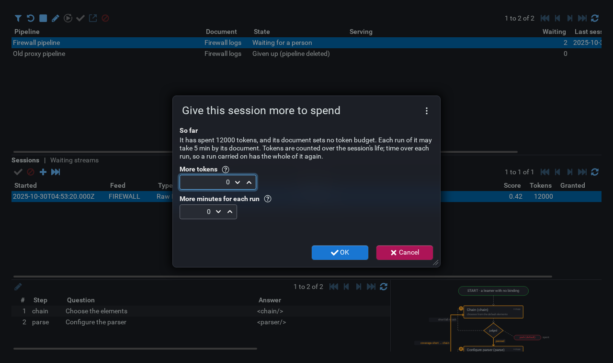
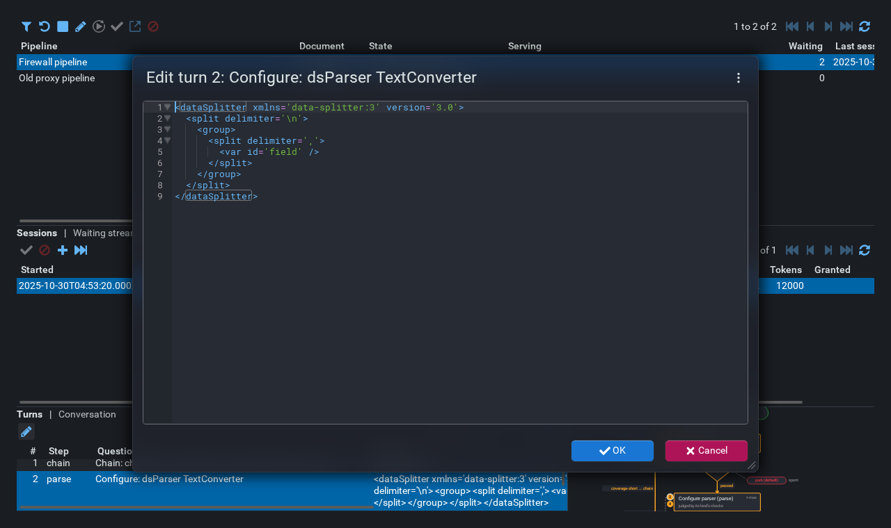
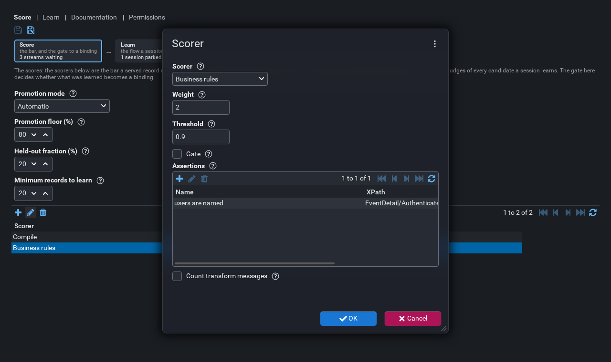
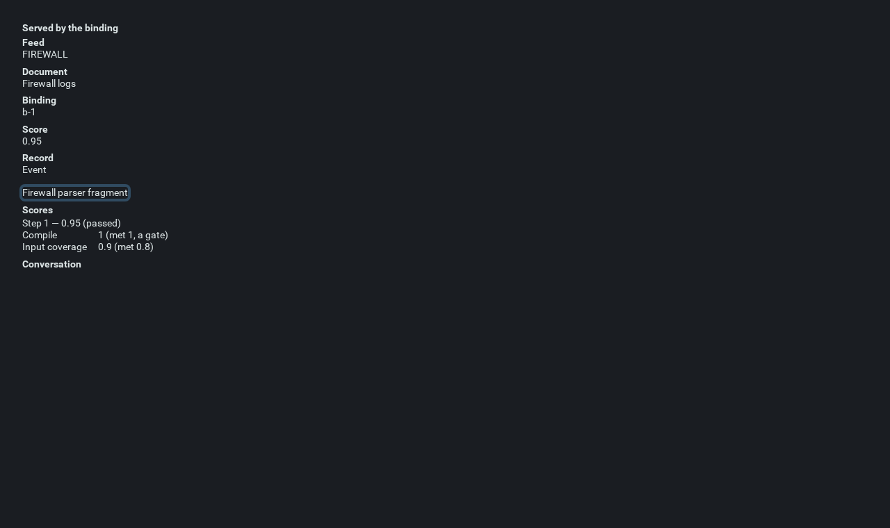
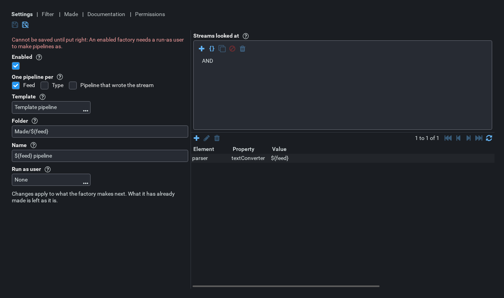
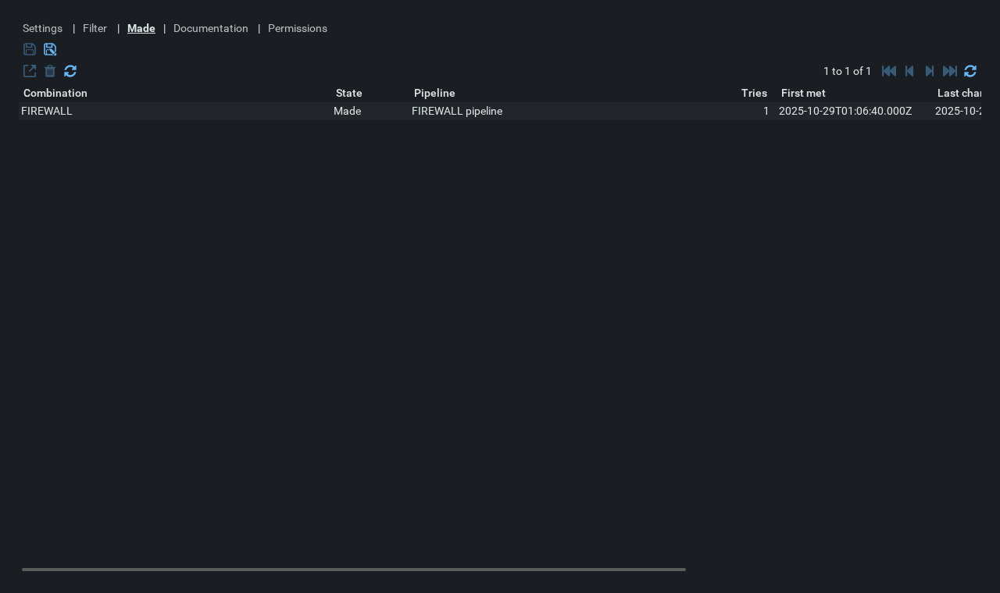

# 7. The user interface

The screens a person uses: the Shapeshifter AI document's editor, the Supervisor, the stepper's pane for
the element, and the Pipeline Factory's editor. They are Stroom GWT screens built to the rules of
`stroom-gwt/UI-GUIDE.md`: a dumb component (a UiBinder template and its Java) and a controller that wires
it, Stroom's own widgets, and workbench stories for every screen. The screenshots are from those stories,
in the dark theme, with made-up data. The terms are in the [glossary](README.md#glossary).

**Names people see (2026-11).** The feature is presented as *Smart Pipelines*. In the code and in stored
content it keeps its earlier names, and this design keeps them too:

| People see | Code and stored content |
|---|---|
| Smart Pipeline: a pipeline with the AI element | A pipeline with a `ShapeshifterAi` element |
| Learning Flow (the document) | `ShapeshifterAiDoc`, type `ShapeshifterAi` |
| AI Translator (the element) | `ShapeshifterAiParser`, type `ShapeshifterAi` |
| The pipeline's Learning Status tab | `PipelineAiTab`, "A pipeline's AI Translation tab" below |
| The pipeline's Quality Assurance tab | `QualityTab` |
| The Learning Flow's Pipelines tab | `FeedsTab`, "Feeds" below |
| Smart Pipelines (Monitoring menu) | The Supervisor |
| Learned translation | The fragment |

The steps the document's flow holds are called *learning steps* on screen, so as not to be confused with
the document's name.

**What is in sight (2026-11).** The screens start from the user stories (an Admin who configures the AI
and watches every pipeline; a Data Provider who uses it in a pipeline, gives it notes and checks how it is
doing), and keep what those don't need out of sight until someone asks for it:

1. **Shown**: what a story needs.
2. **Shown when it matters**: what only some situations call for, e.g. the readiness banner, a stopped
   run's details and suggestions, the waiting streams' tab, *Load default setup*.
3. **Folded away**: extension points, behind a chevron disclosure (`Disclosure`): each Setup section's
   **Advanced options**, a step's own, the learning steps on the route map, and a pipeline's **Learning
   history**.

A disclosure opens itself where what it holds is not as a new document has it, or is wrong
(`AdvancedSettings`, `FeedSituation.needsHistory`), so nothing changed is ever out of sight.

## 7.1 The Shapeshifter AI editor

A Shapeshifter AI document opens in `ShapeshifterAiEditor` with four tabs: **Feeds**, which it opens on;
**Setup**, everything the document holds, found around by a route map; then **Documentation** and **Permissions**. Which
streams reach a document is up to its pipelines' filters, so there is no routing tab.

The screens speak in the words a person uses, not the design's: a learner is a *feed* (named by its
pipeline), a binding a *translation*, a session a *learning run*, a turn a *question*, candidates *tries*,
park *pause*, grant *give it more*, exhaust *finish with Unknowns*, give up *stop learning*, retract *remove
translation*, provisional *on trial*, raised *overdue*, guidance a *note to the AI*, scorers *quality
checks*, the promotion floor the *pass mark*, the learning flow the *approach* and the exhaustion step the
*fallback*. The code, the grammar and these documents keep the design's terms (`PlainWords` holds the
screens' words).

### Feeds


The Supervisor's learning pipelines for this document alone (`FeedsTabController`), by
`LearnerCriteria.docUuid` (A115, A142): a table of every pipeline that learns under it, the same list
(`FeedList`, `FeedListController`) as the Smart Pipelines screen (7.2) shows for every document. Where a feed stands in detail, and what can be done about it, is on its pipeline's **AI
Translation** tab (below); each row has a button (Stroom's in-table `ToolbarButtonCell`, *Open pipeline …*)
that opens the pipeline there, at that feed's element.

- **Readiness** (`ReadinessBanner`, `Readiness`) across the top, only when the document won't learn
  anything, worked out from the document as the Setup tab has it, so that a change there is seen before it
  is saved. When it will learn there is nothing across the top: the Setup tab's route map says how each
  part is set. The banner lists what is right and what isn't, each problem with a button that opens the Setup tab at the section it belongs to
  and, where the document can be changed, makes the change there for the person to see and save —
  *Switch on*, *Choose a model*, *Use the Standard checks* (ISSUES item 22), *Show the approach*.

  
 Only the document is
  checked: whether pipelines use it needs other documents, and a pipeline built by hand is as good as one a
  factory made.
- **The feeds** (`FeedList`), the rest of the tab: a row each with the button that opens its pipeline, its
  name, a chip of where it stands and a line of what it scores or what waits. Filtered as Stroom's other
  lists are: a quick filter of the pipelines' names above the table, and the filter button in its toolbar,
  whose dialog (`FeedFilterEditor`) chooses *Needs you*, *Learning*, *Translating* or *Stopped or off*, each
  with how many it lists, and shows feeds whose pipeline was deleted on request (A137); the button's tooltip
  says when a filter is on. Every feed a document has is read at once and filtered and paged in the client.

### A pipeline's AI Translation tab

A pipeline whose structure (its own, or a parent's it inherits) has a Shapeshifter AI element has an **AI
Translation** tab (`PipelineAiTabController`, `PipelineAiTab`), found from the pipeline's merged layers
(`PipelineAiElement`); a pipeline without one has no such tab. Where a pipeline has more than one AI
element, a choice of them heads the tab. It is held to the **pipeline's** permissions, not the document's:
a person who may view the pipeline reads its feed's learning, runs, conversation, notes and waiting
streams, and one who may edit it acts on them (design 06, `SupervisorResourceImpl`); the document's
settings the tab needs (its flow, pass mark and limits) are given to the pipeline's viewers too
(`SupervisorResource.settings`). Read only, nothing is offered that would change the feed's learning
(`FeedSituation.readOnly`). An element that hasn't learned anything yet says so.

- **The feed** (`FeedDetailController`). Where it stands is one sentence with a chip, a sentence of detail,
  and its main actions as labelled buttons, the rest under *More…* (`FeedSituation`), none of which opens
  anything. Links that follow a suggestion on the Setup tab open the document at its Setup tab. The
  learner's actions and its run's are offered together, by the Supervisor's own guards, so nobody has to
  know which level an action belongs to:

| Situation | Chip | Main actions |
|---|---|---|
| A draft awaits review | Approve | Approve and use it, Reject… |
| A run is parked | Paused | Give it more…, Finish with Unknowns, Answer it myself |
| A run is under way, or nothing serves yet | Learning | (a note to the AI) |
| Given up | Stopped | Learn again |
| A run failed (the model, the node) | Failed | (its suggestions) |
| Learning off | Off | Go to Setup |
| A binding serves on trial | On trial | Accept now |
| A binding serves, below the flag | Below par | Improve… |
| A binding serves | Translating | Improve… |

  The learned translation it runs is a line beneath, *Translating with …*, whose name is a link that opens
  it. Beneath that, for one who may edit the pipeline, the *Note to the AI* box (A46), with the notes in use.
  Then, folded under **Learning history**: the learning run shown (the newest, or another chosen), and how
  far it got (`FeedProgress`): each step of the flow done, where it is now, tried and gone back from, or not
  reached, with why it last went back; the run's conversation (`ConversationList`), a row per question
  opening to its score against what it needed, what was asked and the whole answer, with *Answer this
  myself* (A28, A116); and, on a second tab shown only where streams wait, the streams waiting for the feed
  (`WaitingStreamList`). Learning history opens of its own accord while a run is under way or waits for
  someone, or streams wait (`FeedSituation.needsHistory`); while the pipeline is just translating it stays
  folded, as a Data Provider then needs only where it stands.

  *Give it more…* opens the grant dialog, which says what the run has spent and what its document allows,
  and takes more tokens and more time per run; *Answer this myself* opens the answer in a code editor,
  saved as the person's answer, with the run carried on from there (`TurnAnswerEditor`).

  

  

**Why a run stopped** is said in three short parts rather than one long sentence (`StopReport`, written by
`StopReports` on the server, in one place for every kind of stop): the **error**, one line, which is the
run's decision and the feed's headline; the **details**, the evidence (how each answer fell short, the
closest score against what was needed, the AI's last reply where it was refused, the time or tokens
allowed and used, what the model's server said); and the **suggestions**, each with the action that does
it where a screen can. Beneath the headline the AI Translation tab lists the details and the suggestions; a
suggestion the tab can act on, and that isn't already one of the buttons, is a link: to the note box, to
the model's document, or to the Setup tab's limits, learning steps or model. The report is kept on the
session (`shapeshifter_attempt.report`, as JSON) with its kind of stop (`StopCause`), so that the
fixes are chosen by kind and never by reading the words. The Error streams show the same parts on lines
of their own ("Details: …", "Suggestion: …"), and the Monitoring Supervisor the error line.

### A pipeline's Quality Assurance tab

Beside Learning Status, a pipeline with an AI Translator has a **Quality Assurance** tab
(`QualityTabController`, `QualityTab`), for a QA person judging one pipeline's translated output on its own,
held to the pipeline's permissions as Learning Status is. It is told the pipeline's AI Translator elements by
Learning Status, so the pipeline isn't read twice, and has the same choice of them where there are several.

- **Quality now**: the figures the translation in use is judged by (`QualityFigures`), as tiles, each with
  what it rests on, tinted where it calls for attention: the score lately and over how many records, against
  the line the Learning Flow flags it below; the score when it went live, against the pass mark; whether it is
  trusted or on trial, and what trial asks; and how many streams wait, and whether the longest is overdue.
  Where nothing is in use yet, only the waiting streams, and a sentence saying there is nothing to judge.
- **Learning runs**: each run's start, result, score, tokens and decision, newest first, so that a change in
  quality shows over time.

- **Volume** (`QualityResource`): streams and records translated each day of the last fortnight (UTC), in a
  sentence, as a small bar chart (`VolumeChart`, one measure in one colour, each day's numbers as its tooltip)
  and, folded under *Day by day*, a table. Counted from the output rows each translation recorded
  (`shapeshifter_output.record_count`, kept from 2026-11; earlier streams count as streams without records).
- **What its records became** (cardinality): of the records the translation in use was learned and checked on,
  how many became a real event, a marked Unknown or nothing, and how many kinds of record it settled.
- **Samples**: those records, newest first, the record as received (or as the parser read it) beside the events
  it became. They are the feed's data, so they need Data - View too; someone without it is told why there are
  none.
- **Assessments**: removed from the tab on 2026-11-20, along with its dialog (`AssessmentEditor`) and the
  "Flagged by QA" issues it fed on Learning Status. The server side is kept: `QualityResource`'s assessment
  endpoints, `QualityService`, `AssessmentsDao` and the `shapeshifter_assessment` table, so the UI can come back
  without a migration.

It is read when it is shown and when another element is chosen, not on a timer: quality moves over hours. The
samples are the records kept for regression checks (A18), not a fresh draw from what was translated lately.

### What an AI Translator has learned, on the Structure tab

The pipeline and its learned translation are one thing to a person, though two documents behind the scenes
(A107, A61). With an AI Translator selected on the Structure tab, **What it learned** sits folded above its
properties (`LearnedTranslationController`, `LearnedTranslation`); it is read only when unfolded. Unfolded it
says which learned translation the element runs, as a link that opens it; the learned translation's elements in
the order records pass through them (`LearnedParts`, from the fragment pipeline's layers; its own source left
out), each with its type and the documents it uses (e.g. a text converter, an XSLT) as links that open them; and
a link to the pipeline's Learning Status at that element. An element that hasn't learned anything says so. It
isn't drawn in the tree itself, which is Stroom's shared diagram for every pipeline.

A document's tab isn't refreshed by Stroom as a content tab is, so the Feeds tab reads its feeds again
itself, every ten seconds while it is on screen and *Auto Refresh* is on, and a pipeline's AI Translation
tab its feed, every ten seconds while it is on screen.

### Setup


Everything the document holds (`SetupTabController`, `SetupTab`), in sections that follow a translation's
life (`SetupSection`). Learning, quality and the lifecycle are not given equal places: the lifecycle is the
order of the route map, learning is its first stage, and the quality checks are one yardstick that each
stage holds its own bar against (each step's answer while learning, the pass mark when going live, the
flag line in service).

The tab is found around by its **route map** (`RouteMap`, drawn by `RouteMapDrawing`), down the side: a
translation's life down one line, the sections as squares in order, and under Learning steps, once they
are shown, the learning flow's steps as circles, then the fallback, where there is one, and the translation
learned. The steps are shown only where the person asks (*Customise the learning steps*, under Learning
steps, which also offers *Hide the learning steps*), and always where they are the document's own rather
than a starting point, or something is wrong with them; steps changed in sight stay in sight. A
section's stop says what it is set to or, where the readiness check finds something wrong in it, what
(`SetupSummary`); a step's says what its rules do, and what is wrong with it. Rules that go back are drawn
as arcs on the left, rules that skip ahead or finish dashed. Beside the map is the one part of the setup
chosen on it (`SetupStop`): a section, or a step's card. Under the step chosen, where the document can be
changed and the step isn't the fallback, the map has **+ Add step**: a button of its own (not a stop, so the
arrow keys pass it by; Tab reaches it after the stop chosen) whose menu holds the kinds of step, greyed with
why where a kind may appear only once. The step added goes after the step chosen, and is then the one chosen. The part fills that side unframed, under a heading
made the same way for every part, a step's card included; every stop on the map has the same room about
its words and its mark. Every stop is a button: only the one chosen is in
the tab order, the arrow keys, Home and End move between them, and Enter chooses one. The tab opens on AI
model and instructions; a readiness fix on the Feeds tab opens it at the section the fix is made in.

- **AI model and instructions**: whether the document learns (learning mode) and with what model, the **target
  schema** its translations must conform to (D1: one XML schema version, the latest event-logging version
  installed on a new document; none chosen is a readiness problem, named on the route map, with a fix that shows
  the picker), and the instructions every question carries. The schema
  conformance check's dialog has no setting of its own: it says it validates against the target schema.
- **Learning steps** (`ApproachSectionController`, `ApproachSection`, `StepCard`, `ApproachFlow`): the
  learning flow ([5](05-learning-flow.md)), and what a run may spend. Its own part holds the starting
  points, what is wrong with the flow as a whole, and the limits; each step is a stop of its own beneath it.
  - **Load default setup**, shown with the steps: a button whose menu holds the three example flows (`FlowExample`) as *Straight
    to it* (Direct), *Agree the events first* (Target first) and *Quick, then careful* (Escalating), each
    with what it does as its tooltip. Choosing one replaces the steps, after asking (A34). The one the steps
    are exactly is greyed in the menu and said to be *in use*; after any change the approach is the
    document's own.
  - **A step's card**, shown when it is chosen on the map: its number and name (*Choose the elements*, *Find what one record is*, *Agree the
    target events*, *Write the parser*, *Write the transform*, *Write every element*, "… again" for a
    repeat), tags for what it sets of its own (e.g. *5 tries*, *own checks*), and tools to move, copy and
    delete it; what is wrong with it; and its **rules**, each a sentence — *If* a condition *then* a
    place — both chosen from menus that offer only what the step's checks can raise and the steps that
    exist, with what the step does where its rules say nothing in grey beneath. Folded away under
    **Advanced options** is what only that step changes: when it is asked, its tries and kinds, and
    what judges it, its kind's usual checks said in words or its own ticked (ISSUES item 8: the usual
    checks are written out in the client, as the engine's table is not yet shared). On Choose the
    elements it also holds the **parsers and filters the AI may choose from** (`elements`): a tick box
    for each element type the AI can learn (`FlowStep.LEARNABLE_ELEMENTS`, one per runner of the stage),
    all ticked where the step names none. There is no free text: an element type is learnable only where the
    module has a runner for it, and every other element of a pipeline comes from its template. The last
    one ticked can't be unticked. Element types the step names that can't be learned (a run passes them
    over) are said beneath the boxes, with a link that removes them.
  - Beneath the card, the **question text** of the step chosen, each with *Load built-in* (A33, A85). The
    fallback has no card: chosen on the map, it says what it is, with its question text.
  - **Limits**: what a learning run may spend (time per run and tokens, A145); under Advanced options, the
    tries a step has where it doesn't say (`maxAttempts`) and the largest sample of a stream the AI is
    shown.
  - **Question text every step shares**, also under Learning steps' Advanced options (A86): the system text
    and the split, extraction and transformation rules, each with *Load built-in*. They belong to no step,
    so they are no longer a toggle on each step's text (moved 2026-11-20). Advanced options open of their own
    accord where the document has its own words for any of them (`AdvancedSettings`).
- **Quality checks** ([6](06-scoring.md)): a starting set of checks (`QualityPreset`: *Lenient*,
  *Standard*, the set the demonstration content was learned under, and *Strict*), which writes an ordinary
  list of scorer settings and asks first where it would replace the document's own; under Advanced options,
  the checks as a table
  (check, must pass, pass mark, weight, settings) with add, edit and remove, each edited in the scorer
  dialog as before (ISSUES item 20); and the share of a stream's lines kept back, unseen by the AI, to test
  each answer on.
- **Approving new translations**: the pass mark (promotion floor); whether a new translation is used as soon as it passes
  or waits for approval (promotion mode, A25); under Advanced options, how many records a stream must bring before its translation
  is trusted (fewer, and it is used on trial); and what a feed gets **if the transform can't be finished**:
  *pause for a person*, or *serve what it can, with the rest as marked Unknown events*. The second is the
  fallback (the exhaustion step, `ADMIT`): chosen, it is added to the flow and the last transform step
  goes to it when it runs out of tries; not chosen, it goes, with every rule to it. It is a choice about
  what a feed is served, so it is made here rather than among the steps. Its question text is a link
  that chooses the fallback on the map.
- **Monitoring translations in use**: when a translation in use is flagged; under Advanced options, how many records are kept to check later ones
  against; and when a waiting stream is overdue (maximum deferral age, A57). The regression retention,
  which nothing reads (ISSUES item 24), is not shown, and kept as it was.



The flow is **not shown as text**: people are not expected to read or edit the step fields of
[5.3](05-learning-flow.md#53-a-step), so the editor offers only the cards (A87 is withdrawn from the
editor). The flow is stored and exported as JSON, a step built in the cards alone; the flow language it was
once also written in is gone (Track 2 step 1c).

The structure rules of `LearningFlow.check` (A88) become limits on what is offered: Choose the elements is
pinned first and takes no rules; Find records and Agree targets can be added once each; the fallback is
reached only by a rule on running out of tries; rules point only at steps that exist; a step added beside
another of its name is given an id of its own; and deleting a step that rules go to asks first, and takes
those rules with it. What the limits can't prevent is said on the card it is about, and the store refuses
to save a flow with problems. An edit within a card is made where it is, so a tries value that isn't a
number stays in its field to be put right (ISSUES item 7), and its fine-tuning can't be folded away until
it is.

Every tab has a read-only form, shown when the person cannot edit the document. A pipeline's learning is
acted on from its Learning Status tab, by the pipeline's permissions, not the document's.

## 7.2 Smart Pipelines

*Monitoring → Smart Pipelines*, for anyone with the View Data permission (`ShapeshifterAiSupervisorPlugin`,
`SupervisorController`): every Smart Pipeline of every Learning Flow the person may read, the Admin's one
view of them all. It is the Pipelines tab's list (`FeedList`, `FeedListController`, 7.1) across every
document, with a **Learning Flow** column after the pipeline's name; its quick filter matches either name.
Each row says where the pipeline stands and, where it stopped, why (the error line), and its button opens the
pipeline at its Learning Status tab, where its learning is followed and acted on, by the pipeline's
permissions. Nothing is done to a pipeline's learning here (2026-11; the screen was the three-level Supervisor
of A115, with sessions, turns, a flow chart and every action, all of which Learning Status now holds).

There is no list of every session across pipelines (A143): the pipelines list is the way in.

## 7.3 The stepper

Stepping an AI pipeline is read only ([3.11](03-processing.md#311-stepping)). The element has a pane
(`StageDecisionPane`, from `ShapeshifterAiStepDetails`) saying what it decided or would decide: the feed,
document, binding, score and record boundary, a link to the fragment, the scores step by step, and the
conversation where one ran. The fragment's own elements can be stepped beneath it.



## 7.4 The Pipeline Factory editor

Described in [2.7](02-pipeline-factory.md#27-the-screen).



The Settings tab shows its problems above the form: a factory with any cannot be saved.



## 7.5 Code and stories

| Where | What |
|---|---|
| `stroom-core-client` `stroom.shapeshifter.client` | `ShapeshifterAiPlugin`, `ShapeshifterAiSupervisorPlugin`, and in `component`: the editor and its tabs (`FeedsTab`, `FeedList`, `FeedDetail`, `ConversationList`, `ReadinessBanner`, `SetupTab`, `ApproachSection`, `StepCard`, `RuleRow`, `RouteMap`, `SetupStop`), what they say worked out without a browser (`RouteMapDrawing`, `PlainWords`, `FeedSituation`, `FeedProgress`, `Readiness`, `SetupSummary`, `QualityPreset`, `ApproachFlow`, `LearnFlow`), the scorer, assertion, built-in text, guidance, grant, pipeline filter and turn answer editors, `Disclosure` and what it folds (`AdvancedSettings`), the Quality Assurance tab (`QualityTab`, `QualityFigures`), what an AI Translator learned (`LearnedTranslation`, `LearnedParts`), the Smart Pipelines screen (`SupervisorController` over `FeedListController`), `StageDecisionPane` |
| `stroom-core-client` `stroom.pipelinefactory.client` | The factory's plugin, editor and tabs |
| `stroom-core-shared` `stroom.shapeshifter.shared` | `ShapeshifterAiResource` (the document), `SupervisorResource` (everything the Supervisor reads and does), `QualityResource` (the Quality Assurance tab) and their request and row types |
| `stroom-learning-flow` `doc` | `ShapeshifterAiResourceImpl`, `SupervisorResourceImpl`, `ShapeshifterAiStore` |
| `stroom-gwt-workbench` `app.shapeshifter`, `app.pipelinefactory` | The stories `App/Editors/ShapeshifterAiEditor`, `App/Editors/PipelineAiTranslation`, `App/Editors/PipelineQualityAssurance`, `App/Editors/PipelineStructureLearned`, `App/Editors/ShapeshifterAiStopReports`, `App/Main/ShapeshifterAiSupervisor`, `App/Main/StageDecisionPane` and `App/Editors/PipelineFactoryEditor`, with `ShapeshifterAiFixtures` holding their made-up data |

Run one screen's stories with the leak check, after a draft compile:

```
./gradlew workbenchDraftCompile --no-daemon
./gradlew workbenchTest --no-daemon -PworkbenchTestFilter='*shapeshifteraieditor*'
```

The filter is a glob over story ids, e.g. `*shapeshifteraisupervisor*`. `workbenchServe` serves the last
compile and does not compile itself. See `stroom-gwt/stroom-gwt-workbench/WRITING-STORIES.md`.
