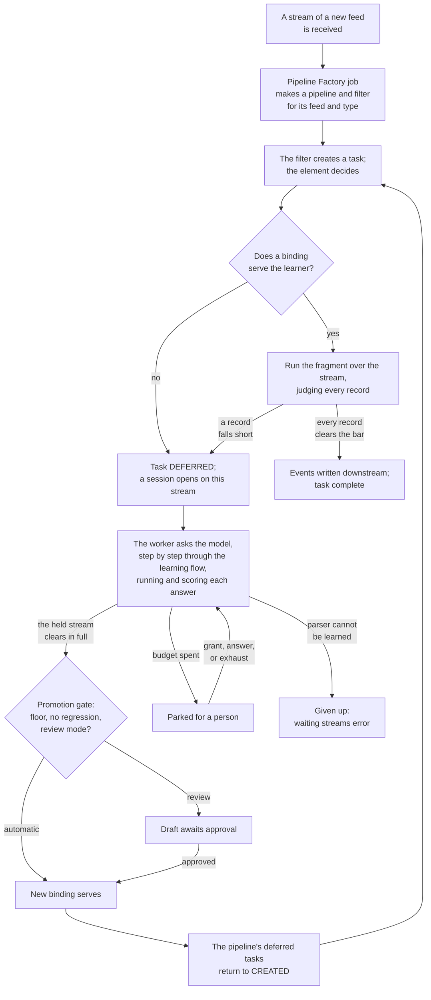

# 1. Overview

The whole of Shapeshifter AI on a few pages: what it is for, the parts it is made of, what happens to a
stream from the first one of a new feed onwards, what a person does, and what the system promises. Each
section points at the document that takes it further. The terms are defined in the
[glossary](README.md#glossary).

## 1.1 What it is for

Data reaches Stroom in whatever form its source writes. To be useful it must become event XML, and today
a person writes the Data Splitter configuration that cuts a raw stream into records and the XSLT that
turns each record into an event. Both are specialist work; a complex feed's stylesheet runs to thousands
of lines, and every new feed needs one.

Shapeshifter AI has a model write them instead, under supervision. Three principles shape everything else:

- **The model configures; it never translates.** What it writes is ordinary Stroom content — a Data
  Splitter configuration, an XSLT, a pipeline joining them — and once that is accepted every stream of the
  feed runs through it at Stroom's normal speed with no model involved. The model is asked only when a
  feed has nothing that can translate it.
- **Nothing is trusted that has not been run and scored.** Every answer the model gives is run as a real
  pipeline over the feed's own data and judged by Stroom's validators against the event schema and the
  document's other scorers. The model's own opinion of its work counts for nothing.
- **Nothing is lost and nothing is held hostage.** A stream that cannot be translated yet waits as a
  deferred processor task and is processed when it can be. No stream is errored to make it wait, and no
  learning ever runs on a processing thread (A48).

Everything is Stroom: the configuration is a Stroom document type (A3), what is learned is Stroom content,
the work is Stroom processor tasks and scheduled jobs, the screens are Stroom's, the model is reached
through `stroom-ai`'s model documents as an OpenAI-compatible endpoint (A13).

## 1.2 The parts

| Part | What it is | Where it is described |
|---|---|---|
| **Pipeline Factory** | A document type and a job, *Pipeline Factory*, that finds the feed and type combinations in Stroom's streams and makes a pipeline and an enabled processor filter for each, from a template. General purpose: it knows nothing of AI (A103) | [2](02-pipeline-factory.md) |
| **AI template** | A pipeline whose head is the Shapeshifter AI element, followed by whatever should receive events — typically an `XMLWriter` and a `StreamAppender`. Made pipelines inherit it (A105) | [2](02-pipeline-factory.md), [3](03-processing.md) |
| **Shapeshifter AI element** | The parser-position element (`ShapeshifterAi`) at the head of every AI pipeline. For each stream it serves, defers or errors; it never learns | [3](03-processing.md) |
| **Shapeshifter AI document** | The settings learning runs under: the model, the learning flow, the scorers and thresholds, the promotion mode, the budgets. A person authors it; nothing learned is written to it (A41) | [4](04-learning.md), [5](05-learning-flow.md), [6](06-scoring.md) |
| **`DEFERRED` task status** | An addition to `stroom-processor`: a task can end deferred, keeping its place to be processed again, and counts against its filter's task budget while it waits (A59, A109) | [3](03-processing.md) |
| **The worker** | The job *Shapeshifter AI Deferred Learning*, every minute, which carries sessions waiting for the model to their end | [4](04-learning.md) |
| **The Supervisor** | The screen a person watches and steers learning from: learning pipelines, their sessions and waiting streams, a session's flow and conversation | [7](07-ui.md) |
| **Runtime state** | Tables in `stroom-shapeshifter-ai-impl-db` — learners, bindings, snapshots, sessions and turns, deferrals, corpus, outputs, guidance, spend — behind seams with in-memory twins for tests | [8](08-data-and-code-map.md) |
| **Attempt retention** | The job *Shapeshifter AI Attempt Retention*, at midnight, which ages out finished sessions and the learning of deleted pipelines | [4](04-learning.md) |

## 1.3 A stream's journey

### The first stream of a new feed

1. **A pipeline is made for it.** A stream of a feed and type the factory has not met is found by the
   *Pipeline Factory* job, which runs every minute. It makes a folder, a pipeline inheriting the AI
   template, and a processor filter selecting exactly that feed and type, all as the factory's run-as user
   (A123). From here the feed is processed like any other: its filter can be paused, prioritised, put on a
   node group or used to reprocess ([2](02-pipeline-factory.md)).
2. **Its task finds nothing to serve it.** The filter creates a task, and the Shapeshifter AI element at
   the head of the pipeline reads the stream's first 64 KiB and makes the *task decision*. This pipeline's
   learner — the element in this pipeline (A114) — has no binding, so the task ends `DEFERRED`, a row
   records why the stream waits, and a session is opened on this stream for the worker
   ([3](03-processing.md)).
3. **The worker learns.** Within a minute the worker claims the session and walks the document's
   learning flow. Typically: *Chain* — which elements, e.g. `DSParser → XSLTFilter`; *Split* — what one
   record is; *Target* — the event each kind of record should become; *Configure* — the parser's
   configuration, then the transform's. Each answer is a candidate: it is run as a real pipeline over the
   stream, scored, and its outcome decides the next step — on to the next, the same step asked again with
   the shortfall explained, or a step the flow names for that outcome ([4](04-learning.md),
   [5](05-learning-flow.md)).
4. **The candidate is judged on the whole stream.** The session is done only when every record of the
   stream it learned from clears the bar (A50) — not only the sample the model was shown — and the
   promotion gate holds it to the document's floor and to no regression on any record a binding was ever
   accepted on (A15, A56). Then its fragment, parser configuration and XSLT are written as Stroom content
   beside the pipeline (A113, A133), and their configuration is snapshotted (A61)
   ([6](06-scoring.md)).
5. **The promotion wakes the stream.** The learner is bound to the new fragment, and every deferred task
   of the pipeline returns to `CREATED` (A129). The stream is processed again, served this time, and its
   events go downstream. A binding learned from fewer records than the document's minimum is
   *provisional*: it serves, and is promoted in place once enough clean records have passed through it
   (A5, A101). Under *review* promotion mode the binding is a draft instead, and the streams wait for a
   person to approve it (A25).

### Every later stream

The task decision finds the binding and the fragment runs over the stream as a nested pipeline, once,
while it is read. Each record the fragment writes is judged by the per-record gates as it is produced
(A55). If every record clears, the events go downstream and the output is stamped with the snapshot that
made it, so that it can be reprocessed exactly as it was first processed (A61). There is no model call.

### A stream with something new in it

A feed changes: a new kind of record appears that the stylesheet has no template for. The first record
of it falls short of the bar, so the run stops, what had been written downstream for the stream is
discarded, and the task defers — with a row stamped against the binding in force, so that it is not run
again until that binding changes. The learner is marked and a session opens to learn it again: it walks
the flow afresh, opening with what the serving binding scored on this stream and the records that fell
short, and every candidate for the transform is held to those records. The new candidate must do at
least as well on the stream as what serves it, and no worse on anything the learner was ever accepted on.
Streams of the feed that clear the bar go on being served meanwhile; only those carrying the new kind
wait. (A person's *improve* is different: it starts from the serving binding's own configuration,
[4](04-learning.md).)

### When learning cannot finish

- **The budget runs out.** A session's tokens are counted over its life and its time per run (A145). One
  that runs out parks for a person, keeping its claim, and its streams go on waiting (A65). A person can
  grant it more, answer a turn instead of the model, or send it to the exhaustion step.
- **The transform's candidates are spent with records still short.** The flow's *Admit* step — the
  exhaustion step — learns a *marked Unknown* event for each kind of record nothing better could be done
  with, and the stream is served (A51–A53, A76). A later improvement may turn a marked Unknown into a real
  translation; nothing turns a translation into an Unknown (A66).
- **The parse cannot be learned.** If the parser's candidates are spent without meeting the input
  coverage and yield gates, there is nothing to score and nothing to serve. The learner gives up and the
  streams waiting on it error with the reason — the one outcome that errors anything (A52, A54). A person
  sends the learner back to learn again, and reprocesses the error streams as any others.
- **A stream waits too long.** One deferred past the document's maximum deferral age is *raised* in the
  Supervisor and goes on waiting (A57).

## 1.4 What a person does

The system runs without anyone, but it is built to be watched and steered. From the
[Supervisor](07-ui.md):

- **Watch**: every learning pipeline with its state, what serves it and how well, how many streams wait
  and for how long; each session's path over the flow and its whole conversation, turn by turn.
- **Review**: under *review* promotion mode a promoted candidate is a draft, its learner's streams wait,
  and a person approves or rejects it (A25).
- **Steer**: leave guidance for a learner — a hint, a correction, a fact the sample does not show —
  carried into every question after it (A46); answer a turn instead of the model, and the session carries
  on from there.
- **Unstick**: grant a parked session more tokens or time (A77); send it to the exhaustion step.
- **Decide a learner's fate**: send it back to learn again, ask it to improve while it serves, give it up,
  accept a provisional binding, retract a binding.

And from the rest of Stroom, because everything is ordinary content: open the learned XSLT and edit it
by hand (it is snapshotted on its next use, A72); step a made pipeline in the stepper, where the
element shows a pane of what it decided and why and steps into its fragment, writing and learning
nothing (A30, A121); pause, prioritise or reprocess a feed through its filter.

## 1.5 What it promises

| Promise | How |
|---|---|
| **No stream is lost or errored to make it wait** | Deferral is a task status, not an error; a deferred task is retried after a delay and woken by a promotion (A48, A59). Only a given-up learner errors streams |
| **A stream is served whole or not at all** | One record short of the bar and the task defers, discarding what was written for the stream (A50, A55) |
| **Accepted output never gets worse** | A new binding must clear the floor and do no worse than its predecessor on every record that was learned for (A15, A56, A66) |
| **Processing never waits on a model** | Learning runs only in the worker; a task never asks the model (A48, A60) |
| **Every output can be traced and replayed** | Each output is stamped with the snapshot that produced it and its input spans; an as-processed reprocess runs that snapshot (A61) |
| **Learning has bounded cost** | Each session has token and time budgets, and parks for a person when they are spent (A5, A65, A145). What each document spends is counted across the cluster (A44); the breaker that would act on that count is designed and not built |
| **It works with the model switched off** | A document's learning mode can be *disabled*: what serves goes on serving, and streams of unlearned feeds wait |
| **A person can always see and overrule it** | Every session and turn is recorded; every automatic act has a manual counterpart in the Supervisor |

## 1.6 What it is not yet

This is an MVP prototype, built to explore whether the capability is worth having, on fixture data in an
environment that is not security sensitive. One thing is still to be built for real data
([10](10-status-and-future.md)):

- **A static check of every stylesheet the model writes** (A147). On a node a candidate is run by the
  real `XSLTFilter`, with the whole `stroom:` function library, so a stylesheet could call a function that
  reaches the network — `http-call`, `fetch-json`, `ask-ai`. A stylesheet is to be refused before it is
  ever run if it calls any extension function or reaches outside its input. The stand-in Tier 1 tests run
  on already refuses all of this.

Samples reach the model as they are and are never redacted (A146): redaction good enough to protect data
would itself need a model, and a model asked to translate redacted data loses the context it translates by.
A feed is pointed at a model only where its data may go to that model.

The safety controls for running unattended at volume — error mode, a processor gate, a request-rate limit
across documents, an AI review job — are designed and deferred.
