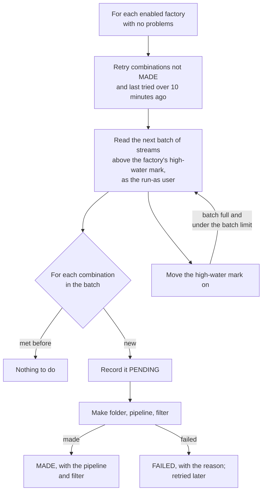

# 2. The Pipeline Factory

How a pipeline and a processor filter come to exist for every feed. The Pipeline Factory is a
general-purpose Stroom feature: it makes pipelines from a template and knows nothing of AI (A103). The
AI feature depends on it only through the template a person gives it and the element property values it
writes (§2.6). The terms are in the [glossary](README.md#glossary).

> **Two things called "pipeline factory".** Stroom has long had `stroom.pipeline.factory.PipelineFactory`,
> which builds a running pipeline from a pipeline's elements. It is unrelated. The feature described
> here is the document type `PipelineFactory` (`PipelineFactoryDoc`) and its packages under
> `stroom.pipelinefactory`, with no dot between the words.

## 2.1 Why there is one

Each AI pipeline learns one translation for whatever its processor filter gives it (A104). For learning
to be manageable, a filter must give it one kind of data: one feed, or one feed and type. A Stroom
installation has hundreds of feeds, and making a pipeline and filter for each by hand is the work the
feature exists to remove. So a factory watches the streams arriving, and the first time it meets a new
feed it makes that feed's pipeline and filter from a template, the same way every time. From then on
the feed is processed like any other: its filter can be paused, given a priority, put on a node group or
used to reprocess.

The earlier design learned one translation per *shape* within a single shared pipeline, and routed
streams to their shape's fragment by rules. That is gone (A104, A117, A131). A pipeline's filter is now
its route.

## 2.2 The document

A Pipeline Factory document (`PipelineFactoryDoc`) holds one factory's configuration. What it has made
is runtime state, held in tables (§2.5), not on the document.

| Setting | Field | Meaning | Default |
|---|---|---|---|
| Enabled | `enabled` | Whether the job runs this factory | off |
| Streams looked at | `streamFilter` | An expression over stream meta, e.g. `Type = Raw Events`. Every filter the factory makes takes this too, joined by `AND` with the combination's values | every stream |
| One pipeline per | `key` | The meta fields one combination of whose values is one pipeline (A106, A119). Only `Feed`, `Type` and `Pipeline` may be named | `Feed`, `Type` |
| Template | `template` | The pipeline every made pipeline inherits (A105) | none |
| Folder | `folderPattern` | Where a made pipeline goes, a path from the explorer's root, with the key substituted (A113) | `Feeds/${feed}` |
| Name | `namePattern` | What a made pipeline is called (A113) | `${feed} ${type}` |
| Properties | `properties` | Values written onto elements of every made pipeline, as element id, property name and pattern (A113) | none |
| Run as user | `runAsUser` | Who the job makes folders, pipelines and filters as, and who the made filters run as (A123) | none |
| Filter settings | `filterSettings` | The settings of every filter it makes (A108) | as the processing screen makes a filter, but enabled |

**Patterns.** A pattern names a key field in lower case: `${feed}`, `${type}`, `${pipeline}`. A pattern
may name only fields in the key (`PipelineFactoryKey`). For `Pipeline` the filter matches the pipeline's
UUID, but patterns are given its name; a pipeline the run-as user cannot read is named by its UUID.

**Why the key is so limited (A119).** A processor filter can select streams only by Stroom's fixed meta
fields, so a pipeline per value of anything else (a receipt header, say) could never be given its
streams. Of the fields a filter can query, only feed, type and the pipeline that wrote the stream sort
streams into kinds; an id, a time, a count or a size would make a pipeline per stream. A key of
`Pipeline` makes one pipeline per upstream pipeline, which suits processed streams. A raw stream has no
pipeline, so a factory keyed on `Pipeline` never meets one.

**Filter settings (A108).** Every processor filter setting that is not about one filter's identity:
priority, automatic priority, maximum processing tasks, processor profile (which carries the node group
and time periods), enabled, include in export, minimum and maximum meta create time, and maximum task
creation delay. Which pipeline a filter runs and what it matches are worked out per combination, the
run-as user is the factory's, and a made filter never reprocesses.

**Validity.** `PipelineFactoryDoc.problems()` lists what is wrong in words a person can act on: an empty
or unqueryable key, a field twice, a template that is not a pipeline, an empty name pattern, a pattern
naming a field outside the key or with an unclosed `${`, a property without an element id or name. An
*enabled* factory also needs a template and a run-as user. A factory may be saved incomplete while
disabled. The store refuses to save a factory with problems, and an import of one is refused with the
problems shown on the import screen (A119).

## 2.3 The job

The job *Pipeline Factory* runs every minute (`PipelineFactoryModule`). It runs on one node at a time
under the cluster lock `pipeline-factory`: two nodes reading the same streams would race to make the
same pipelines. A unique key on the combination table backs this up.



`PipelineFactoryRunner.exec()` runs every enabled factory without problems, as the processing user. A
factory that fails is logged and the others still run. For each factory:

1. **Retry.** Every combination met but not made — `FAILED`, or left `PENDING` by a run that stopped
   part-way — and last tried longer ago than `retryFailedAfter` is tried again. The wait is there because
   a failure such as a missing permission waits for a person, and retrying every minute would make and
   delete the same pipeline again and again.
2. **Scan.** `CombinationScanner` reads streams with ids above the factory's high-water mark, in id order,
   a batch at a time, as the factory's **run-as user**. So a factory meets only feeds that user can read,
   which are the only feeds its filters could process. It reads locked (still being written) and unlocked
   streams, since the key values are known from the moment a stream exists and a stream once passed is
   never read again. It does not read deleted streams.
3. **Meet.** Each distinct combination in the batch is recorded as met (`Combinations.met`). Only the
   first meeting returns true, and only then is the pipeline made.
4. **Advance.** The high-water mark moves to the batch's highest id, after the batch's combinations are
   recorded. A run that stops part-way loses nothing: a batch read again finds its combinations already
   met, and a combination stopped part-way through being made is retried with the failures.
5. **Repeat** while batches come back full, up to `maxScanBatchesPerRun`, so a factory new to a large
   store reads its history over several runs instead of holding the job.

**A new factory reads every stream already held** that its filter matches, from id 0. That is what
bringing an existing store under factories needs, and too much where only new feeds should get pipelines.
Adding a `Create Time` term to the stream filter bounds both what the factory looks at and what its
filters process, so the two cannot disagree. The screen's help text says so.

Configuration, under `pipelineFactory` in the application config (`PipelineFactoryConfig`):

| Property | Default | Meaning |
|---|---|---|
| `scanBatchSize` | 10,000 | Streams per read. Only each stream's key values are held |
| `maxScanBatchesPerRun` | 100 | Reads per run of one factory |
| `retryFailedAfter` | 10m | How long a combination that failed waits before it is retried |
| `db` | | The factory's database connection, as other modules have |

## 2.4 What it makes

`PipelineMaker.make` makes three things for a combination, all as the run-as user (A123). Made
documents take their folder's permissions.

- **The folder** the folder pattern names, made if missing.
- **A pipeline** named by the name pattern, whose `parentPipeline` is the template (A105). It holds
  nothing of its own except the factory's property values, substituted for this combination (A113), and
  a description, "Made by Pipeline Factory *name*". Every other change to the template reaches every
  pipeline made from it.
- **A processor filter** on that pipeline, whose expression is the factory's stream filter `AND` each key
  field equal to the combination's value: with a stream filter of `Type = Raw Events` and the default
  key, `(Type = Raw Events) AND Feed = SYSLOG AND Type = Raw Events`. Its settings are the factory's filter settings, its run-as user is the factory's, and it
  never reprocesses.

Before making anything it checks the template: that it exists, that its inheritance stack merges, and
that every property the factory writes is a **string** property of an element the merged template
holds. A value written where nothing reads it would be silently lost. A failure leaves nothing behind
but the folder: a pipeline whose filter could not be made is deleted again, so that a retry does not
make a second one. Every failure is a `PipelineMakerException` whose message names the factory, the
combination and the cause, and it is what the Made tab shows.

**After making, the factory never touches them again.** A filter a person pauses stays paused, and a
pipeline a person edits stays edited. A change to a factory's template, patterns or filter settings
applies to what it makes next, and leaves what it has made alone (A122); both tabs say so. Because made
pipelines inherit the template, a change *to the template itself* reaches them all. An "apply to all
made" action is future work.

## 2.5 What it remembers

Two tables in `stroom-pipeline-factory-impl-db`, both in `V08_00_00_001__pipeline_factory.sql`:

- **`pipeline_factory_combination`**: one row per factory and combination. The combination is its key's
  fields and values as JSON, fields in name order, and is unique per factory by its SHA-256
  (`combination_hash`), since the text has no length limit. It holds `state` (`PENDING`, `MADE`,
  `FAILED`), `tries`, the pipeline's UUID and name, the filter's UUID, and the last failure's `message`.
- **`pipeline_factory_scan`**: one row per factory, its high-water mark `last_meta_id`.

The behaviours that follow from this:

- **A made pipeline a person deletes is not made again.** Its row stays `MADE`, and the Made tab shows
  that the pipeline is gone. *Forget* removes the row, so the combination's next stream makes it afresh.
  Forgetting a combination whose pipeline still exists means the next stream makes a second one, and
  the confirmation says so.
- **Deleting a factory forgets everything it met and how far it looked**, and leaves its pipelines and
  filters, which are a person's once made (`PipelineFactoryStoreImpl.deleteDocument`).
- **The template travels with a factory**: it is listed among the factory's dependencies, exported with
  it, and re-pointed when a copy re-points its dependencies.

## 2.6 How an AI factory is set up

Nothing in the factory is specific to AI. An AI factory is an ordinary factory whose template has the
Shapeshifter AI element at its head:

```
Source → ShapeshifterAi → XMLWriter → StreamAppender
```

The element is a parser-category element, so it takes the raw stream straight from the source. The
parser and XSLT it learns are not elements of the made pipeline. They live in a separate fragment the
element runs inside itself (A107), so inheritance has nothing to reconcile with learning: the made
pipeline inherits the chain above unchanged, and a change to the template, such as a different
destination, reaches every made pipeline without touching anything learned.

The one place the two features meet is the element's two properties for **where learned content
goes**, which the factory writes as it would any string property (A113):

| Element property | Typical factory pattern | Unset |
|---|---|---|
| `learnedFolder` | `Feeds/${feed}` | The pipeline's own folder |
| `learnedName` | `${feed} ${type} learned` | The pipeline's name followed by ` learned` (A133) |

So a feed's pipeline and the fragment, Data Splitter and XSLT learned for it sit in one folder and sort
together, with the fragment told from the pipeline by its name. A learner's later fragments are numbered
after this name (A132). A pipeline made by hand sets these properties by hand, or leaves them unset.

The Shapeshifter AI document the element points at holds the settings every pipeline made from the
template shares: the model, the flow, the scorers, the budgets. Each made pipeline then learns on its own,
as its own learner (A104, A114).

The feature works without a factory too: any pipeline whose chain holds a Shapeshifter AI element is an
AI pipeline. The demo content pack ships four such pipelines, made as a factory would make them, so that
a demo needs no factory run (`DemoContentPack`).

## 2.7 The screen

The Pipeline Factory editor (`stroom.pipelinefactory.client`) has five tabs:

- **Settings**: enabled, the key as tick boxes (Feed, Type, Pipeline that wrote the stream), template,
  folder and name patterns, run-as user, the stream filter, and the property values as a list.
- **Filter**: the filter settings, laid out as the processing screen lays out a filter's.
- **Made**: one row per combination met, newest first: the combination, its state (including whether
  its pipeline still exists), the pipeline with *Open*, tries, first met, last changed, and why it
  failed. *Forget* on a row. Reading it needs View on the factory; forgetting needs Edit.
- **Documentation** and **Permissions**, as every document has.

The [user interface document](07-ui.md) shows it.

## 2.8 Code and tests

| Where | What |
|---|---|
| `stroom-core-shared` `stroom.pipelinefactory.shared` | `PipelineFactoryDoc`, `PipelineFactoryKey` (fields, defaults, patterns), `PipelineFactoryProperty`, `PipelineFactoryFilterSettings`, `PipelineFactoryCombination` (a Made row), `PipelineFactoryResource` (fetch, update, combinations, forget) |
| `stroom-pipeline-factory-impl` | `PipelineFactoryModule` (store, resource, job), `PipelineFactoryRunner`, `CombinationScanner`, `PipelineMaker`, `Combinations` (the seam over the tables), `PipelineFactoryService` (the Made tab's reads and forget, with permission checks), `PipelineFactoryStoreImpl`, `PipelineFactoryConfig` |
| `stroom-pipeline-factory-impl-db` | `CombinationsDao`, the migration, jOOQ classes |
| `stroom-core-client` `stroom.pipelinefactory.client` | The plugin, the editor and its tabs |

Unit tests sit beside the implementation and run against `InMemoryCombinations`
(`TestPipelineFactoryRunner`, `TestCombinationScanner`, `TestPipelineMaker`, `TestPipelineFactoryService`,
`TestPipelineFactoryStoreImpl`); `TestCombinationsDao` runs against the database. In `stroom-app`,
`TestPipelineFactoryMakesPipelines`, `TestPipelineFactoryRunsOverTheStreams`,
`TestPipelineFactoryPipelinesProcess` and `TestPipelineFactoryStore` run the factory in a node, the third
processing streams through what it made. The editor's workbench stories are `App/Editors/PipelineFactoryEditor`.
