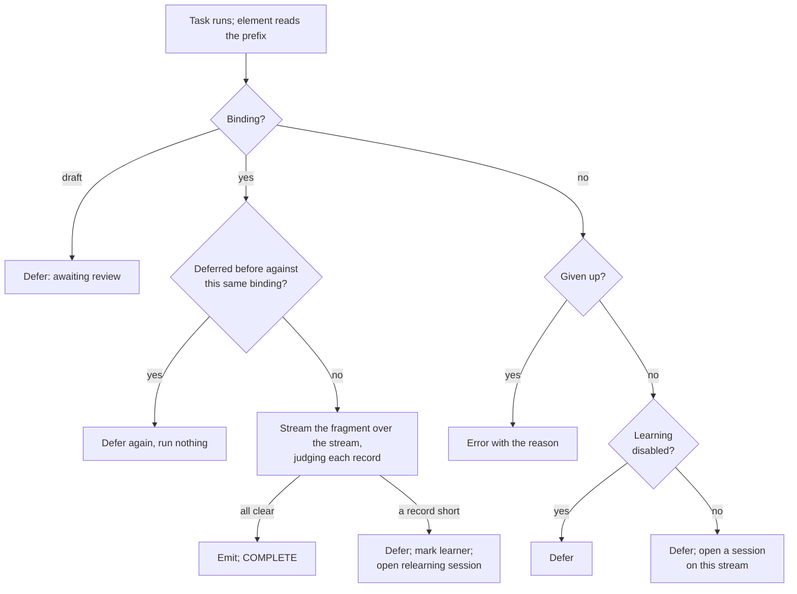

# 3. Processing

What the Shapeshifter AI element does with a stream when a processor task runs it: serve it, defer it,
or error it. This is the processing half of the feature. It never learns and never calls a model (A48,
A60); [learning](04-learning.md) is the worker's. The terms are in the [glossary](README.md#glossary).

## 3.1 The element

`ShapeshifterAiParser` (type `ShapeshifterAi`, category parser) sits at the head of an AI pipeline,
straight after `Source`, and takes the raw stream:

```
Source → ShapeshifterAi → XMLWriter → StreamAppender
```

| Property | Meaning |
|---|---|
| `shapeshifterAi` | The Shapeshifter AI document whose settings apply. Required |
| `asProcessed` | Reprocess each stream through the snapshot that produced it before, instead of what serves today (§3.10). Default false |
| `learnedFolder` | Where what it learns goes (A113); read from the pipeline by `PipelinePlaces`, not by the element. See [2.6](02-pipeline-factory.md#26-how-an-ai-factory-is-set-up) |
| `learnedName` | What what it learns is called (A113, A133) |

When the pipeline is built the element checks its position: if the document names allowed elements,
the chains they can make must start with a parser, since the element is given raw data (A1). A document
that could never learn anything usable here is refused before a model is asked anything.

Everything the element does is in `Supervision` (pipeline-scoped), which hands the decision to `Stage`.
The element is the learner `(pipeline UUID, element id)` (A114). The pipeline is the one the processor is
running, never its template, and an element outside a running pipeline is refused.

## 3.2 Reading the stream

A task reads only the stream's first 64 KiB as text (`Input.PREFIX_BYTES`). That is more than any sample
the model is shown, and enough to make the decision. If a binding serves, the fragment reads the rest as
it runs, so a stream of any size is processed in one pass without being held in memory. A stream that is
not UTF-8, or is given as characters rather than bytes, is read whole, since the fragment must read the
bytes as the text was read. A byte order mark is removed.

A step in the stepper and an as-processed reprocess read the whole stream as text, as they always have.

## 3.3 The task decision

`Stage.decide` makes one cheap decision per stream from what the learner already has:

| What the learner has | Outcome | What else happens |
|---|---|---|
| A binding, and every record of the stream clears the bar | **Emitted**: events go downstream, task `COMPLETE` | Output stamped with the binding (§3.4) |
| A binding, and a record falls short | **Deferred** | Row stamped against the binding; learner marked; a relearning session opened if none holds the claim (§3.6) |
| A binding, and this stream already fell short against the same binding | **Deferred** without running anything | The session is opened if none holds the claim |
| A draft binding awaiting review (A25) | **Deferred**, "Awaiting review" | None. Approve or reject moves it |
| No binding, learning on | **Deferred** | A session is opened on this stream for the worker, or the stream waits on the session already open |
| No binding, learning disabled | **Deferred** | None. The stream waits for a person to turn learning on |
| Given up (A52, A54) | **Errored** with the reason | The stream's deferral row is removed. The only outcome that errors |



Opening a session in a task only writes the attempt row and parks it at its first question for the
worker (A60, A64). The model is never called on a processing thread.

## 3.4 Serving a stream

When a binding serves, the element runs its fragment over the whole stream as a nested pipeline (A20),
built by Stroom's own pipeline factory in the same pipeline scope. The fragment's errors reach this
pipeline's error stream, naming the fragment's own elements, and its events reach the element's
downstream. The fragment runs **once**: the run that is judged is the run that is served.

**The bar (A55).** `RecordGate` sits at the fragment's tail. Each record of the output (one child of the
output's root) is held until it is judged, and is passed downstream only if it clears. Records are
judged by the document's per-record scorers only: schema conformance, extraction quality and business
rules. Compile, input coverage and yield measure a whole candidate; they judged it when it was promoted
and have nothing to say about one record ([6](06-scoring.md)). The root's opening is replayed before the
first record that passes, so if the first record falls short, nothing at all has gone downstream.

**A record short** stops the run. `Stage.stream` defers the stream (§3.5) and throws
`DeferTaskException`. Whatever the downstream has written for the stream is discarded, because a
deferred task writes nothing (§3.5). A stream is served whole or not at all (A50).

**A stream that clears in full:**

- its deferral row, if it had one, is removed;
- the output stream is stamped with attributes saying what made it (§3.9);
- a *provisional* binding (A5, A101) that has now served at least the document's `minRecordsToLearn`
  records, with a mean score at or above the promotion floor, is promoted in place: no longer
  provisional, with this score;
- otherwise the learner's rolling score is updated, for the Supervisor's view of what could be better.
  It triggers nothing;
- an output row records the stream, the pipeline and the binding and snapshot that served it.

Each served stream also carries an INFO line on its error stream saying what served it, and a stream
the fragment made nothing of carries an ERROR saying so.

**A hand edit is snapshotted on its next use (A72).** Before the decision is made, the binding's
snapshot is compared with the fragment's documents as they are now. If a person has edited the learned
XSLT or parser by hand, their versions differ, a new snapshot is taken and the binding points at it. It
is a promotion by hand: streams deferred against the old snapshot are judged against the edit.

## 3.5 Deferring a stream

### In the processor

`DEFERRED` is a task status added to `stroom-processor` (A59) and the third way a task can end, besides
`COMPLETE` and `FAILED`:

- An element throws `stroom.processor.api.DeferTaskException` with a reason. It is unchecked, so it
  passes through SAX handlers. `DeferTaskException.unwrap` finds it inside the wrappers the pipeline adds
  around exceptions.
- The parser, filter, fork and XSLT plumbing (`AbstractParser`, `XsltFilter`, `XMLFilterFork`,
  `ProcessorFactoryImpl`, `SimpleProcessorFactory`) let it through instead of turning it into a fatal
  error. `AbstractProcessorTaskExecutor` does not log it to the error receiver, so no error stream is
  written, and nothing is written for the stream.
- `DataProcessorTaskHandler` sets the task to `DEFERRED`, with no node and no times, so it is any node's
  to claim once it comes back.

A deferred task comes back to `CREATED` in two ways:

- **The retry delay.** The *Processor Task Reaper* job returns deferred tasks older than
  `stroom.processor.deferredTaskRetryDelay` (default 5 minutes). This is what stops a deferred task
  waiting for ever.
- **A wake** (§3.6), which returns every deferred task of every filter on one pipeline at once
  (`ProcessorTaskDao.wakeDeferredTasks`).

**Nodes must claim their own tasks.** A wake writes rows the worker reads, which a master-fed task queue
would not see. So `stroom.processor.claimTasksOnWorker` must be on, and while it is off the processor
refuses to make a filter over a pipeline that may defer (`SupervisedPipelines`).

A stream whose session is still learning just defers again on each retry, cheaply: its row says it
already failed against the same binding, so nothing is run (§3.3).

### In Shapeshifter AI

A **deferral row** (`Deferrals`, table `shapeshifter_deferral`) says why a stream waits. There is one per
learner and stream, holding:

- the reason;
- the stamp of the binding it fell short of (its snapshot), or nothing where there was no binding;
- how many records fell short;
- when it first waited (kept across retries, since a new reason does not make it newly late);
- how many times it has been tried.

The row holds no record text: the session works out what fell short on the one stream it learns from,
and for any other stream that would be stale as soon as the transform changed (A69). The row is removed
when the stream is served or errored.

**Raised (A57, A79).** A stream that has waited longer than the document's maximum deferral age
(`maxDeferralAgeMs`, default 24 hours) is *raised*: computed when read, flagged in the Supervisor, and
still waiting. Nothing errors it.

### The task budget (A109)

A filter's task budget counts `DEFERRED` tasks alongside `CREATED` ones
(`ProcessorTaskCreatorImpl`). While a learner learns, its filter makes tasks up to its limit, they defer,
and creation for that filter stops until a promotion wakes them or someone acts. No other feed waits,
because no other feed shares the filter (A104). Only waiting `CREATED` tasks use the profile's shared
creation budget, so one learner's backlog cannot starve the profile's other feeds. Only AI pipelines
defer, so for every other filter in Stroom the count is unchanged.

## 3.6 Waking

- **On every promotion** (and approval of a draft) the learner's pipeline is woken: the deferred tasks of
  every filter on it, including any reprocess filter a person made, return to `CREATED` (A129, `Wake`,
  `TaskWake`). Each is then decided again against the new binding. Deferral rows stay until each stream is
  served.
- **On every pass of the worker**, `Stage.wakeSuperseded` wakes pipelines with streams waiting against a
  stamp that is no longer the binding in force (A130). This catches a stream that fell short of the old
  transform while a promotion was being made, wrote its row after the promotion's wake, and so was
  missed by it. Learners behind a draft are left to their review.

The stage never asks for anything to be reprocessed (A129). What it errors — streams of a learner that
gave up, or served by a binding later retracted — it reports, with the number of streams affected, and
a person makes an ordinary reprocess filter on the pipeline to run them again.

## 3.7 When a stream has something new in it

A stream served by a binding whose record falls short **marks** the learner for relearning, with the
reason, and opens a relearning session on that stream if no session holds the learner's claim. The
session is opened knowing what the binding scored on the stream and how many records fell short; the
worker then carries it ([4](04-learning.md)). Only the streams that carry the new kind of record wait.
Every other stream of the feed goes on being served by the binding meanwhile.

A stream that fell short against a binding that has *since been replaced* is not used to mark the
learner: that would relearn what was just learned. It waits against its old stamp, and is woken and
judged against the new binding (§3.6). A learner with a draft awaiting review is not marked either: the
stream waits for the review.

A person can also mark a learner from the Supervisor (A100). A marked learner whose streams are all
being served relearns on its next stream that brings at least `minRecordsToLearn` records: the session
is opened, and the stream is served by the binding as usual (`relearnOnMark`).

## 3.8 Errors

The only stream the element errors is one whose learner has **given up** (A52, A54): no binding serves it
and learning stopped because the parser could not be learned. The task writes an error stream with the
reason and the stream's deferral row is removed. Once a person sends the learner back to learn, its error
streams are reprocessed like any others.

Configuration errors fail the task as in any pipeline: no document set on the element, a document that
does not exist, a document whose allowed elements cannot parse, or an element not running in a pipeline.

## 3.9 What an output records

Every stream a binding serves gets meta attributes (`Produced.asAttributes`):

| Attribute | Value |
|---|---|
| `ShapeshifterAiDoc` | The document's UUID |
| `ShapeshifterAiBinding` | The binding that served it |
| `ShapeshifterAiFragment` | The fragment pipeline |
| `ShapeshifterAiSnapshot` | The snapshot of the fragment's configuration that ran (A61) |
| `ShapeshifterAiProvisional` | Whether the binding was provisional |
| `ShapeshifterAiScore` | The binding's score |
| `ShapeshifterAiRecord` | The record boundary the fragment was learned with |

With two Shapeshifter AI elements in one pipeline, the second's attributes are suffixed with its element
id. In a multi-part stream, a part served by a different binding from an earlier part gets a warning.

An output row (`Outputs`, table `shapeshifter_output`) records the same against the stream and pipeline;
it is what an as-processed reprocess reads (§3.10). The table can also hold each record's span in the
input, so that a fault found later in an event could be relearned from the record's own text without
running the parser again over the whole stream. Spans are written only for the stream a fragment was
learned on, not for streams served as they are read, and nothing reads them yet
([10](10-status-and-future.md)).

## 3.10 Reprocessing

- **As current** (the usual case): an ordinary reprocess filter on the pipeline. Each stream goes
  through the task decision as it stands today, so a backlog gets what has been learned since.
- **As processed**: a pipeline whose element has `asProcessed` set runs each stream through the snapshot
  recorded for it in `shapeshifter_output`. Nothing is learned, scored or relearned, whatever has happened
  to the binding since. Snapshots are immutable, so the answer is the one first given: this is for
  audit. A stream with nothing recorded is refused with a reason, not quietly served as current.

## 3.11 Stepping

Stepping an AI pipeline is read only (A30, A121): `Stage.dryRun` serves with the binding as it stands,
and writes nothing, opens no session and defers nothing. A learner nothing serves is reported as what
would happen, e.g. "Would learn a fragment for this learner". The element's pane in the stepper shows
the decision and why (`StepDetails`), and the fragment's own elements can be stepped beneath it, record
by record. Where nothing ran, one empty record is emitted on a step (and only on a step), so the stepper
has something to stop at and the pane can be shown.

## 3.12 When a pipeline is deleted

Stroom's delete event for a pipeline marks its learning deleted (A120, A134, `PipelineDeletions`). Its
deferral rows are removed, since no task of a deleted pipeline will run their streams again (A135). The
worker abandons any open session the next time it comes to it, and the Supervisor hides the pipeline's
learning unless asked (A137). The attempt retention job removes the learning once the mark is older than
attempts are kept. The fragment and its documents stay in the explorer (A136). A pipeline that comes back
with the same UUID, from an import of its export, is unmarked. A delete or return that no node heard is
found by the retention job.

## 3.13 Code

| Class | Role |
|---|---|
| `element.ShapeshifterAiParser` | The element: properties, position check, hands the stream to `Supervision` |
| `element.Supervision` | Reads the stream, chooses task, step or reprocess, records outputs, plays events downstream |
| `stage.Stage` | `decide`, `stream`, `dryRun`, `reprocess`, `wakeSuperseded`; also learning (see [4](04-learning.md)) |
| `stage.Decision` | The outcomes as a sealed interface |
| `stage.Input` | The stream as the stage sees it: prefix, or whole |
| `fragment.PipelineFragmentRunner` | Runs a fragment as a real nested pipeline; `StandInFragmentRunner` is its Tier 1 twin |
| `fragment.RecordGate`, `RecordShortfall` | The per-record bar at the fragment's tail |
| `stage.Deferrals`, `Outputs`, `Wake` | Seams over the deferral rows, output rows and the wake |
| `element.TaskWake` | The wake in a node, through the processor task service |
| `element.StepDetails` | The stepper pane's contents |
| `element.PipelineDeletions` | Hears pipeline deletes and restores |
| `stroom-processor`: `DeferTaskException`, `TaskStatus.DEFERRED`, `ProcessorTaskReaper`, `ProcessorTaskDao.wakeDeferredTasks`, `ProcessorTaskCreatorImpl` | The deferred status, its retry, wake and budget |

In `stroom-app`, these run the path in a node: `TestTheJudgedRunIsTheServedRun`,
`TestScenario16AServingRunWritesAsItGoes`, `TestScenarioBManyStreamsManyThreads`,
`TestAReprocessFilterWakesWithItsPipeline` (the wake reaches every filter on the pipeline) and
`TestScenario33SteppingIntoTheFragment` (the stepper pane).
