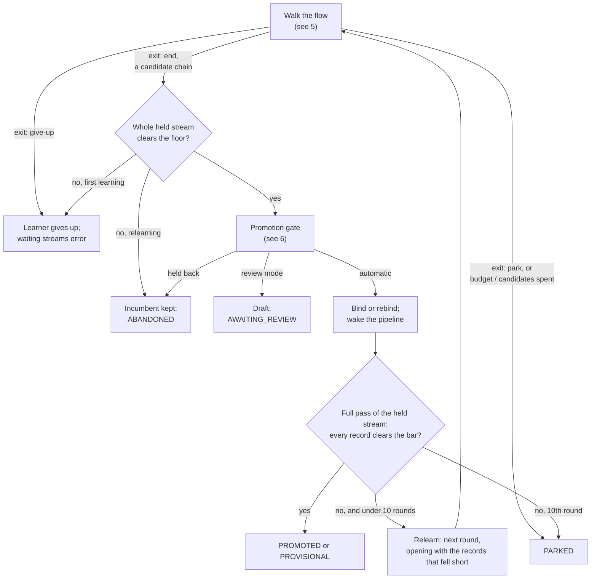

# 4. Learning

How a learner comes to have a binding: the session, the worker that carries it, its claim and budgets,
how it ends, what it writes, and what a person can do along the way. What the model is asked is the
[learning flow](05-learning-flow.md); how answers are judged is [scoring](06-scoring.md). The terms are in
the [glossary](README.md#glossary).

## 4.1 Where learning happens

Learning never runs on a processing thread (A48, A60). There are exactly two places a model is asked:

- **The worker**, the job *Shapeshifter AI Deferred Learning*, every minute on every node. It carries
  sessions a task opened.
- **Improve**, a person's request from the Supervisor, which runs synchronously in that request (A102).
  This is the one exception, recorded as ISSUES item 3.

A task's only part in learning is to *open* a session (§4.2) and defer its stream
([3.3](03-processing.md#33-the-task-decision)).

## 4.2 A session

A session (an *attempt*, table `shapeshifter_attempt`) is one run of learning for one learner, from the
stream that opened it to what it came to. It records:

- the learner, the document it ran under, and the promotion mode at the time;
- the stream it was opened on (the *held stream*), with its feed and type;
- the node holding its claim, and until when;
- tokens spent, and any grant;
- its status and reason, and the binding and score it came to;
- one row per turn (`shapeshifter_turn`): the step, the candidate number, the question's kind and
  summary, the answer, who answered, the outcome, the check that decided it with its score and threshold
  (A144), and the guidance the question carried, so a re-walk replays what was used.

A turn records a summary of what was asked, not the prompt sent.

**Opening.** `Stage.recording` first makes sure the learner's learned-content folder exists or can be
made, so that a folder that cannot be made is found before anything is spent. Then it opens the attempt
row, which takes the learner's **claim**: there is at most one open session per learner. If another holds
it, the stream simply waits on that one. A session opened by a task stops at once at its first question
with status `AWAITING_MODEL`, holding its claim, and the task defers.

**Statuses** (`AttemptStatus`):

| Status | Meaning | Open? |
|---|---|---|
| `IN_PROGRESS` | A node is working on it now | yes |
| `AWAITING_MODEL` | Waiting for the worker to put its next question to the model | yes |
| `PARKED` | Stopped for a person: budget, rounds or candidates spent, or the flow's `park` exit (A65) | yes |
| `AWAITING_REVIEW` | Wrote a draft; waiting for approve or reject (A25) | until decided |
| `PROVISIONAL` | Bound on too few records (A5, A101) | final |
| `PROMOTED` | Bound, or rebound | final |
| `REJECTED` | A person rejected its draft | final |
| `RETRACTED` | A person took back what it bound | final |
| `ABANDONED` | Wrote nothing: gave up, kept the incumbent, or was no longer wanted | final |
| `ERROR` | The model, the node or the database failed | final |

## 4.3 The worker

Each pass (`DeferredLearning` → `DeferredWorker.advance`) runs as the processing user:

1. Takes up to `deferredLearningBatchSize` (default 10) sessions, oldest first, from those
   `AWAITING_MODEL` and those whose claim has **lapsed** (an `IN_PROGRESS` session whose node died).
2. For each, abandons it if its pipeline was deleted (A135), its document was deleted, or its held
   stream is no longer in the store. Otherwise it calls `Stage.resume`.
3. Then wakes pipelines with streams waiting on a replaced binding
   ([3.6](03-processing.md#36-waking)).

**Resuming re-walks the conversation (A28, A45).** Nothing of a session's working state is stored except
its turns. `Stage.resume` takes the claim, re-reads the held stream, and runs the flow from the first
step over the same sample. Each question that has an answer in the record is answered from the record
(`RecordedAdvisor`), which re-derives everything those answers produced: the chain, the record boundary,
the targets, each element's configuration and output. Only questions beyond the record go to the
model. So any node can carry any session, and a person's answer to a turn is just a recorded answer the
re-walk picks up (§4.7).

Before carrying on, resume checks that the session is still wanted. If the learner now has a draft
awaiting review, has given up, or its document has learning disabled, the session is closed `ABANDONED`.

Whether the session is a first learning or a relearning is not stored either: it is read from the
learner's bindings as they stand. If a binding serves the learner, it is a relearning.

**The claim (A42, A45).** The claim lasts `sessionLease` (default 10 minutes) from its last renewal. It is
renewed before every question, as every turn is recorded, and by a heartbeat during a long model call
(`HeartbeatingAdvisor`). A live session never lapses. A session whose node died lapses within one lease,
and the next pass on any node carries it on from its recorded turns. The lease must be longer than the
slowest expected model call, or a slow answer looks like a dead node. A parked session's claim does not
lapse.

## 4.4 Budgets

A session has two budgets from its document, checked before each question (`Conversation.Budget`):

- **Tokens** (`tokenBudget`), counted over the session's whole life, across every run and every node
  (A5). No token budget means no limit.
- **Time** (`attemptBudgetMs`), counted per run: each time the session is carried on it has the whole
  of it again (A145).

A person's **grant** adds tokens, time or both, for that session alone (A77). A budget spent is not an
error: the session **parks** for a person (§4.5).

Two more guards: each step has a limited number of candidates (see [5](05-learning-flow.md)), and a
session runs at most 10 **rounds** (§4.5) before it parks regardless.

**Spend across the cluster (A44).** What every model call costs is added to a per-document counter in
`shapeshifter_spend`, over a one-hour window, whichever node made it. Nothing reads the counter yet: the
rate limit and the breaker that would act on it are designed and not built
([10](10-status-and-future.md)).

## 4.5 How a session ends

**The flow's exit** ([5](05-learning-flow.md)):

- **`end`** with a candidate chain goes on to judgement.
- **`give-up`** gives the learner up. This is the parser's default exit when the parse cannot be learned,
  since nothing can serve a stream that cannot be cut into records (A52, A54, A83). The learner's
  pipeline is woken so its waiting streams error now, not at the retry delay. A relearning never gives
  up, because that would error streams a binding is serving; it keeps the incumbent instead.
- **`park`**, or budget or candidates spent in the worker, parks the session for a person (A65). Its
  streams go on waiting, and nothing is turned into a marked Unknown because money ran out.

**Judgement.** The candidate chain is run over the whole held stream (the model was shown only a prefix of
it), and must clear the document's promotion floor. A first learning that fails the floor gives up. A
relearning must also score no lower than the incumbent did on the stream, and do no worse on the
learner's corpus (A15, A56, A66). Details are in [6](06-scoring.md).

**Binding.**

- **First learning:** a new binding is written for the learner. It is **provisional** if the held stream
  had fewer than `minRecordsToLearn` records (A5, A101); it serves, and is promoted in place once it has
  served enough records at or above the floor ([3.4](03-processing.md#34-serving-a-stream)).
- **Relearning, automatic mode:** the incumbent binding is **rebound**. It keeps its UUID and history and
  points at the rewritten fragment (§4.6) and a new snapshot.
- **Review mode (A25):** a **draft** binding is written instead, pointing at a new fragment. The learner
  awaits review, and its streams wait with it (a relearning's incumbent goes on serving what it can).
- Every binding records its snapshot (A61), score and record boundary, and the records it was learned
  for go into the corpus (A56). For a first learning that is the sample; for a relearning, the records
  that fell short.
- On a promotion the learner's state is reset (its relearning mark spent) and its pipeline is
  **woken** ([3.6](03-processing.md#36-waking)).

**Settling: the held stream is the acceptance test (A50, A64).** In the worker, a binding is not the end.
`Stage.settle` runs the held stream in full through the new binding, judging every record by the bar. If
every record clears, the session ends. If any fall short, up to five of them, as the parser cut them and
as the transform left them, open a new **round**: a relearning under the same session and claim, every
transform candidate held to those records (`heldTo`). A session ends when its stream clears, or parks
after its tenth round. A session is never done just because the sample cleared.

## 4.6 What learning writes

`FragmentWriter` writes ordinary Stroom documents, through `ExplorerContentCreator`, in the learner's
folder (the element's `learnedFolder`, or the pipeline's folder) under its name (`learnedName`, or the
pipeline's name followed by ` learned`, A113, A133):

- **a fragment**: a Pipeline document, e.g. `Source → DSParser → SplitFilter → XSLTFilter` or
  `Source → JSONParser → SplitFilter → XSLTFilter`, with no writer or destination (A107). A
  `SplitFilter` cuts the parsed stream at the record boundary, so the transform is given one record at a
  time and a stream of any size is never held whole;
- **a document per configured element**, named for the fragment with the element id appended: a text
  converter holding the Data Splitter configuration, an XSLT.

Where they are written depends on the path:

| Path | What is written |
|---|---|
| First learning | A new fragment. If the name is taken, the first free number is appended (A132) |
| Relearning, automatic | The incumbent's fragment **rewritten in place** (A58): the same pipeline and the same configuration documents, their text replaced; a new document only for an element the fragment did not have. One fragment and one stylesheet per learner, growing as it learns. What ran before is kept in the snapshot |
| Review mode | A new, numbered fragment for the draft. Approve rebinds the incumbent to it |

Nothing learned is written to the Shapeshifter AI document (A41). A **snapshot** (`Snapshots`, table
`shapeshifter_snapshot`) is taken on every binding and rebinding: the immutable text of the fragment's
configuration, keyed by the documents' versions. Outputs name the snapshot that made them, which is what
makes an as-processed reprocess exact ([3.10](03-processing.md#310-reprocessing)).

A person may edit the learned documents by hand. The edit is snapshotted and takes effect on its next use
(A72), and the next relearning rewrites from it.

## 4.7 What a person can do

All of these are on `SupervisorResource` and in the [Supervisor](07-ui.md). Each is recorded with who did
it.

**On a session:**

| Action | Effect |
|---|---|
| **Answer instead / edit and re-run from here** (`amend`) | A person's answer replaces a turn's. Later turns are discarded, any draft the session wrote is removed, the learner's state is reset, and the session is reopened for the worker to re-walk from the record. Nothing is run in the request (A28) |
| **Grant** | More tokens and/or minutes for a parked session; it returns to `AWAITING_MODEL` (A77, A145) |
| **Exhaust** | A parked session is reopened, and at its first transform question takes the flow's *spent* transition to the Admit step, where the flow has one (A65, A76) |
| **Approve** a draft | The promotion: a relearning's incumbent is rebound to the draft's fragment; otherwise the draft goes live. The pipeline is woken (A25) |
| **Reject** a draft | The draft goes with its corpus entries; its documents stay. The learner **gives up** with the reason, so the model is not asked the same question again until a person sends it back (A25) |

**On a learner (from its pipeline's row, A141):**

| Action | Effect |
|---|---|
| **Learn again** (`relearn`) | Marks the learner. Its next stream with enough records relearns while the binding serves (A100). Clears a give-up |
| **Improve** | A session that starts from the serving binding's own configuration, shows the model what it scores, and must beat it on every corpus record. The person's message is recorded as guidance first. Synchronous (A46, A102) |
| **Give up** | The learner learns no more; streams nothing serves error with the reason; what serves goes on serving; the pipeline is woken. Refused while a draft awaits review, since rejecting it is the way to give up |
| **Accept** a provisional binding | Promotes it now instead of waiting for enough records. It already cleared the floor; what is skipped is the wait, not the judgement |
| **Retract** a binding | The binding goes and the learner knows nothing again; its next stream learns afresh. Returns how many streams the binding produced output for, so a person can make a reprocess filter for them (A129). Unlike reject, the learner does not give up |
| **Guidance**: hint, withdraw | A message carried into every later question for the learner. It is read when each walk begins, so a hint left while a session waits reaches the walk that resumes it, and each turn records what it carried (A46) |

## 4.8 Learner state

`LearnerState` is derived for display, not stored as one field:

| State | When |
|---|---|
| `GIVEN_UP` | By a session's flow or by a person; streams nothing serves error |
| `LEARNING_OFF` | The document's learning mode is disabled; what serves goes on serving |
| `AWAITING_PERSON` | A draft awaits review, or a session is parked |
| `LEARNING` | A session is open, or nothing serves yet and the next stream will open one |
| `SERVING` | A binding serves and nothing else is under way |

Underneath, the learner's row (`shapeshifter_learner_state`, `LearnerStates`) holds: the document it last
ran under, the give-up reason, the relearning mark and its reason, the draft awaiting review, and the
rolling score. Its bindings are rows in `shapeshifter_binding` (`LearnerBindings`, A124). Both are cached
per node (`bindingCache`, `learnerStateCache`) and cleared on every node when they change.

## 4.9 Retention

The job *Shapeshifter AI Attempt Retention* runs at midnight (`AttemptRetention`):

- It removes finished attempts and their turns older than `attemptRetention` (default 90 days; zero keeps
  everything). An open, parked or awaiting-review attempt is never removed, however old.
- It marks the learning of pipelines that no longer exist, for deletes no node heard, and unmarks those
  that came back (A134). A pipeline is marked only after a read of it on its own says it is gone, so a
  store that failed part-way never causes live learning to be forgotten.
- It forgets the learning of pipelines deleted longer ago than the retention: rows only, never the
  explorer documents (A136).
- It works in batches, a bounded number per night.

## 4.10 Configuration

Under `shapeshifterAi` in the application config (`ShapeshifterAiConfig`):

| Property | Default | Meaning |
|---|---|---|
| `deferredLearningBatchSize` | 10 | Sessions one worker pass carries |
| `sessionLease` | 10m | How long a claim lasts from its last renewal |
| `attemptRetention` | 90d | How long finished attempts are kept |
| `bindingCache`, `learnerStateCache` | | Per-node caches |
| `db` | | The runtime state's database connection |

Learning settings that belong to a document (model, flow, budgets, floor, `minRecordsToLearn`, promotion
mode, learning mode, sample size, maximum deferral age) are on the Shapeshifter AI document; see
[5](05-learning-flow.md), [6](06-scoring.md) and [7](07-ui.md).

## 4.11 Code

| Class | Role |
|---|---|
| `stage.Stage` | `resume`, `settle`, `learnAndBind`, `relearnUnderClaim`, `bind`, `improve`, `grant`, `exhaust`, `amend`, `approve`, `reject`, `accept`, `retract`, `relearn`, `giveUp` |
| `stage.DeferredWorker`, `element.DeferredLearning` | The worker pass, and the job that runs it |
| `stage.HeartbeatingAdvisor` | Renews the claim during a model call |
| `learning.Conversation` | Walks the flow; holds the budget check |
| `learning.RecordedAdvisor` | Answers from the record, then hands on to the model, or stops |
| `stage.Attempts`, `LearnerStates`, `LearnerBindings`, `Snapshots`, `Guidance`, `Spend` | Seams over the runtime tables, with `state.InMemory*` twins |
| `fragment.FragmentWriter`, `ExplorerContentCreator` | Write and rewrite learned content |
| `element.AttemptRetention`, `KeptLearning` | The retention job |
| `doc.SupervisorResourceImpl` | A person's actions |

Scenario tests (`src/test/.../scenario`, run in memory with a scripted model) cover the paths above.
`TestScenario30DeferredWorkerInAPipeline`, `TestScenario57TheSessionRunsTheHeldStreamInFullInAPipeline`
and `TestScenarioAFromNothingToServed` in `stroom-app` run them in a node.
