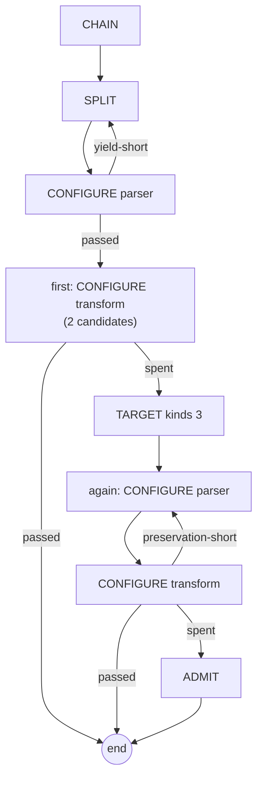

# 5. The learning flow

What the model is asked, in what order, how each answer is judged, and where each judgement leads. A
session walks its document's learning flow ([4](04-learning.md)); this is the flow. The terms are in the
[glossary](README.md#glossary).

## 5.1 The idea

The model is never asked "translate this feed". It is asked a series of small, closed questions, each
with a strict reply grammar and a judge (A21): which elements, in order; what one record is; what each
kind of record should become; this element's configuration. Each answer is run as a real pipeline step
over the feed's own data and scored before the next question is asked, so the next question carries real
input: what the previous element actually wrote.

Which questions are asked, in what order, judged by what, and where to go on each outcome is **data on the
document**: the *learning flow*, a graph of steps (A33, A37, A81). The question kinds, their reply
grammars, the checks and the outcomes are **code**: a closed vocabulary the flow is written in. A new kind
or check is new code; a new flow is a document edit.

## 5.2 The vocabulary

**Question kinds** (`QuestionKind`):

| Kind | Asks for | Reply grammar | Judged by default |
|---|---|---|---|
| `CHAIN` | Which elements, in order | Element type names joined by newlines, commas or `->`, drawn only from the allowed elements (`ChainReply`) | The grammar alone |
| `SPLIT` | What one record is (A31, A35): for raw text, a parser configuration that cuts the sample into whole records; for XML or JSON input, the element or key that is one record | One configuration document, or one element/key name | coverage, yield, wholeness |
| `TARGET` | What one representative record of each kind should become: an event, or the word *none* (A31) | One event document, or *none*, per kind | Whether the event is one worth aiming at (`TargetChecks`) |
| `CONFIGURE` | An element's configuration: a Data Splitter, an XSLT | Exactly one document, fenced once or bare (`ConfigurationReply`) | Every check |
| `ADMIT` | The transform's configuration once more, now allowed to write a *marked Unknown* for kinds it cannot translate (A51, A53) | As `CONFIGURE` | Every check |

**Checks** (`Check`), which a step may name to replace its kind's defaults:

| Check | Wraps | Asks |
|---|---|---|
| `coverage` | Input coverage scorer | Did the parser read the input? |
| `yield` | Yield scorer | Did it produce about as many records as there should be? |
| `wholeness` | | Is each record whole, not a fragment of one? |
| `conformance` | Schema conformance scorer | Are the events valid against the event schema? |
| `quality` | Extraction quality scorer | Are they good events, not degenerate ones? |
| `rules` | Business rules scorer | Do they meet the document's XPath assertions? |
| `preservation` | | Do the parser's records keep everything the targets need? |
| `fidelity` | | Do the transform's events reproduce the targets? |
| `errors`, `classification` | Error load, event classification | **No scorer exists**; hidden in the editor (ISSUES item 20) |

**Outcomes** (`StepOutcome`): `passed`; `refused` (the reply broke the grammar); `compile-failed`;
`run-failed` (the element raised errors on its input); and `<check>-short` for each check, e.g.
`coverage-short`, `preservation-short`.

**Exits** (`FlowExit`, A83): `park` (for a person) and `give-up` (the learner gives up). `end` is the end
of the flow, with a chain to judge.

## 5.3 A step

A step is written as one line (`FlowStep.parse`), and the editor builds the same thing as a form:

```
[id:] KIND [parser|transform] [when always|text|xml|json] [candidates n] [kinds n] [elements a,b,…]
      [checks a,b,…] [on <outcome> goto <id>|end|park|give-up | abandon]… [on spent goto … | abandon]
```

| Part | Meaning |
|---|---|
| `id:` | A name for `goto` to reach. Without one, a step is reached by its kind's default name |
| `parser` / `transform` | `CONFIGURE` only (`ConfigureRole`): the chain's first element where it parses raw input, or every element after it. Neither means every element in chain order |
| `when` | `StepGuard`: ask always, or only where the input is raw text, XML or JSON. A step whose guard fails is skipped |
| `candidates n` | How many answers the step may have before it is *spent*. Default: the document's `maxAttempts` (5) |
| `kinds n` | `TARGET` only: how many kinds of record to propose a target for. Default 3 |
| `elements` | `CHAIN` only: the element types to choose from (A95). Default `DSParser`, `JSONParser`, `XMLParser`, `XSLTFilter` (A10). With exactly one, the question is not asked |
| `checks` | Replaces the kind's default checks |
| `on <outcome> goto` | Leave at once, on the first candidate with that outcome |
| `on spent goto` | Where to go when the candidates are gone |
| `abandon` | Take the step's own default exit: `give-up` for a parser step, whose spent candidates are the one failure nothing can serve (A52, A54); `park` for any other (A65) |

**How a step behaves** (`Conversation`):

- A step **re-asks itself** with the feedback of what fell short until its candidates are spent. That
  needs no transition.
- `passed` goes to the **next line**, unless `on passed goto` says otherwise.
- A transition on an outcome fires at once. One on `spent` fires when the candidates are gone; without
  one, the step takes its default exit.
- **Each transition is taken at most once per session**, so every flow terminates. A flow that would take
  one twice abandons, saying which.
- What a transition carries (the feedback that sent it) is given to the next question asked, so a skipped
  step passes it on.
- `ADMIT` is entered only by a transition, never by falling through from the line above it.
- An element whose configuration is not the model's business is run once and judged, without a question
  (*run-only*).

**Structure rules** (`LearningFlow.check`, A88): `CHAIN` first, once, with no transitions; `CONFIGURE` or
`ADMIT` last; `SPLIT` and `TARGET` at most once each; ids unique and none reserved (`end`, `park`,
`give-up`); every `goto` names a step, `end` or an exit. A flow with problems cannot be saved, and a
session under one abandons before asking anything. The flow must also configure every element of the
chain, or the session abandons at the end.

## 5.4 The example flows

A new document starts with `DIRECT`. `FlowExample` holds three flows the Learn tab can load; they
are starting points, and the document owns its steps once loaded (A34).

**Direct** (the default) asks for the chain and then each element's configuration (A21):

```
CHAIN
CONFIGURE parser
CONFIGURE transform on spent goto admit
ADMIT
```

**Target first** settles the record boundary, then what each kind of record should become, and holds
every configuration to those events (A31). A parser that loses what a target needs is sent back:

```
CHAIN
SPLIT
TARGET kinds 3
CONFIGURE parser
CONFIGURE transform on preservation-short goto parser on spent goto admit
ADMIT
```

**Escalating** settles the split, goes direct, and asks for targets only if the transform stays short
(A39, A40):

```
CHAIN
SPLIT
CONFIGURE parser on yield-short goto split
first: CONFIGURE transform candidates 2 on passed goto end on spent goto target
TARGET kinds 3
again: CONFIGURE parser
CONFIGURE transform on preservation-short goto again on spent goto admit
ADMIT
```



## 5.5 What each question carries

`QuestionText` computes the blocks and `Templates` renders them. Every question carries:

- the **system text**: the stage's objective, the document's `instructions`, and the demands every answer
  must meet;
- the stream's **feed and type**;
- the **sample** (§5.6), or for a later element, the real input it will receive: what the elements
  before it wrote;
- on a re-ask, the **previous answer and the feedback** that lost it marks;
- the learner's **guidance** (A46);
- the reply grammar, stated every time.

Extraction questions also carry the mandatory `xsi:schemaLocation` and the ban on `ignoreErrors`.
Transformation questions also carry the event schema's named failure modes and the degeneracy trap.
Once the split is settled, a transform is shown **one record**, since that is what the fragment's
`SplitFilter` will give it, with how many records and kinds the stream holds. It is still run over every
record. Before the targets are settled it is shown one record of each kind (A47).

**Templates (A33).** Each question is a `Template` with built-in text and `${variable}` slots: system text,
chain, split (text, XML and JSON forms), target, configuration, admission, and three rule blocks. A
variable renders a whole block or nothing, so templates need no conditionals. A document overrides only
the templates it names; every other follows the built-in text, whose version (`Templates.VERSION`,
currently 6) is stamped on the document when saved, so a document saved against older text says so.

The built-in text is the conversation as measured by the live harness (archived design 02 §6), including a
worked Data Splitter example and "a header line is a record too". Changing it means raising the version.

**The system text and transcript.** The model sees the whole conversation so far: the system text, then
every earlier exchange of the session. Every call is audited against the document with the model, the
kind of question, the tokens and the outcome, but not the sample (`ModelAdvisor`).

## 5.6 The sample

The model learns from a prefix and is judged on the whole (`Stage.learningPrefix`):

- **Text** is cut into lines; the first `1 - heldOutFraction` (default 80%) are the sample, within
  `sampleSizeLimit` (default 8 KiB), cut at whole lines.
- **XML** that is one document is learned whole, or cut at whole children of its root and closed again.
- **JSON** that is one document is cut at its widest array's items and closed again, since a prefix of a
  JSON document would not parse.

Whatever the sample, the candidate chain is run over the **whole held stream** before it can be bound,
and the session settles on the whole stream ([4.5](04-learning.md#45-how-a-session-ends)).

**Held records.** A relearning opens with what fell short: what the serving binding scored on the stream,
its verdicts, and the records that fell short, as the parser cut them and as the transform left them.
Every candidate for the transform is held to those records as well as to the sample (`heldTo`), since the
sample may not contain them. A candidate that falls short on one is told which.

## 5.7 Marked Unknowns: the exhaustion step

Some kinds of record cannot be translated into anything better than "unknown". The `ADMIT` step exists so
that such a stream can still be served, honestly:

- It is reached only by a transition from a spent transform step, typically `on spent goto admit` (A76).
- It asks for the transform once more, now allowed to write, for each kind it cannot translate, an
  `EventDetail/Unknown` carrying a `Data` item named by `LearnedUnknown.MARKER` whose value is the model's
  name for the kind (A53, A62, A74).
- **Only `ADMIT` may write the marked form.** At any other step a candidate that writes it is refused,
  including when it is held to the records that fell short, since those are the ones a model would most
  like to admit.
- A bare `Unknown` without the marker is refused by the quality scorer, as always.
- A later relearning may turn a marked Unknown into a real translation; the corpus forbids the reverse
  (A66, [6](06-scoring.md)).

A person can send a parked session to this step directly (*exhaust*, [4.7](04-learning.md#47-what-a-person-can-do)).

## 5.8 Talking to the model

`Advisor` is the seam: one question at a time, each carrying the exchanges before it. In a node it is
`ModelAdvisor` over `stroom-ai` (A13): the document names a `stroom-ai` model document, an
OpenAI-compatible endpoint, and `stroom-ai` resolves its key from the credentials service, guards the base
URL against SSRF and applies the HTTP client configuration. Transport retries are the client's own, so a
dropped connection is not a failed candidate. There is no response cache: a re-ask with the same words
must reach the model. A document with no model gets `NoModelAdvisor`, which fails loudly.

In tests the advisor is scripted (`testFixtures`). `RecordedAdvisor` answers from a session's recorded
turns and then hands on to the model, or stops (§4.3 of [4](04-learning.md)).

**Running a candidate.** Each answer is run by a `StepRunner` for its element: `DataSplitterStep`,
`JsonStep`, `XmlFragmentStep` and `XsltStep` in the module, used by Tier 1 tests; and in a node,
`PipelineStepRunner`, which builds a one-element pipeline with the real element, pools and function
library. `TestStepRunnersAgree` holds the two to the same answers. `XsltStep` refuses every way a
stylesheet could reach outside its input; the real runner does not yet (ISSUES item 21, A147).

## 5.9 The document settings the flow uses

| Setting | Default | Meaning |
|---|---|---|
| `flow` | `DIRECT` | The steps and template overrides |
| `instructions` | none | Free text added to the system text of every question |
| `maxAttempts` | 5 | Candidates per step, where a step does not say |
| `sampleSizeLimit` | 8,192 | Most characters the sample may hold |
| `heldOutFraction` | 0.2 | Share of a text stream's lines kept out of the sample |
| `model` | none | The `stroom-ai` model document |
| allowed elements | `DSParser`, `JSONParser`, `XMLParser`, `XSLTFilter` | The Chain step's `elements` |

Budgets are in [4.4](04-learning.md#44-budgets); scorers, thresholds and the promotion floor in
[6](06-scoring.md).

## 5.10 Code

| Class | Role |
|---|---|
| `shared.LearningFlow`, `FlowStep`, `Transition`, `FlowExample`, `FlowProblem`, `Template` | The flow as data |
| `shared.QuestionKind`, `Check`, `StepOutcome`, `StepGuard`, `ConfigureRole`, `FlowExit` | The closed vocabulary |
| `learning.Conversation` | The interpreter: walks the flow, asks, runs, judges, follows transitions |
| `learning.ChainReply`, `ConfigurationReply`, `Boundary`, `Target`, `TargetChecks` | Reply grammars and the target checks |
| `learning.Question`, `QuestionText`, `Templates` | The questions and their text |
| `learning.Advisor`, `RecordedAdvisor`; `element.ModelAdvisor`, `ModelAdvisors`, `NoModelAdvisor` | Who answers |
| `learning.StepRunner` and its implementations; `element.PipelineStepRunner` | Running a candidate |

The flow is edited on the document's Learn tab as a chart beside a form per step ([7](07-ui.md)).
