# 7. The user interface

The screens a person uses: the Shapeshifter AI document's editor, the Supervisor, the stepper's pane for
the element, and the Pipeline Factory's editor. They are Stroom GWT screens built to the rules of
`stroom-gwt/UI-GUIDE.md`: a dumb component (a UiBinder template and its Java) and a controller that wires
it, Stroom's own widgets, and workbench stories for every screen. The screenshots are from those stories,
in the dark theme, with made-up data. The terms are in the [glossary](README.md#glossary).

## 7.1 The Shapeshifter AI editor

A Shapeshifter AI document opens in `ShapeshifterAiEditor` with four tabs: **Score**, **Learn**,
**Documentation** and **Permissions**. Score and Learn are the two stages a stream meets, in that order
(A110), and each shows the process across its top (`ProcessHeader`, A98): both stages as boxes, its own
highlighted, with this document's live figures from the Supervisor, such as "3 streams waiting" and
"1 session parked". Which streams reach a document is up to its pipelines' filters, so there is no routing
tab.

### Score

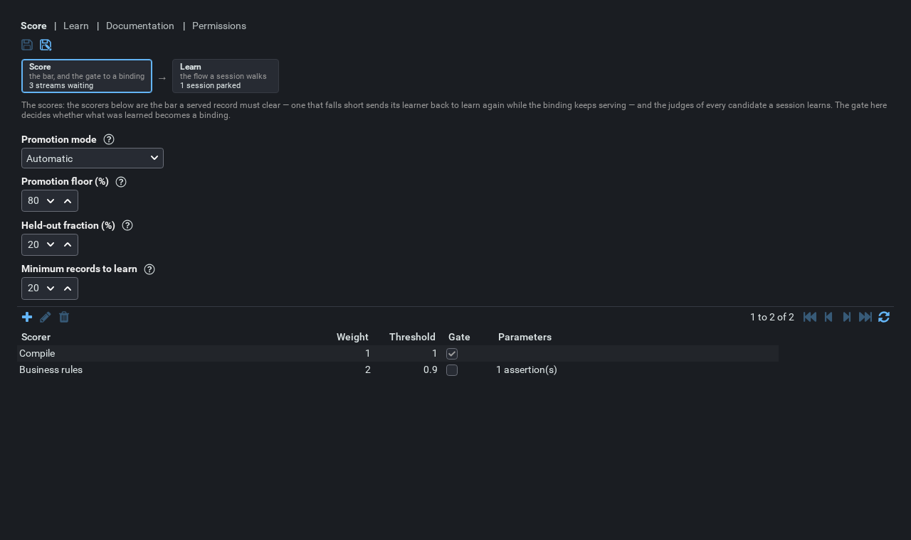

The gate and the bar ([6](06-scoring.md)): promotion mode, promotion floor, held-out fraction, minimum
records to learn, regression records per binding, regression retention (currently unused), and *Flag a
serving binding below*. Beneath them is the scorer set as a table (scorer, weight, threshold, gate,
parameters) with add, edit and delete. *Add* offers the first built scorer type not already in the set.

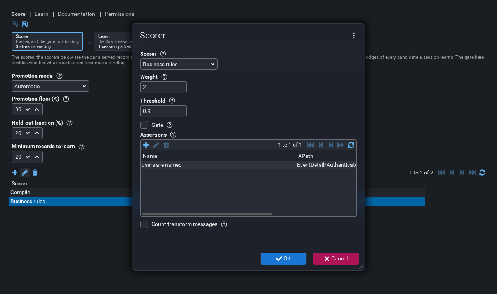

The scorer dialog edits one `ScorerSetting`: the type, chosen from the scorers that exist (ISSUES item
20); weight, threshold and gate; and the type's own parameters. For business rules that is a list of named
XPath assertions, each edited in a dialog of its own. The set refuses a second scorer of a type it already
holds.

### Learn

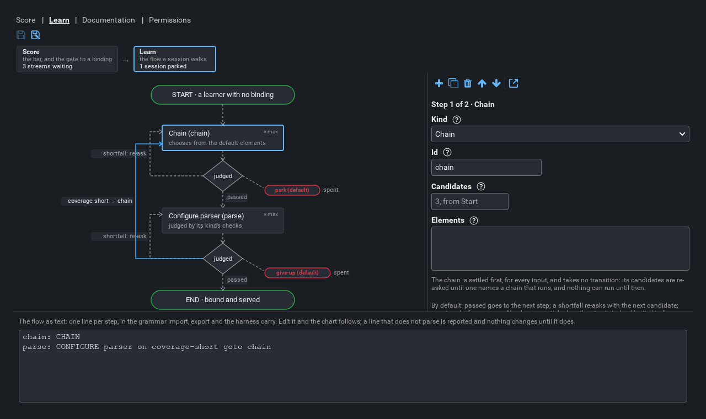

The learning flow ([5](05-learning-flow.md)) in three views kept in step:

- **The chart** (`FlowChart`): *Start*, each step with its judgement diamond and its transitions, the
  default re-ask loops, the exits (`park`, `give-up`, marked *default* where the step's own default
  applies) and *End*. Click a node to edit it.
- **The form** for the selected node, beside the chart, with a toolbar: add, copy, delete, move up, move
  down, and *Load an example* (`FlowExample`). A step's form (`FlowStepEditor`) shows only the fields its
  kind uses (A97): kind, id, role, guard, candidates (with the default it takes from Start as placeholder),
  kinds, elements, the checks as tick boxes, and the transitions as a list. Everything with a closed list
  is chosen from it, so nothing can be typed that the server would refuse.
- **The flow as text**: one line per step, in the grammar of
  [5.3](05-learning-flow.md#53-a-step). Edit it and the chart follows; a line that does not parse is
  reported, and nothing changes until it does.

Selecting **Start** shows the session's own settings: learning mode, model, instructions, default
candidates, time budget, token budget, sample size limit and maximum deferral age. It also shows the
question text: each `Template`, with *Load built-in* to see or start from the built-in text (A33).

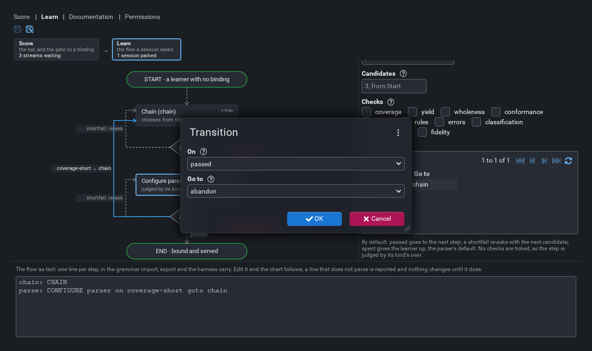

A transition is edited in a dialog: *On* (an outcome, or *spent*) and *Go to* (a step, `end`, `park`,
`give-up` or `abandon`).

Both tabs have read-only forms, shown when the person cannot edit the document.

## 7.2 The Supervisor

*Monitoring → Shapeshifter AI Supervisor*, for anyone with the View Data permission
(`ShapeshifterAiSupervisorPlugin`). It is three levels, master to detail (A115):

1. **Learning pipelines**: one row per learner (`LearnerList`).
2. **A pipeline's sessions** and **waiting streams**, as two tabs (`SessionList`, `WaitingStreamList`).
3. **A session's turns** and **conversation**, as two tabs, beside its flow (`TurnList`, `TurnTranscript`,
   A116).

There is no list of every session across pipelines (A143): the pipelines list is the way in.

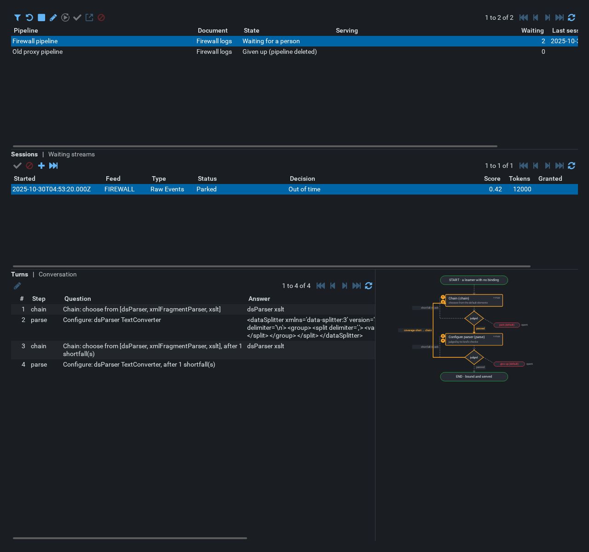

### Learning pipelines

Columns: pipeline, document, state (`LearnerState`, [4.8](04-learning.md#48-learner-state)), what serves
it, how many streams wait, and when its last session ran. The filter (A142) narrows by document, by state,
and whether to show deleted pipelines' learning (hidden by default, A137).

Actions on the selected learner act on it, or on its serving binding (A141):

| Button | Action ([4.7](04-learning.md#47-what-a-person-can-do)) |
|---|---|
| Filter | Narrow the list |
| Learn again | Mark the learner; its next stream relearns while the binding serves |
| Give up | It learns no more; its streams nothing serves error |
| Guidance | What has been said to this learner, and say something more |
| Improve | Ask for the binding to be made better, from what it already does |
| Accept | Accept a provisional binding now |
| Open | Open the binding's fragment |
| Retract | Take the binding back |

### Sessions and waiting streams

**Sessions:** started, feed, type, status, decision, score, tokens, granted. Actions:

| Button | Action |
|---|---|
| Approve, Reject | Decide a draft (A25) |
| Grant | Give a parked session more to spend (A77, A145) |
| Exhaust | Send a parked session to the exhaustion step (A65, A76) |

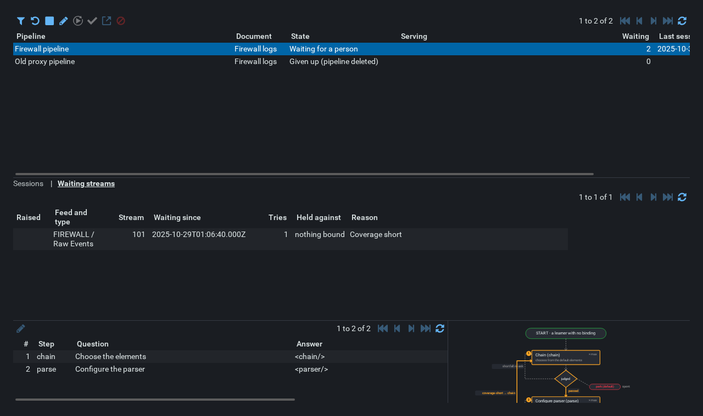

**Waiting streams:** raised, feed and type, stream, waiting since, tries, what it is held against (the
binding it fell short of, or *nothing bound*), and the reason.

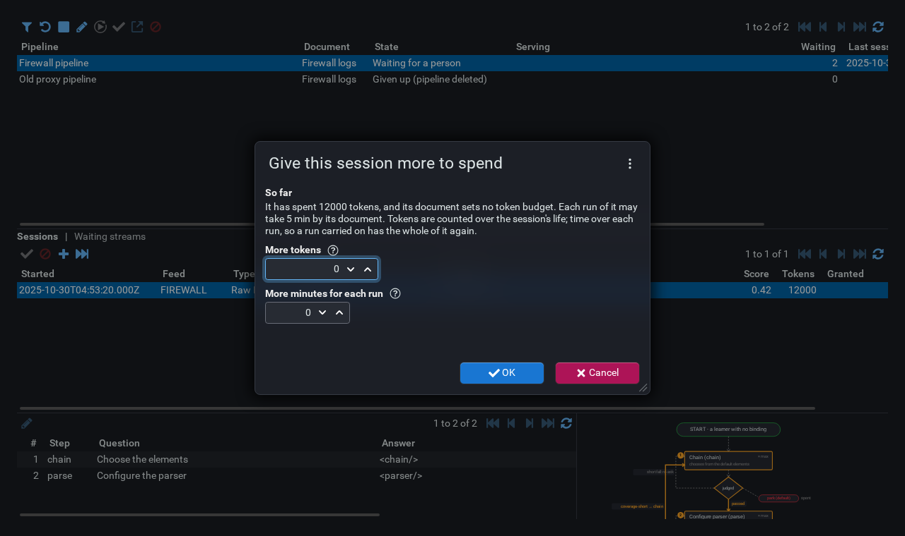

The grant dialog says what the session has spent and what its document allows, and takes more tokens and
more minutes per run.

### A session

**Turns:** number, step, question, answer, with *Answer instead* on a turn (`TurnAnswerEditor`): the
answer in a code editor, saved as the person's answer, with the session re-run from there.

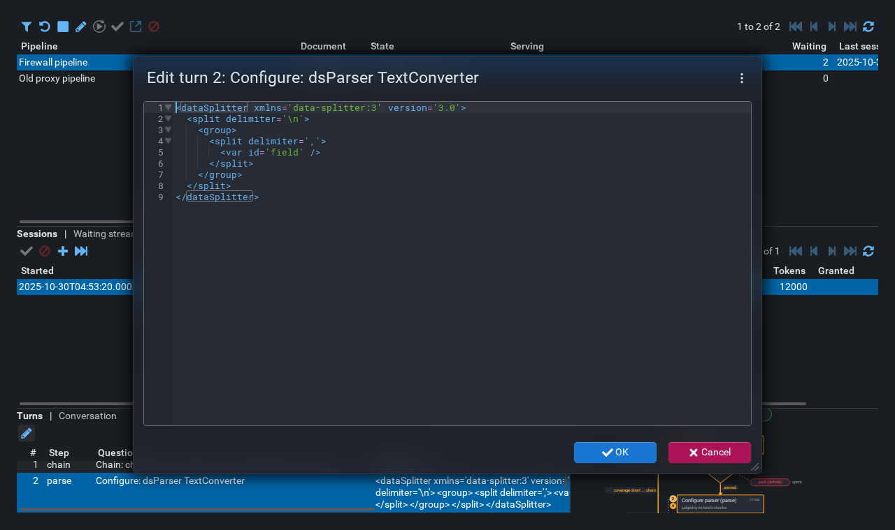

**Conversation:** the same turns as a transcript: for each, what was asked, who answered, the answer, the
outcome and the deciding check's score against its threshold (A144). Beside both tabs is the session's
path over the flow chart: each step visited is numbered by the turns that asked it, and the transitions
taken are highlighted.

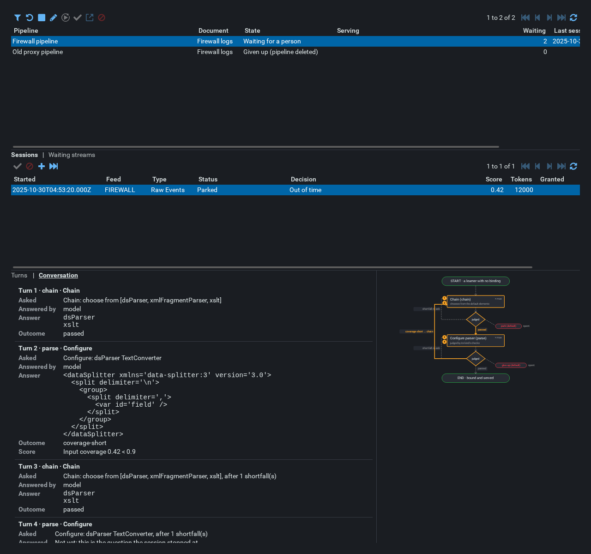

## 7.3 The stepper

Stepping an AI pipeline is read only ([3.11](03-processing.md#311-stepping)). The element has a pane
(`StageDecisionPane`, from `ShapeshifterAiStepDetails`) saying what it decided or would decide: the feed,
document, binding, score and record boundary, a link to the fragment, the scores step by step, and the
conversation where one ran. The fragment's own elements can be stepped beneath it.

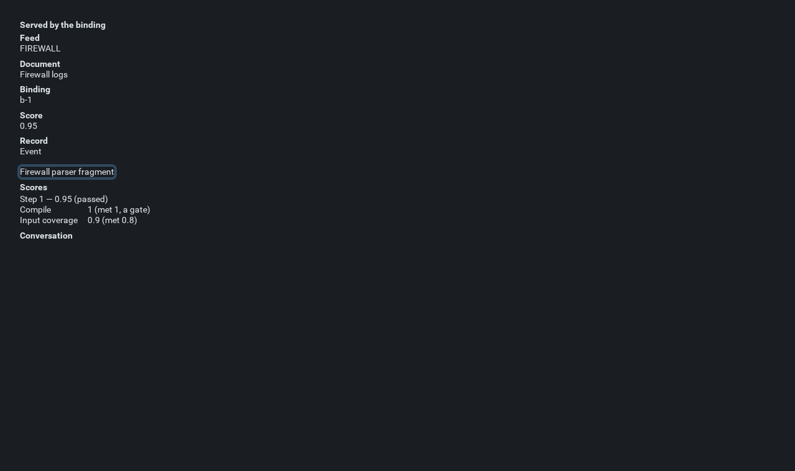

## 7.4 The Pipeline Factory editor

Described in [2.7](02-pipeline-factory.md#27-the-screen).

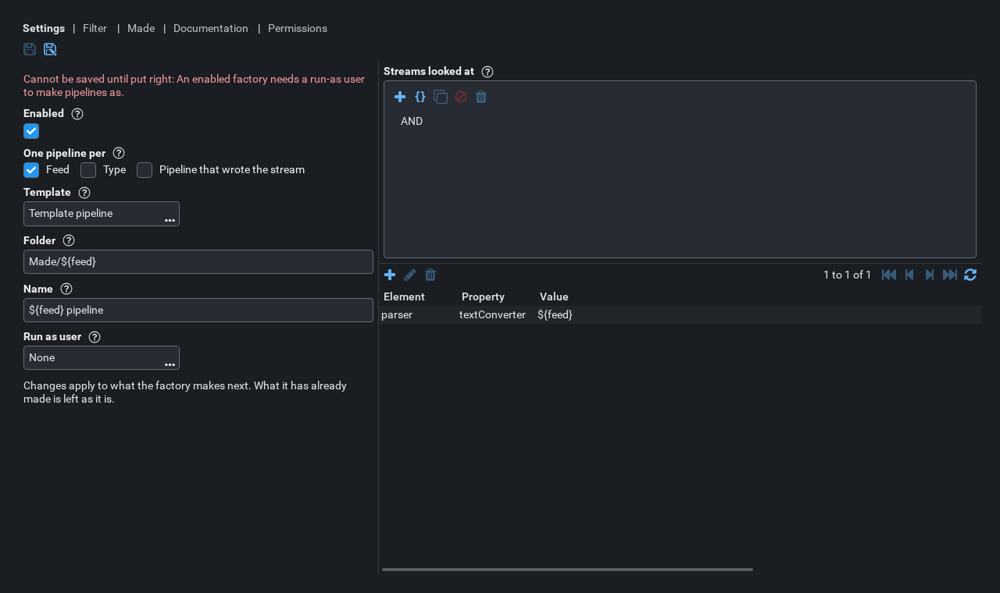

The Settings tab shows its problems above the form: a factory with any cannot be saved.

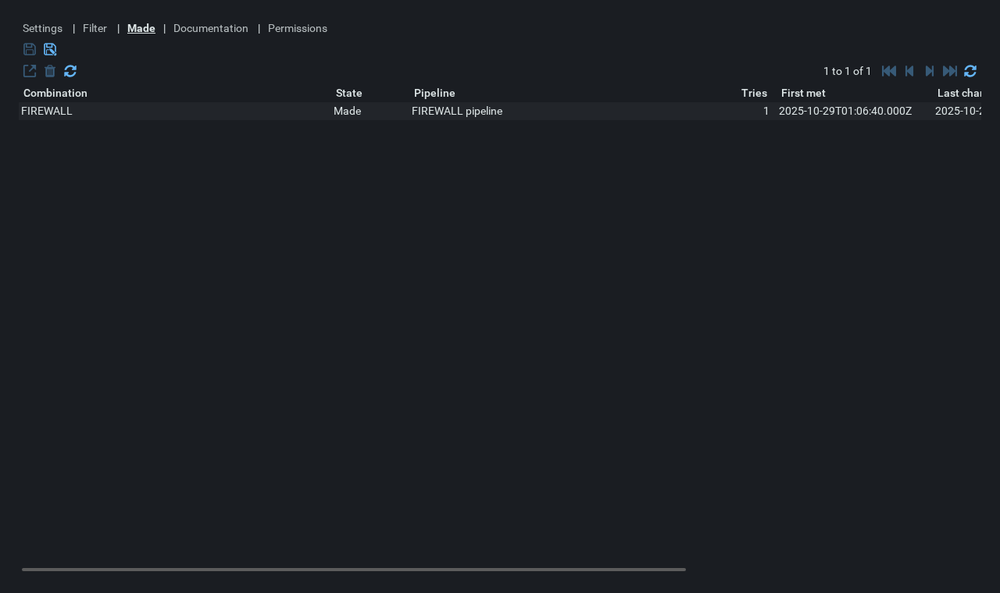

## 7.5 Code and stories

| Where | What |
|---|---|
| `stroom-core-client` `stroom.shapeshifter.client` | `ShapeshifterAiPlugin`, `ShapeshifterAiSupervisorPlugin`, and in `component`: the editor and its tabs, `FlowChart`, the step, transition, scorer, assertion, built-in text, guidance, grant, learner filter and turn answer editors, the Supervisor and its lists, `StageDecisionPane` |
| `stroom-core-client` `stroom.pipelinefactory.client` | The factory's plugin, editor and tabs |
| `stroom-core-shared` `stroom.shapeshifter.shared` | `ShapeshifterAiResource` (the document), `SupervisorResource` (everything the Supervisor reads and does) and their request and row types |
| `stroom-shapeshifter-ai` `doc` | `ShapeshifterAiResourceImpl`, `SupervisorResourceImpl`, `ShapeshifterAiStore` |
| `stroom-gwt-workbench` `app.shapeshifter`, `app.pipelinefactory` | The stories `App/Editors/ShapeshifterAiEditor`, `App/Main/ShapeshifterAiSupervisor`, `App/Main/StageDecisionPane` and `App/Editors/PipelineFactoryEditor`, with `ShapeshifterAiFixtures` holding their made-up data |

Run one screen's stories with the leak check, after a draft compile:

```
./gradlew workbenchDraftCompile --no-daemon
./gradlew workbenchTest --no-daemon -PworkbenchTestFilter='*shapeshifteraieditor*'
```

The filter is a glob over story ids, e.g. `*shapeshifteraisupervisor*`. `workbenchServe` serves the last
compile and does not compile itself. See `stroom-gwt/stroom-gwt-workbench/WRITING-STORIES.md`.
