# Design 01 — Intelligence in the pipeline: a supervised stage, not an external controller

> **Archived.** This is the design as it was written and ruled, kept for its reasoning and history. The current design is [the design set](../README.md); code comments that cite this document by number and section still resolve here.

*Reframed 2026-09-11 from `full-design.md` (v0.4, May 2026). That document describes two components,
Shapeshifter Intelligence and Shapeshifter Engine. This design keeps only Intelligence, drops the
Engine entirely, and re-targets the whole mechanism at Stroom's existing Data Splitter and XSLT.*

> *Superseded in part by design 06, phase J (2026-10-07 and 08).* The pipeline is the unit of learning
> (A104): a **learner** is one Shapeshifter AI element in one pipeline (A114), and what serves it is its
> **binding** (A117, A124, A140). Shapes, the learning key, the shape signature, the routing table and its
> selectors, pinning (A138) and the ledger (A131) are gone; a stream waits as a deferred task, which a
> promotion wakes by its pipeline (A129). Where this document says a shape, read a learner; where it
> says a rule, read a binding. It is kept as the record of how the design arrived where it is.

*Every decision the design rests on is a numbered ruling, A1–A46; §13 lists them with their status
and §14 records when each arrived. Two were ruled against the recommendation — promotion is
automatic (A9), and AI writes extraction configs as well as transforms (A8) — and the sections below
say what each of those obliges in return.*

The source design puts Intelligence outside Stroom: its own database, its own UI, its own
configuration, reaching into the pipeline to take data and hand it back. That was the right shape
when Intelligence drove a separate engine. It is the wrong shape now. Everything Intelligence wants
to do — run a transform, capture what it produced, judge it, run it again differently — Stroom
already does, in the pipeline stepper, for a human sitting at a screen. This design makes that
machinery headless and puts the loop where the data already is.

---

## 1. What this design keeps and what it discards

| From the source design | Status | Why |
|---|---|---|
| Quality scoring as the foundation | **Kept and substantially revised**, §8 | Re-based on Stroom's existing validators. The event schema turns out to contain a reward hack that the source design's scoring model would walk straight into. |
| The score → improve → rescore loop | **Kept**, §4, §6 | This is the whole idea. It gains a replay unit, two execution modes and a held-out validation set. |
| Phased transformation | **Kept**, §3 | Generalised: a phase becomes a *supervised stage*, and a pipeline may hold several. |
| Processor selection from feed attributes | **Kept**, §3, §7 | Promoted from name-matching to an explicit, versioned routing table. |
| Circuit breaker, retry limits, rate limiting | **Kept and load-bearing**, §11 | Ruled A9, promotion is automatic, so these stop being prudence and become the only control. |
| Immutable versioning of configurations | **Kept and hardened**, §7 | Becomes append-only *variants*, because Stroom documents have no readable version history. |
| AI mode per phase (automatic / assisted / disabled) | **Recast as promotion mode**, §7.4, §11 | Ruled A9: promotion is automatic and the guards in §7.4 are the primary control. A25 adds a per-document *review* mode beside it as an option, not a replacement; there is no assisted mode. |
| Shapeshifter Engine, node graph, visual editor | **Discarded** | Out of scope by instruction. The subject is DS3 and XSLT. |
| Pattern library | **Discarded** | An Engine feature. |
| Intelligence's own central database and UI | **Discarded**, §3 | Ruled A3: configuration is a Stroom document type. Duplicating permissions, import/export and audit outside Stroom content management buys nothing and costs all three. |
| "Replaces the Data Splitter + XSLT pair with one step" | **Inverted** | This design *supervises* that pair rather than replacing it. |
| AI writes to the visual editor | **Replaced**, §10 | AI writes DS3 XML and XSLT text, validated before use. |

The source design's three architectural claims that survive unchanged are worth stating plainly,
because everything below serves them: AI configures the engine rather than running the transforms;
the system must work with Shapeshifter AI switched off; and the vast majority of data must never touch AI at all.

---

## 2. Where it stands

The central finding is that Stroom already contains almost all of the required machinery, built for
the interactive pipeline stepper, and that none of it is reachable from a running pipeline. The gap
is smaller than the source design assumes, but it is in an awkward place.

| Capability needed | What already exists | Where |
|---|---|---|
| Run a pipeline without committing output | `PipelineFactory.create(data, terminator, controller, stopAfter)` replaces **every** `DestinationProvider` with an `OutputRecorder` when a controller is present | `factory/PipelineFactory.java:115`, `insertRecorder` ~`:655` |
| Run an *unsaved* XSLT or DS3 config | `SupportsCodeInjection.setInjectedCode(...)`, fed from `PipelineStepRequest.getCode()` keyed by element id | `SupportsCodeInjection.java:23`; injection at `PipelineFactory.java:403-412` |
| Capture output in memory | `OutputRecorder` (bytes), `SAXEventRecorder` (replayable Saxon TinyTree), `TestAppender` (caller-supplied stream) | `writer/OutputRecorder.java:32`, `filter/SAXEventRecorder.java:51` |
| Re-run one interior element over stored upstream events | `PipelineFactory.createFrom(...)` with `MidPipelineScope.ELEMENT_ONLY` / `ELEMENT_AND_DESCENDANTS`, driven by `ReprocessDriver` | `PipelineFactory.java:187-280`, `stepping/capture/ReprocessDriver.java:89` |
| Keep several candidate results side by side | `ElementFingerprinter` content-addresses captured IO by the element's effective config | `stepping/fingerprint/ElementFingerprinter.java:70` |
| Spill intermediate results to disk | `StepDataStore`, `{temp}/{session}/{metaId}/{part}/{elementId}/{fingerprint}.dat` | `stepping/store/StepDataStore.java:67` |
| Nested pipeline inside a running pipeline | Reference data loading already does it, synchronously, via a child task context | `refdata/ReferenceData.java:616` → `ReferenceDataLoadTaskHandler.java:186` |
| Recompile when a config changes | Parser and XSLT pool keys are the **whole document**, so a rewritten config self-invalidates; `usePool=false` bypasses the pool | `cache/AbstractPoolCache.java:42-140`, `XsltDoc.java:105-122` |
| Select a config at runtime by feed | `namePattern` / `xsltNamePattern` with `${feed}` substitution | `filter/PipelineDocFinder.java:50-153` |
| Drop records that errored | `RecordOutputFilter` buffers each record and discards any that raised ERROR or FATAL | `filter/RecordOutputFilter.java:38` |
| Validate **per record** against a schema | `SchemaFilterSplit` wraps `SchemaFilter` so errors are reported per top-level element | `filter/SchemaFilterSplit.java:73-74` |
| Business-rule signalling from a transform | `<xsl:message>` with a severity element name is already an error channel | `filter/XsltFilter.java:361-420` |
| Per-stream quality counters | `RecordCount`, `ErrorStatistics` | `state/RecordCount.java`, `errorhandler/ErrorStatistics.java:23-49` |
| Call an LLM | `AiService.chat(DocRef, String systemPrompt, String message)`; models are documents with a configurable `baseUrl` | `stroom-ai-api/.../AiService.java:67`, `OpenAIModelDoc.java:55-109` |

Two things are absent, and both shape the design.

**Code injection is gated on stepping.** `PipelineFactory.setProperty` consults the injected-code map
only when a `SteppingController` is present. There is no headless route to "run this element with
that configuration". This is the change on which running a fragment through `PipelineFactory`
rests — the harness of §9.1 drives the Data Splitter and Saxon directly and does not need it — and
§12 lists it first.

**Stroom documents have no readable history.** `AbstractDoc` carries a `version` UUID and
`DBPersistence` does a genuine `UPDATE ... WHERE version = ?` with `DataChangedException` on a stale
write, so optimistic locking is real and free. But there is no diff and no revert. The
`doc_data_snapshot` tables *do* store a content-deduplicated copy of every asset on every write;
nothing reads them back. Section 7 declines to build on that substrate and explains why.

### 2.1 The corpus, and what it can settle

The repository already contains paired configurations, inputs and expected outputs for both stages.
This is the material against which every threshold in this design will eventually be set, and §9
argues it is also the material that can test the design's central premise before anything is built.

| Corpus | Contents | Use |
|---|---|---|
| `stroom-pipeline/src/test/resources/TestDS3/` | 19 cases as `.ds3.xml` + `.in` + `.out.xml` triples; three `_FAIL` cases, two of them with `.err`. Harness `TestDS3.java` discovers stems by globbing and diffs against the golden. | Extraction-stage ground truth |
| `stroom-shapeshifter/stroom-shapeshifter-engine/src/test/resources/fixtures/legacy/` (in the engine checkout, not this repository) | The same 19 plus `020_escaped_values`, `021_trimmed_values`, `022_empty_input`, all but one with a `.messages` file of normalised diagnostics | Extraction-stage ground truth, with error text |
| `stroom-core/src/test/resources/samples/config` | 50 Pipelines, 27 XSLTs, 6 TextConverters, 51 Feeds, serialised as content | Transformation-stage ground truth |
| `samples/input/*.in`, `samples/output/*.out` | 80 inputs, 79 goldens, matched by feed name | End-to-end ground truth |
| `stroom-app/.../TranslationTest.java` | Imports the whole sample config, creates a processor filter per pipeline, runs every feed, diffs against goldens **and** validates against the schema | The ready-made harness |

What the corpus covers, and does not: CSV headed and unheaded, quoted CSV, pipe-delimited
single-line, regex-captured fixed-shape lines, multi-line block records, `key=value` (Linux auditd),
application log lines, single-column, and nested list-in-field. There is **no syslog case, no true
fixed-width case and no JSON case** among the DS3 tests, despite those being the formats most often
cited as the target. Inputs run from 43 B to 2 KB and yield **2–9 records**; sample XSLTs are 19–129
lines against the "thousands of lines" the source design describes for real translations.

The consequence is a sharp division. The corpus is sufficient to validate *mechanism* — can a model
reconstruct a working config, do the scorers rank good output above bad. It is nowhere near
sufficient to set *thresholds*: at 2–9 records per case, a yield-based scorer has almost no
resolution, and no DS3 case is large enough to exercise sampling, streaming or cost. Every number in
an implementation must therefore be a configured default with a recorded justification, and the
thresholds remain open until real feeds arrive.

**Both schemas are external.** The event schema arrives via the downloaded
`event-logging-xml-schemas` content pack, and `data-splitter-v3.0` via `core-xml-schemas`. Neither is
checked in. The compile gate of §8.1 and the schema scorer of §8.2 both depend on those packs being
installed, which makes content-pack availability a deployment prerequisite of the feature rather
than an incidental detail.

### 2.2 First values, from phase B

Phase B (design 03; slices 13–18, 2026-09-21) added the formats §2.1 said the corpus lacked, each with
a fixture of twelve to forty records, a hand-written golden and a scripted scenario, and run 7 (02
§6.3) learned them live. The thresholds below are the values those scenarios state and the live run
was judged by: the first values design 03 §4 owed, set from the goldens, and to be settled in phase G
from real feeds. Where a row says *default*, the document's default applies: promotion floor 0.9,
minimum records per shape 10 (the scenarios use 5, their fixtures being small), relearn threshold 0.8,
held-out fraction 0.2, sample size limit 8,192 characters, five candidates a step.

| Format | Coverage (not a gate) | Yield (not a gate) | Extraction quality (gate) | Business rule | Run 7 score |
|---|---|---|---|---|---|
| Syslog, RFC 3164 and 5424 | 0.9 | records, 1.0 per record, threshold 0.5 | 0.7; `EventSource/User/Id` | interactive events name the user | 1.000 |
| auditd, `key=value`, multi-line | 0.9 | **lines, 0.35 per line, threshold 0.6** — a record is about three lines; a split of one record per line scores a third of it | 0.7; `EventSource/User/Id` | logons name the user | 0.997 |
| Windows security events, XML | — (XML input; no parser) | records, 1.0 per record, threshold 0.5 | 0.7; `EventSource/User/Id` | logons name the user | 0.997 |
| JSON, lines and a document | — (the parser is run only) | records, 1.0 per record, threshold 0.5 — by the array's items since slice 19 | 0.7; `EventSource/User/Id` | logons name the user | 0.999 / 0.999 (run 8) |
| Fixed-width, six columns | 0.9 — full for any regex that matches the line, so it never decides | records, 1.0 per record, threshold 0.5 | 0.7; `EventSource/User/Id` | **a sign-on decision states its outcome** — what the four-column transform cannot meet | 1.000 |
| CSV, quoted field over lines | 0.9 | **lines, 0.77 per line, threshold 0.9** — twenty records over twenty-six lines; a line split scores 0.77 | 0.7; `EventSource/User/Id` | — | 1.000 |

What the values say. Coverage at 0.9 never decided a phase B outcome: every parser the model wrote
consumed the whole input, and the two ways to lose records — a dropped column, a record cut in two —
lose no characters. What decided them was yield stated *per line* where a record spans lines, and
preservation against targets where a column was dropped. So the setting that matters per format is
the yield basis and its expected ratio, which an operator can read off the feed (records over lines
of a sample) and which the document's instructions should say in words as well. The extraction
quality threshold of 0.7 with one required path was met by every promoted transform at 0.99 or
better, so it discriminated the degenerate stylesheet (0.5 on Windows, scenario 45) from the real
ones with room to spare; whether 0.7 is too low for a real feed is phase G's question. The promotion
floor of 0.9 was never the deciding gate either — scores were 0.997–1.000 or given up outright — and
the thresholds design 03 §4 leaves open remain open: these are the values to start a new document
from, not the values a real feed will keep.

---

## 3. The shape

Five pieces. Nothing here is an external service; all of it is Stroom content and Stroom pipeline
elements.

```mermaid
flowchart TB
    subgraph Pipeline["A Stroom pipeline"]
        Src["Source"] --> S1["Supervisor\n(extraction stage)"]
        S1 --> S2["Supervisor\n(transformation stage)"]
        S2 --> Good["Schema XML\n→ downstream"]
        S2 -.->|"given up"| Bad["Error stream\n+ ledger row"]
    end

    subgraph Content["Stroom content"]
        Doc["Shapeshifter AI\n(new doc type)"]
        Routing["Routing table\n(in the document doc)"]
        Variants["Transform variants\n(pipeline fragments)"]
    end

    Scoring["Scoring service"]
    AI["stroom-ai\nAiService"]

    S1 -.-> Doc
    S2 -.-> Doc
    Doc --> Routing
    Routing --> Variants
    S1 <--> Scoring
    S2 <--> Scoring
    S1 -.->|"on failure"| AI
    S2 -.->|"on failure"| AI

    style S1 fill:#223355,stroke:#4477aa
    style S2 fill:#223355,stroke:#4477aa
    style AI fill:#3a2255,stroke:#7744aa
    style Bad fill:#553333,stroke:#aa5555
    style Good fill:#225533,stroke:#44aa77
```



**A transform variant** is the unit of selection: a **pipeline fragment** — an ordinary Pipeline
document whose element chain starts at the implicit `Source` and ends before any writer or
destination — at a parser or a filter. `Source → DSParser(tc-syslog)` is a variant. `Source → XSLTFilter(xslt-syslog-v3)` is a
variant. `Source → DSParser(tc-syslog) → XSLTFilter(xslt-syslog-v3)` is also one. This single
abstraction covers every case asked for: switching between JSON, XML and DS3 parsing is a stage whose
variants are fragments containing a `JSONParser`, an `XMLParser` or a `DSParser`; supervising XSLT
alone is a stage of single-filter fragments; combining the two is a stage whose fragments hold both.
A variant is not a new document type — it is a `DocRef` to a Pipeline in the routing table.

The first cut of the Shapeshifter AI document encoded a variant as an ordered list of `(element type,
configuration DocRef)` pairs. That is a poorer copy of `PipelineData`, which already expresses
elements, their properties and the links between them, and which the supervisor was going to
synthesise anyway. A fragment is strictly more expressive — several filters, element properties such
as splitter options or XSLT parameters, a `RecordOutputFilter` to drop bad records — and it is
something an operator can open in the pipeline editor, step, and diff against the variant it
replaced. Its dependencies on the configuration documents it references are remapped on import by the
pipeline store, so the document depends only on its model and on fragments. `parentPipeline` gives a
fragment a template to inherit from, so a structural change common to every variant of a stage is
made once, in the template. The supervisor must reject a fragment that contains a destination.

**Ruling A10.** *The variant model is generic over element types. The initial set is `DSParser`,
`XSLTFilter`, `JSONParser` and `XMLParser`. Shapeshifter documents are deliberately not in the
initial set but require no structural change to add: `ShapeshifterParser` and `ShapeshifterFilter`
already implement `SupportsCodeInjection`, which is the only hook the supervisor needs.*

**Proposed ruling A20.** *A variant is a pipeline fragment: a Pipeline document with no destination,
referenced from the routing table by `DocRef`. This takes A10 to its conclusion — a fragment is
generic over every element, so A10's initial set becomes a statement about what the AI is asked to
write rather than about what the routing table can hold.*

**The supervisor element** is one new pipeline element, parameterised entirely by its Shapeshifter AI document. It
takes its input, runs a variant as a nested sub-pipeline, captures the output, scores it, and decides
what to do next. It builds the nested pipeline by merging the fragment's `PipelineData` with its own
capture filter at the tail — the same substitution the stepper makes — and runs it inside a child task
context, exactly as reference data loading already does.

**The Shapeshifter AI document** is the new Stroom document type (ruled A3). One document describes one stage:
its learning key, its variants and how to select among them, its scorers with their weights and
thresholds, its AI instructions, its candidate limit and budgets, its sample size limit, its
execution mode and its promotion mode. These are ordinary content: permissioned, importable, exportable. Because a document is
referenced by a pipeline element property, the same document can be shared by many pipelines, which is
what the source design wanted its scoring-profile library for. The document holds configuration
only: what the stage has learned, given up or is waiting on is runtime state and is never written to
the document — §11.4 says where it lives.

**The routing table** maps a selector to a variant. As first drawn, a selector was `(feed, stream
type, record shape signature)` with wildcards, resolved most-specific-first. That uses two of the
stream's metadata fields and ignores the rest, and the rest is often the better signal: a stream
carries an attribute map — the receipt headers `Content-Type`, `Compression`, `System`,
`Environment`, `File` and whatever else the sender set — that `stroom:meta()` already exposes to
XSLT through `MetaDataHolder`. `Content-Type: application/json` names the parser outright, before
a byte has been sniffed; a `System` header separates two senders sharing one feed. The content-derived
signature is the fallback field for when the sender said nothing.

**Proposed ruling A22.** *A routing rule's selector is an `ExpressionOperator` over the stream's
metadata — the `MetaFields` and the attribute map — with the record shape signature (§5) as one more
matchable field, evaluated by the `ExpressionMatcher` that receive rules already use at the front
door. Rules are ordered, and order is specificity: the first rule whose expression matches binds the
variant, exactly as `ReceiveDataRule` works, so no most-specific-first resolution has to be invented.
Feed and stream type become expression terms rather than columns.*

It lives inside the Shapeshifter AI document, and §7 explains why that placement is what makes
reproducibility tractable. The shape remains the unit of learning, validation and quarantine (§5);
A22 changes only how a selector is written, not what a shape is for. The routing-table editor, when
it comes, is the receive-rules expression editor reused rather than a bespoke one.

Three decisions taken with A22 on 2026-09-16, each the option that keeps the table honest:

- **No matching rule means an unknown shape, and the stage learns.** The table grows by learning;
  there is no catch-all to write and no dispatcher. A rule bound to nothing is a rule the operator
  has reserved: when it is the first match the shape is given up by operator decision — no variant,
  no attempt, a sentinel with reason *reserved* — not a fall-through (ruled 2026-09-17).
- **A learned rule's selector is exactly the document's learning key, and nothing wider.** As first
  decided the key was fixed at `Feed AND Type AND Shape Signature`. The owner ruled on 2026-09-17
  that most bindings will switch on feed and type alone, and that which fields take part is the
  document's to choose (A29): the learning key, defined in §5, defaults to `Feed AND Type`, with the
  signature added where one feed carries several record kinds. The key is the terms the variant is validated on under A14
  and A15, so it is what the learned rule binds on. Binding on fewer terms than the key would let a
  promotion validated on one feed apply to another that §7.4 never saw; binding on more would be
  brittle, since a sender omitting a header is then a new shape and a new call. Operators widen a
  learned rule by hand.
- **The chain question sees the learning key's values, not the attribute map.** Every field in the
  key is shown to the model and bound in the rule — one list, ruled so on 2026-09-17, so what the
  model was told and what the rule requires cannot drift apart. Attribute-map fields such as `Format`, `Schema`, `System` or
  `Environment` say what the data is and where it came from and are the ones worth adding;
  sender-set headers carry hostnames, paths and tokens and should not be chosen. Header values go
  through the same A17 redaction as the sample. `RoutingRule.learnedSelector` currently hard-codes
  the three original terms and `Sample` carries a fixed header list; both take the document's key
  under A29, and redacting the values waits on redaction being built.

The routing table has its editor: a Routing tab on the document, built the same day, that is the
receive-rules screen re-pointed — an ordered grid (selector, fragment as an openable document link,
score, promotion time, pin) with add/edit/copy/delete/move, and an edit dialog holding the standard
expression editor over `RoutingFields` and the standard document picker. The picker cannot tell a
fragment from a full pipeline, so the Shapeshifter AI store refuses to save a rule whose pipeline, merged
across its inheritance stack, contains a writer or destination, naming the element. The scorer set
has the same treatment on a Scoring tab: one row per scorer with its weight, threshold, gate flag and
parameters (§8.4), each scorer at most once. The rest of the document is split by what it governs:
Settings (execution mode; learning mode, `AUTOMATIC` or `DISABLED`, the latter being the AI-off
degradation §11 requires), Learning (model, learning key, relearn threshold, allowed elements,
instructions, the learning plan's steps and templates (§10.2), candidate limit, budgets, sample
size limit) and Promotion (promotion mode (A25), floor,
held-out fraction, minimum records, regression-stream cap and retention) — five tabs, plus
Documentation and Permissions, each a plain form. Replay unit is not a setting: it is a property of
the chosen fragment (§4). The document *stores* configuration only. The one piece of runtime state
shown on it is the draft rules on the Routing tab, read from the A26 tables; error mode, attempts,
conversations and outcomes are viewed across every document in the Supervisor view of A28 (§11.6).

**Five words, used strictly.** A *variant* is a pipeline fragment written for a stage (A20), whether
or not a rule yet binds it. A *shape* is one value of the document's learning key (§5); the A21
question that chooses an element chain is the *chain* question, not a shape question. An *attempt*
is one learning episode for one shape — the A21 conversation, made durable by A28 — and a *candidate* is
one whole chain tried within it: re-asking a failing element yields a new candidate that keeps the
elements that passed, so the candidate limit (`maxAttempts` as built) counts chains and the
per-attempt budget bounds the whole attempt. Code still says `Attempted` where it means a candidate. A
*sentinel* is the error-stream entry and ledger row written for a stream, or record range, of a shape
the stage will not process (§5.1). One more word carries two meanings and the context must say
which: a *kind* of question is one of the four typed questions of §10.2 (`QuestionKind`), and a
*kind* of record is one signature class among the records of a shape — what A31's target question
asks about, at most as many as the step's `kinds` limit — which is finer than a shape and is never
routed or bound on. An *outcome* is the typed result of judging one candidate — passed, refused, or
which check fell short — the closed vocabulary the plan's transitions are written over (A37, §10.2).
And a *plan* is the graph of questions, checks and transitions the document holds (§10.2): an attempt
*follows* a plan, and what it says and hears while doing so is its conversation — the plan is data, the
conversation is the run.

**The scoring service** is an SPI with built-in scorers wrapping validators Stroom already has; §8.

---

## 4. The replay unit

*Ruled A1.*

A loop needs to run the same input more than once. A pipeline element does not get that for free: it
receives SAX events pushed at it, once. This constraint decides the design's structure, and the
answer differs by stage.

The ruling is that scoring and transformation are **per record wherever records exist**, because
quality is not measurable in aggregate — a stream that is 90% correct and 10% garbage scores the same
as one that is uniformly mediocre, and only the first is fixable. `SchemaFilterSplit` already reports
validation errors per top-level element, so the per-record signal exists without new machinery.
Stages divide into two kinds:

| Stage kind | Replay unit | Where replayed input comes from | Cost of a retry |
|---|---|---|---|
| **Extraction** — raw bytes to records. Nothing has been split, so there is no smaller unit. | The stream, or a bounded prefix | Re-open the source stream from the data store; it is re-readable by construction | Re-runs the split. Bounded by using a probe prefix for selection and the full stream only once a variant is chosen. |
| **Transformation** — records to schema-compliant output | One record | Buffer the record's SAX events; `SAXEventRecorder` already does this and replays as a `ContentHandler` source | One record's work. Trivial. |

So the design does not need to buffer whole streams, and should not.

**Ruling A1** (revised 2026-09-17)**.** *Every variant has a replay unit, `STREAM` or `RECORD`,
derived from its fragment at build time — `STREAM` if the chain contains a parser, `RECORD`
otherwise — not declared on the document, since under A21 the model chooses the chain per shape. The
stage's position fixes which unit its variants may have — a stage fed by the source hosts `STREAM`
variants, a stage fed by a parser hosts `RECORD` ones — and that is enforced at pipeline build time
against the document's allowed-element list: a stage after a parser may not allow parsers, and a stage
at the source must.*

A1 declares what is *re-run*; it does not declare what is *scored*. Under A20 a single fragment may
span both kinds — `Source → DSParser → XSLTFilter` replays the stream, because nothing upstream of
the parser can be replayed by the record — and A21 scores after each element that has a scorer.
Scoring granularity therefore follows the chain, not the replay unit: stream-level after a parser
(compile, coverage, yield), per record after a filter (schema conformance, anti-degeneracy, business
rules). Where the learning key includes the shape signature (A29), the signature is computed on the
stage's *input*, because routing happens before any variant runs: the token-class skeleton of the
raw line at a stage fed by the source, the element skeleton of the record at a stage fed by a parser. The sentinel of a given-up
shape is per record range where a stream carries several shapes and per stream otherwise (§5.2), so
a combined fragment can quarantine per record even though it replays per stream. Settled
2026-09-17.

### 4.1 Extraction learns too, and needs a second signal

The recommendation was that extraction should select among known variants but never invoke AI,
because its only signal is record yield and yield is too weak to steer a model — a splitter that
breaks on the wrong boundary can still produce a plausible count. **Ruled otherwise (A8): AI writes
DS3 configurations at the extraction stage.**

That ruling is workable, but only with a signal stronger than yield, because the failure it invites
is specific and silent: a configuration that produces a believable number of records by quietly
discarding everything it could not match. DS3 will do this happily — `ignoreErrors` exists precisely
to permit it, and test cases 011 and 012 exercise it.

**Ruling A11.** *Extraction scoring is record yield **and input coverage** — the proportion of input
bytes and lines actually consumed by the split. A configuration that matches half the input and
discards the rest scores as the half-failure it is. Coverage is the primary guard against the
dominant failure mode of a generated splitter, and it is cheap: the parser already knows its
position.* Since A36 the score is the character share alone; the lines not consumed are named in the
diagnostic (§8.4).

The asymmetry between the stages remains and should shape their AI instructions. At stage two the
system knows precisely what is wrong, because a strict schema says so per record. At stage one it
knows only how much it consumed and how many records fell out. Extraction prompts should therefore
lean on worked examples — the corpus in §2.1 is exactly that — rather than on diagnostics.

---

## 5. Record shapes and the quarantine

A record that has defeated the system must not defeat it again, at cost, every time a record of the
same shape arrives in a later stream.

**The learning key** is the ordered list of fields a document learns and binds on — `Feed AND Type` by default,
any of the stream's metadata or attribute-map fields, and optionally the shape signature (A29, §3). A
**shape**, everywhere this document uses the word, is one value of that key: with the default key a
shape is a feed-and-type, and one feed carrying five kinds of record is one shape handled by one
variant that must cope with all five. Adding the signature to the key is what makes those five
shapes, and five variants, and the finer the key the more the machinery below has to do. The coarser
the key, the more a bound rule must be watched, because a new kind of record inside a bound shape is
not an unknown shape — it is a failing record under a rule that was working: its per-record scores
feed a rolling score for the shape, and when that falls below the document's relearn threshold the
shape is marked for relearning — the same trigger shape A23 uses for its review score, driven here
by the deterministic scorers, with the rolling score a column on the shape row (A26). The failing
record itself does not enter the loop and is not sentinelled: the fragment's `RecordOutputFilter`
drops it into the error stream, as any bad record is dropped today, and it counts toward the rolling
score. Only an unknown shape, or a bound shape marked for relearning, starts an attempt; while a
relearn attempt runs the incumbent rule keeps serving, in both modes, and nothing is sentinelled.
Ruled
2026-09-17, with the relearn threshold a Learning setting on the document.

**A shape signature** is a hash of a record's structure with its values removed. For a transformation
stage it is the element and attribute skeleton — names and nesting, no text. For an extraction stage,
operating on raw text, it is the token-class skeleton of a line: runs of digits, letters, punctuation
and whitespace reduced to classes, so two syslog lines differing only in hostname and timestamp share
a signature. Signatures are cheap, stable under value variation and sensitive to structural
variation, which is the discrimination wanted. The exact normalisation is unsettled (A6).

Shapes — key values — drive four things:

1. **Routing.** A rule binds a variant to a shape (A22). With the signature in the key, one feed
   carrying five kinds of record is handled by five variants without anyone writing a dispatcher;
   with the default key, by one.
2. **Learning economy.** The AI is consulted about a *shape*, once, not about every record having it.
   The first record of a new shape may cost a call; the ten million after it cost nothing. This is
   how "minimal AI usage" is achieved rather than merely asserted.
3. **Validation.** A shape is the unit over which the held-out split of §7.4 is taken.
4. **Quarantine.** A shape whose attempt was abandoned is recorded as given-up for that
   `(doc, shape)`. Later streams of that shape skip the loop and are sentinelled without
   consulting AI. What is recorded is a ledger of inputs, not a store of records; §5.2 says why.

### 5.1 Where the sentinel comes from

The owner's original brief suggested the final AI candidate should produce a transform emitting a `<BAD_RECORD>`
output. The instinct is right — the give-up outcome must be durable, surviving into future streams
without re-deciding — but the mechanism should be inverted, for two reasons.

**The sentinel must not depend on the AI.** If the give-up path is AI-authored, the one path that
exists specifically to handle "the AI could not do this" is written by the thing that could not do
it. A malformed give-up template is unfixable by the mechanism that produced it. The supervisor knows
the shape failed, the candidate count and the scoring detail, and can emit a sentinel
deterministically and identically across every feed, stage and model.

**The sentinel must not enter the main output.** A `<BAD_RECORD>` element is not valid against the
event schema — §8.2 shows how strict that schema is. Putting it in the main output means either the
downstream validator rejects the stream or validation is relaxed, and relaxing it to accommodate
known-bad data destroys the signal everything else depends on.

**Ruling A4** (restated 2026-09-17 with §5.2)**.** *The supervisor emits the sentinel, not the AI. A
stream, or record range, of a given-up shape never enters the main output: the supervisor writes an
`ERROR` to the error stream naming the shape, the attempt's candidate scores and the reason for
give-up, and records the input in the ledger of §5.2. The main output receives only what passed.*

Throughout this document a **sentinel** is that pair — the error-stream entry and the ledger row.
It is not a record held anywhere; §5.2 says why nothing can be.

This turns "flag for manual review" — a phrase in the source design with no mechanism behind it —
into queryable data, and gives the dashboard its most useful view for free: the ledger
grouped by shape, ordered by how much data each shape is costing.

### 5.2 Leaving the quarantine

> *Superseded in part by design 06 A131 (2026-10-07): there is no ledger. Every learning session is an attempt, a person sends a learner back from it, and a stream a failed session errored is an ordinary error stream, reprocessed on the pipeline.* The ledger this section describes, and the release of it, are gone; what waits now waits as a deferred task, which a promotion wakes (design 06 A129).

**Ruling A12.** *Promoting a variant whose selector covers a quarantined shape automatically triggers
reprocessing of the quarantined records for that shape. Recovery does not depend on anyone
remembering to go back for it.*

Two consequences to handle in implementation. Reprocessing must be idempotent with respect to
downstream output — records carry their source stream and record index, and the reprocessed output
supersedes rather than duplicates. And the reprocessing load is bursty by nature, since a single
promotion can release a large backlog; it belongs on the normal processing queue at low priority, not
executed inline at promotion time.

**Nothing is held.** Read literally, "quarantined records" and "release" suggest a place where
records wait. There is none, and there cannot be: a processing task on a node ends in output, an
error stream, or output with errors, and a cluster has no parked state between them. What there is
instead is Stroom's own idiom — the input stream stays in the store, and processing it again
replaces what it produced. `MetaService.findReprocess` finds inputs by criteria over their outputs,
and `AbstractProcessorTaskExecutor.deleteDuplicateOutput` marks the earlier output of the same input
and pipeline deleted when a reprocess task runs, which is the idempotency the paragraph above asks
for, already built.

So the quarantine is a **ledger**, not a store: which input streams, and which record ranges within
them, were emitted as sentinels for which `(doc, shape)`, and why. A stream of a given-up
shape produces an error stream saying so — one `ERROR` per input stream, or per record range where
the shape is one of several, naming the shape and the reason — and the ledger records it. A12's
release is then the creation of a reprocess filter for the inputs the ledger names; Stroom does the
rest. The same mechanism serves review mode (A25): a draft's error names the draft rule and its
fragment, and a reviewer sees what the draft would produce by stepping the fragment against the
erroring stream — real input, no copy — before approving. Holding the draft's *output* in a review
feed or a review stream type was considered and set aside on 2026-09-17: the first duplicates data
under a second retention and permission regime for a view the stepper already gives, and the second
needs a re-typing of streams that Stroom does not have and downstream processors keyed on type
would not survive.

---

## 6. Inline and deferred learning

An LLM call takes seconds to minutes, and the owner's brief places it inside a processing task, holding
a task slot and a volume handle while it waits. Stroom's AI service has no timeout beyond the model
document's HTTP configuration (defaulting to ten minutes), no retry policy, no rate limiting and no
concurrency ceiling. A feed producing unfamiliar records at volume would convert a processing queue
into a queue blocked on an HTTP endpoint.

The original draft ruled deferred learning the default on exactly that reasoning, and a later
revision made inline the default where the model was close at hand (A13), on the grounds that the
latency argument is weaker there. Ruled 2026-09-17: the mode does not depend on where the model is.
Latency is the operator's to judge per document, and where the data goes is A17's concern, not this
section's.

| | **Inline** | **Deferred** |
|---|---|---|
| On an unknown shape | Try the existing bindings (below); if none fits, run the attempt in the task: call AI, apply, rescore, loop to the candidate limit, then emit | Try the existing bindings (below); if none fits, sentinel the stream, record an attempt in `AWAITING_MODEL` (A28), continue |
| Latency impact | Task blocks for the loop | None |
| When a fix takes effect | Immediately, for the current stream | For later streams; quarantined data reprocessed per A12 |
| Correct for | Backfills, onboarding, moderate volume, a fast endpoint | High volume, a slow or shared endpoint |

**Ruling A5.** *Execution mode is a document setting, `INLINE` or `DEFERRED`, deferred by default. Every
attempt carries a wall-clock and token budget for the whole conversation, mandatory in both modes: an
inline attempt that exceeds it sentinels the stream and continues as a deferred attempt, so the loop
degrades rather than blocks. Nothing in the mode depends on the model's location.*

**Before any call, the existing bindings are tried.** A new shape is new to the routing table, not
necessarily to the variants already in it: a splitter written for one syslog shape will often consume
its neighbour. So the first step for an unknown shape costs no model call, in both modes: each variant the
document's table binds for the same feed and type — not the whole table — is run over the records of
the shape, and one that clears the floor
(A15) handles the current stream and is written to the table as a *provisional* rule — the document's
learning key, per §3 — with the bindings of §7.3 rule 3 recording it as such. Held-out validation (A14)
is satisfied by construction, because no model was shown these records for this variant; the rule
promotes as soon as the shape has the minimum records the document asks for, and the regression stream
(A18) is appended then. Only when no bound variant clears the floor does the stage ask the model, and a fresh candidate
that clears the floor is treated the same way: it handles the current stream and is bound as a
provisional rule. The difference is that the model *was* shown these records, so A14 is not yet met
and cannot be until later records of the shape arrive; the candidate waits on them to promote, and
until then every stream it produces carries a provisional binding. A shape that never reaches the
minimum stays provisional: the Supervisor view lists provisional rules by age and records seen, and
a person may approve one (ruled 2026-09-17). That is output from a variant
tuned to exactly the records it was shown, caught by A14 and A18 later rather than now — accepted
2026-09-17 as the price of inline learning fixing the first stream at all. A provisional rule that
then fails the gate is retracted: the shape returns to unknown, and the streams that carry the
retracted binding are reprocessed as-current (§7.3) — the release A12 performs on promotion, applied
on retraction.

---

## 7. Reproducibility

*The approach below was proposed in response to the owner's question about whether improvements
break already-processed streams, and accepted.*

### 7.1 The problem is not new, and that is the clue

Stroom has this property today. An operator edits an XSLT; every stream reprocessed afterwards
produces different output than before. Nothing records which stylesheet processed which stream. The
pipeline references the XSLT by `DocRef`, the `DocRef` is stable, and the content behind it is
mutable. Reprocessing has never been reproducible.

This design does not introduce the problem; it changes its *frequency*, from a rare deliberate human
act to an automatic and continuous one, and that is what makes the existing situation intolerable
rather than untidy. The right response is not a special mechanism for AI-authored changes but to fix
the underlying gap in a way that happens to make them safe.

### 7.2 Rejected alternatives

**Build version history on the snapshot tables.** `doc_data_snapshot` already holds every version of
every document's content, deduplicated, linked to the audit row that wrote it. A read API would give
Stroom real history, diff and revert. This is the most valuable item on the list and the one most
worth existing — but it is a change to Stroom's content foundations, it benefits far more than this
feature, and making this design depend on it would make this design hostage to it (A7).

**Branch the whole pipeline.** Give each variant its own complete pipeline document — source to
destination — and route streams to pipelines. Coherent, and what the question anticipated. Rejected
because everything outside the supervised segment — the source, the destinations, the elements before
and after the stage — is identical across variants, and branching the whole pipeline copies all of it
per variant, so every genuine change to the common part must then be applied N times. Stroom's own
`xsltNamePattern` makes the narrower choice, varying only what differs, and makes it correctly. What
*does* differ between variants is the supervised segment itself: under A21 the chain question may
choose a different element chain, not merely a different document, so a variant is more than a
document reference. A20 therefore branches exactly that segment, as a fragment, and no more: the
production pipeline stays single and holds the supervisor element, and a fragment's `parentPipeline`
keeps a structural change common to every variant of a stage to one edit.

### 7.3 The model

*Ruled A2.*

Three rules, and one does all the work.

1. **Never mutate a configuration document that has processed data.** An improvement creates a *new
   document* — a sibling, not a new version. Because the document is new its `DocRef` is new, so any
   stream that recorded the old `DocRef` still points at content that has not changed and cannot.
   This sidesteps the absence of version history: Stroom cannot give us "version 3 of document X",
   but it can give us document X3, and for this purpose they are the same thing.
2. **The routing table is the only mutable part.** Improvement is expressed by rebinding a selector
   to a newer variant, never by editing content. The routing table is small, is a single document,
   and is the natural home for score history and for *pinning*: a pinned rule is exempt from automatic
   rebinding and retraction, so an operator can freeze a binding they trust; a person's retract in the
   Supervisor view refuses a pinned rule until it is unpinned.
3. **Every output stream records the bindings that produced it** — the selector that matched, the
   fragment's `DocRef` and `version` UUID and those of every configuration document it references,
   the document and its version, the scores, the candidate count and whether the binding was
   provisional — in the output stream's metadata.

Reprocessing then becomes a choice rather than an accident:

- **As-processed** — read the recorded bindings and use exactly those documents. Rule 1 guarantees
  the content is immutable, so the result is identical to the original. This is what an audit needs.
- **As-current** — resolve the selector against today's routing table. This is what "we fixed it,
  reprocess the backlog" needs, and the mode in which A12's quarantine release runs.

The reprocessing request says which. That is the whole answer, and it costs one field in the routing
table, one metadata block on output streams, and a discipline about not mutating documents.

### 7.4 The promotion gate

**Ruled A9: promotion is automatic whenever the score improves — there is no human approval step.**
The recommendation was a human gate with per-feed opt-in to automation; the ruling went the other
way, which is defensible but transfers the entire burden of safety onto what "improves" means. Five
conditions, all required:

1. **Held-out validation (A14).** The score that decides promotion is measured on records of the
   shape that the model **was not shown**. Until it can be, a variant that cleared the floor runs
   under a *provisional* binding (§6), and provisional output is marked as such in its bindings. Without this, the cheapest way to satisfy any scorer is a
   transform that handles exactly the examples in the prompt, and a gradient-following process will
   find it. Where a shape has too few records to split, promotion waits for more rather than
   proceeding on the training set.
2. **An absolute floor (A15).** The candidate must clear a configured minimum, not merely beat a poor
   incumbent. Without it a feed that starts badly ratchets upward forever without becoming correct.
3. **No regression (A15).** The candidate must not score worse than the incumbent on the same
   held-out records. Without it an "improvement" can silently downgrade a feed that was already good.
   Where the shape has no incumbent this condition is vacuous and conditions 2 and 5 carry the weight.
4. **Anti-degeneracy (A16).** The candidate must not have gamed the schema; §8.3. This is a
   promotion condition and not merely a scorer, because the degenerate output is *schema-valid* and
   would otherwise pass every other test here.
5. **Cumulative regression (A18).** The candidate must not score lower than the recorded score on
   any input the rule has previously been promoted against. Condition 3 compares against the
   incumbent on *today's* held-out sample only, so a candidate that fixes one kind of record can silently break
   another that was fixed three promotions ago and is absent from the current sample. This condition
   closes that gap by making the regression check cumulative over the rule's whole history.

**The regression set.** Every promotion appends the records it was validated on — input, the
promoted variant's output, the per-record scores, the bindings and, under A31, the targets the records
were learned against (§10.1) — to a **regression stream** for
the rule — keyed on the rule's `uuid` (A26), so a rule an operator widens keeps its history — capped
in records. Three properties are deliberate:

- *Score-not-lower, not byte-equal.* The stored output cleared the floor; it is not a golden. A
  better variant will legitimately produce *different* output, so a byte diff against it is the wrong
  test. The candidate is re-scored on the stored inputs and must not fall below the stored score; the
  diff is kept as an informational signal, not a gate.
- *A stream, not part of the Shapeshifter AI document.* A stream per rule gets retention, permissions and
  search for free and keeps the Shapeshifter AI document small. It is also the natural mirror of the
  ledger in §5: the ledger records what the rule cannot yet do, the regression stream records what
  it must keep doing.
- *It is the harness of §9, made permanent.* The regression set has exactly the `(input, expected
  output)` shape of `TestDS3` and `TranslationTest`, so the same inverted-corpus harness runs it, and
  the corpus of accepted behaviour grows with every promotion rather than being fixed at whatever the
  repository shipped with.

**Ruling A18.** *Every promotion appends its validation records to a per-rule regression stream.
A candidate is promoted only if its score on the full regression stream is not lower than the
recorded score for any record in it. The stream is capped in records and carries the feed's data
classification; its retention is a document setting (`regressionRetentionDays`), capped by the source
feed's retention so the copy never outlives the data it was taken from — settled 2026-09-17.*

Because in automatic mode no human sees the change (in review mode the gate's promotion becomes a
draft, A25), the circuit breaker in §11 is not prudence but the control itself:
consecutive-failure detection, score-regression rejection, rate limiting, spend limiting, and a
global off switch. Every promotion is an audited event recording the before and after documents, the
held-out scores and the model that produced it.

### 7.5 The cost, stated honestly

Append-only produces a lot of documents: a signature-keyed feed with thirty shapes each improved four
times is a hundred and twenty XSLT documents and, under A20, as many fragments, and the explorer is not designed
for that. Mitigations: variants
live in a dedicated folder per document, hidden from the default explorer view, and the routing table is
the UI through which they are actually browsed. This is real work, but it is bounded and
presentational, where the alternatives are architectural.

---

## 8. Scoring

The source design lists five scoring factors. All map onto machinery that exists; the contribution
here is to run them in a harness that *collects* judgements instead of failing the stream, and to add
three the source design lacks — one because extraction now learns (A11), one because the event
schema turns out to be gameable (A16), and one advisory judge of faithfulness (A23).

### 8.1 The compile gate comes first

Before a candidate runs it must compile: Saxon must accept the XSLT, and a DS3 configuration must
pass the `data-splitter-v3.0` schema that `DS3ParserFactory` already validates against — the
corpus's case 008 is exactly a deliberately malformed config failing at configure time. Both paths
capture diagnostics in a `StoredErrorReceiver` and replay them, so the failure is available as text.
A candidate that does not compile scores zero and never runs, and its diagnostics are the
highest-value feedback the model can receive, because they say exactly what is wrong rather than
merely that something is.

### 8.2 The schema is a strong signal

Checked against `event-logging-v3.0.0.xsd`: 3,178 lines, 98 complex types, 128 enumerations.
Effectively everything is `xs:sequence`, so **element order is enforced**. There is exactly one
wildcard in the whole schema and it is not reachable from the mandatory event skeleton. Datetimes are
pattern-constrained to millisecond precision with a trailing `Z`; MAC addresses, IP addresses, ports
and email addresses are likewise pattern-bound. `EventTime`, `EventSource` and `EventDetail` are all
mandatory; `System` itself requires `Name` and `Environment`; `EventSource` requires `Generator` and
a choice of `Device`/`Client`/`Server`/`Door`; `EventDetail` requires `TypeId` and one of 22 branches.

A mostly-right event does not validate. Schema conformance therefore deserves heavy weight, and the
realistic failure modes for a model are predictable and worth naming in the prompt: wrong element
order, missing `System` or `Generator` or `Device`, a wrong `EventDetail` branch, a datetime without
milliseconds, and invented enumeration values.

Stroom's validation messages are already post-processed for humans — the `cvc-` prefix stripped and
namespace URIs removed from "One of …" lists, at `SchemaFilter.java:105-120` — yielding text like
`Invalid content was found starting with element 'EventDetail'. One of '{EventSource}' is expected.`
That is usable as model feedback unmodified.

### 8.3 The degeneracy trap

**This is the finding that changes the scoring model.** The last branch of the `EventDetail` choice
is `Unknown` (`event-logging-v3.0.0.xsd:955`), and its content model is `Data*` with `minOccurs="0"`.
So this validates:

```xml
<EventDetail><TypeId>T</TypeId><Unknown/></EventDetail>
```

`Data` — a `Name`/`Value` pair, nestable — is declared in 44 places across the schema and is
available at `Event`, at `EventSource` and inside most detail branches. A transform can therefore
emit the mandatory skeleton, put `Unknown` in the one place a decision was required, dump every
extracted field into untyped `Data` elements, and **score full marks on the strongest scorer while
extracting no meaning whatsoever**.

This is not a hypothetical. It is the cheapest way to satisfy a schema-conformance objective, so it
is what an optimising process finds first — and under A9 a variant that scores well is promoted with
no human looking at it. The source design's scoring model, which treats schema conformance as the
principal signal, would walk directly into it.

**Proposed ruling A16.** *Schema conformance is a gate, not a maximand. A separate extraction-quality scorer
measures how much of the output is typed: the ratio of schema-named elements to `Data` elements, the
proportion of records whose `EventDetail` names a real branch rather than `Unknown`, and coverage of
the fields the document declares required. `Unknown` is permitted only where the document explicitly
allows it, and never counts toward a passing score. A candidate failing this check cannot be
promoted regardless of its schema score.*

The schema's own annotations are a useful source of the document's required-field list — it states, for
instance, that all interactive events must provide the user's Id, a rule the XSD itself does not
enforce because `User` is optional everywhere. Statements like that should be lifted into both the
required-field list and the model prompt.

### 8.4 The scorer set

| Scorer | Signal | Built on |
|---|---|---|
| Compile | Does it compile or schema-validate as a config at all | Saxon; `data-splitter-v3.0` via `SchemaFilter` |
| Input coverage *(extraction)* | Proportion of input characters consumed rather than discarded; the lines not consumed named in the diagnostic (A36) | Parser position; see A11 |
| Yield | Output records per input record, line or byte, against an expected ratio; a step whose input is already records is judged one record out per one in unless the basis is records | `RecordCount`, `RecordCountFilter` |
| Schema conformance | Proportion of records validating, **per record** | `SchemaFilterSplit` wrapping `SchemaFilter` |
| Extraction quality *(anti-degeneracy)* | Typed-element ratio, `Unknown` rate, required-field coverage | XPath over the captured `SAXEventRecorder` tree |
| Business rules | Configured XPath assertions over the record | The same tree; `<xsl:message>` severities from the transform |
| Error load | Errors and fatals per record | `ErrorStatistics.getTotal(Severity)`, `getRecords(Severity)` |
| Event classification | Records assigned a recognised type, and the distribution | XPath over the captured tree |
| AI review *(advisory)* | Does this output faithfully represent this input, judged by a model on a sample of single records | `stroom-ai`; see A23 |

Scores are recorded per record; the stream figure is derived, never primary. `FullPipelineTest` (in the engine checkout)
already demonstrates this shape working — 200 records of which 59 are deliberately invalid, counted
by severity with the bad ones dropped by the record output filter.

Each scorer a document applies carries a weight, a threshold and a gate flag, and the parameters its
signal needs, which the Shapeshifter AI document holds as one class per scorer (`ScorerParameters`, built
2026-09-16 with its editor on the document's Scoring tab):

| Scorer | Parameters |
|---|---|
| Compile, Input coverage | none |
| Yield | expected ratio; basis — input records, lines or bytes |
| Schema conformance | schema group, `EVENTS` by default |
| Extraction quality | whether `Unknown` is tolerated; the required-field XPaths (both moved here from the document's general settings, where the first cut had put them) |
| Business rules | named XPath assertions; whether the transform's own `xsl:message` warnings count as failed rules |
| Error load | the severity counted from, `ERROR` by default |
| Event classification | the recognised `TypeId` values; empty means anything but `Unknown` |
| AI review | sample rate (records per thousand), calls per hour, the rubric put to the model; never a gate |

**Proposed ruling A23.** *An AI review scorer samples emitted records, occasionally and
asynchronously, and asks a model whether each output faithfully represents its input — the one
signal the deterministic scorers cannot see: a datetime mapped to the wrong field, a logon that was
a logoff. It is advisory and a trigger, never a gate: a model judging a model's output can be wrong
in the same direction as the transform it judges, so the anti-degeneracy scorer of A16 remains the
safety mechanism. When a shape's rolling review score falls below the scorer's threshold the shape is
marked for relearning, and the judge's critique is the feedback of the next candidate — a further
kind of question in the conversation, `Critique`, beside the four of §10.2, which a scripted model answers
like any other. Its
findings are written as an audit stream. It is budgeted per hour, separately from learning's
per-attempt budgets, so that honesty-checking and learning cannot starve each other.*

---

## 9. Evaluating the design before building it

The riskiest assumption here is not architectural. It is that a model can write a working DS3
configuration or XSLT from examples at all, and well enough that automatic promotion is safe. The
corpus in §2.1 can answer that now, with no part of this design implemented.

**The inversion.** Each `TestDS3` case is a `(config, input, expected output)` triple. Withhold the
config, give the model the input and the expected output, ask for a configuration, and run it through
the existing `TestDS3` harness. The same inversion works for transformation: the sample content pairs
80 inputs with 79 golden outputs through known XSLTs, and `TranslationTest` already imports the
content, runs every feed and diffs the result. Withholding an XSLT and asking for a replacement is a
few lines of harness change, not a new system.

This yields three things that are otherwise guesswork:

1. **A reconstruction rate per stage.** What proportion of the 19 extraction cases and 27 XSLTs can be
   rebuilt to a clean diff. Ruling A8 put AI at the extraction stage against the recommendation; this
   measures whether that was right, on the cases whose formats the corpus actually covers.
2. **Calibration of the scorers against ground truth.** Every case has a known-good config, so the
   scorers can be checked for the property they must have: a known-good config must score at or near
   the top. A scorer that ranks the shipped, golden-diffing config poorly is broken, and that is
   worth discovering before it gates promotion.
3. **A degeneracy probe.** Hand-write the `Unknown`-and-`Data` transform of §8.3 for one feed and
   confirm the scorer set rejects it. If the anti-degeneracy scorer cannot catch a deliberately
   degenerate transform, it will not catch an accidentally degenerate one.

A fourth use is negative and equally valuable: the corpus's three `_FAIL` cases, plus the `.messages`
files in the shapeshifter fixtures, give real diagnostic text for the feedback loop, so the prompt's
error-reporting format can be designed against real messages rather than imagined ones.

What this cannot settle is thresholds. At 2–9 records per case the yield scorer barely resolves, and
no case is large enough to exercise sampling or cost. Those wait for real feeds.

### 9.1 The harness, and what its first run found

The extraction half of this section exists, in `stroom-shapeshifter-ai`, and was first run on
2026-09-16. The transformation half waits on the `TranslationTest` stack and the event-logging content
pack and is not started.

**What was built.** At first run, three main-source pieces, each the smallest thing the design names:
`DataSplitterCompiler` is the compile gate of §8.1 — configuration text in, a runnable parser or the
diagnostics out, nothing persisted on the way; `DataSplitterRunner` is the extraction replay unit of §4,
running a compiled configuration over one input and capturing the records document, the input span of
every record and every diagnostic; `InputCoverage` is the A11 scorer, computed from those spans.
`ConfigurationReply` is the response grammar of §10 — one fenced block or a bare document, anything else
refused. The test sources hold the corpus loader, an in-memory schema store standing in for the node
(the Data Splitter schema arrives from the `core-xml-schemas` pack, as §2.1 said it must), and four
evaluations: calibration, the compile gate on model-shaped mistakes, the degeneracy probe, and the
inversion itself. The inversion runs only when `SHAPESHIFTER_AI_BASE_URL` and `SHAPESHIFTER_AI_MODEL`
name an OpenAI-compatible endpoint, and has not yet been run against one. The scorer SPI of §3 was built the
next day — `Scorer`, `Scorecard`, `Verdict`, with compile, coverage and yield scorers — as were
`Stage`, `Router`, `Quarantine`, `RegressionSet`, `ShapeSignature` and `FragmentRunner` behind it;
§12 marks what remains.

**Calibration held.** All sixteen golden configurations compile, reproduce their expected output
byte-for-byte and raise no diagnostic; all three failing cases are rejected at compile or raise errors
when run. Coverage for the goldens:

| Case | Records | Char coverage | Line coverage | Why not 1.0 |
|---|---|---|---|---|
| 001 csv with header | 6 | 0.936 | 6/7 | header line consumed into a `var`, not a record |
| 011 ignore group errors | 2 | 0.600 | 2/3 | `ignoreErrors` discards the bad line — by design |
| 012 ignore root errors | 2 | 0.436 | 2/3 | likewise |
| 019 single line split | 1 | 0.687 | 1/1 | header segment consumed into a `var`; the input is one line |
| the other twelve | 1–8 | 1.000 | all | |

Two things follow. Coverage as measured is *record* coverage: text a configuration consumes into a `var`
and uses later reads as uncovered, which is wrong in principle and, on a real feed where the header is
one line in thousands, negligible in practice — but it means the coverage floor cannot sit near 1.0,
and case 019 shows why a floor is a setting on the document and not a constant. And the `ignoreErrors` goldens
score low *correctly*: a known-good configuration that discards a third of its input is, for A11's
purposes, a third-failure, and the calibration expectation for coverage is "at the top for the input's
matchable content", not "at the top".

**The degeneracy probe found the lever.** Against case 002 — six quoted CSV lines, golden at six
records and full coverage — two hand-written degenerate configurations:

- One that matches only the lines mentioning the office and sets `ignoreErrors`. Two tidy records, no
  diagnostic, coverage 0.32. Yield calls it less productive; coverage calls it what it is. A11 works.
- One that takes every line as a record but keeps only the first field. Six records, full coverage —
  a record's span is the whole of what it was split from, however little of it the configuration kept —
  so coverage is blind. But the Data Splitter itself is not: without `ignoreErrors` it raises one
  "expressions failed to match all of the content" error per record, and the error-load scorer sees
  six. With `ignoreErrors` it raises nothing, and no signal at the extraction stage sees the loss.

So `ignoreErrors` is the single lever by which a generated splitter silences both guards, and it has no
legitimate use in a configuration that is supposed to consume its input.

**Proposed ruling A19.** *A generated extraction configuration may not set `ignoreErrors`. Its
presence rejects the candidate at the compile gate, before it runs. The prompt says so as well, but the
gate is what enforces it.*

**The compile gate speaks the model's language.** A configuration without `xsi:schemaLocation` is
rejected with *"No schema locations specified. You must use one of the following schema locations where
namespace URI='data-splitter:3': file://data-splitter-v3.0.xsd"*; a schema violation with
*"Attribute 'delimiter' must appear on element 'split'"*; an unclosed element with the parser's own
message. All three are usable as feedback unmodified, as §8.2 found for the event schema. The
schemaLocation requirement is not obvious and belongs in the prompt (§10), since a model that omits it
burns a candidate learning it.

**One implementation note that will recur.** Schema validation behind the Data Splitter reports through
a pipeline-scoped `ErrorReceiverProxy`, not through the error handler handed to `configure`. Without
the proxy pointed at a receiver, an unexpected validation error is a null-pointer exception. The
compiler points the proxy at its own receiver for the duration of each compile, which is what a
pipeline run does; the supervisor element will need the same discipline for every element it hosts.

---

## 10. The AI seam

`stroom-ai` is the right place to plug in and already does the hard parts: models are documents with
per-document permissions, the API key resolves indirectly through the credentials service, the base
URL is configurable so any OpenAI-compatible endpoint works — which is what ruling A13 requires, the
protocol rather than a place — and `SsrfGuard` rejects metadata and wildcard addresses. Nothing here
knows which vendor answers: the node takes the `ChatModel` `stroom-ai` builds from the model document,
and the live harness builds the same client against whatever base URL the environment names. There is even precedent for AI
inside a pipeline, in the `stroom:ask-ai` XSLT function.

What is missing matters, and this design must supply it:

| Gap | Consequence here | Required |
|---|---|---|
| No structured or JSON output; `chat` returns free text | The response must be parsed to recover a configuration | Extract from a fenced code block with a strict grammar; refuse anything ambiguous. Extraction failure is a failed candidate with feedback, not an error. |
| `chat(model, systemPrompt, message)` is one-shot; there is no message history | An attempt is a conversation (A21), and every turn after the first needs the turns before it | Add a multi-turn call taking the transcript. `getChatModel()` already exposes langchain4j's `ChatModel`, which takes a message list, so this is a thin addition. The transcript itself lives in the attempt tables of A28, not in the `AiChat`/`AiChatMessage` store, which is a chat feature and too thin for typed questions with runs and scores attached; `stroom-ai` logs each raw exchange for audit and nothing more. |
| No retry on transient failure | A dropped connection burns a candidate | Separate *transport* retries from *candidates*. A 503 is not a failed candidate. |
| No rate limiting or concurrency ceiling | A bad feed at volume becomes unbounded spend | Per-document and global token and call budgets, enforced before the call. |
| No token or cost accounting | No way to see or cap spend | Read `tokenUsage()` and record per feed, stage and shape. |
| `chat()` emits no audit event — only REST callers are logged | AI-authored changes to a security product's transforms would be untraceable | Log every invocation through `DocumentEventLog` with the prompt, model, target document and outcome. Non-negotiable, and doubly so under A9. |
| Response cache keyed on `(modelUuid, systemPrompt, message)` | **A retry with an unchanged prompt returns the cached failure** | Bypass the cache explicitly on retries rather than relying on the prompt having varied. |

**The prompt contract.** An attempt is not one request but a **conversation of typed questions, asked
in chain order, each answered by running the fragment as far as it has been built**. What follows is
the conversation as first ruled (A21) — the *direct* example of §10.2, and what a new document's steps
say; §10.1 adds the split and target questions of the *target-first* example, and §10.2 makes the
steps, their order and their words the document's own:

1. **Chain.** Given the sample (which A17 redacts once A38 is built, and which travels as it arrived
   until then), the values of the learning key (A29 — where the key
   includes a `Format` or `Schema` header it answers half of this question before the sample is
   read) and the document's allowed elements,
   which chain of elements fits? The answer is drawn from a vocabulary of element type names and
   nothing else, so it is validated by lookup, and the supervisor builds the fragment skeleton from it
   (A20). The model never writes pipeline structure. When the document allows exactly one element the
   question is not asked — a single-purpose stage costs no extra call.
2. **Configuration, one element at a time.** For each element in the chain that takes a document,
   ask for that document, then **run the fragment up to and including that element** before asking
   for the next. The question for the XSLT therefore carries the parser's *actual* output as the input
   it must transform, not a description of it. A transform written against an imagined parser output
   is the likeliest way to get one that compiles and scores zero. Elements that take no document
   (`JSONParser`, `XMLParser`) are run-only steps.
3. **Score after the step that has a scorer.** Compile, input coverage (A11) and yield after the
   parser; schema conformance, anti-degeneracy (A16) and business rules after the transform.
4. **Feedback goes to the step that lost the marks.** Low coverage re-asks the parser question with
   the diagnostics; low conformance re-asks the transform question only, keeping the parser that
   passed. Retrying the whole chain for a fault in its last element wastes the budget and, worse,
   re-rolls the part that worked.

Every question carries the stage's objective and the document's instructions; the sample; the transcript of
the attempt so far; for extraction, a worked example (the first live run, design 02 §6.2, found this the one
thing without which no splitter compiled); the current document for that step, if any, with the output it produced, the
scores with the specific failures that lost marks, and compiler diagnostics if it did not compile.
For transformation, it also carries the schema's named failure modes (§8.2); the required-field list
(§8.3) and the business rules are in the system text, said once, up front, since the live runs found
the model never told of them until a score was taken (design 02 §6.3). For extraction, it carries the
mandatory `xsi:schemaLocation` and the `ignoreErrors` prohibition, both of which §9.1 found the compile
gate enforcing. The response to a configuration
question must be a single document of the declared type and nothing else. Prior candidates and their
failures accumulate across the attempt — without that, the second candidate commonly repeats the
first. The attempt's wall-clock and token budgets (A5) bound the whole conversation, not each question
or candidate.

Running a prefix of the chain is the headless harness of §12 item 2 invoked on a partial fragment; it
is not additional machinery, but it is a requirement the harness must be built to.

**Proposed ruling A21.** *An attempt is a conversation: a chain question, then one configuration question
per document-bearing element in chain order, each asked with the real output of the elements before
it, with feedback returned to the step that failed; a `Critique` question where A23 has one to
offer; and a closing promotion turn, answered by the §7.4 gate — *provisional* where A14 cannot yet be
met (§6) — or, in review mode, by a person (A25, A28). The document carries the allowed-element list from which the chain is chosen; A10's initial set
is its default. Depends on A20.*

The conversation was built on 2026-09-16 as `Dialogue` in `stroom.shapeshifter.ai.learning`, behind an
`Advisor` seam that a node will implement over `stroom-ai` and that `CannedAdvisor` implements for
`TestConversation`. Against the corpus's CSV case it settles the chain, asks for the splitter, runs it, asks
for the stylesheet with the real `records:2` output, runs that, and hands a chain to `FragmentWriter`,
which writes the two configuration documents and the fragment into real stores. The step runners drive
the Data Splitter and Saxon directly; the fragment is not yet run through `PipelineFactory`, which is
§12 item 2. The writer creates its documents through the explorer, into a folder its caller names
(§7.5), so that learned content has a node in the tree and the folder's permissions; a document
created straight through its store would have neither.

**The conversation is resumable, and that is what makes it supervisable.** As built, `Conversation` runs to
completion in one call. A28 makes an attempt a persisted state machine instead: it stops at each
question, the attempt and its turns so far are rows (A26's module), and it continues when the next
answer arrives — from the model, driven by a job, or from a person. The `Advisor` seam already
abstracts who answers; A28 adds that the answerer may change between turns, and that any turn's
answer may be replaced and the conversation re-run from there. Inline mode is the state machine driven
synchronously within the task to its end; deferred mode is the same machine left at its first
question for the job to pick up; review mode is the same machine whose promotion turn is answered
by a person rather than by the §7.4 gate alone.

### 10.1 Learning against a target

**What the first live runs showed.** As built, the model goes straight from the parser's records to a
stylesheet, and every fault in *what the event should be* reaches it as a fault in *the stylesheet's
output*, one validator message at a time (design 02 §6.2). Two different hard problems — deciding what
the event is, and expressing the mapping — are tangled in one question, and the second is the one the
model is good at. There is a second, quieter fault in the same shape: coverage (A11) measures what a
splitter *consumed*, not what it *kept*. A regex that swallows every line while capturing two of its
four fields scores 1.0 on coverage, and nothing notices until the stylesheet cannot find the field —
by which time the feedback lands on the wrong step.

**Proposed ruling A31.** *A stage is learned against a* target*: events the model proposes from the
raw sample before any configuration is written, one per kind of input record, validated on the spot
and open to review. Extraction is then judged by whether its records* preserve *what the target needs;
transformation by whether its output* reproduces *the target. The conversation of A21 becomes:*

1. *Chain, as now.*
2. *Split. What one record is in this input, before anything is said about its meaning: for raw text
   the delimiter or pattern that cuts one record per unit; for XML the element that is one record; for
   JSON the array whose items are records. Judged by coverage and yield against the input's own
   structure, and by nothing else.*
3. *Target. From the records the split yields — one representative per kind, chosen by signature: the
   text skeleton of a line, the element skeleton of a markup record with the values of its naming
   attributes (`Name`, `key`), since records of one vocabulary are told apart by what they are called —
   the schema's rules (§8.2) and the document's instructions, the model proposes the event
   each record should become. Each is validated at once by schema conformance, extraction quality and
   the business rules, with the content model of whatever fell short (§8.2's enrichment); a re-ask
   carries the shortfall of the document the model itself wrote, so the ladder of one missing child per
   candidate is one step. In review mode a person may approve the targets before anything is written
   (A25, A28): "this record becomes this event" is the artefact to read.*
4. *Configuration for the parser, carrying the sample, the split, the worked example (design 02 §6.2)
   and the targets: the records must carry every value the events need. A* field-preservation *scorer holds it
   to that — every leaf value of a target that appears in its source record must appear as a data value
   in the record the parser emits — beside coverage, which still catches dropped lines. Constants the
   instructions supply (a system name, an environment) are not in the source and are not demanded.*
5. *Configuration for the transform, carrying the real records and their targets: produce exactly
   these. A* target-fidelity *scorer compares the stylesheet's output with each target as canonical
   trees; the stream-level scorers judge the rest of the stream, which is what catches a stylesheet that
   reproduces the three records it was shown by literal values and no others.*
6. *Feedback goes to the step that lost the value: a target value absent from the records re-asks the
   parser; present in the records but missing or wrong in the events re-asks the transform. §10's rule
   4, with a way to know which.*

*Targets persist: onto the regression set at promotion as its goldens (A18) — the* (input, expected
output) *pairs §7.4 said the set has and §9.1's harness runs — and as what the Supervisor view shows and
Approve and Reject act on. An XML or JSON input has no parser document to write, but it has a split —
which element or array item is one record — and its target is set from the records the split yields,
and governs the transform alike.*

**Where this stands after being measured** (design 02 §6.3; A32–A34). This is built as the
*target-first* example plan of §10.2, not what a new document starts with: on clean single-line feeds the direct plan
reached the same scores at half the tokens, on the one multi-line feed run target-first's events were
better but its split was not, and the nested feed is unmeasured — so the choice is the document's, per
model and per feed, and the harness exists to make it. Three details of the build differ from the text
above and are recorded rather than hidden. First, field preservation and target fidelity are not
document scorers of §8.4's kind: there is nothing to weight or threshold — a target is met or it is
not — so they are checks the conversation applies after the scorecard (`TargetChecks`), the parser's and
the last element's respectively, and §12 item 20 calls them checks. Second, for an input that
is already XML — the first element is not a parser — the split question asks which element is one
record (A35, built after the coherence audit found the build taking the root's children instead): the
reply is an element's local name, judged by whether such elements occur, are not the root, are not a
container holding a repeated child, and between their occurrences hold the document whole. The
transform question is then told that each such element is one record. Since slice 19 (2026-09-22) the
boundary the conversation settled — the element for XML, the array's key for JSON, `root` for top-level
values — is carried by the learned outcome and written on the routing rule (`recordBoundary`), and the
stage counts a stream's records by it — the A14 evidence — and the yield scorer counts a records input by
it, on the learning stream and on every stream the rule then serves; a rule from before it, or one for
raw text, has none and the root's children are the count as before. Run 7 (02 §6.3) forced it: a JSON
document counted as one record had a one-event transform promoted at 1.000. Third, input that is already markup is not cut to
a learning prefix — a prefix of a document is not a document — but learned from whole, within the
document's sample size limit. And since A37 the routing of rule 6 is not code but a transition the
document's plan declares — `on preservation-short goto parser` — with the examples declaring it
as written here (§10.2).

**Record boundaries come first, always, and are the one thing a target cannot fix.** A target is
chosen from representative *records*, which presumes the sample is already cut into records: a line
each, as the harness assumes today, a multi-line record the corpus also holds (cases 003, 007, 009), an
element within an XML document, an item within a JSON array. So *Split* is its own question for every
kind of input — ruled 2026-09-18 — asked before *Target* and answered without one: extract nothing yet,
only cut. It is judged by coverage and yield against the input's own structure, since meaning is not
yet in play. A target set on mis-cut records steers everything after it wrong, so the boundary is the
one thing learned without a target, and the parser's configuration that follows is written to the split
already settled.

**Finding the input again, at scale.** A stream may be thirty gigabytes and a fault found at its
millionth event. Relearning against that event needs its *input* record, and the design has the means:
the Data Splitter's locator reports where each record began and ended in the source (`DSLocator`,
which §9.1's harness already reads for coverage), and the source stream is in the store and
re-readable by construction (§4). The supervisor records each emitted record's input span with its
bindings (§7.3 rule 3), and a fault reported against an event — by a scorer, by A23's reviewer, by a
person — names the span, from which the raw text is read back without re-running anything. This holds
only if the splitting was right: a span from a mis-cut record is not the record. Which is the second
reason the boundary is learned first and separately: once it is trusted, every later question, at any
scale, can be put with the exact input text in hand; if it cannot be trusted, nothing downstream can be
corrected record by record, and the whole stage must be relearned from a fresh sample.

### 10.2 The plan is data

A21 and A31 are two plans, and the live runs (02 §6.3) found neither better on every feed. The
owner's ruling (A32, then A33) is that this is not a choice to make in code: models trained differently
want different plans, and what varies between them is *what is asked, in what words, in what
order* — so that is what the document carries. Two layers, and the line between them is what the
machine can execute. The word: what the document holds is a **learning plan** (renamed 2026-09-21
from "conversation definition", once A37 made it a decision tree rather than a conversation); the
attempt that follows it is still a conversation, and its record a transcript.

**Typed, in code: the question kinds.** A reply has to *be* something the stage can run and judge. There
are four kinds and each is a (reply grammar, judge) pair: *Chain* — element names joined by `->`,
checked against the allowed elements; *Split* — for raw text one fenced configuration, compiled, run
over the sample, judged by coverage, yield and wholeness, and for input that is already XML the local
name of the element that is one record, judged by occurrence, not-the-root, not-a-container and
wholeness (A35); *Target* — one fenced event or the word `none`,
validated and judged by the scorers of meaning; *Configure* — one fenced configuration per element,
compiled, run and judged by the scorecard and, where targets exist, by preservation or fidelity. A new
kind is new code — A23's *Critique* will be the fifth when the review scorer is built. Nothing a
template says can add one.

**Typed, in code: the outcomes.** Judging a candidate ends in an *outcome*, and outcomes are the second
closed vocabulary (A37): `passed`; `refused` — the reply was not in the kind's grammar; `compile-failed`;
`run-failed` — the element failed on its input; and one `<check>-short` per check in the closed list of
checks — `coverage`, `yield`, `wholeness`, `conformance`, `quality`, `rules`, `errors`,
`classification`, `preservation`, `fidelity` — with `critique` to follow A23. The scorers of §8.4 and
the checks of §10.1 are the sources; a new check is new code, and so is a new outcome. The attempt's
budget (A5) is not an outcome: it ends the attempt from outside the conversation, whatever step it is at.

**Data, on the document: the learning plan.** A `LearningPlan` section of the Shapeshifter AI
document, with two parts — and no mode. There is one mechanism, the step graph, and "direct",
"target-first" and "escalating" are three graphs a document might start from (A34, A37), not settings
it is in:

- *Steps* — the document's own list, one line each, in the order they are first entered:

  ```
  [id:] KIND [parser|transform] [when always|text|xml|json] [candidates n] [kinds n] [elements a,b,…]
        [checks a,b,…] [on <outcome> goto <id> | abandon]… [on spent goto <id> | abandon]
  ```

  The *id* names the step for `goto`; unset, it is the kind's name in lower case, so a graph with no
  jumps writes nothing new. The *kind* is one of the four above. `CONFIGURE` may be qualified by a
  *role* — `parser`, the chain's first element where it is a parser with a document to write, or
  `transform`, the filters after it — so that a graph can put a step between the two; unqualified it
  configures every element in chain order, as A21 wrote it, and a role the chain does not have is
  skipped. The *guard* is `always`, `text` (raw input a parser with a configuration cuts), `xml` (the
  input is already records) or `json` (a run-only parser turns it into records). The *limits* are the candidates a step may spend (the document's `maxAttempts` when unset) and, for
  *Target*, how many record kinds are asked about. *Checks* names which of the closed list judge this
  step; unset, the kind's own — coverage, yield and wholeness for a split, the scorecard and, where
  targets exist, preservation or fidelity for a configuration — and the thresholds are the Scoring
  tab's, said once, not repeated per step. *Transitions* are the flow: on any shortfall a step re-asks
  itself with the feedback, up to its candidates, which is A34's rule and still the default; `on
  <outcome> goto <id>` leaves at once instead — a target value the records lack is not the transform's
  to fix — and `on spent goto <id>` says where to go when the candidates are gone, `abandon` unless
  said. `passed` goes to the next line unless the step says `on passed goto`, and `goto end` ends
  the plan — `end` is a reserved name no step may take. A jump back is allowed and is finite by
  construction: each transition is taken at most once per attempt, and a second time abandons, naming
  the loop. The list ends with a `CONFIGURE`; an element still unconfigured when the plan ends
  abandons the attempt naming it, since which elements the chain has is not known until the chain
  question is answered.

  A run-only element — a `JSONParser`, asked nothing — has one candidate, its run, so on failure its
  step takes `on run-failed goto` or else `on spent goto`, and abandons otherwise.

  Constraints, checked on save and again before the model is asked: `CHAIN` first, once and with no
  transition, since nothing can run until the chain is settled; ids unique and none `end`, `park` or
  `give-up`; every `goto` names a step, `end`, or an exit (`park`, `give-up`; A83); `SPLIT` and
  `TARGET` at most once each; the last step a `CONFIGURE` or the `ADMIT` step, which only `on spent`
  may reach (A76). *Revised 2026-10-06 for `ADMIT` (phase 5) and the exits of design 05.* A target asked before any split is proposed from the sample's lines (raw text) or the
  root's children (XML) or the parser's records (JSON); a split asked of XML input asks for the element
  that is one record (A35), and of JSON for the key of the array whose items are records, or `root`
  where each top-level value is one, as JSON lines are. A new document starts with the *direct*
  example's steps — `CHAIN`, `CONFIGURE` — and the Learning tab can load any example into the list to edit from; the examples (`PlanExample`) are the
  plans as measured in 02 §6.3 and carry no other weight. *Direct* is the two lines above.
  *Target-first* is `CHAIN`, `SPLIT`, `TARGET kinds 3`, `CONFIGURE parser`, `CONFIGURE transform
  on preservation-short goto parser` — A31 as ruled, its split asked of every input and its rule 6
  written as the one transition. *Escalating* is the one neither could say and 02 §6.3
  asked for — direct's cost on a clean feed, a target when the feed turns out to need one:

  ```
  CHAIN
  SPLIT
  CONFIGURE parser on yield-short goto split
  first:  CONFIGURE transform candidates 2 on passed goto end on spent goto target
  TARGET kinds 3
  again:  CONFIGURE parser
  CONFIGURE transform on preservation-short goto again
  ```

  The direct transform's pass ends the plan; only its exhaustion reaches the target. The re-asked
  parser needs no `checks`: once targets exist, preservation is a `CONFIGURE parser` step's own. The
  split is asked of every input (A39): what one record is costs one question and is what the count,
  the target and yield rest on — run 7 (02 §6.3) promoted a one-event transform over a JSON document
  counted as one record for want of it. A parser refused on yield — a multi-line record it cut per
  line, as auditd's was in run 7 — goes back to the split rather than trying again blind (A40).

- *Templates* — override-only: the text of any of `SYSTEM`, `CHAIN`, `SPLIT`, `SPLIT_XML`, `SPLIT_JSON`, `TARGET`,
  `CONFIGURATION`, `SPLIT_RULES`, `EXTRACTION_RULES`, `TRANSFORMATION_RULES`, with `${variable}` slots
  bound from the attempt. A definition names only what it changes; everything else follows the built-in
  text — the words the live runs taught: the worked Data Splitter examples, the enumeration and namespace
  hints, the header read into a `var` — of the version the document was saved against, so a finding
  added to the defaults reaches every document that did not override that template. Variables render *blocks*, not bare values — `${feedback}` is the whole "what
  fell short" list or nothing, `${previous}` the previous configuration fenced with its lead-in or
  nothing — so a template needs no conditionals. Each template has the variables it may use; one that
  names another is refused on save, naming the template and the variable. The variables:
  `${headers}` `${sample}` `${elements}` `${feedback}` `${instructions}` `${demands}` (system: the
  scorers' required fields and rules) `${elementType}` `${documentType}` `${input}` `${previous}`
  `${split}` `${targets}` `${rules}` (the extraction or transformation rules for the element)
  `${record}` `${kind}` `${total}` `${splitRules}` `${transformationRules}` (the transformation rules
  put with a target).

**Ruling A37.** *The plan is a graph over two closed vocabularies from code — the question kinds
and the outcomes of judging — and the graph is the document's: each step names its kind, its checks and
its transitions,* `on <outcome> goto <step>` *at once and* `on spent goto <step>` *when its candidates
are gone, self re-ask on shortfall remaining the default and a pass going to the next line unless*
`on passed goto` *says where;* `end` *names the plan's end. A `CONFIGURE` step may take a role, parser or
transform. Every transition is taken at most once per attempt, so every graph is finite and every
scenario can walk it. The routing of §10.1's rule 6 is a transition in the examples, not a rule in
code. This takes A34's ordered list to its conclusion: a list is a graph with no jumps, and the two
examples of A34 are read into the new grammar unchanged in meaning.*

**What this is not.** Not a script: no expressions over attempt state, no values, no counters beyond a
step's candidates, no loop but a transition taken once. A transition can only name an outcome the code
already produces and a step the document already has. The moment a plan needs more than typed
questions, typed outcomes and declared transitions, that is a new kind, a new check or a new outcome,
and it is written in Java where the scenarios can hold it. Not a prompt-engineering surface either, in
intent: the defaults are the measured plans, and an override is a hypothesis the live harness (02
§6.3) exists to test — `SHAPESHIFTER_LIVE_PLAN` names the example whose steps the harness's
documents carry, and a definition under test is simply a document.

**What it makes simpler.** A28's durable attempt is a persisted state machine, and under A37 its
machine is the graph: a turn row records the step's id, the candidate number and the outcome, resuming
is re-entering a step, and *answer instead* is replacing one candidate's reply and judging it again.
The interpreter walks steps and takes transitions; it holds no knowledge of which plan it is in.

**Where it is seen.** The Learning tab shows the steps as one line each in the grammar above, with the
examples to load from, and the templates one at a time — the effective text, editable, with the built-in text a reset
away — and the version of the built-ins the document was last saved against. A28's turn rows record
the text as sent, so a run read back is the conversation that ran, whatever the defaults have since become.
The one-line grammar is the first editor, not the last: once the mechanism has been proven — the
scenarios of 02 and a live run over a graph that escalates — the graph gets a structured editor of its
own, §12 item 24, in which a step is a form and a transition is chosen from the closed lists rather
than typed. The stored form is the same JSON either way; the text grammar remains for reading a
plan at a glance and for the harness.

---

## 11. Safety and runtime state

Three risks absent from the source design, all consequences of putting AI inside a security-audit
product rather than a general data tool.

### 11.1 Three risks, and the controls

**AI-authored XSLT is executable code.** It runs inside Stroom with the full `stroom:` extension
function library: reference data lookup, `http-call`, `fetch-json`, and `ask-ai` itself. An XSLT is
not a passive configuration artefact and must not be treated as one. AI-authored transforms run
against a **restricted function library** with network-capable and AI-capable functions removed,
enforced at execution rather than by asking the model not to use them. `XsltPoolImpl.createValue`,
where `StroomXsltFunctionLibrary` is registered, is where the restriction is imposed.

**Raw log data leaves the platform.** The mechanism works by sending samples to a model. For a
platform ingesting logs whose contents are an organisation's most sensitive material, this decides
whether the feature can be switched on at all.

**Ruling A17.** *Samples are value-redacted by default — reduced to token classes — with raw samples
permitted only by explicit per-document override. The model needs shape far more than it needs values.
Samples are size-capped in all cases. The override exists for the cases where literal values carry the
parsing clue, such as delimiters, keywords and field markers.*

**Ruling A38** (2026-09-21, the shape of redaction; the build deferred)**.** *A redacted sample keeps the
feed's vocabulary and classes its values: punctuation and whitespace stay; a token that recurs across the
sample's records — field names, keywords, labels, month names — is vocabulary and stays; a token that
varies per record is classed, letters to* `a` *and digits to* `9`*, length kept, the recurrence threshold a
document setting. Redaction applies to every text the model sees — the sample, the parser's real output
carried into the transform question, the record a target is asked about, the lines feedback quotes — and
to every comparison against something the model wrote: targets are events over classed values, so
preservation and fidelity redact the real output before holding it to them. It is measured as a harness
dimension beside the plan. The owner deferred building it: it is a second variable on an unproven
capability and would make the transforms harder to read; the live runs send fixture data only. It must be
built before a real feed is pointed at a model outside the deployment (design 03, phase G).*

**The setting was withdrawn, 2026-10-03** (the owner's). A17's override lived on the document as
`sampleRedaction`, defaulting to `REDACTED`, while nothing redacted anything: every document asserted a
safety property the build did not deliver, which on this feature is the property its conditions of
deployment turn on (§15.1). The field and its control are gone until A38 is built, when they return —
documents that carried it read as before, since an unknown property is ignored, and the words of A17 and
A38 above are the specification to build from. What remains built of A17 is the size cap, which is a
document setting still.

A17 governs what reaches the *model*. The regression stream of A18 is a separate exposure: it is a
persistent copy of real, unredacted log samples living outside the source stream's lifecycle, because
a regression set of redacted inputs would test nothing. It therefore inherits the feed's
classification and has its own retention — a document setting capped by the source feed's retention
(A18) — so that shortening a feed's retention shortens its regression streams too and the feature
never becomes a place where data outlives its policy.

Shapeshifter AI must be **opt-in**, never globally on, and the unit of opt-in is the document: a supervisor element
names one document, every rule the stage learns is written into that document's routing table under
its learning key (§3), and the document's learning mode, promotion mode (A25) and budgets
govern every feed that reaches it. There is no separate setting for new shapes — a new shape is what
the document's Learning and Promotion settings *are* for — and no global one. A feed that wants
different treatment goes through a pipeline whose supervisor references a different Shapeshifter AI document;
documents are cheap and sharable, so that is one document, not a matrix of per-feed overrides. The
system must remain usable with Shapeshifter AI's model calls disabled (`LearningMode.DISABLED`) — in which case it degrades
to automatic variant *selection* and scoring: the bound-variant trial of §6 still runs, a variant that
clears the floor is still bound provisionally and still promotes through the gate, and only the model
is never asked. That is independently worth having and is the mode in which the source design's
"manual fallback" principle is honoured.

**Concurrent learning about the same shape.** Several nodes will meet the same unfamiliar shape
simultaneously, and without coordination each calls the model and each creates a variant. A lease per
`(doc, shape)` is required before an attempt is started; losers wait for the winner's outcome.

The circuit breaker is kept as the source design specifies — consecutive-failure detection,
score-regression rejection, per-document rate limiting, global off switch — with a **spend** breaker
added, since cost is not otherwise visible and a feed quietly burning budget produces no other
symptom. Under A9 these are the only thing standing between a generated transform and production.

### 11.2 Error mode

**Perpetual failure.** The quarantine of §5 handles failure per *shape*: a sentinel goes out and,
where the key includes the signature, the rest of the stream flows. It does not handle the stage failing wholesale — every shape new, every
attempt abandoned, every stream burning model calls — and nothing upstream can be told to stop:
the processor keeps handing streams over, and disabling its filter from inside a pipeline element
is the wrong lever. What the breaker's open state should do is what a pipeline already does when a
stream cannot be processed: write a fatal error stream and move on.

**Proposed ruling A24.** *The circuit breaker's open state is an* error mode *per (doc, feed),
entered when a streak of abandoned attempts or sentinelled streams crosses a document threshold, or the
spend breaker trips. While it is open the supervisor does no routing, learning or fragment runs; it
writes a fatal error stream for each input stream, naming the reason, and returns. Error mode sits
above the per-shape sentinel, which continues to serve shapes that fail alone. It is left by an
operator's reset from the Supervisor view (A28), whose per-document status strip shows which feeds are
in error mode and why;
optionally, after a configured period, one stream is processed normally and its success closes the
breaker while its failure re-opens it. The state is a row in `shapeshifter_feed_state` (A26), not the document, as §3 says of all
runtime state.*

### 11.3 Human review

**Human review.** A9 ruled promotion automatic and §7.4 supplies the guards that make that
workable. Some feeds will want a person to look before a learned transform goes live all the same
— not as the primary control, which stays the guards, but as an option a cautious feed can take.

**Proposed ruling A25.** *Promotion mode is per document:* automatic*, as A9 ruled, or* review*. In
review mode the stage learns, judges and writes exactly as in automatic mode, but the rule it
appends to the routing table is a* draft*: the router does not bind it, and a stream of the shape
produces an error stream —* Awaiting review: draft rule N on document P binds fragment F for shape S
*— and a ledger entry, as an unknown shape's would (§5.2). The document's Routing tab shows the draft
with its fragment openable and steppable against the erroring stream, and* Approve *or* Reject*;
the Supervisor view of A28 shows the same draft among every other pending decision.
Approve is the promotion — time, score, and the A12 release, which is a reprocess filter for the
inputs the ledger names, so nothing is lost while waiting and nothing was held. Reject discards the
rule, records the reason, and leaves the shape given up until an operator says otherwise, so the
model is not re-asked the same question daily. The toggle lives on the document, which is the unit of
opt-in this section names; there is no global switch. A third mode — process with the draft and
flag the output — is noted as a follow-up for feeds that would rather have unreviewed data than none;
it is the automatic path plus a marker, and needs nothing reworked to add.*

### 11.4 Runtime state

**Where runtime state lives.** §3 says runtime state is not in the document, and §5.2 says the
quarantine is a ledger. Both need a home that every node can read on the hot path — the given-up
check runs for every stream — write on every sentinel, query as a set on release, and clear. That is
row work, not stream work, and Stroom's modules do it the same way each time: a
`stroom-<x>-impl-db` module with a Flyway migration, jOOQ-generated classes and a connection
provider of its own, the DAO implemented over them in the impl module.

**The cluster this must survive.** Stroom processes millions of streams across hundreds of nodes,
hundreds of threads each. Two paths fall out of that, and only one is hot. *Serving* a bound shape
costs a signature, a routing lookup, a state check and the fragment run — the work Stroom would do
anyway — and must cost **no database round trip per stream**: the rules and shape state are cached per
node behind `LoadingStroomCache` and invalidated cluster-wide by `EntityEvent` on promotion, as the
docstore's own caches are. *Learning* is rare and slow, and is where every lock, row and model call
belongs; A27's processor dependency keeps streams from being created at all while a feed is in error
mode or its shape is learning. The bottleneck at that scale is the model, not MySQL: hundreds of nodes
learning at once meet the provider's rate limit long before the database notices, which is why A44
makes the limits cluster facts rather than per-node ones.

**Ruling A41 (the owner's, 2026-09-22).** *The document holds only what a person authors — the model,
instructions, learning key, plan, templates, scorers, thresholds, modes and allowed elements. Nothing
learned is written to it: the routing table becomes rows, one per rule, and the supervisor never
writes the document at all.* Two nodes promoting two shapes of one document is otherwise a whole-
document read-modify-write race that silently loses a rule, and machine writes otherwise share an
optimistic lock with the operator editing the Learning tab. The Routing tab reads the rules through a
resource; the router reads them from the cache. A document with ten thousand shapes is then a table,
not a growing blob. Exporting a document no longer carries its learned rules, which is right: learned
state is environment-specific, as processor filters are, and the fragments are documents of their own.

**Ruling A42 (the owner's, 2026-09-22).** *The learning lease is per `(doc, shape)`, and a node that
does not win it does not wait: it writes its ledger row, sentinels the stream as an unknown shape's
would be, and returns. The winner's promotion releases the backlog as A12 releases any other — a
reprocess filter over the inputs the ledger names.* Waiting would hold a processing thread for
minutes; at hundreds of threads a shape's first minute would stall the cluster. Nothing is held (§5.2)
is as true of concurrency as of quarantine. The lease is one conditional write — holder and expiry,
heartbeat to extend, expiry reclaims after a crash — so that one row is the single point of truth for
who is learning what. A45 says which row: the attempt's, not the shape's (built 2026-09-22, and the
shape's lease columns dropped with it).

**Ruling A43 (the owner's, 2026-09-22).** *One learner per shape: variants are not learned in parallel
and merged.* Two learned variants cannot be merged — they are XSLT and Data Splitter documents, not
data — and racing them would double the spend for what the gate decides anyway. A shape improves by
relearning when its rolling score falls (§5), against the regression set that stops a new variant
regressing (A18). Candidates competing *within* one attempt, under one lease, stay open as a plan-
grammar question (A37).

**Ruling A44 (the owner's, 2026-09-22).** *The per-document rate limit and the spend breaker are
cluster-wide counters in the A26 module — a token bucket row per document, updated atomically — not
per-node limiters.* A budget divided by node count is not a budget, and a feed burning spend on one
node is invisible to the others.

**Proposed ruling A46 (the owner's, 2026-09-22, from the live run of item 25).** *A supervisor may put
a message of their own into the learning at any point — to hint the model, to correct it, or to supply a
configuration themselves — and may ask for an improvement of a rule that is already serving, whether or
not it is failing. The message is a turn like any other: authored by a person, recorded against the
attempt (A28), and carried into every question after it. An improvement is a relearning that begins from
what the incumbent wrote rather than from nothing, and it runs as a bound-variant trial: the incumbent
keeps serving (A29) and a candidate takes over only through the ordinary gate (A15, A18, §7.4).*

**Why it is not a human gate.** Nothing waits for a person and nothing asks for one: A9 stands, and an
intervention is asynchronous — it becomes the next attempt for that shape, taken by the deferred worker
(A5, A28), while the incumbent goes on serving every stream in the meantime. A supervisor who never
opens the view changes nothing about how the feature behaves.

**What already exists, and what is missing.** A person can replace the answer to a turn and have the
walk re-derive from it (`amend`, A28/A45) — which is already how they force a change, since replacing a
configuration turn's answer means writing the stylesheet themselves. They can send a shape back to be
learned afresh with a reason in their own words, and the model opens the next attempt with it
(`relearn`). They can approve, reject and retract (A25, §7.3). Two things are missing, and they are
exactly what the run of 2026-09-22 showed the need for. First, a message that is *not* an answer to a
question: the run's blind re-asks and its `records:2` confusion were both cases where a sentence from a
person — *"this feed's XML is its own, not a parser's"* — would have been worth more than another
candidate. Second, a way in for a rule that is **not failing**: a rule serving at 0.93 is above every
threshold, nothing is wrong, and there is no door marked "make this better".

**How a person finds those rules.** Not by an alert, which would be a gate by another name. The
Supervisor view (§11.6) gains a filter over rules that are serving: by rolling score, ordered by the
traffic each carries, so "good but not perfect" is a query someone runs when they have time rather than
a queue that fills up. The same row offers *improve*, which is `relearn` with the incumbent's
configuration and the person's message carried into the attempt.

**Its three decisions, ruled 2026-09-22 on the recommendations.**

1. *What a hint attaches to.* Recommended: the **shape**, not the turn. A hint is a `GUIDANCE` row per
   `(doc, shape)`, and whatever question is asked next carries every hint standing at that moment,
   recording on its turn which ones it carried. Nothing has to be timed, nothing is refused for arriving
   at the wrong moment, and a hint outlives the attempt that first used it — which is right, because
   what a person knows is about the feed, not about turn 7 of attempt 412. It also survives drift: the
   relearning of A29, months later, carries it too. The plan's grammar (A37) is untouched — a hint is
   an input a question carries, never a question kind.
2. *Whether a person's own configuration must pass the gate.* **Ruled: it is judged like any other
   candidate, and a person may promote one the scorers refused — except on compile and schema
   conformance, which are not negotiable.** The proxy scorers (§8) — yield, extraction quality, business
   rules, input coverage and the floor itself — measure what is hard to measure, and a person who knows
   the feed may be right where they are wrong; the override and its author are recorded in the ledger,
   the rule is marked authored rather than learned, and A18's regression set catches the mistake if it
   was one. Compile and schema conformance are different in kind: a configuration that does not compile
   cannot run, and output that does not validate breaks every consumer downstream of the stream rather
   than merely scoring badly. There is no button for those.
3. *One-off against standing.* **Ruled: the view offers to copy a hint up into the document's
   `instructions`, and never does it silently.** A hint lives on the shape; where it reads as generally
   true — *"this system's timestamps are local, not UTC"* — one click promotes it to the document, which
   is what an operator authors (A41). Copying it automatically would edit their document behind them and
   let an aside about one odd feed steer every other shape the document learns.

**"Mid process" is only one state of three, and it is the cheap one.** The question of when a hint can
arrive answers itself once the states are named. *A rule is serving* — the ordinary case, and no attempt
exists: a hint is guidance for the next attempt, and the stream in flight goes on through the loaded
fragment, untouched. *An attempt is parked* (`AWAITING_MODEL`, `AWAITING_REVIEW`) — the deferred case,
and the only one that is genuinely mid-process: the attempt is a durable record between turns, not a
live thread, so a hint is appended and the worker's next turn carries it. *An attempt is being walked
right now* — inline, inside a processing task, bounded by its budget and over in seconds: nothing can
join it, as A28 already says, and the hint stands for the next attempt instead. So a hint never
interrupts anything, and never needs to: the loaded transform keeps serving in all three.

**An improvement does not wait for traffic.** The records a rule was promoted on are kept per rule
(A18), with the score each achieved, so an improvement attempt has both a sample to learn from and the
bar to beat without a stream arriving: the candidate is asked over those records and must not score
lower on any of them (§7.4). A feed that ships once a day can still be improved at eleven in the
morning.

**What it does not become.** Not a chat beside the conversation: the questions stay typed and the answers
stay grammared (A21, A37), because that is what makes a transcript re-walkable (A45) and a run
reproducible. A hint is data the questions carry, not a conversation the plan has to follow.

**Ruling A47 (the owner's, 2026-09-22, from the audit of item 25).** *The configuration question shows
one record of each kind the split found — but only where the plan has not yet settled its targets. Where
it has, the targets already show a record of each kind beside the event it must become, and repeating
them in the question is budget spent saying the same thing twice.*

The audit's open point, and the live run's evidence for it. Under target-first the model sees every kind
twice over — once as a record, once as the event it becomes — and row 07 promoted at 0.999 knowing its
stream held two shapes. Under the escalating plan the transform is asked *before* any target exists, so
the model saw one login, was told by A46's carried counts that seven more records of another shape
followed, and had nothing to go on but that sentence. Saying a second kind exists is not the same as
showing it. The records shown are capped by the kinds the split found, and the first of each, in the
order the stream carries them; the counts stay as they are, since how many records follow is worth
saying whether or not their shapes are shown.

**Proposed ruling A26** *(revised 2026-09-22 by A41 and A44)*. *The stage's runtime state is five
tables in a `stroom-shapeshifter-ai-impl-db` module, one row per thing the design names:*

| Table | One row per | Holds |
|---|---|---|
| `shapeshifter_shape` | `(doc, learning-key value)` — feed and type by default, the signature where the key includes it | status — unknown, learning, provisional, bound, awaiting review, given up — with reason and the attempt that set it; the `uuid` of the routing rule for the shape, draft or active; the rolling per-record score of §5 and the rolling AI-review score of A23 |
| `shapeshifter_ledger` | sentinelled input | the shape, the input stream's meta id, the record range where the shape was one of several, when and why |
| `shapeshifter_feed_state` | `(doc, feed)` | the failure streak and error-mode state of A24: since when, why, last reset and by whom |
| `shapeshifter_rule` | learned routing rule (A41) | the document, the selector's terms as the learning key wrote them, the fragment's doc ref, `uuid`, state (draft, provisional, active, retracted), score, promoted time, the record boundary of A35, and the order among the document's rules |
| `shapeshifter_spend` | `(doc)` | the cluster-wide token bucket of A44: budget, spent, window, and the breaker's state |

*The given-up check is one indexed lookup; a sentinel is one ledger insert; release selects the
ledger's meta ids, creates a reprocess filter for them through `ProcessorFilterService`, deletes the
rows and sets the shape bound. A scheduled job prunes ledger rows whose input retention has since
deleted, and shape rows nothing references after a an age set on the document, so the tables do not outlive the
data they point at. Routing rules gain a `uuid`, assigned on creation, so that approval, the shape
row and the bindings of §7.3 rule 3 can name a rule stably; a rule read without one is given one.
A23's findings — input, output, score, critique — stay a stream, for retention and reading; only
the rolling scores are columns.*

### 11.5 The processor waits

**The lever that makes waiting free: the processor waits.** Both A24 and A25 accept that nothing
upstream can be told to stop, and pay for it in error streams and reprocessing. That is not quite
true, and the price is higher than it looks: error mode as A24 describes it stops the *model* being
called, but every stream still costs a task, a run to the short-circuit and an error stream written
to disk, and review mode costs the same for a feed that is perfectly healthy, for every stream, until
a person clicks Approve. Task creation
already waits on *feed dependencies*: `ProcessorTaskCreatorImpl.getMaxMetaId` computes the highest
stream id a filter may create tasks up to from its `QueryData.feedDependencies`, and an empty answer
means "nothing yet". A **dependency on the Shapeshifter AI document** would be a second
condition in the same place: a filter names the document it depends on, as it names the feeds it
depends on, and creates no tasks for a feed while that feed's *recorded state under the document* —
the `shapeshifter_feed_state` row of A26 — is `ERROR`, or while a shape of that feed is
`AWAITING_REVIEW`. The gate is per (doc, feed), as error mode is: one feed's breaker holds only
that feed's streams, and a shared document does not stall its healthy feeds. With the signature in the
key the gate is still per feed, so one shape awaiting review holds the feed's healthy shapes too —
accepted, since waiting was the point and per-shape flow is what the ledger path gives. It is the
same state the
Supervisor view shows, read from the same rows. Streams accumulate at the tracker,
nothing is written, nothing is reprocessed; an approval or a reset clears the state and task
creation resumes from where it stopped. This is cleaner than errors and a ledger for everything the
gate can see, and the ledger remains for what it cannot — with the signature in the key, a single
unknown shape inside a stream the filter has already released.

**Proposed ruling A27.** *A processor filter may depend on an Shapeshifter AI document as it
depends on feeds, and creates no tasks for a feed while that feed's recorded state under the document
is `ERROR` or has a shape `AWAITING_REVIEW`; the gate is per (doc, feed). This is the intended mechanism for the wholesale states, not an optimisation of the error
path: without it error mode and review mode still cost a task, a run and an error stream per input
stream, and a waiting system that keeps processing is not waiting. It is sequenced after the rest
because it changes `stroom-processor`, which the owner wants left alone until the stage itself is
proven; until it lands, the error-and-reprocess path of A24 and A25 is the behaviour, correct but
not free, and the ledger remains afterwards for the per-shape case the gate cannot see.*

### 11.6 The Supervisor view

**One place to see it all.** The owner asked on 2026-09-17 for a single table of every Shapeshifter AI
interaction — pending ones a person can decide or alter, completed ones showing the conversation and
the decision reached — as a supervisory overview of the whole process, in every mode. It is a better
idea than it first looks, because it collapses three loose ends into one mechanism. Under A21 an
attempt is already a conversation of typed questions, each answered, run and scored, so a person does not
edit free text: they replace the answer to one question — the splitter, the stylesheet, the element
chain — and the step re-runs. A25's drafts, A26's shape statuses, A23's findings and A24's error
mode are all things awaiting a decision or recording one. The one thing the overview needs that does
not yet exist is for the conversation to be **durable and resumable** (§10), and that single change is
also the deferred worker §6 was missing, and also the answer to "can a person start learning rather
than merely approve it" — they raise an attempt for a given-up shape from the same screen, so no
on-request learning mode is needed.

**Proposed ruling A28.** *Every attempt is a durable, resumable record — its conversation, each turn's
question, answer, run output and scores, and its outcome — and the same record whichever mode
produced it. A* Supervisor view*, top-level beside Processors and Jobs rather than a tab on one
document, lists attempts across all documents, filterable by document, feed, shape, execution mode,
promotion mode and status:* `IN_PROGRESS`*,* `AWAITING_MODEL`*,* `AWAITING_REVIEW`*,* `PROVISIONAL`*,*
`PROMOTED`*,* `REJECTED`*,* `ABANDONED`*,* `ERROR`*. One row per attempt: when, where, mode, candidates used, tokens
and cost, the decision and who or what made it. A row opens to the conversation turn by turn — question,
answer, captured output, the scores that lost marks — with* answer instead *and* edit and re-run
from here *per turn, and* approve*,* reject*,* retract *(an automatic promotion undone — the routing
rebind §7.3 already allows and audits)*, widen selector *and* re-learn *per attempt. Automatic
attempts appear in the same rows, differing only in who answered; A9 is untouched. A person cannot
pause an in-flight automatic attempt — an inline one is bounded by its budget, a deferred one by
the job — but can retract its result.
The deferred worker is the job that advances attempts in* `AWAITING_MODEL`*; review mode is an
attempt whose promotion turn awaits a person. Storage is two more tables in the A26 module,*
`shapeshifter_attempt` *and* `shapeshifter_turn`*, specific to this feature and unrelated to
`stroom-ai`'s chat store; they are the single source of the view's table and detail, and every state
and interaction the design names is recorded there. The view also carries a per-document status
strip: feeds in error mode with reason and reset (A24), and provisional rules by age and records
seen, which a person may approve (§6). The raw exchange with the model is additionally
logged through `stroom-ai`'s audit as §10 requires.*

*Built out over 2026-09-23 (design 02 §6.1): the ledger grouped by shape, Approve, Reject and re-learn
beside the attempt, answering a turn instead and editing one to run the attempt again from there, and
retracting a rule that is serving — which is the gate's own retraction (§6) offered for a reason no gate
can see, and which leaves the shape to be learned again rather than giving it up. Completed 2026-09-24:
the six filters this ruling names; **learning a given-up shape from the ledger**, which is the door the
ruling leans on when it says no on-request learning mode is needed — the give-up goes, the shape is
marked, and the streams waiting on it are asked for again so that the first of them through learns it;
and accepting a provisional binding without waiting for the records that would promote it (§6). Not
built, because there is nothing yet to show: the half of the status strip that lists feeds in error mode
with reason and reset, which is A24's and is deferred with phase E — `shapeshifter_feed_state` does not
exist. The row also lacks the candidates used and the cost this ruling names; tokens are there and cost
is derived nowhere.*

**What A46 adds to the view** (the owner's, 2026-09-22). Two things the list above does not carry: a
*message* a person writes into an attempt, which is neither an answer to a turn nor a decision about
one, and a way in for a rule that is serving well enough that nothing has flagged it. The view gains a
filter over serving rules by rolling score, ordered by the traffic each carries, with *improve* beside
*re-learn* on the row; and *hint* on an attempt, which lands as a `GUIDANCE` turn the questions after it
carry. §12 item 29 is the build.

### 11.7 The stepper

**Where the UI lives.** The feature has four surfaces, and this section is the fourth: the document
editor's five tabs (§3), Approve and Reject on the Routing tab (§11.3), the Supervisor view over every
attempt (§11.6), and the pipeline stepper, where a person meets the supervisor element in the place
they already debug pipelines.

**The element in the stepper.** Shapeshifter AI is one pipeline element per supervised stage (§12
item 4): `Source → ShapeshifterAI → …`, or two elements for the extract-then-transform picture of §3
(design 02, scenario 21). The stepper today gives every selected element the same panes —
`ElementPresenter` shows a *code* pane when the element type has `ROLE_HAS_CODE`, an *input* pane
when it has `ROLE_MUTATOR`, always an *output* pane, and a *log* pane — fed by `SharedElementData`,
which is three strings: input, output, indicators. The supervisor element has no single document to
show as code — the Shapeshifter AI document is edited in its own editor — and what a person needs to
see when they select it is not text at all but the stage's decision for the current stream: exactly
what `StageRun` carries.

**Proposed ruling A30.** *When the supervisor element is selected in the stepper, its code pane is
replaced by a* stage pane *showing, for the stream and record at the cursor:*

- *the stream's* shape *— the learning key's values (§3);*
- *the routing table with its* match path *— every rule in order, whether it matched, the term that
  failed where it did not, and the winner highlighted; each rule's state (reserved, draft, provisional,
  pinned, promoted) as the Routing tab shows it;*
- *the* decision *and its reason — bound, provisional, promoted, drafted, sentinelled, given up,
  retracted, or* would learn *— with the ledger row and the reprocess request where one was written;*
- *the bound fragment as an openable document link, with the scorecard's verdicts per step (§8);*
- *the transcript, turn by turn, where the stream was learned; and*
- *the actions the Routing tab and the Supervisor view offer on the matched rule — Approve, Reject,
  pin, retract — beside the evidence they act on.*

*The element's node in the stepping tree expands to the bound fragment's chain, so that its elements
—* `DSParser → XSLTFilter` *— are stepped like any other, each with its own code, input and output.
This is §5.2's reviewer flow: a draft's fragment stepped against the stream that errored, real input
and no copy, with Approve one pane away.*

*Stepping is a dry run. Under a `SteppingController` the element routes and serves only: it asks no
model, writes no document, no ledger row and no reprocess request, and for an unknown shape the
stage pane says what the stage* would *do —* would learn*,* would sentinel: disabled*,* would try v1
— rather than doing it. A* learn now *action may follow, as an explicit act, once attempts are
durable (A28).*

**How it is carried.** `SharedElementData` gains an optional, JSON-typed `details` — an
`ElementStepDetails` with one subtype for now, `ShapeshifterAiStepDetails`, built from the `StageRun`
— and `ElementPresenter` hands details it recognises to a presenter registered for the type in place
of the code pane. The slot is generic so that another element with a decision to explain can use it;
the alternative, rendering the decision into the log string, would lose the links and the actions.
`SteppingPipelineTreeBuilder` expands the element's node to the fragment's elements when the element
reports a binding. The `StageRun` itself is unchanged: it was designed as everything a scenario
asserts on (design 02 §1), and that is the same list a person wants to see.

---

## 12. What has to change in Stroom

In dependency order as far as item 16; items 17 onward each extend an earlier item and are listed in
the order they arrived. Items marked *built* already exist in `stroom-shapeshifter-ai` or the client.

1. **Decouple code injection from stepping.** `PipelineFactory.setProperty` consults the injected-code
   map only when a `SteppingController` is present (`PipelineFactory.java:403-412`). Introduce a
   configuration-override carrier that does not imply stepping, supplied by both the stepper and the
   supervisor. Without this, running a candidate requires either faking a stepping session or writing
   it to the document store first — and writing before scoring is what §7 forbids.
   *Built 2026-09-23 as `InjectedCode`, a pipeline-scoped map of element id to configuration text. The
   factory applies it as it builds each element rather than while setting a property, so an element that
   references no document takes the code just the same — which is the case a supervisor has, since a
   candidate references nothing. `XsltFilter` and the three text-converter parsers build a transient
   document from the code where they find none, and the stepper sets the carrier from the step request,
   which is the only way it now reaches an element. Setting a property is again only setting a property.*
2. **A headless capture-and-score harness.** The recorder substitution in `insertRecorder` and the
   mid-pipeline entry in `createFrom` are driven from `SteppingService`, outside the processing path.
   Extract the reusable core so an element can drive it, and so it can run a prefix of a fragment
   (A21) and hand the captured output to the next question.
   *The capture half built 2026-09-23: `PipelineCapture` is the seam the build wraps elements for —
   register a monitor, drive a record detector, be told when a record ends — with `SteppingController`
   as stepping's implementation and `HeadlessCapture` as the one for everything else, keeping each
   element's input and output per record in memory and involving no session, request or store. The
   factory no longer reads the stepping request at all: what filters an element's output is asked of the
   capture. A prefix is already `stopAfter`, and running the chain against the scorers is the stage's
   work, not the pipeline's. The bound path built on it 2026-09-23: `FragmentRunner` is a seam, a node
   runs the fragment as a pipeline (`PipelineFragmentRunner`) and Tier 1 keeps the stand-in, with a
   Tier 2 scenario holding the two to the same events. **The conversation's candidate runs followed the same
   day**: `PipelineStepRunner` is the element as the pipeline runs it, wrapped in the smallest pipeline
   that can be given text, and a Tier 2 scenario per kind of element holds it to the module's runner.
   **Item 2 is complete.***
3. **The new document type.** The `Doc` and `Resource` in `stroom-core-shared`; `DocumentTypeRegistry`
   — both the constant *and* the `put` in the static block; a `DocumentTypeGroup` and `SvgImage`; the
   store, serialiser and resource implementation; one `DocumentStoreBinder.create(...).bind(...)`,
   which registers the explorer handler, import/export and content indexing together; and on the
   client the plugin, presenter, view, gin module, ginjector, `AppGinjectorUser` entries and an
   `App.gwt.xml` inherit. *Built 2026-09-16, with the five-tab editor of §3.*
4. **The supervisor element**, merging the fragment's `PipelineData` with a capture filter and running
   it in a child task context, following `ReferenceDataLoadTaskHandler`. *`Stage`, `Router`,
   `Quarantine` and `FragmentRunner` hold the element's logic, built; the pipeline element and the
   child-task run are not. By 2026-09-18 the `Stage` covers route, learn, judge, write, emit,
   bound-variant trial, provisional binding, promotion, retraction, relearning, review mode with
   Approve and Reject, over the runtime-state seams of A26 — design 02 §6.1. The element itself,
   `ShapeshifterAiParser`, is built the same day: a parser-position element that runs the bound
   fragment as a nested pipeline in its own scope, with scenario 18 passing as a processor task;
   the child-task context and per-element capture (item 2) are not. **Both positions built
   2026-09-23**: `ShapeshifterAiFilter` is the same stage shaped as a filter, which is what the
   transformation stage needs and a parser cannot be — the editor refuses a parser under a parser, so
   the `RECORD` position of A1 and the `S1 → S2` pair of §3 could not be drawn at all. What the two
   have in common is `Supervision`; what differs is only their shape in a pipeline. Scenario 50 runs the
   transformation position end to end. With it, the element stopped running anything: a fragment run
   keeps the events its tail emitted and the stage carries them on the `StageRun` of the run it decided
   on, so a stream is transformed once and not twice. The child-task context is still not built.*
   *Removed 2026-10-06 (A99, design 04 §10): the filter form was the one place a task still learned
   inline, since the records a parser above it made were its stream and the worker could not read them
   back; rather than give the attempt its own sample, the form is gone, and the stage has one shape, the
   parser's, whose task defers. The `S1 → S2` pair goes with it; a transform over parsed records is one
   chain the stage learns whole, its parser included.*
5. **The scorer set of §8.4**, including the input-coverage scorer (A11) and the anti-degeneracy
   scorer (A16), which have no existing equivalent. *The SPI and the compile, coverage and yield scorers
   are built; schema conformance, extraction quality (anti-degeneracy) and business rules followed on
   2026-09-18, applying to a step whose input was already records (§4) — design 02 §6.1; error load,
   classification and AI review are not.*
6. **Additions to `stroom-ai`:** a multi-turn chat call with message history (A21); transport
   retries, budgets and rate limiting, token accounting, audit logging of invocations — the whole
   transcript, not each call in isolation — and explicit cache bypass. *Built 2026-09-18 beside
   `stroom-ai` rather than in it: `ModelAdvisor` takes the chat model `stroom-ai` builds for the
   document's model and puts the whole transcript to it, counts tokens, audits each call against the
   Shapeshifter AI document, and bypasses the response cache by not using it; the `Conversation` enforces the
   attempt's budgets (A5). Rate limiting across documents is not built and is deferred — §15.2; the
   spend breaker of A44 is kept.*
7. **Output stream metadata for bindings** (§7.3 rule 3), and a reprocessing mode that honours it.
   *Built: the `Bindings` record on every `StageRun` and the `Outputs` seam (2026-09-18), the element
   writing them to the output stream's attributes through `MetaData`, and — 2026-09-23 — the
   as-processed mode that reads them back: `Outputs.asProcessed` asks what was bound when an input was
   last processed by a pipeline, `Stage.reprocess` runs that fragment again and learns nothing, and the
   supervisor element chooses between the two modes with a property, since a reprocess in Stroom names
   a pipeline and not a mode.*
8. **The runtime-state schema** (A26, A41–A44): a `stroom-shapeshifter-ai-impl-db` module in the pattern of
   `stroom-ai-impl-db` — Flyway migration, jOOQ codegen, its own connection provider — holding the
   three tables of §11.4; the DAO in the impl module; the error stream
   text for a given-up and for a draft shape; release as the creation of a reprocess filter for the
   ledger's inputs; a scheduled prune job; a `uuid` on `RoutingRule`; and, on the rule's row, the
   record element the XML split settles (A35), carried onto the rule and into the stage's record count
   and yield basis (§10.1). *The `Shapes`, `Ledger`,
   `Outputs` and `Reprocessing` seams the tables will implement, and the `Stage`'s use of them, are
   built 2026-09-18 with in-memory implementations; the module is not.* A41 adds the rules themselves
   as rows and takes the routing table off the document, which makes `Rules` a seam beside the others
   and removes the supervisor's `writeDocument` altogether; A42 adds the claim — the attempt's own row
   (A45) — and the loser's sentinel to the stage; A44 adds the spend table. Caches over the rule and shape rows, keyed
   by document and invalidated by `EntityEvent`, are what keep the hot path free of the database.
9. **A regression stream per rule** (A18), appended at promotion and re-scored by the
   promotion gate; retention a document setting capped by the source feed's retention (A18).
   *The set, its in-memory implementation and its use at the gate are built; **the stream, its
   retention and its classification are deferred — §15.1**, and there is nothing to retain until the
   records are real.*
10. **A restricted XSLT function library** for AI-authored transforms (§11).
   ***Deferred — §15.1**, as a condition of deployment rather than a piece of work waiting its turn.*
11. **Content-pack prerequisite checks** — the event and data-splitter schemas are downloaded content,
   not in-repo; the feature should refuse to start rather than silently score everything zero.
   ***Deferred — §15.2.***
12. **Error mode** (A24): per-(doc, feed) breaker state in `shapeshifter_feed_state` (A26), the fatal error stream
   written while open, a per-document status strip with reset in the Supervisor view, and the optional
   half-open retry. *`errorModeAfter` and its Settings tab are built, and so is the
   `shapeshifter_feed_state` table; **the rest is deferred — §15.2**, since what the prototype needs —
   that a failed attempt loses no data — is the sentinel and the ledger, which are built.*
13. **Review mode** (A25): `promotionMode` on the document, `draft` on a routing rule (authoritative; the
   shape's `awaiting review` status mirrors it), the router skipping drafts, Approve and Reject on the
   Routing tab, and rejection recorded against the shape. *All but the Routing tab's buttons built
   2026-09-18 as `Stage.approve` and `Stage.reject` — design 02 §6.1. **The buttons built 2026-09-23**:
   two endpoints on the document's resource running the stage in a pipeline scope as the Supervisor's
   own actions do, and two buttons enabled only where the selected rule is a draft. Approve asks first;
   Reject asks why and refuses a blank, since the reason is all the shape carries afterwards.*
14. **The AI review job** (A23): sampling of emitted records under an hourly budget, the audit
   stream of findings, the rolling score per shape, the relearn trigger and the `Critique` question.
   ***Deferred — §15.2.***
15. **Durable attempts and the Supervisor view** (A28, A45): `shapeshifter_attempt` and
   `shapeshifter_turn` in the A26 module, the attempt row carrying the claim on its shape (A45); the
   conversation **resumable by replay** rather than by saved workings — an attempt stops at a question,
   and is carried on by re-walking it with the answers it was given, which re-derives everything those
   answers produced, because the chain, the boundary, the records, the targets and each element's
   configuration and output all follow from the sample and the answers. What the model said is a
   record; what running produced is a consequence, cheaper to re-derive than to store and the stream's
   own text besides (A38). A replayed answer is judged exactly as it was judged the first time, so an
   attempt that reaches the same question has reached the same state; the job that advances attempts awaiting the model —
   which is deferred mode's worker; the cross-document Supervisor view with its list, detail, per-turn
   *answer instead* and *edit and re-run*, and per-attempt approve, reject, retract, widen and
   re-learn; and the REST resource behind it. Sequenced after item 8, which it extends, and before
   the processor change, since it is what makes deferred and review modes usable rather than merely correct.
16. **A document dependency on processor filters** (A27): a filter naming the Shapeshifter AI document it
   depends on, and task creation for a feed waiting while its recorded state under the document (A26) is
   `ERROR` or has a shape `AWAITING_REVIEW`, in `ProcessorTaskCreatorImpl.getMaxMetaId` beside feed
   dependencies. Sequenced last because it changes `stroom-processor`; the intended mechanism, not
   an optimisation. ***Deferred — §15.2**: the behaviour it replaces, error and reprocess, is correct.*

17. **The learning key** (A29): `learningKey` and `relearnThreshold` on the document's Learning tab;
   `RoutingRule.learnedSelector` and `Sample` generalised from the fixed three terms to the key; the
   rolling per-record score on the shape row and the relearn trigger. Extends item 3. *The document,
   tab, selector and sample are built 2026-09-17, with `promotionMode` (A25), `errorModeAfter` (A24)
   and `uuid`, `draft` and `provisional` on the rule (A26, A25, A5), the store naming every rule on
   save and validating the key, and a State column on the Routing tab; the rolling score, the
   relearn trigger and the Stage's use of any of it are not.*
18. **Replay unit off the document** (A1 revised): remove `replayUnit` from `ShapeshifterAiDoc` and
   the Settings tab; derive it from the fragment at build time and check the allowed-element list
   against the stage's position. Extends item 3. *Removed 2026-09-17; **the derivation and both checks
   built 2026-09-23** — `ReplayUnit` and `ReplayUnits.ofElements`, a bound fragment held to what its
   stage is given when a rule is saved, and the document's allowed elements held to where its
   supervisor stands when the pipeline is built.*

19. **The stage pane in the stepper** (A30, §11.7): the `details` slot on `SharedElementData` and its
   `ShapeshifterAiStepDetails` subtype built from `StageRun`; the presenter that replaces the code
   pane; the stepping tree expanding the element to its fragment's chain; the dry-run rule for the
   element under a `SteppingController`. Depends on item 4.
   *The server half built 2026-09-23. The dry run first, because it is a hazard rather than a feature:
   `Stage.dryRun` routes and serves and does nothing else, and a shape no rule binds is reported as
   `Decision.Would` rather than learned — until it existed, opening the stepper on an untaught feed
   would have taught it. Then the slot: `ElementStepDetails` on `SharedElementData`, carried through the
   capture store the stepper reads back from, and supplied by the element itself through
   `HasStepDetails`, because only the element knows when the record its details are about has been
   processed. `StepDetails` is the mapping from `StageRun`, which was already everything a scenario
   asserts on. **The pane built the same day**: `ShapeshifterAiStepPresenter` where the code pane would
   be, showing the decision, the shape, the rule, the scorers step by step, the conversation turn by turn
   and the fragment as a link; which elements show a pane is a registry the feature writes itself into,
   keyed by element type because the stepper's layout is built before any step has been taken. The pane
   is read-only: the actions A30 puts beside the evidence are the Routing tab's and the Supervisor
   view's and arrive with them. **Stepping into the fragment built 2026-09-23** (scenario 33): the
   chain hangs in the tree beneath the stage, each element with what it was given and what it wrote for
   the record at the cursor. Not by building the fragment under the stepping controller, as this note
   guessed — that controller inserts a split at the parser's records whatever the pipeline does, and a
   capture judging a configuration must not, so building it there would have made the stepper show
   something other than what runs. The fragment goes on running under its own capture and hands what it
   captured to the step through the `details` slot. The pipeline gained two general things for it:
   `ElementStepDetails.getNested`, so the stepper draws a chain without knowing what kind of element ran
   it, and a record index on `HasStepDetails`, because an element that runs a chain decides once for the
   stream and works record by record. Where one run covered the whole stream — a chain for raw text
   carries no `SplitFilter`, since the parser's own configuration cuts the records — the row says so and
   the pane notes it, rather than cutting the element's output up to look per-record; and its text
   is carried as an excerpt, because these details are stored against every record of a stream and
   a whole-stream chain would otherwise write the stream into the step store once per record of it.
   The capture is **taken** from the runner rather than read, so that a stage which ran no chain
   cannot be hung with the last one that did.*
20. **Learning against a target** (A31, §10.1): the *Split* question first for every kind of input,
   then the *Target* question; representative records per line kind by signature;
   the field-preservation and target-fidelity checks; feedback attributed to the step that lost the
   value; targets carried on the attempt and onto the regression set; the target as what review shows.
   Changes A21's conversation and what A28's turn rows hold, so it is sequenced before items 8 and 15.
   Built as the *target-first* example steps (item 22), the split question for XML input included (A35);
   owed: the record element carried onto the rule and into the stage's record count and yield (with
   item 8), and the A18 check reading the targets as goldens.
21. **Input spans in the bindings** (§10.1): the record's start and end in the source, from the Data
   Splitter's locator, recorded with the bindings of §7.3 rule 3 per emitted record, and a way to read a
   record's raw text back from the store by span, so that a fault at any event can be relearned with its
   input in hand. Extends item 7. *Built 2026-09-23: the spans travel with the judgement to `Outputs`,
   `Outputs.span` gives one back and `Inputs.textOf` reads the record out of the stream by it. A span is
   a line and a column, since that is what the locator reports, so reading one reads the stream down to
   that line rather than seeking to a byte.*
22. **The plan as data** (A32–A34, §10.2): `LearningPlan` on the document — the document's
   own steps with guards and limits, override-only templates with variables, the built-ins' version;
   `PlanExample`, the two measured step lists the Learning tab loads from; the `Conversation`
   interpreting the steps; `QuestionText` rendering templates; validation on save and before the first
   question; the Learning tab's steps and template editor; a resource that serves the built-in templates
   to the client. Replaces the `DialogueShape` setting of A32 with the section it named, and A34 took
   the preset out of the section. *Built 2026-09-18 as the ordered list, as `DialogueDefinition`,
   `DialogueStep` and `DialogueExample`; the graph and the rename are item 23.*
23. **The plan as a graph** (A37, §10.2): the closed list of outcomes and of checks in
   `stroom-core-shared`; the definition's classes renamed for what they now are — `DialogueDefinition`
   to `LearningPlan`, `DialogueStep` to `PlanStep`, `DialogueExample` to `PlanExample`,
   `SHAPESHIFTER_LIVE_DIALOGUE` to `SHAPESHIFTER_LIVE_PLAN` — while `Dialogue`, the run, kept its name
   then and became `Conversation` on 2026-09-24;
   `PlanStep` gains an id, a role, its checks and its transitions, with the
   one-line grammar extended and every constraint of §10.2 checked on save and at the stage; the
   `Conversation` recast as an interpreter that enters steps and takes transitions, the routing of §10.1's
   rule 6 leaving `TargetChecks` for the examples; the *escalating* example beside the two; every
   scorer and check reporting its outcome; the Learning tab's grammar and the examples; scenarios
   39–42. Extends item 22 and is sequenced before item 8, since A28's turn rows record the step id and
   outcome and the tables should be cut once. *Built 2026-09-21 as slice 12 — design 02 §6.1; the
   `Exchange` of every turn now carries its step, candidate and outcome, which is what A28's turn row
   will persist.*
24. **The plan editor** (A37, §10.2): a structured editor for the graph on the Learning tab, in
   place of the text box — the steps as a list or tree with the transitions drawn between them; a
   step as a form: kind and role from the closed lists, guard, limits, checks as a multi-select of the
   closed list, transitions as an outcome picker and a step picker, so that nothing can be typed that
   the server would refuse; the examples loadable as before; the validation of §10.2 shown inline
   against the step it names; and, once A28 lands, the last attempts' paths drawn over the graph —
   which steps were entered, which transitions fired, where each candidate's outcome landed — so the
   editor is also where a plan is read back against what it did. The text grammar stays as the
   read-only summary and as what the harness and import/export carry. Sequenced after item 23 has
   been proven by the scenarios and by a live run over a graph that escalates (the run planned for
   2026-10-01), so that the editor is built over a mechanism that has been seen to work rather than
   over a grammar that may still move. A GWT draft compile is the check of its `.ui.xml` bindings.
   *Built 2026-09-24 at the owner's direction, a week before that sequencing: the steps as a list with
   add, edit, copy, delete and move; a step as a form whose kind, role, guard and checks are all
   pickers; its transitions as a list inside it, each an outcome picker and a step picker over the
   plan's own steps; the examples loadable as before; and `LearningPlan.problems()` — the store's own
   check — shown beside the list as it is edited, since what can be wrong with a graph is a property of
   the whole of it and no form per step could catch it. The text grammar stays as the read-only summary
   and as what the harness and import/export carry. The risk of building ahead of the live run is
   bounded by the forms being driven from the closed lists: a value added or renamed flows through, and
   only a new field on a step would mean rework. The paths drawn over the graph from A28's attempts are
   not built.* *2026-10-06, design 05 (phase H, slices 1 and 2): the transitions are drawn, as a
   vertical flowchart on a Flow tab of its own; the problems are painted on the step they name; and
   the Supervisor draws an attempt's path over the flow. Editing on the chart itself is slice 3.*
25. **The learned boundary as a `SplitFilter` in the written fragment** (A35; the owner's question,
   2026-09-22). Stroom's own shape for XML and JSON is parser, then `SplitFilter`, then the transform:
   the filter cuts the parsed stream into one document per record at a depth and count, so the
   stylesheet sees one record, memory is bounded by the record and not the stream, and an error is
   isolated to the record that raised it. The fragment this feature writes is `JSONParser →
   XSLTFilter` or `XSLTFilter` alone, and the stylesheet the model writes iterates the whole parsed
   document — right at fixture size, wrong at stream size. The record boundary the split settles is
   exactly the filter's setting in disguise: the element's depth for XML, the array's items for JSON.
   So the written fragment gains a `SplitFilter` between the parser (or the source) and the
   transform, set from the rule's `recordBoundary`; the transform question shows the model one
   record's document, as a person writing a Stroom stylesheet is shown one; the fragment runner and
   the scorers run the chain as the pipeline will, per record; and the `SplitFilter` the schema
   conformance scorer already uses internally becomes the fragment's own. For raw text the Data
   Splitter is the splitter and nothing changes. Phase D, with item 4, since it changes what the
   fragment is. **Built 2026-09-22** over three slices and audited; what it left is A47: the question
   shows the first record, and where the plan has no targets yet it should show one of each kind the
   split found.
26. **Markup without a root** (the owner's question, 2026-09-22). A stream of XML fragments — one
   `<Event>…</Event>` per line, no root — is not a document, and today the stage treats it as text:
   held out by lines, its chain `XSLTFilter` alone, its split unanswerable and its transform run over
   text it cannot parse, so the attempt is abandoned. Stroom's answer is the `XMLFragmentParser`, a
   parser whose TextConverter holds the wrapper document — a root with `&fragment;` as its content —
   so the fragments become one document with the root's children as records. The feature needs the
   same as a step runner, run only with a built-in wrapper (`<records>` holding the fragments) unless
   the document names a wrapper of its own, allowed by name beside `DSParser` and `JSONParser`; the
   walk's kind then follows the parser's *output* — a run-only parser whose output is records XML gets
   the XML split question (the element), one whose output is the XSL/json vocabulary gets the JSON one
   (the array) — rather than "run-only means JSON" as it reads today. JSON records without a root —
   JSON lines, or objects concatenated — are already handled: the parser wraps them in a root map, and
   the split's `root` names every top-level value a record (design 02 scenario 46). Design 02 scenario
   49 states the XML case; phase D, since the fragment gains an element. *Built 2026-09-23 as
   `XmlFragmentStep`, with `StepRunner.fixedConfiguration` for a configuration the model is not asked
   for and `StepRunner.consumes` for which split question the stream calls for; the markup split is now
   settled over what the parser wrote rather than over the stream.*

27. ***Deferred — §15.3.*** **The built-in templates exported as a skill** (a developer's observation, 2026-09-22: "this
   sounds like a skill"). What `Templates` holds is, in all but format, what an agent skill is —
   packaged, versioned domain instruction with worked examples, loaded when the task arises: the Data
   Splitter grammar and its strict shape, the two worked splitters, the quoted-field regex, the header
   read into a `var`, the event schema's rules and failure modes, the degeneracy trap, the split
   question per kind of input. It is already versioned (§10.2), already overridable per document,
   already tested by running its examples. The step owed is to make the same text available outside
   this feature — as a skill artefact a person writing a Data Splitter configuration or a Stroom
   stylesheet by hand can load — generated from the built-ins so that there is one source: what the
   live runs teach the feature, they teach the developer, and a finding raises one version. Cheap,
   independent of the phases, and the place where this feature's knowledge stops being private to it.
28. ***Deferred — §15.3.*** **An agentic plan, measured against the others** (the same observation, taken the other way). The
   control here is deliberately not agentic: the interpreter walks a plan an operator can read (A37),
   asks one closed question a step, runs the candidate itself, scores it with gates outside the model
   (§8), routes on typed outcomes, and leaves a transcript a person can answer instead of (A28). Run 7
   is the argument for that shape — given a scorer wrong about the unit, the model optimised to it and
   the gate admitted a one-event transform (design 02 §6.3). But A32 says a conversation is a setting to
   be measured, not an opinion to be held: an `AGENT` plan — the model given the skill text of item 27
   and run-and-score as tools, inside the same budget, behind the same promotion gate and writing the
   same transcript — is one more row in the plan comparison, and would say what the closed questions
   cost and what they buy. Phase G, with the real feed; not before phase C, since what makes it
   answerable at all is the durable attempt.
29. **A supervisor's message, and improving a rule that is already good** (A46; the owner's, from the
   live run of item 25, 2026-09-22). Two additions to what a person may do, both over machinery that
   exists. *A message*: a `GUIDANCE` row per `(doc, shape)` — a hint, a correction, a fact about the
   feed the sample does not show — carrying its text, its author and when it was given. Every question
   the conversation asks carries the guidance standing at that moment and records on its turn which rows it
   carried, so a re-walk (A45) replays what was actually used rather than what has since been added. A
   hint therefore needs no timing: it attaches to the shape, not to a turn, and applies to the attempt
   in flight if one is parked and to the next one otherwise. It is neither an answer nor a question,
   and the plan's grammar (A37) is untouched.
   *An improvement*: `Stage.improve(doc, ruleUuid, message, by)` beside `relearn`, which opens the
   next attempt for that shape from the incumbent's configuration rather than from nothing — the model
   is shown what is serving, what it scores and what the person wants better — and runs it as a
   bound-variant trial, the incumbent serving every stream until the gate (A15, A18, §7.4) says the
   candidate is better. Its sample is the regression set: the records the rule was promoted on and the
   score each achieved (A18), so an improvement runs when a person asks for it rather than when the
   feed next ships. The way in is the Supervisor view (§11.6): a filter over serving rules by
   rolling score, ordered by traffic, and *improve* and *hint* on the row; and *hint* on an attempt in
   flight, which lands as a turn and re-walks. Phase F, with the view's other interactions, since it
   is an operator surface over parts already built — except the `GUIDANCE` turn kind and the message
   on `shapeshifter_shape`'s relearning reason, which are a migration and belong with the first slice
   that touches those tables. Item 29 assumes A46's three open decisions are settled first: how a hint
   enters, whether a person may promote over the gate's refusal, and whether a hint is copied into the
   document's `instructions`.
   *The message built 2026-09-23 as the `Guidance` seam (migration 011, 012) — per `(doc, shape)`,
   carried into every question and recorded on each turn that carried it — and `Stage.improve` the same
   day, opening an attempt from the incumbent's configuration and judging it against every record the
   rule was accepted on. The rule records its shape now (migration 013), since an improvement starts
   from a rule and a selector's values are escaped for the matcher. The surfaces followed the same day:
   the `Serving` seam and the Supervisor's list of serving rules — ordered by the traffic each carries
   and filtered by what each has been scoring, with *improve* and *hint* on the row — and *hint* on an
   attempt. The rule carries its shape's hash beside its id (migration 014) so that the list can join
   and page in the query rather than in Java, which is what a document with ten thousand shapes needs.
   Owed: the promotion over a refusal that decision 2 allows; and an improvement should be taken by the
   deferred worker rather than run while the request is open, which wants the attempt to remember that
   it is an improvement and to find its sample in the regression set.*

Items 1 and 2 are changes to `stroom-pipeline` that benefit the stepper too. They were built as part of
this work rather than proposed separately, at the owner's direction (2026-09-23): while this is an MVP
prototype, whatever cross-module change the feature needs is made here, and the detail is picked out of
the cross-module changes in a later review phase. The same goes for anything else in `stroom-pipeline`
or elsewhere that the remaining items need — the constraint is that such a change must leave what it
touches working and tested, not that it must be avoided.

`02-scenarios.md` orders this list by the scenario that forces each item, and is where the
behaviour of the finished stage is stated as tests. `03-phases.md` groups it into phases A–G, each
with the criterion that ends it, adds the input formats the feature must be shown to handle (design
02 scenarios 43–48), says where each ruling still owed falls due, and — since the work was scoped to a
prototype (§15) — gives in its §7 the order the rest of the MVP is built in and why that order.

---

## 13. Rulings

| | Question | Status |
|---|---|---|
| A1 | Replay unit per variant, derived from its fragment; scoring granularity follows the chain (§4) | **Ruled**; revised 2026-09-17 — the unit is the fragment's, not the document's |
| A2 | Write-back model — branch rather than mutate; §7.3 as proposed | **Ruled** |
| A3 | Stage configuration is a Stroom document type, not a separate database | **Ruled** |
| A4 | The supervisor emits the sentinel; a sentinel is an error-stream entry plus a ledger row | **Ruled**; restated 2026-09-17 with §5.2; **the ledger row superseded by A131** (design 06, 2026-10-07): a sentinel is an error stream alone |
| A5 | Execution mode is a document setting, deferred by default, with a mandatory per-attempt budget; independent of where the model is; existing bindings are tried before any model call | **Ruled** 2026-09-17; a candidate that clears the floor handles the current stream under a provisional binding until A14 can be met |
| A6 | Shape signature normalisation | **Open** — needs real feeds |
| A7 | Whether to propose document version history over `doc_data_snapshot` separately | **Open** |
| A8 | AI writes extraction configs, not selection-only | **Ruled** against the recommendation; A11 is the compensating guard |
| A9 | Promotion is automatic on score improvement; no human gate | **Ruled** against the recommendation; §7.4 is the compensating guard. A25 adds a per-document review mode as an option, not a replacement |
| A10 | Variant model generic over element types; DS3/XSLT/JSON/XML initially | **Ruled**; A20 proposes the unit that carries it |
| A11 | Extraction scored on yield **and input coverage** | **Ruled**; coverage's measure settled by A36 |
| A12 | Promotion automatically releases the matching quarantine | **Ruled**; restated 2026-09-17 — the quarantine is a ledger of inputs, release is a reprocess filter, nothing is held (§5.2); **superseded by A129 and A131** (design 06, 2026-10-07): a promotion wakes its pipeline's deferred tasks, and there is no ledger |
| A13 | The model is reached as an OpenAI-compatible endpoint through langchain4j, whatever the model is and wherever it runs | **Ruled**; **restated 2026-09-23 by the owner**: the protocol is the ruling and where the endpoint runs is not. No vendor's client library, and no code that knows which vendor answered — `stroom-ai`'s `OpenAIModelDoc` and the `ChatModel` it builds are the whole of it. The live harness tests a vendor-neutral client against whatever endpoint the environment names |
| A14 | Promotion measured on a held-out sample the model never saw | **Ruled** |
| A15 | Absolute floor **and** no regression against the incumbent | **Ruled** |
| A16 | Anti-degeneracy scorer; schema conformance is a gate, not a maximand | **Proposed, §8.3** — arises from the schema review and is owed a ruling |
| A17 | Redacted samples by default, raw by override — per feed as first ruled, per document since opt-in became per document (§11) | **Ruled**; **build deferred to §15.1** as a condition of deployment; scope restated 2026-09-17; the document setting withdrawn 2026-10-03 until the build, the size cap kept |
| A18 | **The set is built; the stream is deferred — §15.1.** Per-rule regression stream; promotion must not regress on any previously-accepted record; retention a document setting capped by the feed's | **Ruled** 2026-09-14; retention settled 2026-09-17 |
| A19 | Generated extraction configurations may not set `ignoreErrors`; rejected at the compile gate | **Proposed, §9.1** — arises from the degeneracy probe and is owed a ruling |
| A20 | A variant is a pipeline fragment — a Pipeline document with no destination — not a list of element/document pairs | **Ruled, 2026-09-22** — the owner's, as built since slice 3: the fragment writer, runner and content creator, the rule's `pipeline` |
| A21 | An attempt is a conversation: chain first, then one configuration per element in chain order, each with the real output of the elements before it; feedback to the failing step; a `Critique` question and a closing promotion turn; the document carries the allowed-element list | **Ruled, 2026-09-22** — the owner's, as built: the *direct* plan, generalised by A31, A34 and A37 into the plan as data; the `Critique` kind deferred with A23 (phase E) |
| A22 | A routing selector is an expression over stream metadata and the attribute map, with the shape signature as a field; rules are ordered and first match binds | **Ruled, 2026-09-22** — the owner's, as built since slice 4, narrowed by A29 to the document's learning key |
| A23 | **Deferred — §15.2.** An AI review scorer samples single records asynchronously; advisory and a relearn trigger, never a gate; its critique feeds the next candidate | **Proposed, §8.4** — the owner's, 2026-09-17 |
| A24 | **Partly built; the rest deferred — §15.2.** The circuit breaker's open state is an error mode per document and feed: fatal error streams, no model calls, operator reset with optional half-open retry | **Proposed, §11.2** — the owner's, 2026-09-17 |
| A25 | Promotion mode per document, automatic or review; a reviewed rule is a draft the router skips, its shape erroring into the ledger until Approve promotes it and reprocesses | **Proposed, §11.3** — the owner's, 2026-09-17; an option beside A9, not a revision of it |
| A26 | Runtime state — shape status (unknown, learning, provisional, bound, awaiting review, given up), lease and rolling scores, the ledger, feed error-mode state — is three tables in a `stroom-shapeshifter-ai-impl-db` module; routing rules get a `uuid`; a job prunes | **Proposed, §11.4** — the owner's, 2026-09-17; the ledger since removed by A131 (design 06) |
| A27 | **Deferred — §15.2.** Processor filters may depend on a Shapeshifter AI document and create no tasks for a feed while its feed-state row is `ERROR` or a shape of it is `AWAITING_REVIEW`; per (doc, feed); the intended mechanism for waiting, sequenced last because it touches `stroom-processor` | **Proposed, §11.5** — the owner's, 2026-09-17 |
| A28 | Every attempt is a durable, resumable record in its own tables; a cross-document Supervisor view lists all attempts in every mode, with pending ones decidable and any turn amendable; the job advancing attempts awaiting the model is deferred mode's worker | **Proposed, §11.6** — the owner's, 2026-09-17; makes A25 and deferred A5 usable |
| A29 | The learning key — the fields a learned rule binds on and the chain question sees — is a document setting, default `Feed AND Type`, with attribute-map fields and the shape signature choosable; a shape is one value of the key; shown means bound; a bound shape whose rolling per-record score falls below the document's relearn threshold is relearned | **Ruled** 2026-09-17 — the owner's; replaces the fixed `Feed AND Type AND Shape Signature` of the first A22 decisions |
| A30 | The supervisor element in the stepper shows a stage pane — shape, match path, decision, fragment and verdicts, transcript, actions — in place of a code pane, expands to its fragment's chain, and runs dry | **Proposed, §11.7** — the owner's, 2026-09-18 |
| A31 | A stage is learned against a target: events the model proposes per kind of record, validated and reviewable before any configuration is written; extraction judged by preserving what the target needs, transformation by reproducing it; the record boundary is its own question for every kind of input, asked first and answered without a target; input spans kept so a fault at any event can be relearned with its record | **Ruled, 2026-09-18** — the owner's, after the first live runs; *Split* always its own question ruled the same day. Built as the *target-first* example steps (A34) and measured against direct (design 02 §6.3); the split question for input that is already XML built under A35; the record element's reach into the stage's count and the rule is owed to §12 item 8 |
| A32 | The conversation's shape — direct (A21) or target-first (A31) — is a setting on the Shapeshifter AI document beside the model it is used with, default direct; models trained differently want different conversations, and the two are measured against each other on the same feeds rather than one chosen in code | **Ruled, 2026-09-18** — the owner's, after design 02 §6.3; **superseded by A34** the same day: the setting became the document's own step list, and the measuring it asked for stands |
| A33 | The plan is data on the document (§10.2): an ordered step list of the four typed question kinds with `always/text/xml` guards and per-step limits, and override-only templates with block variables over versioned built-in text; the kinds, their reply grammars and their judges stay in code; no expressions or loops | **Ruled, 2026-09-18** — the owner's, on four questions put with recommendations: section on the document (not a separate type), ordered list with simple guards, override-only, built now as slice 11 |
| A34 | No presets: the document owns its step list, and "direct" and "target-first" are examples the Learning tab loads into it, nothing more; the plan is the ordered list, each step re-asked on its own shortfall — not problem-triggered steps | **Ruled, 2026-09-18** — the owner's, on the coherence audit finding the preset had survived A33 as a mode in all but name; supersedes the setting of A32. A37 takes the list to a graph; no presets stands |
| A35 | The split question is asked of XML input too, as A31 said: the reply names the element that is one record, judged by occurrence, not-the-root, not-a-container and wholeness; the transform is told each such element is one record; markup input is learned from whole, not from a line prefix | **Ruled, 2026-09-18** — the owner's, on the coherence audit: build it rather than amend A31. The boundary on the rule and in the stage's count and yield built in slice 19, 2026-09-22, ahead of the A26 tables, on run 7's evidence |
| A36 | Input coverage is the share of the input's characters consumed; lines are counted and named in the diagnostic but do not set the score | **Ruled, 2026-09-18** — the owner's; on a seven-line sample a header was a seventh by lines and a sixteenth by characters, and the live runs found that deciding promotions (02 §6.3) |
| A37 | The plan is a graph over typed question kinds and typed outcomes: each step names its checks and its transitions — `on <outcome> goto <step>` at once, `on spent goto <step>` when its candidates are gone — with self re-ask the default; `CONFIGURE` may take a role, parser or transform; each transition taken at most once per attempt; the rule-6 routing is a transition in the examples, not code | **Ruled, 2026-09-21** — the owner's, on four questions put with recommendations: graph over typed outcomes (not a list with an outcome guard); checks declared per step from a closed list; the parser–transform routing in the graph; designed and specified now, built as slice 12 ahead of the A26 tables |
| A38 | **Deferred — §15.1.** Redaction keeps the feed's vocabulary and classes its values; applies to every text the model sees and every comparison against what it wrote; measured as a harness dimension | **Ruled, 2026-09-21** — the owner's, on three questions with recommendations; the build deferred by the owner until the formats are proven, and owed before phase G |
| A39 | The escalating example asks the split of every input: what one record is costs one question and is what the count, the target and yield rest on | **Ruled, 2026-09-22** — the owner's, on run 7 and slice 19, over the recommendation of JSON alone: the split is always asked |
| A40 | A parser refused on yield — a multi-line record it cut per line — goes back to the split question (`CONFIGURE parser on yield-short goto split`) rather than being re-asked blind | **Ruled, 2026-09-22** — the owner's, from run 7's auditd under escalating |
| A41 | The document holds only what a person authors; nothing learned is written to it — the routing table becomes rows, one per rule, and the supervisor never writes the document | **Ruled, 2026-09-22** — the owner's, on how the feature survives hundreds of nodes: a whole-document rewrite per promotion loses rules and collides with the operator's own edits (§11.4) |
| A42 | The learning lease is per `(doc, shape)`; a node that does not win it sentinels the stream and returns rather than waiting, and the winner's promotion releases the backlog | **Ruled, 2026-09-22** — the owner's: waiting holds a processing thread for minutes, and nothing is held (§5.2) is as true of concurrency as of quarantine. **Built 2026-09-22**, as the attempt's claim (A45): the shape's lease columns were dropped in the audit of slice 25, two rows saying who is learning being the drift A45 was ruled to prevent |
| A43 | One learner per shape: variants are not learned in parallel and merged; a shape improves by relearning against the regression set | **Ruled, 2026-09-22** — the owner's: two learned documents cannot be merged, and racing them doubles spend for what the gate decides anyway |
| A44 | The per-document rate limit and the spend breaker are cluster-wide counters in the A26 module, not per-node limiters | **Ruled, 2026-09-22** — the owner's: a budget divided by node count is not a budget |
| A45 | The attempt row is the learning lease: one open attempt per `(doc, shape)` is what "one learner" means, and a paused attempt is still learning, so `shapeshifter_shape`'s lease columns give way to the attempt's own claim. A node takes a shape by opening an attempt for it and gives it up by closing one; an attempt whose expiry passes without a heartbeat is abandoned by the worker, which frees the shape | **Ruled, 2026-09-22** — the owner's, on the recommendation: once attempts are durable (A28) two rows would otherwise say who is learning, and a parked attempt would have to hold a lease no thread is behind |
| A46 | A supervisor may put a message of their own into the learning at any point — hint, correction or a configuration they write themselves — and may ask for an improvement of a rule that is already serving, not only one that is failing. A hint is a recorded turn carried into every question after it; an improvement is a relearning from the incumbent's configuration, run as a bound-variant trial with the incumbent still serving | **Proposed, 2026-09-22** — the owner's, from the live run of item 25; its three decisions **ruled the same day** on the recommendations: a hint attaches to the shape and whatever question comes next carries it; a person may promote a configuration the scorers refused, recorded as an override and marked authored, but never one that fails to compile or writes schema-invalid events; and a hint is offered for the document's `instructions`, never copied there silently. Built in phase F (§12 item 29) |
| A47 | The configuration question shows one record of each kind the split found, but only where the plan has not yet settled its targets — where it has, the targets already show a record of each kind beside the event it must become | **Ruled, 2026-09-22** — the owner's, on the recommendation, closing the audit of item 25: under the escalating plan the transform is asked before any target exists, so a stream of two shapes showed the model one and a sentence about the other. Cheap, and next |
| A48 | Execution of an AI pipeline is a pull with deferral, not a push with errors: a task that cannot be completed now returns to CREATED with a minimum time before retry, nothing is errored in order to make it wait, and learning never runs on a processing thread | **Ruled, 2026-10-04** — the owner's, after the locking and error-stream mechanism caused connection and task timeouts in a node; design 04 |
| A49 | A shape, for learning, is a feed and a type. Event types within a stream are XSLT match treatment and need no mechanism outside the transform to identify them | **Ruled, 2026-10-04** — the owner's, against a per-record novelty measure; design 04 §2 |
| A50 | A stream with even one record that cannot be translated is held until it scores in full, and the session learns every event in it: the held stream is the session's acceptance test | **Ruled, 2026-10-04** — the owner's; design 04 §4 |
| A51 | Unknown is the product of an exhausted session — a learned match for a record type nothing better could be done with, baked into the transform. Not a fallback for anything unmatched, and not counted by the feature: statistics over converted streams are ordinary downstream processing | **Ruled, 2026-10-04** — the owner's, correcting a catch-all reading; design 04 §2 |
| A52 | A translation always terminates — what cannot be translated becomes Unknown and is served — and a parse that cannot be learned is the one real error, there being nothing to score and nothing to serve | **Ruled, 2026-10-04** — the owner's; design 04 §2. Qualified by A65: a translation short of budget waits for a person rather than terminating |
| A53 | A learned Unknown is marked: the exhaustion step asks for an Unknown event carrying a defined marker, and the quality scorer accepts a marked Unknown where it refuses a bare one | **Ruled, 2026-10-04** — the owner's, on a question put with a recommendation; design 04 |
| A54 | A parse is unlearnable when the session's parser candidates are spent without meeting the document's input-coverage and yield gates; no new setting decides it | **Ruled, 2026-10-04** — the owner's, on a question put with a recommendation; design 04 |
| A55 | The bar a served record must clear is the gates that apply per record, and nothing else | **Ruled, 2026-10-04** — the owner's, on a question put with a recommendation; design 04 |
| A56 | The regression corpus is per record and holds only the records a session had to learn for, each with its accepted output — never a whole stream and never a record that already translated | **Ruled, 2026-10-04** — the owner's, on a question put with a recommendation; design 04; restated 2026-10-05 without the passing sample |
| A57 | A stream deferred past the maximum age is raised and goes on waiting; nothing errors because a session is slow, and this is what error mode (A24) becomes | **Ruled, 2026-10-04** — the owner's, on a question put with a recommendation; design 04 |
| A58 | A session improves a transform in place: one fragment and one stylesheet per feed and type, growing matches as it learns | **Ruled, 2026-10-04** — the owner's, on a question put with a recommendation; design 04 |
| A59 | The minimum time before a deferred task is retried is one configured delay, and a promotion wakes its tasks early; `processor_task` gains no column | **Ruled, 2026-10-04** — the owner's, on a question put with a recommendation; design 04 |
| A60 | Execution mode is removed from the document: learning never runs in a processing task, and a setting offering the choice would change nothing | **Ruled, 2026-10-04** — the owner's, on a question put with a recommendation; design 04 |
| A61 | Every promotion keeps an immutable snapshot of the fragment's configuration, keyed by version; `Outputs` records the version, and an as-processed reprocess runs the snapshot | **Ruled, 2026-10-04** — the owner's, on a question put with a recommendation; design 04 |
| A62 | The marker of a learned Unknown is a named `Data` item inside `EventDetail/Unknown`, which the quality scorer leaves out of its count of untyped elements | **Ruled, 2026-10-04** — the owner's, on a question put with a recommendation; design 04 |
| A63 | The document's regression cap bounds a rule's corpus | **Ruled, 2026-10-04** — the owner's, on a question put with a recommendation; design 04 |
| A64 | A node that takes an attempt carries the session to its end in one pass — until the held stream passes, the budgets are spent, or it parks for a person | **Ruled, 2026-10-04** — the owner's, on a question put with a recommendation; design 04 |
| A65 | A session whose budgets run out before its held stream passes parks for a person: it keeps its lease, its streams go on waiting, and nothing is baked as Unknown because a budget ended | **Ruled, 2026-10-04** — the owner's, against the recommendation to go straight to exhaustion; design 04 |
| A66 | The corpus holds a candidate to no worse: every entry's new output clears the bar and a record once translated never becomes Unknown; output may otherwise change, and a marked Unknown may become a real translation without anybody agreeing | **Ruled, 2026-10-04** — the owner's, on a question put with a recommendation; design 04 |
| A67 | Nothing new bounds a shape that keeps failing to release its streams: the cluster-wide spend limit (A44) stops a document asking and the deferral age raises what has waited too long (A57) | **Ruled, 2026-10-04** — the owner's, on a question put with a recommendation; design 04 |
| A68 | A marked Unknown is revisited only when a person asks; it clears the bar and nothing retries it on its own | **Ruled, 2026-10-04** — the owner's, on a question put with a recommendation; design 04 |
| A69 | A session learns from one stream and every waiting stream is tried again when it promotes; a waiting stream records that it waits and against which transform, and nothing about which of its records failed | **Ruled, 2026-10-05** — the owner's, against pooling evidence across the backlog and against storing failed records per stream; design 04 §4 |

Where a row says *revised*, *restated* or *settled* 2026-09-17, the change was put to the owner as a
recommendation with alternatives and taken by them that day: the text is the editor's, the decision
the owner's. A16 and A19 are still proposed, and §7.4 and the closing paragraph below lean on them;
they are the two rulings most worth giving next.

Two rulings went against the recommendation, A8 and A9, and both traded a human control for an
automated one. Each is workable, and each is only workable with the guard that replaces it: A8
depends on input coverage (A11) to catch splitters that discard what they cannot match — and, §9.1
found, on A19 to keep the one lever that silences A11 out of a generated configuration — and A9
depends on held-out validation (A14), the floor-and-no-regression pair (A15) and the anti-degeneracy
check (A16) to catch transforms that satisfy the scorer without doing the work. Those guards are not
refinements. Under automatic promotion they are the entire safety mechanism, and §9 exists so that
they can be tested against the corpus before anything depends on them.

---

## 14. Revision history

**2026-09-11.** Reframed from `full-design.md`. Two rounds of questions to the owner, ruled the same
day: A1–A5, A8–A15 and A17 ruled; A6 and A7 left open. The design checked against the repository's
DS3 and translation test corpus and against the event schema; §2.1 and §8 carry what that found,
including the degeneracy trap (§8.3) that changes the scoring model and proposes A16.

**2026-09-14.** A18, the regression set, ruled.

**2026-09-16.**
- The extraction half of the §9 evaluation built and first run; §9.1 records what it found and
  proposes A19.
- The Shapeshifter AI document type and its editor built. Building it showed the routing table's unit of
  selection was a hand-rolled copy of `PipelineData`; A20 proposes a pipeline fragment instead.
- A21 follows: an attempt is a conversation that settles the fragment's chain before asking for any
  document. Built as `Dialogue`, which is what a conversation was called until 2026-09-24.
- A22 asks what selects a branch and answers: an expression over the stream's metadata, as receive
  rules already do, with the content-derived signature as one field among them.

**2026-09-17.**
- The owner added A23 (an AI reviewer of single records), A24 (error mode), A25 (per-document review
  mode), A26 (runtime state in tables) and A27 (a processor-filter dependency on the document).
- A12 and A4 restated: the quarantine is a ledger and nothing is held (§5.2).
- A5 ruled: execution mode is a document setting independent of model location; existing bindings are
  tried before any call; a candidate that clears the floor runs under a provisional binding until
  A14 can be met (§6, §7.4). Scoring granularity follows the chain (§4). Opt-in is per document (§11).
- A28 proposed: durable, resumable attempts in their own tables and a cross-document Supervisor view
  over every Shapeshifter AI interaction, pending or decided (§10, §11).
- A29 ruled: the learning key is a document setting, `Feed AND Type` by default; shown means bound; a
  bound shape relearns when its rolling score falls below the document threshold (§3, §5).
- Two consistency passes, the second after an independent review: §1, §3, §5.1, §7.2, §11 and §12
  brought into line with A20–A29; *attempt* split into attempt and candidate (§3); replay unit made a
  property of the fragment (A1 revised); a failing record under a bound rule stated not to enter the
  loop (§5); per-feed settings made per document (A17, budgets, rate limits); A27's gate made per
  (doc, feed); regression streams keyed on the rule `uuid` with retention capped by the feed's
  (A18); *pin* defined and effective-dating dropped (§7.3); §12 reordered and marked built/pending.
- Third pass after a second independent review, four decisions taken on recommendation: the A21
  question is *Chain*, not *Shape*; a reserved rule that matches gives the shape up; the Status panel
  moves to the Supervisor view; a provisional rule that never reaches the minimum stays provisional
  and is surfaced by age. Also: a variant is any fragment written for a stage; a candidate is a whole
  chain; the signature for routing is computed on the stage's input; replay unit is fixed by stage
  position against the allowed-element list; the incumbent keeps serving during relearning;
  bound-variant trials are limited to the same feed and type; `DISABLED` still selects and promotes;
  §11 split into subsections; §12 gains items for A29 and the A1 revision and marks what is built.
- The document type renamed from *AI Transform Policy* to **Shapeshifter AI** (`ShapeshifterAiDoc`,
  type string `ShapeshifterAi`, package `stroom.shapeshifter.ai.doc`) at the owner's request, and
  "policy" dropped from the prose in favour of "the (Shapeshifter AI) document": one feature name,
  and no collision with Stroom's other AI features.
- `AiMode` renamed `LearningMode` (the Shapeshifter AI document's *learning mode*, `AUTOMATIC` or
  `DISABLED`): it says whether the stage may call the model, and "AI mode" collided with Stroom's other
  AI settings.
- The model and UI brought up to the day's rulings (§12 items 17 and 18): `learningKey`,
  `relearnThreshold`, `promotionMode`, `errorModeAfter` and `regressionCap` (per rule) on the
  document, `replayUnit` removed; `uuid`, `draft` and `provisional` on `RoutingRule` and
  `learnedSelector` over the key; the Learning, Promotion, Settings tabs and the Routing grid's State
  column; the store names rules and validates the key on save. `Question.Shape` is `Question.Chain`.
  Four decisions taken on recommendation: a stream lacking a key field is refused rather than bound
  wider (§3); the learning key is edited as an ordered picker (`LearningKeyPresenter`: add from the
  fields not yet in the key, remove, move) rather than typed; `errorModeAfter` is one counter over
  abandoned attempts and sentinelled streams alike; Approve and Reject land with the ledger, not as
  flag-only buttons.
- Audit of everything built, before the first commit: a code review found eight defects and seven
  were fixed — a stream lacking a key field is now sentinelled before any question or document
  (§3); the XML shape signature is the first record's skeleton, not the whole stream's, so a stream's
  signature no longer varies with its record count (§5); `FragmentRunner` runs the merged inheritance
  stack, as `FragmentCheckImpl` judges it; the Data Splitter compiler hands the pipeline-scoped error
  receiver back rather than clearing it; a blank stream and a refused chain reply no longer lose their
  diagnostics; the Routing tab edits rules by position, so a copied rule cannot be mistaken for its
  original. Accepted as documented behaviour: a selector naming a header the stream lacks does not
  match, even under `NOT`. A GWT draft compile validated the UI templates.

**2026-09-18.**
- The `Stage` brought through design 02's slices 2–4 — bound-variant trial, provisional binding and
  promotion, retraction, the rolling score and relearning, the ledger and its release, review mode
  with Approve and Reject — over the A26 seams with in-memory implementations; design 02 §6.1 records
  each slice and the decisions taken in it, four of which are put to the owner there. §12 items 4, 7, 8
  and 13 marked accordingly.
- A30 proposed, at the owner's framing: the supervisor element's place in the pipeline stepper (§11.7)
  — a stage pane in place of a code pane, the fragment's chain stepped as children, and a dry run.
  §11.7 also names the feature's four UI surfaces and where each is specified; §12 gains item 19.
- The supervisor element built (§12 item 4) and scenario 18 passing in a real pipeline as a processor
  task; the fragment runs as a nested pipeline; bindings reach the output stream's attributes (item 7).
  Interim: the fragment runs twice per stream, runtime state is node-local memory, and there is no
  model advisor bound — design 02 §6.1 records each.
- The scorers of §8.4 that judge meaning built — schema conformance as a gate, extraction quality as
  the A16 gate, business rules — and scenarios 4–10 and 19 passing. Writing them found the 3.0.0 schema
  stricter than the catalogue's flawed candidates assumed (§8.2's list stands: a dropped `User` or
  `Device` fails conformance before anything else can judge it); design 02 §6.1 records the rest.
- The first live run, against `claude-sonnet-5` through an OpenAI-compatible endpoint: design 02 §6.2.
  Three findings bear on this document. §4.1's prediction held exactly — extraction is taught by a
  worked example, not by diagnostics (0 of 5 splitters compiled without one, 5 of 5 with). §10's prompt
  contract is now text, `QuestionText`, and the grammar held over 75 replies. And §8.2's feedback wants
  one enrichment: when conformance reports an element's content incomplete, the element's whole content
  model from the XSD, since the validator otherwise names one missing child per candidate and a model
  climbs that ladder one rung a turn. Scenario 27 — learn, fall, relearn, rebind — ran live end to end.
- A31 ruled, the owner's, from the live runs: a stage learned against a target (§10.1) — the model
  proposes the events from the raw sample first, validated and reviewable; extraction is judged by
  preserving what the target needs and transformation by reproducing it; the record boundary is its own
  question for every kind of input, learned first and alone; input spans are kept with the bindings so a fault at the millionth event of a large
  stream can be relearned with its record in hand. §12 gains items 20 and 21.
- A32 ruled, the owner's, after the two conversations were measured against each other (design 02 §6.3):
  the shape of the conversation is a document setting beside the model, default direct, so that a strategy
  can be chosen per model and per feed rather than fixed in code. `ConversationShape` on the document; the
  Learning tab offers it.
- A33 ruled, the owner's, the same evening, on the question A32 raised — is it a fixed set of modes or
  configurable, templated, staged questions? §10.2: the question kinds stay typed in code; the
  conversation — steps, templates — is data on the document. §12 gains item 22.
- A34 ruled, the owner's, on the coherence audit that followed: the built-ins are examples only, the
  document owns its steps, the model is the ordered list with per-step re-asks. `ConversationShape` became
  `ConversationExample`; the preset field is gone; A32's setting is superseded.
- A35 and A36 ruled, the owner's, on the audit's two open questions with recommendations: the XML split
  question built (§10.1, scenario 37's XML variant); coverage by characters (§8.4). Decided at the same
  time: the next live run is feeds 06 and 07 in both conversations when the key allows; slice 12 is the A26
  tables (§12 item 8), which is also where the record element reaches the rule.

**2026-09-21.**
- Coherence audit after A31–A36: the text that pre-dated A34 and A35 brought into line — the
  `TARGET_FIRST` "preset" and "XML split owed" wording in §13, the split kind's two grammars (§10.2),
  the Learning tab's contents (§3), the regression set carrying targets (§7.4), §12 item 8 carrying the
  A35 debt, design 02 §6's ordering of the tables before the durable attempts — and *kind* defined,
  since it had come to mean both a question and a class of record (§3).
- A37 ruled, the owner's, from the observation that direct and target-first were two paths through a
  flow the document could not express: the conversation is a graph over typed kinds and typed outcomes,
  with checks and transitions declared per step (§10.2). Three examples now, the third escalating from
  direct to a target when the transform stays short. §12 gains item 23, slice 12, ahead of the A26
  tables; design 02 gains scenarios 41 and 42.
- The owner confirmed the intent behind A37 — a decision tree a user composes from markup, with no
  code of their own — and asked for its editor to follow the mechanism rather than lead it: §12 item
  24, a structured editor over the same JSON, sequenced after item 23 is proven by the scenarios and a
  live run.
- The word changed, the owner's, on two questions with recommendations: what the document holds is a
  **learning plan** (`LearningPlan`, `PlanStep`, `PlanExample`, `SHAPESHIFTER_LIVE_PLAN`), since A37
  made it a decision tree; the run stays an *attempt* with its *conversation* and *transcript*, and the
  `Dialogue` class keeps its name — until 2026-09-24, when it became `Conversation`. §3 defines both;
  the code follows in slice 12.
- Slice 12 built: A37 in code (§12 item 23) — `Check`, `StepOutcome`, `ConfigureRole`, `Transition`,
  `PlanStep`, `LearningPlan`, `PlanExample` with the escalating example; `Conversation` an interpreter over
  the graph; scenarios 41 and 42; the rename throughout. Building the escalating example found that a
  pass must be able to end the plan, so `on passed goto` and the reserved `end` joined the grammar
  (§10.2). Audited the same day: nine findings fixed, the two that mattered being `on passed` firing
  after a step's first unit rather than the whole step, and an explicit id shadowing a default one
  passing validation — design 02 §6.1. 145 module tests, 14 shared, 2 Tier 2; checkstyle clean; GWT
  draft compiled.
- Slice 13, phase B's first format: syslog in both forms on one feed (design 02 scenario 43, §6.1; design
  03 §5). The yield scorer's markup sniff mistook a `<PRI>` prefix for XML; fixed.
- A38 ruled, the owner's, on three questions with recommendations — what redaction keeps, where it
  applies, how it is measured (§11.1) — and the build deferred by the owner: formats first, redaction
  before a real feed meets an external model.
- Slice 14, auditd (design 02 scenario 44, §6.1; design 03 §5): a multi-line record with no separator,
  the boundary a shared serial. The expected yield per line is how a document says a record is several
  lines, so a lines or bytes basis now judges the transform record for record (§8.4).
- Audit of slices 13–14 and the day's fixes: ten findings fixed — design 02 §6.1. 154 module tests, 14
  shared, 2 Tier 2; checkstyle clean; GWT draft compiled.
- Slice 15, Windows security events (design 02 scenario 45, §6.1; design 03 §5): the degeneracy trap in
  the wild, refused; and a finding — kinds of XML record are told apart by structure, and Windows events
  of different `EventID`s share one, so the target step saw one kind. A kind by a discriminating value is
  owed (§10.1's "one representative per kind, chosen by signature" is not enough for such logs).
- Audit of slice 15 and the range since upstream: nine findings, eight fixed — design 02 §6.1; among them
  a failed gate now decides a candidate's outcome ahead of any other shortfall, and feedback carried to a
  run-only element reaches the next question asked.
- Slice 16, JSON (design 02 scenarios 2 and 46, §6.1; design 03 §5): the `JSONParser` step runner, run
  only; the `json` guard and `SPLIT_JSON` template (§10.2); the split names the array whose items are
  records, or `root`; a markup record's kind carries its naming attributes (§10.1), which tells the three
  Windows event kinds of scenario 45 apart; a JSON document is learned whole and counts as one record at
  the stage, so it binds provisionally as nested XML does — the cut and the count by the array's items
  are owed (design 03 §5).
- Audit of slice 16: five findings, four fixed — design 02 §6.1; a JSON document is told by parsing its
  one value, not by its first bracket; `root` reaches a top-level array's items; a markup record's kind
  counts repeated siblings once and a `Name` only where the element repeats.
- Slice 17, fixed-width (design 02 scenario 47, §6.1; design 03 §5): a positional regex that consumes
  every character passes coverage and drops two columns; the transform's shortfall on a business rule
  escalates to a target, and preservation catches the parser. No module code changed.
- Audit of slices 12–17 (the owner's code review): six findings fixed — design 02 §6.1; `CHAIN` takes no
  transition; a run-only element's failure is `run-failed` and its step may route on spent; a split
  that emits nothing is refused; a step id is checked however it arrives; markup that is not one
  document is held out like text.
- Slice 18, CSV with embedded newlines (design 02 scenario 48, §6.1; design 03 §5), the last scripted
  format of phase B: a line split of a quoted multi-line record is refused by yield against the lines a
  record takes, not by wholeness, which is a character share and loses nothing to it; the DS3 rules
  teach the quoted field.
- Audit of slice 18 and the range (the owner's code review): six findings fixed, one kept — design 02
  §6.1; markup that is not one document brings its lines to the stage's count; a JSON document is cut
  at the size limit; one transition per outcome; a byte order mark is stripped; the built-in templates
  are version 4.
- Run 7, phase B's live run (design 02 §6.3): rows 08–14 on sonnet-5 under target-first and
  escalating; five of six formats learned to the floor under each, all six under one or the other —
  phase B's exit criterion met. The JSON document, counted as one record, was given up on yield under
  one plan and promoted at 1.000 with one event from twelve under the other: the count by the array's
  items (design 03 §5) is urgent.
- Slice 19, the record boundary on the rule and in the stage's count and yield (A35; design 02 §6.1;
  design 03 §5): `RecordBoundary` — the element, or the JSON array's key — carried from the split
  through the learned outcome onto the routing rule, counted by the stage and the yield scorer on the
  learning stream and every served stream; the escalating example gains `SPLIT when json` (§10.2). Run
  8 (02 §6.3): the JSON document promoted under both plans, 0.999 and 1.000, all twelve events.
- Phase B closed out, 2026-09-22: §2.2 records the first values of the thresholds per format, from
  the goldens and run 7 — yield per line where a record spans lines is what decided outcomes,
  coverage never did. A20–A22 ruled as built, the owner's; A39 and A40 ruled, the owner's, from run
  7: the escalating example splits every input, and a parser refused on yield goes back to the split.
- Slice 25, the attempt resumed (A28, A45; design 02 §6.1): the claim moved from the shape row to the
  attempt, a parked attempt keeping it; `RecordedAdvisor` answering from the turns and then from
  whoever will; `Stage.resume`; the conversation resumable by replay rather than by saved state.
- Audit of slice 24, before the resuming is built on it: eight findings, all fixed — design 02 §6.1;
  the tokens an attempt spent were always zero, since the node makes an advisor per call and the
  recording read a different one from the conversation; a record that failed could fail a bound stream; a
  turn was written only at the end; a decision's `toString` carried the stream's own text; approval
  and rejection left an attempt awaiting review for ever.
- Slice 24, the attempt as a record (A28; design 02 §6.1): `shapeshifter_attempt` and
  `shapeshifter_turn`, the `Attempts` seam and its DAO, and the stage recording an attempt and every
  turn of it. Not the rendered prompt, which waits for redaction (A38); not yet the claim on the shape,
  which waits for the conversation to be resumable (A45).
- §12 item 26 built (design 02 §6.1): a stream of markup fragments is wrapped into a document and
  learned as the records it carries, where it was previously read as text and abandoned. With it:
  an element may declare a configuration that is never asked for, and each parser declares what it
  consumes so that the split question follows the stream rather than a guess from the element's shape.
- §12 item 21 built (design 02 §6.1): each record's span in the stream it was cut from is kept with
  the bindings, and a record's own text is read back from the stream by it — what lets a fault found at
  an event be put to the model with the input that made it, without parsing the stream again. Scenario
  38's read-back, which is one of phase D's exit criteria.
- Audit of item 2's last slice (the owner's code review): five findings, all fixed — design 02 §6.1.
  The first was the drift the slice exists to prevent, and the agreement test had passed it: wrapping a
  parser dropped the record ranges input coverage (A11) is scored on, turning a gate off in silence. A
  node now wraps only the transform, which is the one element the module re-implements; the parsers
  already drive stroom's own factories. With it: a prepared candidate is built once rather than per
  record, a refusal by the parser in front of a transform is heard rather than lost, and the injected
  code carrier is restored rather than cleared, so a candidate judged inside a stepping session no
  longer wipes the person's edits.
- §12 item 2 completed (design 02 §6.1): a node judges a candidate with the element that will run it.
  `PipelineStepRunner` wraps each element in the smallest pipeline that can be given text, injects the
  candidate rather than writing it, and captures what the element wrote; the module's runners remain
  Tier 1's, and a Tier 2 scenario per kind of element holds the two to the same answers. The four Tier 2
  scenarios now run their candidates through the real elements without a line changing in them.
- **A supervisor's message, and improving a rule that is already good** (A46, §12 item 29, design 02
  §6.1): a hint attaches to the shape and every question afterwards carries it; `Stage.improve` opens an
  attempt from what the incumbent wrote, judged against the records the rule was accepted on, with the
  incumbent serving throughout. The improvement needed the rule to record its shape (migration 013),
  since a selector holds the shape's values escaped for the matcher and reading one back is guesswork.
  Owed: the surfaces — *hint* on a shape or attempt, and the filter over serving rules with *improve* on
  the row. Stated rather than leaned on: the regression set is in memory, so after a restart a rule has
  no accepted records and an improvement is refused rather than judged against nothing.
- **The Supervisor's decisions and the ledger beside them** (A28's remainder, design 02 §6.1):
  Approve, Reject and *learn this shape again* on the attempt list, and the ledger as a row per shape —
  how many streams are waiting, since when, and what the last of them was told. The ledger needed a way
  to be *read*: it had only a way to be spent, and reading by releasing would have put a backlog through
  the pipeline because somebody opened a screen. Owed: *answer instead* and *edit and re-run from here*,
  which belong to a turn, and *retract* and *widen selector*, which have no endpoint yet.
- **Approve and Reject on the Routing tab** (§12 item 13's remainder, design 02 §6.1): review mode has
  been built in the stage since 2026-09-18 and had no buttons. It has them now, on the table that holds
  the draft. The slice also found a regression the audit before it had introduced — a second description
  of a decision, with a `default` that threw, called for outcomes it had never been called for, which
  fataled every successful stream. Only Tier 2 saw it, because the module tier has no element; there is
  one description now and a test that every outcome has a line.
- Audit of the phase F slices (the owner's code review): five findings, all fixed — design 02 §6.1.
  Four were the dry run telling a person something other than what would happen: the pane prefixing
  *Would* onto a decision that was not hypothetical; a step the element had nothing to say about keeping
  the step before; a variant the stage said it would bind showing an empty output pane, because what was
  served followed the bindings rather than the run's events; and a provisional rule about to be retracted
  reported as served. A surface that shows the wrong thing confidently is worse than one that shows
  nothing, and all four did.
- **Phase F opened** (§12 item 19's server half, design 02 §6.1): stepping is a dry run, and a
  supervised stage has something to say about a step. `Stage.dryRun` routes and serves and writes
  nothing, so a person opening the stepper on an untaught feed no longer teaches it by looking; and
  `SharedElementData` gains the `details` slot A30 asks for, carried through the capture store and
  supplied by the element through `HasStepDetails`. The pane itself followed the same day; what is left
  of item 19 is stepping *into* the fragment, which the nested pipeline makes a server change rather
  than a client one.
- Audit of the item 4 slices (the owner's code review): six findings, five fixed — design 02 §6.1 —
  and one recorded. The critical one was the fix's own seam: the events of a run are taken from the
  runner, which keeps only the last, and a helper took them for judgements that ran no fragment at all,
  so a shape learned behind a fragment that had already run took *that* run's events. Two of the others
  were opened by the pair existing — two supervised stages share one set of stream attributes and one
  output table, and the second stage's bindings were being dropped while an as-processed reprocess could
  not tell the two apart. Recorded rather than fixed: one run doing both jobs means the run must finish
  before the decision is known, so a served stream's whole output is now held as events; the way out is
  to know the decision before the run, which is a ruling about when a stream may be emitted and then
  retracted.
- **The two positions a stage can stand in, and one transform per stream** (§12 item 4, design 02
  §6.1): `ShapeshifterAiFilter` is the supervised stage shaped as a filter, which settles the collision
  item 18's audit recorded — the transformation stage has an element it can stand in, and the `S1 → S2`
  pair of §3 can be drawn. `Supervision` is what both elements are. With it the element stopped running
  the fragment a second time for the output: a run keeps the events its tail emitted, the stage carries
  them with the judgement it decided on, and what is served is what was judged. The diagnostics of that
  run go with them, so a served fragment is still heard on the pipeline's error stream (A20) now that
  the second run is gone.
- Audit of item 18 (the owner's code review): six findings, five fixed — design 02 §6.1 — and one
  collision to rule on. The element types that parse were hardcoded in two places on a mistaken belief
  that a resource cannot reach the element registry; both now ask the registry the fragment check asks.
  "Cannot be read" was being answered as "fed by the source", which refused a transform-only document
  for a fabricated reason. And the refusal named the element rather than the allowed-element list that
  was at fault. **The collision**: a supervisor element declares the parser role and the pipeline editor
  refuses a parser under a parser, so the `RECORD` position of A1 — and the `S1 → S2` pair of §3 —
  cannot be drawn in the UI. Expressing it needs a transformation-stage element that is a filter rather
  than a parser, which belongs to §12 item 4. *Settled 2026-09-23: that element is
  `ShapeshifterAiFilter`.*
- §12 item 18 built (design 02 §6.1): the replay unit derived from the chain rather than declared, and
  the two checks A1 asks for — a rule's fragment must be replayable over what its stage is given, and a
  document's allowed elements must match where its supervisor stands. Both refuse before a model is
  asked.
- Audit of item 7 (the owner's code review): nine findings, all fixed but one recorded — design 02
  §6.1. Four were the same oversight: an output is not described by its fragment alone, so the record
  boundary is now recorded with it, the pipeline is part of what a row is, and a produced time says
  which row was written last. The fifth was the ledger: a refusal no promotion can answer was going onto
  the list a shape's settling releases, where it would have renewed itself for ever.
- §12 item 7 completed (design 02 §6.1): reprocessing as-processed, which runs a stream through the
  fragment that produced its output rather than through whatever is bound today. The first of design 03
  §7's ten slices, and the one that closes the loop's audit half.
- The phases restructured for the MVP (design 03): phase D no longer carries the restricted XSLT
  library or the content-pack checks, which are deferred; "where it stands" is brought up to the
  thirty-seventh slice; and design 03 §7 gives the order the rest of the MVP is built in, ten slices
  from here, with the reason for each. The principle it is ordered on: close the loop before dressing
  it — every surface in phase F shows something the loop does, so the reprocessing that releases a
  sentinelled stream (item 7) comes before any of them, and the plan editor, which edits the mechanism,
  comes last.
- **§15 Future work** added at the owner's direction: what is being built is an MVP prototype — the
  process and the UI, on fixture data, in an environment that is not security sensitive — so the
  controls written for a feature handling sensitive material are gathered there rather than built now.
  Redaction (A17, A38), the restricted XSLT function library (item 10) and the regression stream's
  retention are conditions of *deployment* and say so; error mode (A24), the processor gate (A27), the
  AI review job (A23), cluster-wide rate limiting and the content-pack checks are operational safety at
  volume; the agentic plan, the templates as a skill and the rulings that need real feeds are research.
  The spend breaker stays, because a candidate loop against a metered endpoint costs real money while
  nobody is watching. Nothing is rescinded: every ruling keeps its number and its section, and §15.4
  says what the MVP keeps although it reads as safety.
- Three decisions, the owner's: the next slice is item 26 (a stream of markup fragments is not a
  document, and today is abandoned); the conversation's candidate runs will follow the bound path's shape —
  a node runs them through the real pipeline while Tier 1 keeps the stand-in, with an agreement test per
  input shape as the guard; and cross-module changes are made as part of this work rather than proposed
  upstream separately, since this is an MVP prototype and the cross-module detail will be reviewed as a
  phase of its own later.
- Audit of the bound path (the owner's code review): seven findings, all fixed — design 02 §6.1. The
  capture was splitting streams the pipeline does not split, so a text feed would have been judged one
  record at a time and served whole; a capture now takes the pipeline's own shape and stepping keeps
  its record-by-record split. A candidate that would not compile killed the attempt with a
  NullPointerException, because nothing installed an error receiver — and nothing it did say would have
  reached the model either. What an element logs outside a record boundary is no longer lost, a pipeline
  that stops carries the reason on the step that stopped it, an undefined element throws rather than
  being skipped, the capture is capped, and three dead dependencies are gone.
- The bound path moved onto the real pipeline (design 02 §6.1): `FragmentRunner` split into a seam with
  `PipelineFragmentRunner` for a node and `StandInFragmentRunner` for Tier 1, and a Tier 2 scenario that
  runs one written fragment both ways over one stream and holds them to the same events. They agree,
  which is also the first independent check of item 25: the fragment's `SplitFilter` and the module's
  `RecordSplit` cut the same records. It settles the `XsltPool` debt too — a rule served through the
  pipeline is compiled by `XsltFilter`, which pools.
- Audit of the capture seam (the owner's code review): six findings, all fixed — design 02 §6.1. Four
  were the same mistake in different clothes, that a capture which is not a stepping session still has to
  be as careful as one: indicators were never cleared, so one record's error would have been reported
  against every record after it, and were then dropped rather than handed back; a record an element
  wrote nothing for lost its place in the captured lists, which is exactly what a scorer pairing input
  with output cannot have; records of a segmented source shared their numbers; and a null highlight
  would have turned a recorder's failure into a crash. With them: a cap, since holding every record of a
  real stream is an out-of-memory; and item 1's injected code no longer stands in for a name pattern
  that has stopped resolving, which is a fault to be told about rather than a gap to fill.
- §12 item 2's capture half built (design 02 §6.1): `PipelineCapture` extracted as the seam a pipeline
  build captures through, `SteppingController` one implementation and the new `HeadlessCapture` the
  other. A pipeline can now be run over an input with every element's input and output handed back per
  record, with no stepping session, step request or durable store behind it — which, with item 1, is the
  whole of what the supervisor does by hand today. The factory stops depending on the stepping request.
- §12 item 1 built (design 02 §6.1): a pipeline runs an element with the configuration it was handed
  rather than the document it references, without being a stepping session and without that
  configuration having been written anywhere. `InjectedCode` carries it, the factory applies it as it
  builds each element, and an element that references no document takes it just the same — which is the
  case that matters, since a candidate references nothing and writing before scoring is what §7.3
  forbids. The stepper now says what it wants the same way anyone else does.
- Audit of A47 (the owner's code review): five findings, all fixed — design 02 §6.1. The question
  promised the model one record of each kind while the representatives are capped at three, so a feed of
  five shapes would have been told it had seen them all; where the cap bites the question now says how
  many it is not showing. The block also sat between the record and the sentence describing it, so
  "the input below" had no referent and "nothing outside it to look at" contradicted the list above it —
  it now follows the one-record instruction and says these are other runs, not context. With them: the
  examples share one record's worth of budget rather than taking one each, and the counts are taken over
  the records the element will actually be given.
- A47 built (design 02 §6.1): the configuration question carries one record of each kind the split
  found, where the plan has not settled its targets — `Configuration.otherKinds`, one representative per
  kind, capped at three. Under target-first nothing changes, since the targets already show each kind
  beside its event. Two scenarios hold both halves. **The audit of item 25 is closed.**
- A46's three decisions ruled, all on the recommendation, and A47 with them. A hint attaches to the
  shape rather than to a turn, so it needs no timing: whatever question comes next carries every hint
  standing then and records which it carried, and "mid process" turns out to be one state of three —
  a parked attempt, which is a record between turns and not a thread. An improvement's sample is the
  regression set (A18), so it runs when a person asks rather than when the feed next ships. A person may
  promote a configuration the proxy scorers refused, recorded as an override and marked authored, but
  never one that fails to compile or writes schema-invalid events: those are the contract downstream
  rather than a measure of quality. A hint is offered for the document's `instructions`, never copied
  there silently. A47 closes the audit's open point: the question shows one record of each kind, but
  only where the plan has not settled its targets — where it has, the targets already show them.
- A46 proposed, the owner's, from what the live run showed: a supervisor may put a message of their
  own into the learning — a hint, a correction, a configuration they write themselves — and may ask for
  an improvement of a rule that is already serving, not only one that is failing. A hint is a recorded
  turn carried into every question after it; an improvement is a relearning from the incumbent's
  configuration, run as a bound-variant trial with the incumbent still serving, so nothing waits for a
  person and A9 stands. §12 gains item 29 and §11.6 the way in: a filter over serving rules by rolling
  score, since a rule at 0.93 is above every threshold and nothing would otherwise ask. Three decisions
  open, recommendations given: how a hint enters, whether a person may promote a configuration the gate
  refused, and whether a hint is copied up into the document's `instructions`.
- The live run of item 25 (design 02 §6.4): `claude-sonnet-5`, the four rows that carry a record
  boundary, both plans, against the same rows before the item. Shown one record, the model's first
  stylesheet for JSON lines was right on every scorer where the whole-stream framing had settled at
  0.938; the JSON document and the Windows export cost fewer tokens for the same or a better score. The
  cost is a question: the boundary must be settled before one record can be shown, so a row that had
  promoted in two questions over the whole document now takes the split question first — which is the
  trade the item makes, since the two-question candidate was judged on a document it will never be
  given. Two defects found by reading the transcripts and fixed: a per-record run whose pieces would not
  read back produced nothing and said nothing, so four re-asks on one row were blind; and the
  transformation rules state the stylesheet reads `records:2`, which is untrue for a stream that is
  already XML, where the transform is handed the feed's own markup — the configuration question now says
  so beside the input, the rules template being the owner's to edit (A33). Not measured: one record per
  kind, and any other model.
- Audit of §12 item 25, over all three of its slices (the owner's code review): eight findings, all
  fixed — design 02 §6.1. A stream carrying a single record was run as though it carried none, so the
  one case where a document's envelope is smallest and most tempting was learned from the envelope and
  then written with a filter that removes it; a chain with two elements after the split re-split the
  events document where the parser's records had been, when a fragment carries one `SplitFilter` and
  never one per element; a shortfall every record shared was told once per record and rendered whole
  into the next prompt; and running per record compiled the stylesheet per record, which
  `StepRunner.prepare` now pays once per candidate. With them: the one record shown now says how many
  records the stream holds and how many shapes they are of, so a stream that reports several things
  does not hide the rest behind the first; the input is cut once rather than twice per candidate; a
  run-only element after the filter is run per record as the gate runs it; and "this is one record" is
  said as a fact about the input rather than through the branch that describes the boundary. Still owed
  on the bound path: `XsltPool`, as the schema scorer already goes through `SchemaPool`.
- Slice 32, the last of §12 item 25 (design 02 §6.1): the transform question shows the model one
  record's document, cut as the fragment's filter will cut it, runs every candidate over every record,
  and tells it plainly that one record is all it will ever be given. Run 7's degenerate transform stops
  being expressible — "the first item" is the record it was given — and a stylesheet that reaches outside
  its record is now refused at the step that wrote it rather than at the gate. **Item 25 complete.**
- Slice 31, the rest of §12 item 25 (design 02 §6.1): the chain is run one record at a time from the
  first element that is not a parser, in the promotion gate and in the bound fragment, because that is
  how the pipeline runs it — the cutting driven by stroom's own `SplitFilter` rather than copied from it.
  A stylesheet that reaches into the document's envelope is perfect over the whole document and writes
  nameless events per record: scored the old way it was promoted, and it is now refused. Still owed: the
  transform question showing the model one record, which changes what is asked and wants a live run.
- Audit of slice 30 (the owner's code review): three findings, all fixed — design 02 §6.1. The written
  fragment carried a `SplitFilter` the fragment runner refused to run, so a bound JSON or XML shape would
  have thrown on its second stream; the depth was never persisted, so every rule read back from its row
  lost it; and a boundary with no depth was written with a filter at a depth that splits nothing.
- Slice 30, the first of phase D (§12 item 25; design 02 §6.1): the written fragment gains a
  `SplitFilter` in front of its transform, set from the record boundary the split settled, so that the
  stylesheet sees one record and memory is bounded by the record rather than the stream. The depth is
  read from the document the split was settled against rather than assumed — an item of an array under a
  key sits three elements down, not two. Owed with it: the scorers and the fragment runner running the
  chain per record, and the transform question showing one record.
- Audit of slice 29 (the owner's code review): fourteen findings, all fixed — design 02 §6.1. The
  Supervisor's approve, reject, amend and re-learn were held to `VIEW` rather than `EDIT`, so a
  read-only user could bind rules and spend tokens; the page count was of every attempt rather than of
  the documents the asker may see; and a retraction replayed every generation of a rebound rule, since a
  rule keeps its uuid and the output rows are now durable. The caches fired `UPDATE`, which would have
  re-indexed a document nobody edited, and handed out the rows' own mutable list. The prune job could
  never catch up and did not prune the output rows the per-stream write creates.
- Slice 29, the rest of phase C (design 02 §6.1): the routing table and shape state cached in front of
  the rows and cleared cluster-wide by what writes them; `ShapeshifterAiConfig` moved into the feature's
  module so it can hold more than a database, and holding the cache sizes, the worker's batch and the
  attempt retention; `Outputs` as a table rather than the meta search §12 item 8 imagined, since stroom
  can only query registered meta fields — and carrying the pipeline, which closes the retraction
  approximation; a prune job for finished attempts and their turns; the Supervisor resource and its
  screen (A28); and A18's targets as goldens built as a signal rather than a gate, because §7.4 rules
  the stored output score-not-lower and not byte-equal.
- Audit of slice 28 (the owner's code review): six findings, all fixed — design 02 §6.1. `amend` opened
  an attempt again before checking the turn a person named exists, and nothing undid that; an attempt a
  node was walking was amended underneath it and the answer lost; reopening neither released a lapsed
  claim — so a dead node blocked its shape for ever — nor pushed out the claim of the attempt it
  reopened; and the in-memory store destroyed turns the table would have rolled back. `amend` also took
  the document on trust.
- Slice 28, a person answering a turn (A28; design 02 §6.1): *answer instead* and *edit and re-run from
  here* as one operation — write the answer, drop what followed, leave the attempt waiting for the worker
  — with the question an attempt stops at recorded unanswered so that there is something to answer and
  something for the replay to check. An attempt that had finished is opened again and takes its shape
  back, refused where another attempt holds it. Closes scenario 31, and with it phase C's exit criterion.
- Audit of slices 26 and 27 (my own; design 02 §6.1): `resume` never asked what the shape had become
  while its attempt waited — reserved, drafted, given up, learning turned off — and would have carried an
  attempt on into a rule an operator had just decided against; it now reads the shape's state exactly as
  `run` does and closes the attempt instead. The worker counted a refused attempt as carried on, and
  `awaiting` stranded a parked attempt whose claim had lapsed. Three dead parameters, two dead accessors,
  a doubled Javadoc and a doubled catch went with them.
- Slice 27, the worker in a node (A5, A28; design 02 §6.1): `StageFactory` for the stage both the
  element and the job run, `StreamInputs` and `StoreDocuments` behind the seams, and the *Shapeshifter AI
  Deferred Learning* job; scenario 30 green in Tier 2. The stage is not a singleton — what it runs on
  reports through the pipeline-scoped error receiver — so the job enters a pipeline scope of its own. The
  reprocess request no longer takes the pipeline from the task it happens to be in: the ledger records
  where each stream it names was being processed, and a release asks once per pipeline, which is also the
  right answer for a document two pipelines use. Two breaks on this branch from slice 21 were found and
  fixed: `TestConfigMapper`'s `AppConfig` subclass and the generated `ConfigProvidersModule`.
- Slice 26, deferred mode and its worker (A5, A28; design 02 §6.1): a deferred document asks nothing in
  the task — the attempt is opened, parked at its first question and the stream sentinelled — and
  `DeferredWorker` carries it on outside it. The `Documents` and `Inputs` seams are what the worker needs
  and the task was always handed. Resuming a relearn as though it were a first learn would have appended
  a second rule for one selector, so what an attempt is doing is read from the rules as they stand, and
  the shape's mark is spent when the relearning happens rather than when it is scheduled. Owed: the node
  wiring — a stage factory, the stream and document stores behind the seams, the job itself, and
  scenario 30 in Tier 2.
- Audit of slice 25 (the owner's code review): eleven findings, all fixed — design 02 §6.1. The replay
  checked nothing, so a document edited while its attempt waited would have had the answers it kept
  given to different questions; every question now writes the one-line summary a turn records, and a
  replayed answer is given only to the question whose summary matches. `resume` took no notice of who
  held the attempt, whether it had finished, or what shape the stream was. And the shape's lease (A42)
  and the attempt's claim (A45) both said who was learning: the lease is gone — seam, implementations
  and columns — which is what A45 was ruled for, and the claim is held by a unique key on
  `(doc_uuid, claim_key)`. A parked attempt's tokens overwrote rather than added, and its A5 budget
  started again on every resume; a replayed turn was rewritten with the model's name over the person's;
  a draft awaiting review was counted as still holding its shape; and the in-memory twins had drifted
  from the tables in three places.
- A45 ruled, the owner's, 2026-09-22, on the recommendation: the attempt row is the lease. Until A28's
  attempts exist the shape row's lease columns are it (slice 23); when they do, one open attempt per
  shape is what one learner means, and a paused attempt is still learning.
- Audit of slice 23 (the owner's code review): seven findings, all fixed — design 02 §6.1. The lease
  was released when the conversation ended rather than when the rule was written, so two nodes could bind
  one selector; its expiry was judged against a different clock from the one that set it, so every
  scenario's lease was expired on arrival; relearning took no lease at all; nothing heartbeat; the
  in-memory shapes dropped the lease on reset where the row keeps it; spend was not counted when an
  attempt threw; and both DAOs took a shared lock they then had to upgrade, which two nodes doing at
  once would deadlock.
- Slice 23, the lease and the spend counter (A42, A44; design 02 §6.1): one learner per shape across
  the cluster, taken before the conversation and given back after, its loser sentinelling rather than
  waiting; what an attempt cost added to the document's window in one place. The policy that reads the
  count is A24's, in phase E.
- Slice 22, scenario 20 against the tables (design 02 §6.1; design 03 §2): tier 2 had been running
  under the mock-service harness, which has no database, so `TestScenario20SentinelInAPipeline` runs
  under the node's own wiring and asserts the seams it tests with are the DAOs. Phase C still owes
  scenarios 30 and 31 (A28), the lease (A42) and the cluster-wide spend (A44).
- Audit of slice 21 and the branch (the owner's code review): fifteen findings, all fixed — design 02
  §6.1; the module's config was not in `AppConfig`, so the build failed on it; a JSON stream over the
  sample limit was cut into something that would not parse; the array key went into an XPath unguarded;
  `remove` left a hole in the rules' order; the ledger could replay a stream twice; a shape id longer
  than its column is keyed by hash.
- Slice 21, the tables (A26; design 02 §6.1): `stroom-shapeshifter-ai-impl-db` with the five tables and
  the DAOs behind `Rules`, `Shapes` and `Ledger`; the node reads its runtime state from rows and a
  harness without a database from `InMemoryStateModule`; eight tests against MySQL. Owed for phase C's
  exit: scenarios 20, 30 and 31 against the tables, the lease (A42), the cluster-wide spend (A44).
- Slice 20, the rules as rows (A41; design 02 §6.1): the `Rules` seam, the routing table off the
  document, the supervisor's `writeDocument` gone, the Routing tab reading and writing through a
  resource one action at a time, the document's only dependency its model. Audited the same day: the
  operator's precedence was inverted by a whole-table save and the new endpoints checked no permission
  — both answered by the row-level API.
- A41–A44 ruled, the owner's, 2026-09-22, on how the feature survives a cluster of hundreds of nodes:
  the document holds only what a person authors and the routing table becomes rows; the learning lease
  is per shape and its losers sentinel rather than wait; one learner per shape, no merging of variants;
  the rate limit and spend breaker are cluster-wide counters. §11.4 carries the reasoning and the
  revised table list.
- A developer's observation, 2026-09-22, that the feature "sounds like a skill" (§12 items 27, 28):
  the built-in templates are a skill in all but format and should be exported as one, from the same
  source; the control layer is deliberately not agentic, and an `AGENT` plan belongs in the plan
  comparison (A32) rather than in an argument.
- The owner's questions on the split, 2026-09-22 (§12 items 25, 26): the extraction rules now teach
  the header read into a `var` and every record's data named from it (`$heading$1`), Stroom's idiom,
  in place of "a header line is a record too" (built-in templates version 5); the learned boundary is
  to become a `SplitFilter` in the written fragment (phase D); XML fragments without a root want the
  `XMLFragmentParser` as a run-only step (scenario 49, phase D); JSON records without a root are the
  parser's root map and the split's `root`, already handled.
- Design 03 written: the phases, at the owner's asking for one plan covering everything discussed and
  the formats never yet exercised — syslog, auditd, Windows security events, JSON, fixed-width,
  multi-line CSV. Slice 12 is phase A; phase B is a slice per format.

---

**2026-10-06.** The plan becomes the learning flow (design 05; A81–A90, ruled the same day on ten
questions put with recommendations): renamed in code and on the document with the old key still read;
the exits `park` and `give-up` beside `end`, with `abandon` read as the step's default; the flow's check
naming the step each problem is about; `on spent` selectable in the transition dialog, which it was not;
and the help text and §10.2's constraints brought up to `ADMIT`. The chart, the Flow tab and the
Supervisor's path overlay follow as phase H's later slices.

## 15. Future work

*Added 2026-09-23 at the owner's direction. What is being built is an **MVP prototype**: enough of the
process and the UI to explore whether the capability is worth having, run against fixture data in an
environment that is not security sensitive. The design was written for a feature that would one day
handle an organisation's most sensitive material, so it carries controls that belong to that day rather
than to this one. They are gathered here — rulings intact, nothing rescinded — so that the prototype is
not slowed by them and nobody later reads their absence as an oversight.*

**Nothing here is cancelled.** Each item keeps its ruling and its section; what changes is when it is
built. Where an item is a condition of deployment rather than a piece of work, it says so.

### 15.1 Conditions of deployment

These are not "later work" in the ordinary sense: the prototype is only safe *because* it is a prototype,
and each of these must exist before the feature meets real data or a real environment.

| Owed | Ruling | Built already | Why it is safe to defer now, and what makes it due |
|---|---|---|---|
| **Redaction** | A17, A38 (§11.1) | Nothing — the rulings say how it works and no part of it is written, and since 2026-10-03 the document carries no setting for it either | Samples reach the model unredacted. Safe while the only samples are fixtures in this repository. **Due before any real feed is pointed at any model** |
| **The restricted XSLT function library** | §12 item 10 (§11.1) | The *learning-time* confinement in `XsltStep`: no `document()`, no `unparsed-text()`, no includes, no external entities, no extension functions, and no recovery from a refused fetch. A candidate cannot read the filesystem while it is being judged | What is missing is the *runtime* restriction, in `XsltPoolImpl` where `StroomXsltFunctionLibrary` is registered: a **promoted** stylesheet runs with the full `stroom:` library and can reach the network — `http-call`, `fetch-json`, `ask-ai`. Safe in a sandbox on fixture data with a person reading every promotion. **Due before the feature runs anywhere that matters** |
| **The regression stream's retention and classification** | A18 (§11.1, §12 item 9) | The `RegressionSet` seam, its in-memory implementation and the gate that scores a candidate against every accepted record | What is missing is the stream itself — the set is in memory, so it has no retention to cap and no classification to inherit. It becomes real data the moment the records are real. **Due with redaction** |

### 15.2 Operational safety at volume

The prototype is one node, one person driving it, one feed at a time. These exist for a feature running
unattended across a cluster. Where part of one is already built it stays and is marked below, because
only what has not been written is worth deferring.

| Owed | Ruling | Built already | What is deferred |
|---|---|---|---|
| **Error mode** | A24, §12 item 12, scenario 23 | `errorModeAfter` on the document and its Settings tab; the `shapeshifter_feed_state` table and its jOOQ, from the A26 slice | The stage reading the counter, the feed-state row being written, fatal error streams while open, the status strip and its reset, the half-open retry. What the prototype needs instead — that a failed attempt loses no data — is the sentinel and the ledger, which are built (§5.2) |
| **The processor gate** | A27, §12 item 16, scenario 32 | Nothing; it changes `stroom-processor` | All of it. The behaviour it replaces — error and reprocess — is correct, merely wasteful |
| **Rate limiting across documents** | §12 item 6's remainder | The spend breaker (A44): the cluster-wide token bucket, its table and seam, and the attempt budgets of A5. It stays, because a candidate loop against a metered endpoint is the one prototype risk that costs real money while nobody is watching | The request-rate limit across documents |
| **The AI review job** | A23, §12 item 14, scenario 24 | Nothing | All of it: the sampling under an hourly budget, the audit stream, the `Critique` question kind and the relearn trigger. It costs money per record and nothing depends on it |
| **Content-pack prerequisite checks** | §12 item 11 | Nothing; the schema scorer loads what it needs and reports what it cannot find | Refusing to start when the event and data-splitter schemas are absent. Robustness rather than capability |

### 15.3 Research, and what waits for real evidence

| Owed | Note |
|---|---|
| **The agentic plan** (§12 item 28) | The `AGENT` plan measured against the closed-question ones. A comparison to run once there is something worth comparing |
| **The templates as a skill** (§12 item 27) | Exporting the built-in prompt templates so the same guidance is available outside the feature |
| **Rulings that need real feeds** | A6 (signature normalisation), A16 (anti-degeneracy as a ruling rather than a built gate), A19 (no `ignoreErrors`), and the thresholds §2.1 left open. All of them are asking a question the fixtures cannot answer |
| **The real-scale trial** | Design 03's phase G: one real feed with an existing stylesheet as the incumbent, replayed through the feature. It is the gate to real data, and §15.1 is its entry condition |

### 15.4 What the MVP keeps, although it reads as safety

Listed because the line is not obvious, and because removing any of these would remove the thing being
explored rather than a control around it.

- **The promotion gate** — the floor, no regression against the incumbent, the held-out sample (A14,
  A15). This is the capability. Without it the prototype demonstrates nothing.
- **The sentinel, the ledger and reprocessing** (§5.2) — without them a failed learn loses data, and a
  prototype you cannot re-run is not one.
- **The sample size cap** — one document setting, already built, and what stops a prompt and a bill
  running away.
- **The spend breaker** (A44), as above.
- **The learning-time stylesheet confinement** in `XsltStep` (§11) — free, and it keeps a candidate from
  reading the filesystem while it is being judged.
- **Review mode** (A25) — it reads as a control, but it is one of the surfaces the prototype exists to
  explore.
- **Opt-in per document** (§11.1) — the unit of opt-in is the UX, not a guard.
