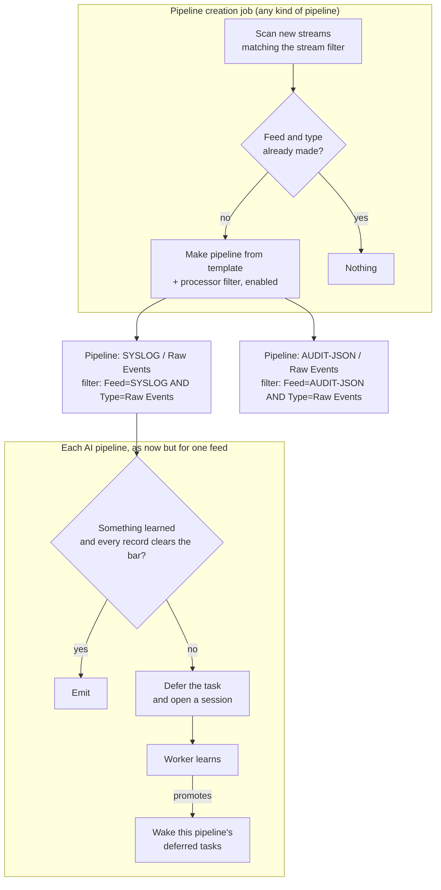

# Design 06 — Pipelines made for feeds: one pipeline per feed and type, made by a job

> **Archived.** This is the design as it was written and ruled, kept for its reasoning and history. The current design is [the design set](../README.md); code comments that cite this document by number and section still resolve here.

*Drafted and ruled 2026-10-07. The ten questions of §8 were put with recommendations. Eight
recommendations were taken; on Q6 the owner ruled that a Pipeline Factory offers every processor filter
setting, and on Q8 that the process header drops its first stage. The rulings are A103–A112 in §10. A113 to A117
were added after them, from the owner's points on naming, the key and the Supervisor, and A118 to A123
from the gaps of §9.*

---

## 1. What is wrong now

One supervising pipeline, with one processor filter, takes every stream the document is pointed at.
Inside it the stage resolves each stream to a shape (a feed and type by default, A49), routes the shape
through the document's own table of rules (A22) and runs the learned fragment for it as a nested
pipeline (A20). Every feed the document learns is processed by that one filter.

That puts the learned pipelines outside everything Stroom uses to control processing:

| Control | Where Stroom keeps it | What a learned shape gets |
|---|---|---|
| Enabled or paused | The processor filter | Only all-or-nothing, over every feed the filter takes |
| Priority | The processor filter | One priority for every feed |
| Maximum processing tasks | The processor filter | One limit shared by every feed |
| Node group and time periods | The filter's processor profile | One profile for every feed |
| Run-as user | The processor filter | One user for every feed |
| Progress, tracker, task counts | The processor filter | One set of figures for every feed |
| Reprocessing | A filter over a pipeline | A reprocess filter the stage builds itself |

It also makes the deferred-task budget unsolvable (ISSUES item 1). Task creation bounds itself on a
filter's `CREATED` tasks. Counting `DEFERRED` ones as well would let one feed's learning session stall
creation for every other feed on the filter, so they are not counted, and the deferred population is
bounded only by what arrives. Every stream of every unlearned feed becomes a deferred task row.

And a person has two routing systems to understand: Stroom's processor filters, which decide what
reaches the supervising pipeline, and the document's Route tab, which decides what happens inside it.

**None of this is a bug in the stage.** It follows from making one pipeline stand for many feeds.

---

## 2. The proposal

Split the work in two.

1. **A general feature that makes pipelines for feeds**, with nothing to do with AI. A job finds
   streams matching a stream filter, picks out the feed and type combinations it has not met, and for
   each one makes a pipeline from a template and a processor filter for it, enabled, with default
   settings taken from its configuration. It could make any kind of pipeline.
2. **AI translation becomes one kind of pipeline it makes.** An AI translation pipeline serves exactly
   what its processor filter gives it: one feed and type. It defers, learns, scores and serves as now,
   but it has no shapes and no routing table. The pipeline is the unit of learning.



What a person sees after it: a folder of ordinary pipelines, one per feed, each with an ordinary
processor filter they can pause, prioritise, put on a node group or reprocess, and the Supervisor
listing the AI ones with their learning state.

---

## 3. What the job does

### 3.1 Its document

A new document type, the **Pipeline Factory** (A103), holds one factory's configuration.

| Setting | What it is |
|---|---|
| Stream filter | An expression over meta, e.g. `Type = Raw Events`, saying which streams it looks at |
| Key | The meta fields that make one pipeline: `Feed` and `Type` by default; `Feed`, `Type` and `Pipeline` allowed (A106, A119) |
| Template | The pipeline every made pipeline inherits from |
| Folder pattern | Where a made pipeline goes in the explorer, e.g. `Feeds/${feed}` (A113) |
| Name pattern | How a made pipeline is named, e.g. `${feed} ${type}` (A113) |
| Element property patterns | Values the factory writes onto elements of each made pipeline, with the key's values substituted, e.g. the AI element's folder and name for what it learns (A113) |
| Run-as user | The user the job makes documents as, and the filters it makes run as (A123) |
| Filter settings | Every setting a processor filter has that is not about one filter's identity (A108): priority, maximum processing tasks, processor profile (its node group and time periods), minimum and maximum meta create time, maximum task creation delay, enabled |
| Enabled | Whether the job runs this factory at all |

### 3.2 Finding new combinations

The job keeps a high-water mark of meta ids per factory, as a processor filter's tracker does. Each run
reads the distinct key values among streams above the mark that match the stream filter, in batches,
and moves the mark on. This is incremental and cheap, and never rescans the whole meta table.

A new factory starts from the beginning of the stream table, so it meets every combination already
held that its stream filter matches. That is the point on a store being brought under factories, and
too much on one where only new feeds should get pipelines: a `Create Time` term in the stream filter
bounds both what the factory looks at and what the filters it makes process, so the two cannot disagree.

It runs as a scheduled Stroom job on one node at a time, under a cluster lock, so two nodes never make
the same pipeline twice. A unique key on the record of what was made backs that up.

### 3.3 What it makes

For each new combination:

- **A pipeline** in the folder and under the name its patterns give, whose `parentPipeline` is the
  template (A105). It holds nothing of its own beyond the element property values the factory
  substitutes (A113). Every other change to the template reaches every made pipeline.
- **A processor filter** on that pipeline whose expression is the factory's stream filter `AND` the
  key's values, e.g. `Type = Raw Events AND Feed = SYSLOG`. Its settings are the factory's filter
  settings, as written there.

### 3.4 What it remembers

One row per combination: factory, key values, the pipeline made, the filter made, when, and a state.

- **A made pipeline a person deletes is not made again.** The row stays and says so. The factory's
  screen offers *forget*, which lets the next stream of that combination make it afresh.
- **A filter a person pauses stays paused.** The job never touches a pipeline or filter after making
  it. From then on they are a person's to change.

### 3.5 Its screen

The document's settings, and beneath them the combinations it has made: key values, links to the
pipeline and filter, when, and state, with *forget* on a row.

---

## 4. What the AI pipeline becomes

### 4.1 The template

The AI translation template is a pipeline holding the Shapeshifter AI element first, pointed at a
Shapeshifter AI document, and the usual writer and destination after it:

```
Source → Shapeshifter AI (parser) → XMLWriter → StreamAppender
```

The Shapeshifter AI element is a parser-category element, so it takes the raw stream straight from the
source. The parser, text converter and XSLT it learns are **not** elements of the made pipeline: they
live in the fragment the element runs inside itself (A107). So inheritance has nothing to reconcile
with learning. The made pipeline inherits the chain above unchanged, and what is learned for its feed
is a separate fragment pipeline with its own text converter and XSLT, which the element's record
points at by snapshot (A61). A change to the template, such as a different destination, reaches every made
pipeline without touching anything learned.

**Where learned content goes** is the element's to know, through two properties: the folder and the
name for what it learns. The factory writes them onto each made pipeline from its patterns (A113), e.g.
folder `Feeds/${feed}` and name `${feed} ${type} learned`, so a feed's pipeline, fragment, text converter
and XSLT sit together and sort together, the fragment told from the pipeline by its name. A pipeline made
by hand sets them by hand. Where they are unset, learned content goes beside the pipeline under the
pipeline's name with ` learned` after it (A133). This replaces the fixed
`Shapeshifter/<document name>` folder and the `<shape>-<time>` names the stage uses now. The document stays what it
is: settings shared by every pipeline made from the template. The flow, scorers, budgets, model and
instructions are written once.

### 4.2 The unit of learning is the pipeline

Every runtime table is keyed today by document and shape (`doc_uuid, shape_hash`). It is keyed instead
by the pipeline the stage runs in (A104). A pipeline has one record of what it has learned, one
attempt at a time, one corpus, one regression set and one set of snapshots.

**There are no rules.** A rule was a selector binding a shape to a fragment, and with one pipeline per
filter there is nothing left to select. What remains of the rule and the shape's state is one
**record per pipeline and element** (§4.7): its learning state, the snapshot that serves it if
anything has been learned, the snapshot awaiting review if one was drafted, its rolling score and the
mark that sends it back to be learned. Today's rule table and shape table become that one table.

The stage no longer computes a shape. It does not need to know what feed it serves, except to show
the model the feed and type it is learning, which it reads from the stream's meta as now.

### 4.3 What goes

- **The Route stage**: the document's rules table and every notion of a rule, the learning key, `Shape`, the reserved rule
  (A22, A29). A pipeline's filter is its route. A reserved shape becomes a paused or deleted filter.
- **The claim per shape** becomes the claim per pipeline.
- **The wake by feed and type** becomes the wake by pipeline: on promotion, move the `DEFERRED` tasks
  of every filter on the pipeline back to `CREATED`. A pipeline may have more than one filter, such as
  a reprocess filter beside the one the factory made, and they share the element's record. This is
  simpler than the present wake.
- **The stage's own reprocess filter** (`PipelineReprocessing`) becomes an ordinary reprocess filter on
  the pipeline, made the same way a person makes one.

### 4.4 What stays

Deferral as a task status (A59), the session and worker, the learning flow, scoring and the record bar,
the corpus, snapshots (A61), the Supervisor, grants and the exhaustion step. All of it is unchanged in
what it does. Only its key changes.

### 4.5 The task budget, settled

With one feed per filter, deferred tasks can count against the filter's budget (ISSUES item 1). While
a session learns, the filter creates up to its limit of tasks, they defer, and creation for that feed
pauses until the session promotes or someone acts. No other feed waits, because no other feed shares
the filter. The deferred population is bounded by the number of AI pipelines times their limit.

The count changes for every filter in Stroom (A109), but only AI pipelines defer, so for every other
filter the number is the same as now.

### 4.6 What knows about what

Nothing outside the element knows a pipeline is an AI pipeline. The Pipeline Factory makes pipelines
from a template and knows nothing of AI. The processor runs the pipeline as it runs any other. A
pipeline is an AI pipeline only because its chain holds a Shapeshifter AI element, and that element
points at the Shapeshifter AI document for its learning and scoring settings. The one place the two
features meet is A113's element properties, which the factory writes as it would write any property.

### 4.7 The key (A114, A117)

A learning session belongs to **the pipeline and the element within it**: the made pipeline's UUID,
which the element already reads from `PipelineHolder` while it runs, and the element's id in the
chain. The pipeline is the one the processor filter runs, never its template. The element id costs
nothing and keeps a pipeline with two AI elements possible, such as design 01's extraction stage
followed by a transformation stage.

The document is not part of the key. It is the settings a session ran under, recorded on each
attempt. A person who points a pipeline's element at another document keeps what was learned.

The record for the pipeline and element is written the first time the element meets a stream. No
record means nothing has been learned and no session has been opened: the element writes the record,
defers the stream and opens the first session. Until then the Supervisor shows nothing for
that pipeline. A made pipeline that has not yet met a stream shows on its factory's screen and in the
processing screens.

---

## 5. What a person sees

| Before | After |
|---|---|
| One supervising pipeline and filter | One pipeline and filter per feed, in a folder |
| Route tab: a table of shapes and rules | Gone. The factory's list of what it made, and the filters |
| Pause one feed: not possible | Pause its filter |
| Feed priority, node group: not possible | Its filter's settings |
| Supervisor: attempts, shapes, serving rules and backlog side by side | Supervisor: pipelines, then their sessions, then one session's flow and transcript (§5.1) |
| Process header: Route, Score, Learn | Score, Learn (A110) |

### 5.1 The Supervisor (A115, A116)

Three levels, each a pane, master to detail, top to bottom:

```
+-------------------------------------------------------------------------------------------+
| Learning pipelines                                       [relearn] [guidance] [improve]   |
| Pipeline (link)      | Document | State             | Serving      | Waiting | Last session|
| SYSLOG Raw Events    | Syslog   | Serving           | snap 14, 0.94|       0 | 2 days ago  |
| AUDIT-JSON Raw Events| Audit    | Waiting for person| -            |     212 | 3 hours ago |
+-------------------------------------------------------------------------------------------+
| [Sessions] [Waiting streams]                  [approve] [reject] [grant] [exhaust]        |
| Started   | Ended     | Outcome             | Turns | Tokens | Time  | Granted            |
| 10:02     | -         | Parked: out of tokens|   23 | 40,000 | 6m    | -                  |
| yesterday | yesterday | Promoted, snap 3    |    11 | 12,500 | 2m    | -                  |
+-------------------------------------------------------------------------------------------+
| Learning flow, path drawn       | Transcript                                              |
|   [Start]                       | 1  Chain   asked ...   answered ...   passed            |
|      |                          | 2  Parse   asked ...   answered ...   0.41, re-asked    |
|   <Parse>--re-ask               | 3  Parse   asked ...   answered ...   0.88, passed      |
|      |                          | ...                                                     |
+-------------------------------------------------------------------------------------------+
```

- **Learning pipelines.** One row per pipeline and element that has ever learned. Its state is one of
  learning, waiting for a person, serving, given up, or learning off. Beside it are the serving
  snapshot and score, the streams waiting, the oldest wait if raised (A57), and when it last learned.
  Pipeline-level actions sit here: relearn, guidance, improve, give up.
- **Sessions,** for the selected pipeline: every attempt, current and historical, newest first. The
  session-level actions sit here: approve, reject, grant, exhaust. A second tab beside it lists the
  pipeline's waiting streams, which is today's backlog pane narrowed to one pipeline.
- **The selected session:** the learning flow with the session's path drawn over it (A88), and the whole
  conversation as a transcript, turn by turn. Clicking a turn lights its step on the chart. Clicking a
  step scrolls the transcript to its turns.

What goes: the ledger of shapes and the serving rules pane, since each is now a column of the pipeline
row; and the five-pane layout.

---

## 6. The costs, stated

- **One processor filter per feed, and one small pipeline beside the fragment.** The documents are not
  new: learning was always per feed and type, and each already gets its own fragment pipeline and
  stylesheet (A58). What is new is a filter per feed where there was one in all, and a made pipeline
  per feed that inherits everything and holds nothing. Task creation already walks every enabled
  filter, and installations with hundreds of filters exist. The real-scale trial (ISSUES item 11)
  should still watch the filter count.
- **The runtime tables are rekeyed.** Their migrations are on this branch only and not released, so
  they are rewritten rather than migrated (A111). A development database drops the tables and their
  Flyway rows.
- **Scenario tests churn.** Every scenario builds a stage for a document and feeds it streams of
  several shapes. Each becomes a stage per pipeline. The production path the scenarios now share
  (A99) makes this mechanical rather than a redesign.
- **Two factories may make two pipelines for one feed.** That is sometimes what is wanted, e.g. a raw
  store and an AI translation. The factory does not look at pipelines it did not make.

---

## 7. The plan, in phases

Five phases, each cut into slices that build, pass checkstyle and their tests, and can be audited and
committed alone. Phase I touches nothing of the AI work and can be committed before J begins. Phase K
must not land before J: counting deferred tasks while one filter still serves many feeds brings back
the stall of design 04 §5.2.

### Phase I — The Pipeline Factory *(new modules; nothing about AI)*

New modules beside the others of their kind: the document and its resource in `stroom-core-shared`,
the store, job and service in a `stroom-pipeline-factory` implementation module, and its table in a
matching `-impl-db` module with its own Flyway migration and jOOQ code.

1. **The document and its store.** `PipelineFactoryDoc` with the settings of §3.1, its serialiser,
   store, import and export, and explorer registration. Unit tests for the document's round trip and
   its validation: a template that is not a pipeline, a key field a processor filter cannot query
   (refused on import, A119), a pattern naming a field the key lacks.
2. **Making one pipeline.** Given a factory and one set of key values, make the folder, the pipeline
   inheriting the template with the substituted property values, and the processor filter with the
   factory's settings and the combined expression. Reuse `ExplorerService`, the pipeline store and
   `ProcessorFilterService.create`. Tests against the database for the documents and filter made,
   their names and places, and a name a key value would make unreadable. The documents are made as the
   factory's run-as user (A123), and a test shows a user without permission on the folder makes nothing.

   *Built 2026-10-07.* `PipelineMaker` makes the folder, the pipeline and its filter as the run-as user.
   It refuses a property on an element the merged template lacks, or one that does not take text,
   before anything is made. If the processor refuses the filter, for example an AI template on a node
   that does not claim its own tasks, it deletes the pipeline again so a retry makes one, not two. A
   `Pipeline` key is matched by UUID and named by the pipeline's name. The application's integration
   tests run under a security context that allows everything, so the run-as refusal is shown by a
   unit test with a mocked context instead.

   *Audit, 2026-10-07.* The template was read only when the factory wrote properties, so a factory
   without them would have made a pipeline inheriting nothing. That was caught only by accident, by the
   processor's own check on supervised pipelines refusing the filter. The maker now reads and merges the
   template before making anything, and a missing one is refused with its name. Left as they are: a key
   value holding `/` makes nested folders, and a name a person already used in the folder is used again,
   since the explorer allows it and the factory's own record (slice 3) stops it repeating itself.
3. **What it remembers, and the job.** The table of §3.4 with its unique key, the meta-id high-water
   mark, the incremental scan of §3.2, and the scheduled job under a cluster lock. Tests: a second run
   makes nothing twice, a deleted pipeline is not made again, *forget* lets it be made afresh, a
   creation that fails (a permission, a template deleted) is recorded and retried on the next run.

   *Built 2026-10-07.* The `stroom-pipeline-factory-impl-db` module holds two tables: one row per
   combination a factory has met, and one per factory for the highest stream id it has read. A
   combination is stored as JSON with its fields in name order and found by the SHA-256 of that text,
   so the order a key lists its fields in does not matter. The job, *Pipeline Factory*, runs every minute
   under a cluster lock. For each enabled factory without problems it retries what it could not make,
   then reads new streams as the run-as user, a batch at a time in id order. It reads unlocked and
   locked streams, but not deleted ones. A combination is recorded as met before its pipeline is made,
   and the place in the stream table moves on only after a batch's combinations are recorded, so a run
   stopped part-way loses nothing. A failure waits `retryFailedAfter` (ten minutes) before it is tried
   again, since a failure such as an AI template on a node that does not claim its tasks would otherwise
   make and delete the same pipeline every minute. A factory new to a large store reads its history over
   several runs, `maxScanBatchesPerRun` batches of `scanBatchSize` streams at a time. *Forget* deletes the
   row, so the combination's next stream makes its pipeline afresh; streams already read before then do
   not.

   *Audit, 2026-10-07.* Deleting a factory left its rows for ever; the store now forgets a deleted
   factory's record and place, and leaves the pipelines it made, which are a person's. The scan's
   correctness rests on the stream search sorting by id, since the place moves to the highest id read; it
   does, and a test now pins the sort and the batch size. Left as they are: a stream the run-as user
   cannot see is passed over for good, so a feed it is later given meets the factory with its next
   stream; a pipeline made but not recorded, because the database failed between the two, is made
   again on the retry; and a copied factory has a UUID of its own, so it meets every combination
   afresh and makes its own pipelines.
4. **Its screen.** The document's settings tab, using the standard expression editor and document
   pickers, with a key picker offering only the fields a processor filter can query (A119), and the list of combinations made with links and *forget*. `gwtCompile`.
5. **Audit and walkthrough.** A factory over `Raw Events` with an ordinary template makes a pipeline
   and filter per feed as data arrives, and each processes.

   *Built 2026-10-07.* The exit is shown end to end by `TestPipelineFactoryPipelinesProcess`: a factory
   over raw events, with `Source → XMLParser → XMLWriter → StreamAppender` as its template, meets two
   feeds, makes a pipeline and filter for each, and the tasks those filters create run each feed's
   streams through its own pipeline to events, without error and without crossing feeds. What remains of
   phase I is a person doing the same from the user interface (ISSUES item 19).

   *Built 2026-10-07.* The document opens on five tabs. **Settings** holds whether the factory runs, the
   key as a tick box per field a filter can sort by, the template, the folder and name patterns, the
   run-as user, the stream filter in the standard expression editor, and the property values as a table
   with an edit dialog. What is wrong with the factory is shown above the form as it is edited, from
   the same checks the store refuses a save with. **Filter** holds every filter setting, laid out as
   the processing screen lays out a filter. **Made** lists every combination met, newest first: its
   values, whether its pipeline was made and is still there, the pipeline, tries, when, and why the last
   try failed. It opens a pipeline and forgets a combination, warning that a pipeline still there will
   be joined by a second. Then **Documentation** and **Permissions**. Two resource calls serve the Made
   tab: the list needs VIEW on the factory and forgetting needs EDIT. The icon is a green box sending out
   three blue arrows. Regenerating the icon enum drops `DOCUMENT_DATA_GEN`, an entry master added to
   the generated file by hand, so the factory's entry was added as the generator writes it and nothing
   else was regenerated.

   *Audit, 2026-10-07.* A tab marks its document changed by comparing what it would write with what it
   read, and a reference compares by UUID alone, so a template renamed since the factory was saved does
   not mark it changed when the picker shows the new name. A factory saved with an empty stream filter,
   rather than none, did: the tab wrote none in its place. It now keeps whichever the document had. Left
   as they are: the Made tab shows a `Pipeline` key's value as the pipeline's UUID, since that value is
   also what forgetting the combination sends; and the expression editor has no read-only form, so a
   person who may only view a factory can change its stream filter on screen, though not save it.

### Phase J — The AI element keyed by pipeline *(the feature)*

The largest phase. Its slices keep the build and the scenarios green at each step.

1. **The key moves under the stage.** Every runtime table's `(doc_uuid, shape_hash)` becomes
   `(pipeline_uuid, element_id)`, with the document recorded on the attempt (A114). The migrations are
   rewritten (A111) and the jOOQ code regenerated. They are renumbered for Stroom 8.0 as they are
   rewritten: the branch targets 8.0, and the twenty it carries are numbered `V07_13_00_*`. The Pipeline
   Factory's own migration is `V08_00_00_001__pipeline_factory.sql`. The stage takes its key from `PipelineHolder` and the
   element. The scenario fixture gives each scenario's feed its own pipeline. Shapes still exist in the
   code but are now one per key, so behaviour is unchanged and every scenario must pass unaltered in
   what it asserts.
   *How, decided 2026-10-07 on reading the code.* The stage's state is reached through eleven seams, each
   with an in-memory form, a database form and, for two, a cache in front. Those keyed by a document and
   a stream — an attempt's claim, and a deferred stream — are keyed instead by a **learner**. A learner is the pipeline and the element (A114),
   and carries the document it runs under for the rows that record it, though the document is not part
   of what it is. *Rules* and *shapes* stay the document's in this slice, since slice 2 replaces both
   with the learner's record, and rekeying them first would be done twice. So does what hangs on a shape
   rather than a stream — the ledger of a given-up shape's streams, a person's guidance about a shape,
   and a rule's outputs — since the actions on them (approving a draft, rejecting it, learning a shape
   again, saying something about it) name a document and a shape and no stream, and would otherwise have
   to look a learner up from a shape; slice 2's record carries the learner and ends that. While shapes
   remain, each of a document's feeds and types is one learner, so the two keys cannot disagree. *Spend* stays the
   document's for good: a budget is the document's setting, counted across the cluster (A44). The document stays on the rows the Supervisor filters by
   what a person may read, and that the Route tab lists, until phase L. The twenty migrations become one,
   `V08_00_00_001__shapeshifter_ai.sql`, written as the schema now stands with the learner's columns in
   place of the document as key; and `shapeshifter_feed_state`, which nothing has read or written since error
   mode went (A57), is left out. The element knows its learner from `PipelineHolder` and its own id, and
   passes it to the stage's `decide` and `stream`; the worker reads it from the attempt's row.

   *Built 2026-10-07.* `Learner` is the pipeline and element and nothing else; an attempt and a
   deferral record the document beside it. A claim is unique per learner and shape, and a deferral per
   learner and stream. What a promotion wakes is still read by document, feed and type, since a
   document's shapes are still its own. `improve` begins from a rule and no stream, and claims the
   shape as the learner of the newest attempt on it (`Attempts.learnerOf`); slice 2 gives the record its
   learner and removes that. The scenarios run as one fixed learner, which changes nothing while shapes
   remain, since claims and deferrals are per shape and per stream. A development database migrated
   under the old numbering must drop the Shapeshifter AI tables and `shapeshifter_ai_schema_history`
   before it starts on this, since Flyway finds the old versions gone.

   *Audit, 2026-10-07.* Every path that runs the element sets the pipeline it runs in — processing,
   stepping, reprocessing, headless translation, data preview — so an element always has its learner.
   One thing is not as it was. A claim was unique per document and shape, and is now per learner and
   shape, so two pipelines running under one document that meet the same feed and type could each learn
   it at once, where before the second waited. Neither the supervising pipeline of old nor the factory's
   pipelines, one per feed, can do that; a person copying a supervised pipeline could. Until slice 2 the
   two would write rules into one document's table, the newer winning. Slice 2's record, per learner,
   makes them two learners with a record each.

2. **Routing goes, then the rekey (A124, A125).** Cut on 2026-10-07 into two slices, routing first,
   since once nothing selects a rule a rule is just the binding a document's shape is served by, and
   what is left to rekey is then (document, shape) to (learner, shape) throughout, as mechanical as
   slice 1.

   *2a, routing.* The router and the selector go: a stream is served by its shape's serving binding,
   the non-draft rule whose shape is the stream's — the older, where two pipelines under one document
   have each bound it (slice 1's audit), until 2b keys rules by learner. A rule written by hand, a reserved rule, the
   order of the table and the learning key go with them, a shape being a feed and a type until slice 3
   removes it. The resource's add, edit, move and delete of a rule go, and with them the Route tab,
   which held nothing else but the learning mode, the learning key and the maximum deferral age:
   phase L's first slice is done here, the learning mode and the deferral age moving to the Learn tab
   (A118) and the process header showing Score and Learn (A110).

   *2a built 2026-10-07.* A shape's binding is its non-draft rule, or failing that its draft. Binding by
   looking (design 01 §6) — trying a fragment learned for a neighbouring shape before asking the model —
   goes with routing: a shape is a feed and a type, so there is no neighbour, and every rule of the same
   feed and type is the shape's own. So the variant trial goes from the decision and from stepping, a
   relearning no longer asks whether its fragment is shared with another rule, and a dry run's *would*
   names no candidate fragment. With learning off, a stream nothing serves waits for a person. The rule
   table loses its order and its selector, in the rewritten `V08_00_00_001` migration, so a development
   database must again drop the Shapeshifter AI tables first. Retired with what they exercised: design 02
   scenarios 25 (a binding fits a new shape) and 26 (a reserved rule), scenario 56's shared fragment, the
   stepped variant, the signature-keyed shape of 43, and the reserved cases of retracting and the
   Supervisor's list. The demo content pack is regenerated, its document no longer carrying a learning
   key.

   *A race found on the way.* Test B (many streams, many threads) failed on every run, with a third
   learning event where two were scripted. Its cause is in J1's code as much as this slice's; this
   slice's timing made it certain. Two windows let a stream judged against the transform a relearning
   was replacing mark the shape for relearning *after* the relearning had spent the mark: between the
   mark being spent and the rebinding, and after the rebinding by a stream that had read the rule before
   it. The mark then outlived the promotion, and the next stream the new transform served cleanly opened a
   relearning of a shape just learned, and asked the model for it. Fixed three ways. A relearning spends
   the mark again once its rebinding is in force. A stream whose judgement was against a transform no
   longer in force neither marks the shape nor opens a session: it waits against the stamp it failed.
   And, since that row is written after the promotion's wake, and its task is deferred after that, the
   learning job's pass now wakes every row waiting against a transform no longer in force
   (`Stage.wakeSuperseded`, over `Deferrals.documentsWaiting`). The pass reads every waiting row of every
   document with one, which slice 4's wake by pipeline should revisit. Scenario 56 has the
   mid-run promotion as a regression test, and test B passes on repeated runs.

   *2b, the rekey.* Rules, shapes, the ledger, guidance, outputs, the corpus and snapshots are keyed by
   learner and shape, as attempts and deferrals already are; `Attempts.learnerOf` and waking by
   document go. The document resource's `rules`, `approveRule` and `rejectRule` go too, ruled on
   2026-10-07 at 2a's audit: nothing calls them once the Route tab has gone, the Supervisor approving and
   rejecting through the attempt, and phase L reads the learner's record if its screens need it. With slice 3 removing the shape, the shape's row becomes the learner's record (A117,
   A124), pointing at its serving binding and any draft.

   *2b built 2026-10-07.* Rules, shapes, the ledger and guidance are the learner's: their rows carry
   the pipeline and element as their key, and the document beside it for the Supervisor's lists and its
   permissions. A rule's uuid names it across every learner, so an action that
   begins from a rule — approve, reject, accept, retract, improve — reads its learner from the rule's
   row and refuses one of another document; `Attempts.learnerOf` is gone. Until slice 3 removes it, a
   `Shape` carries its learner, which is what kept the stage's change to the places a shape is made.
   The Supervisor's rows carry the learner (`LearnerRef`), and a request about one — guidance, learning
   a shape again — sends it back. A promotion wakes its learner's streams of the feed and type. The
   ledger replays a released stream through the learner's pipeline, which is the one that sentinelled
   it. The rule and shape caches are keyed by learner and cleared across the cluster by an entity event
   of their own type naming the pipeline, since a `CLEAR_CACHE` on the pipeline's own type would clear
   every node's merged pipeline data. The document resource's rule endpoints go (ruled at 2a's audit), and
   with them the import of rules a document carried before A41, which named no learner and had nowhere
   to go: such a document reads without them. The rule table names its fragment `fragment_*`, its
   `pipeline_uuid` now being the learner's; the deferral index by document, feed and type becomes one by
   document. A development database must again drop the Shapeshifter AI tables first.

   *2b audited 2026-10-07.* Two gaps closed. A Supervisor request names its learner and its document
   separately and is permitted on the document, so the learner is now held to it: the pipeline, read as
   merged, must name that document on the element (`LearnerDocuments`), or guidance, learning a shape
   again, and amending or relearning an attempt are refused — before, a person who could edit one
   document could act on another's learner by naming it. And a pipeline pointed at another document
   takes what it learned with it: the task decision brings every row of the learner (bindings, shapes,
   ledger, guidance, deferrals) to the document it runs under (`Learners`), once per learner per node
   until it moves again, where before only a row rewritten since moved, leaving the new document's
   Supervisor blind to what served its pipeline and the old one's editors able to retract it. Attempts
   stay with the document they learned for, as history; an attempt opened before the move and carried
   on by the worker after it writes under the old document until the learner is next brought, which
   slice 3's record, read from the learner rather than the attempt, removes.

   The text of the original slice 2 follows.

   **One record, no rules (A117).** The rule table and the shape table become the element's record.
   The routing table, the reserved rule and the selector code go, and the learning key leaves the
   document; its serialiser drops the old key on read. The deferral, snapshot and wake read the record.
3. **`Shape` goes.** The stage stops computing one. What the model is shown of the feed and type comes
   from the stream's meta. The claim is the key.

   *Built 2026-10-07, as one slice.* `Shape` is gone, and with it every key that was a shape. The shape
   table becomes `shapeshifter_learner_state`, one row per learner (A117, A124): given up, marked to
   learn again, the draft awaiting review and the rolling score, behind `LearnerStates` (in memory, as
   rows, and cached). The binding that serves a learner is its one binding that is not a draft; the rule
   table keeps its bindings, without shape columns. The ledger and guidance are a learner's, and an
   attempt's claim is the learner's (`claimed`, unique with the learner while open). A promotion wakes
   every stream waiting on its learner.

   A learner does not know its feed (A126): a stream of any feed is scored against what serves, and
   nothing guards a pipeline fed several feeds by hand. The model is shown the stream's feed and type
   (`Sample.SHOWN`); an improvement, which has no stream, is shown the corpus alone. A fragment is named
   for the feed and type of the stream it was learned on until slice 5 names it for its pipeline. The
   Supervisor's rows and requests name the learner and no shape (A128): `LedgerLearner` and
   `LearnAgainRequest` replace `LedgerShape` and `LearnShapeRequest`, the attempt list's shape column
   and filter go, and the stage pane shows the stream's feed and type. The scenarios that passed several
   feeds through one learner now give each feed its own (A127). The demo content pack ships a pipeline
   and a processor filter per feed, as the factory would make them, and is regenerated. A development
   database must again drop the Shapeshifter AI tables first.

   Left for slice 7's audit, which searches for every remaining shape and rule: the names `RoutingRule`,
   `Rules` and `shapeshifter_rule` for what are now bindings, `ShapeSignature` and `RoutingFields`'
   signature field, the document's `minRecordsPerShape` and the `shapeCache` setting, and test names
   that still speak of shapes.

   *3 audited 2026-10-07.* Three faults closed. An improvement has no stream, so after this slice it
   kept what it learned for on no feed: a node's corpus is a stream on the source feed, and the write
   would have failed or landed nowhere — the scenarios' corpus took any feed, and the node's mock store
   any too. The corpus now says which feed a rule's records are kept on (`RegressionSet.feedOf`), an
   improvement keeps its records there, and both corpora refuse a record kept on no feed. And two older
   faults, found on the way, that left a draft nothing awaited: retracting the binding a draft would
   replace, or accepting or promoting a provisional one, reset the learner's state and with it the
   pointer to the draft awaiting review; and a stream the incumbent fell short on while a draft awaited
   opened a second relearning behind the person reviewing, whose reset did the same. Either way the
   draft went on serving the learner's streams a wait that approve and reject both refused to end. A
   reset that decides nothing about a draft now keeps it awaiting, and such a stream waits for the
   review, as a marked learner's streams already did.
4. **The wake by pipeline, and the stage's reprocess filter retired.** The wake moves every filter's
   deferred tasks on the pipeline (§4.3). `PipelineReprocessing` goes; reprocessing is a person's
   reprocess filter on the pipeline, and a scenario proves a reprocess filter's deferred task wakes.
   Stepping the pipeline reads the record and writes nothing (A121), with a test.

   *Built 2026-10-07.* A wake names a pipeline (`Wake.wake(pipelineUuid)`), and the processor wakes the
   deferred tasks of every filter on it (`ProcessorTaskService.wakeDeferredTasks(pipelineUuid)`, which
   replaces the filter and stream ids): the live filter's and any reprocess filter a person made, which
   an app scenario shows promoted together. The stage asks for nothing to be reprocessed (A129):
   `Reprocessing`, its in-memory form and `PipelineReprocessing` are gone. Promotion and approval clear
   the learner's ledger and wake its pipeline. Learning again and retracting return how many streams a
   person has to reprocess, and the Supervisor's prompts say so instead of promising a reprocess. The
   learning job's sweep reads distinct learner-and-transform stamps (`Deferrals.stampsWaiting`) and
   wakes each pipeline with a stream waiting on a replaced transform once (A130); a learner behind a
   draft, or with nothing serving it, is left. A step was already a dry run; a test now holds it to
   moving no rows to the document it is stepped under, adding nothing to the rolling score, and leaving
   no state, deferral or wake.

   The mock harness's wake needed one thing the table has for free: the mock queue makes each task
   from a filter's tracker and stores none, so the mock task DAO now keeps the deferred ones it is told
   of until they are woken, and the waking task service winds each filter's tracker back to the oldest
   stream woken on it.

   *4 audited 2026-10-07.* The ledger is gone (A131). Since A129 it had nothing left to do, and the audit
   found it doing harm. The worker wrote rows for streams it had only read back out of the store while
   their own tasks waited, so a person sending a learner back would have been told to reprocess streams
   that would also run of themselves. The draft's "Awaiting review" row named a stream that was deferred,
   not errored. A learner sent back from the attempt list kept its rows, and its next promotion cleared
   them unread, now that a promotion no longer reprocessed them. What it held is held elsewhere: every
   session, successful or not, is an attempt; a person sends a learner back from the attempt; and the
   streams that errored are the pipeline's error streams, reprocessed with a reprocess filter like any
   others. The `Ledger` seam, its table, its in-memory form, the Supervisor's ledger panel, its two
   endpoints and `LedgerLearner` and `LearnAgainRequest` go; the table is taken out of the unreleased
   migration, so a development database must again drop the Shapeshifter AI tables first. A sentinel is
   an error stream and nothing more.

   Three faults closed on the way. A give-up below the promotion floor did not wake the learner's
   pipeline, as the flow's give-up does, so its waiting streams sat until the retry delay; it wakes now.
   The in-memory learner states made a row on every read, so a test could not tell a read from a write.
   And the mock task DAO now keeps the deferred tasks of the mock queue, which stores none, so that the
   app harness can wake a pipeline. Left for slice 7: a deferral's `task_id` and `filter_id` are written
   and no longer read, since the wake names the pipeline.

   The removal audited the same day. The tests whose ledger assertions went were read for what they
   still prove; the dry run's disabled-document test had lost its point and asserts again that it writes
   nothing. A scenario now drives the one way back: a learner that gave up, sent back from its attempt,
   learns from the stream that errored when a person reprocesses it, and serves the next. Learn again's
   confirmation says what becomes of the streams that errored. Designs 01, 02, 03 and 04 mark where the
   ledger they describe is superseded by A131.
5. **Where learned content goes (A113).** The element's folder and name properties, defaulting to
   beside the pipeline under its name, replace the fixed folder and the timestamped names.

   *Built 2026-10-07.* The Shapeshifter AI element has `learnedFolder` and `learnedName` string
   properties, which a factory writes from its patterns as it would any property. The stage asks a
   `Places` seam where a learner's content goes. In a node `PipelinePlaces` reads the two properties from
   the learner's pipeline as merged, as `LearnerDocuments` reads its document, so the worker, which runs
   no pipeline, places content as a task would. Unset or blank, the folder is the pipeline's own and the
   name is the pipeline's. A pipeline that can no longer be read puts what a session learns in
   `Shapeshifter` under the pipeline's uuid. A new fragment is named once, and its text converter and
   XSLT take that name with the element id appended. A second fragment where the name is taken, a draft
   in review mode or a fresh learn after a retraction, takes the first free number after it (A132),
   which the content creator finds in the folder. A fragment rewritten in place keeps its name. The
   fixed `Shapeshifter/<document>` folder and the `<feed>-<type>-<time>` names are gone.

   *5 audited 2026-10-07.* Two faults closed. The default name was the pipeline's own, and the pipeline
   is in the folder, so every first fragment would have been numbered "… 2" beside a pipeline of the
   same name; the default is now the pipeline's name with ` learned` after it (A133), and §4.1's example
   follows it. And a folder the explorer cannot make — a pattern substituted with a name its folder
   pattern refuses — was found out only when the fragment was written, after the model had been paid:
   the session closed in error and the learner's next stream opened another, so a bad folder spent on
   every stream. The stage now makes sure of the folder before it opens a session, and a stream whose
   learner cannot be placed waits, saying why; the node remembers the folders it has made sure of, so
   a waiting backlog does not look again on every try. The fixture's creator holds folders to the
   explorer's pattern, so the scenarios meet the same refusal.

   Left as they are: two learners told the same place could, learning at once, both take the same free
   number, which the explorer allows and a person can rename; and a fragment rewritten in place puts a
   document for an element it did not have in the learner's folder as it is now, which differs from the
   fragment's own only if a person moves the folder by hand.

   Audited again the same day. One fault and two slips closed. Since the stage makes sure of a folder
   before a session opens, every task trying a new learner's streams does so side by side, and a folder
   has no unique name: two tasks could each make `Feeds/DOOR-ACCESS` before either saw the other's, and
   the explorer's own walk then fails for good on the twin, so the learner would have waited forever.
   The creator now walks the path itself, one walk at a time on a node, and where a folder has a twin
   takes the one with the lowest uuid, as every node would. The empty path, a pipeline at the top of the
   tree, walked a null part; and a `learnedFolder` of `Feeds//DOOR-ACCESS`, which a pattern substituting
   to nothing can leave, threw before the stage could say why. A folder is now taken as meant: parts
   trimmed, empty ones dropped, nothing left the top of the tree. The waiting reason quotes the failure,
   no longer assuming a bad name. Document names need no such guard: the explorer holds only folders to
   its name pattern.
6. **A deleted pipeline's learning.** Its record is marked deleted and its sessions age out under the
   retention job (A120, A134–A137).

   *Built 2026-10-08.* The mark is the pipeline's, one row in `shapeshifter_deleted_pipeline`, since a
   pipeline's deletion is every one of its elements' at once and a learner may have no state row to
   mark. Stroom's delete event for a pipeline reaches `PipelineDeletions` on every node, which marks the
   learning, where any is kept, and lets go of the streams waiting on it; the first mark's time stands.
   The deferred worker abandons an attempt of a marked pipeline before asking anything. The retention
   job marks the learning of every pipeline it keeps rows for that the store no longer lists, and, once a
   mark is older than attempts are kept, forgets the pipeline's learning in one transaction: state,
   bindings, guidance, waiting streams, attempts and turns, and the outputs, corpus and snapshots of its
   bindings. Learning kept for ever is marked and never forgotten. The fragments it wrote stay in the
   tree. The Supervisor's attempts filter and the serving list's toolbar have a "Show deleted pipelines"
   choice, off by default; a shown row says "pipeline deleted", every action on it is refused at the
   resource and not offered in the screen, and what was said to its learner opens read only, found
   through the document its bindings were kept under since the pipeline names none.

   *6 audited 2026-10-08.* Three faults closed. A pipeline imported from an export of it comes back under
   its uuid, and its learning stayed marked: the pipeline would have run while its sessions were
   abandoned, the Supervisor hid it, and the retention job forgot what it was learning. Stroom's create
   event now clears the mark, and so does the retention job for a marked pipeline it finds there again.
   The retention job marked every kept pipeline its one read of the store's list left out, so a list
   that came back short would have set live learning on the road to being forgotten; a pipeline the list
   leaves out is now marked only once a read of it on its own finds nothing. And that read: the
   database's store says not found by throwing, which the job had taken as not knowing, so in a node it
   never marked anything; the node test found it. A deleted pipeline's turn opens read only.
7. **Audit.** Including a search for every remaining use of shape, rule and learning key in the module,
   its tests, the shared model and the client.

   *Split 2026-10-08,* after the search found 485 uses of shape, 344 of routing and some 3,000 of rule:
   7a clears what is dead or misnamed — pinning (A138), `minRecordsToLearn` (A139), the shape signature
   as the record skeleton it now is, the unused shape cache setting, the deferral's task and filter
   columns nothing reads since A129, and the wording of shape, routing and learning key; 7b renames rule
   to binding (A140); 7c is the audit of the phase.

   *7a built 2026-10-08.* Pinning is gone (A138): the flag, its column, the stage's guards on improve,
   accept, approve, retract, relearning and the worker, the served path's pass-everything judge, and the
   Supervisor's warnings; the four scenarios about it go with it. The document's setting is
   `minRecordsToLearn`, "Minimum records to learn" (A139), and the committed demo pack is written again.
   `ShapeSignature` was a hash nothing read and the record skeleton target checks and sampling use; it is
   `RecordSkeleton`, without the hash. The stage built a routing attribute map for every stream only to
   give the model's sample its feed and type; the sample takes them from the stream, and the map,
   `RoutingFields` and the selector's signature field go. A stream no longer carries its task and filter,
   and a deferral row no longer records them: a wake names the pipeline (A129). The node's `shapeCache`
   setting was the learner state cache, and is named so. `TestScenariosReprocessing` is
   `TestReprocessingAsProcessed`, which is all it tests. The prose of shape and routing that remains sits
   beside the rule's names, and is swept with them in 7b, so that no file is reworded twice.

   *7a audited 2026-10-08.* One fault, older than the slice, closed. The first streams of a new learner,
   served at once, each found no state row and made it with `INSERT … ON DUPLICATE KEY IGNORE`, which on
   a duplicate takes a shared lock; the rolling score's `FOR UPDATE` then had each wanting the exclusive
   lock the others' shared locks refused, and the database killed one, erroring its stream. The many
   streams, many threads scenario met it once the app tests could run again. The row is now made with
   an update on a duplicate, which takes the exclusive lock at once, and a test scoring new learners from
   eight threads at a time fails without it. Two comments still described the shape signature as if it
   were there. A stored document's old `minRecordsPerShape` is dropped on reading, as every unknown
   property is, and the setting takes its default; nothing has been released with the old name.

   *7b built 2026-10-08.* What serves a learner is its binding (A140), in code, tables and screens.
   `RoutingRule` is `Binding`, `Rules` is `LearnerBindings` (its implementations `LearnerBindingsDao`,
   `CachedLearnerBindings`, `InMemoryLearnerBindings`), `ServingRule` is `ServingBinding`, and the
   stage's record of what produced an output, `Bindings` until now, is `Produced`. `shapeshifter_rule` is
   `shapeshifter_binding`, and `rule_uuid` is `binding_uuid` in every table that keeps it; the output
   stream's attribute is `ShapeshifterAiBinding`; the REST paths and JSON name a `bindingUuid`; the node's
   `ruleCache` setting is `bindingCache`. Business rules, extraction and transformation rules, and the
   numbered rules of design 01 §7.3 keep their word. The prose of rule, routing and shape was swept with
   the names, so that a comment says binding, learner or kind of record where it meant the retired
   routing table or shape.

   *7b audited 2026-10-08.* No fault. Nothing reads the old output attribute, no SQL or field name in a
   string still says rule, no committed API description names the old paths, and no doc link points at a
   class that has gone; every changed file is within the feature but the checkstyle allowlist and the
   expected configuration. The rule words that remain are business, extraction and transformation rules,
   the business rules scorer's outcome, and design 01's numbered rules. The rename had left `@param`
   descriptions out of line with their neighbours, and the record of what produced an output said the
   binding "matched", as a selector would have; both are put right.

   *7c, the phase audited 2026-10-08.* Every item a slice left for this audit is closed: the names of
   rule and shape (7a, 7b), the shape signature and `RoutingFields`, `minRecordsPerShape` and the shape
   cache, the deferral's task and filter, the reprocessing test's name and the unpin text (7a). The two
   left as they are in slice 5 stand. Designs 01 to 05 open with a note that phase J superseded their
   shapes, routing table, pinning and ledger and saying how to read them; `ISSUES.md` and the project's
   notes say learner and binding. A factory writes the element's placement through its property values,
   which its own test covers, and the element reads them merged; no one test yet runs the two together,
   which phase M's walkthrough does.

   One fault, older than the phase, closed. A processor filter is made as an import reads it, and its
   pipeline is checked for a supervised stage: the pipeline was read inside a guard, but its merge with
   the pipelines it inherits from was not, so an import that brought a filter before its pipeline's
   parent failed. `TestImportExportSerializer` met it once the whole of `stroom-app`'s tests were run;
   the check now takes a pipeline it cannot merge as not supervised, with a test of each case. The
   whole of `stroom-app`'s tests, and those of every other module the phase touched, pass.

### Phase K — Deferred tasks count *(`stroom-processor`; closes ISSUES item 1)*

1. **Task creation counts `DEFERRED` with `CREATED` (A109).** One change in
   `ProcessorTaskCreatorImpl` and its DAO count, with a test that a filter whose tasks are all deferred
   creates no more, and one that a filter with none deferred creates as before.

   *Built 2026-10-08.* `ProcessorTaskCreatorImpl` counts the tasks a filter holds — `CREATED` and
   `DEFERRED` — in one query, through a new `countTasksForFilter(filter, statuses)` on the task DAO that
   gives a count for each status. A filter's own allowance is spent by both: one whose tasks have
   deferred makes no more until a wake or the sweep returns them and they are processed, and a wake can
   no longer leave it far past its limit, since the tasks it returns were counted already. This is the
   stall design 04 §5.2 avoided, taken knowingly: with one filter per feed and type (A104) it holds back
   only the feed whose learner is waiting.

   *Audited 2026-10-08.* One fault closed, in the slice as first built. The run's budget is shared by
   every filter of a processing profile, and of no profile, and the slice spent it with deferred tasks
   too: a deferred task is no node's to claim, and one learner's backlog of them spent its profile's
   budget on every run, so the profile's other feeds were given no tasks — the opposite of A109's "no
   other filter's count changes". Only the waiting tasks spend the shared budget now; the deferred ones
   count against their own filter alone. The creator's test that encoded the fault now holds the
   opposite, and fails on the old accounting; the creator's tests show a filter at its allowance in
   deferred tasks making no more and one with none deferred going on, and the DAO's test counts each
   status asked for and no other filter's.

### Phase L — What a person sees *(the client)*

1. **The document's tabs.** The Route tab goes, and the process header shows Score and Learn (A110).
   The maximum deferral age moves to the Learn tab (A118). Wording that still says rule or shape
   changes, such as the Score tab's "Flag a serving rule below".
2. **The Supervisor's pipelines and sessions (A115).** The learning pipelines list and the sessions
   list beneath it, the waiting streams on a second tab, and each action moved to the level it acts on.
   The resource's endpoints take the key instead of document and shape. ISSUES item 11's paging is done
   here, in the database, now that the list is per pipeline.
3. **The session's flow and conversation (A116).** The transcript reading down beside the chart, each
   choosing the other. ISSUES items 6 and 9 are fixed here: the exhaustion mark on a session, and a
   multi-part step lit only when its last unit passes.
4. **The grant dialog.** ISSUES item 5, on the ruling ISSUES item 17 owes.
5. **Audit.** `gwtCompile` and a look in the browser.

   *L1 was built in phase J* (slices 2a and 7b): the Route tab is gone, the process header shows Score
   and Learn, the deferral age is on the Learn tab, and the wording says binding. *L2 is cut in two,
   2026-10-08:* 2a the server — the learning pipelines as a page read in the database (ISSUES item 11),
   a pipeline's sessions and waiting streams by its learner, and a person giving a learner up; 2b the
   client, the three levels on that (A141–A143).

   *2a built 2026-10-08.* The learning pipelines are a page read in one statement (`LearningPipelinesDao`,
   in memory `InMemoryLearningPipelines`, held to one answer by an agreement test): a learner is any
   pipeline and element with a state, a binding, a session or a waiting stream, its document the one its
   state, bindings or waiting streams record, else its latest session's. Its state is read in the query,
   in the order given up, learning off, waiting for a person (a draft awaiting review, or a session
   parked or awaiting review), learning (a session open, or nothing serving), serving; so a page narrowed
   by state is a page of the right rows, and its total counts them. Most waiting streams first, then the
   latest session. Each row carries the serving binding and its scores, the waiting count and the oldest
   wait, the latest session, what has been said to it, and whether its pipeline is deleted; the resource
   names the pipeline, through Stroom's document finder, and judges the oldest wait against the
   document's maximum deferral age (A57). A learner's waiting streams are a page read where they are,
   which is ISSUES item 11's paging for the list that replaces the backlog. A learner's sessions are the
   attempts list narrowed by the learner. A person gives a learner up from its row (`Stage.giveUp`): it
   learns no more, its streams nothing serves error with the reason, its pipeline is woken so that those
   waiting come to their end now, what serves it goes on serving, and sending it back undoes it.
   Sending back and giving up both name the learner, need the document's EDIT and refuse a deleted
   pipeline's learner (A137). The attempt-based relearn, the serving list and the backlog stay until 2b
   moves the client onto these.

   *2a audited 2026-10-08.* Two faults closed. A draft is decided before a give-up is read, so a learner
   given up from its row while a draft awaited review went on holding its streams for a review; giving up
   is now refused while a draft awaits, and says that rejecting it is how such a learner is given up.
   And the in-memory state kept no document, so a learner known by its state alone — given up, its
   streams errored — was listed by the node and missed by the scenarios; the in-memory state keeps the
   document it was last written under and is brought to a new one as the table's row is, and the
   agreement test now holds such a learner. Noted for the real-scale trial (ISSUES item 11): each page
   of the list groups the attempts table. A row names its pipeline to anyone who may read the document
   it runs under, as the attempts list already named its feed.

   *2b built 2026-10-08.* The Supervisor is three levels (A141–A143). On top, the learning pipelines,
   a row per learner: its pipeline, document, state (with the reason it was given up, and whether its
   pipeline is deleted), what serves it (the fragment, its rolling and promoted scores, provisional, and
   whether the rolling score is below the document's relearn threshold), its waiting streams (raised
   where the oldest is past the maximum deferral age), its latest session and how much has been said to
   it. The filter narrows it by document, state and show-deleted. The actions are the row's: send back,
   give up (with a reason), hint, improve, and on what serves it accept, open and retract; a deleted
   pipeline's row has none. Under it, tabs of the chosen learner's sessions and its waiting streams; under
   them, a session's turns and its flow. The attempts filter, the serving list and the backlog list go,
   and with them the server's serving read (`Serving`, `ServingDao`, `ServingBinding`, `ServingCriteria`)
   and the attempt-based relearn; the backlog count stays, since the document's header shows it. The
   serving scenarios read the learning pipelines list (`TestTheLearningPipelinesList`): most waiting
   first, a state narrowing the page, and a draft making its learner wait for a person.

   *2b audited 2026-10-08.* Three faults closed. A deleted pipeline's learner was read under a document
   only where it had bound something, so one that had only had sessions was listed under "show deleted"
   and refused when chosen: its waiting streams and what had been said to it would not read. Its document
   is now the one the list gives it (`LearningPipelines.documentOf`, the list's order of tables asked of
   one learner, held to the list in both forms). The chosen row was the object the page was first read
   into, so after any refresh — a session approved or rejected beneath it, the tab refreshed — its
   buttons answered for the learner as it was: Give up offered to a learner a rejection had given up,
   Retract offered for a binding a promotion had replaced. The row is now swapped for its fresh copy
   whenever the page comes back, and an action on it reads the sessions and waiting streams again rather
   than letting the row go. And the serving column had lost what the rolling score rests on, which the
   serving list showed (A46): it says how many records again.

   *3 built 2026-10-08.* A session reads as its conversation beside its path over the flow (A116). The
   transcript has the step that asked each turn and its candidate, and each turn's score (A144): the
   conversation records, per turn, the check that decided it, its score and its threshold
   (`Scorecard.deciding`, carried by the judging to the exchange and the attempt's turn; three columns on
   `shapeshifter_turn`), cleared with the outcome when a person answers the turn instead. Choosing a turn
   lights its step on the chart and rings its own visit among the step's others; choosing a step brings
   its first turn into view, and choosing a visit's number its own turn; the chart scrolls a step chosen
   from the transcript into view. A turn's full text still opens on a double click, as a row's dialog does
   everywhere else, since a single click is the choosing. ISSUES item 6: a session sent to the exhaustion
   step says so in its status until the worker takes it there, and is not offered the step again; once
   taken, the exhaustion turn is in its transcript. ISSUES item 9: a step of several units passes at its
   last unit — a unit's pass followed by the same step's next unit takes no edge (`FlowPath`).

   *3 audited 2026-10-08.* Three faults closed. The transcript showed a hundred turns a page while its
   turns are set rather than fetched, so a second page was empty and a conversation longer than a page —
   a Target over many kinds — could not be read past it, and choosing a later turn from the chart would
   have scrolled to a row of the wrong page; it now shows every turn on one page, as A116 reads it. A
   step chosen on the chart that the session never reached left the turn chosen before selected, so
   Answer would act on a turn of another step; nothing is selected now. And a flow may send a pass back
   to the step itself, which the rule for units read as a unit's pass and drew no edge for; a step that
   loops on its pass takes its edge.

   *4 built 2026-10-08.* A parked session is granted more from a dialog of two fields (ISSUES item 5),
   more tokens and more minutes for each run, on A145: time is counted per run. Above the fields, what
   the session has spent and been granted against its document's budgets, and that a run carried on has
   its whole time budget again. A grant of nothing, or less than nothing, is refused in the dialog, which
   stays open (`GrantRequest.problem`, as the stage holds it). The sessions list shows what each was
   granted, tokens and minutes each run. The wording that called the time budget the whole session's —
   the Learn tab's help, the document's field, the message a run that runs out of time parks with — says
   it is each run's.

   *4 audited 2026-10-08.* One fault closed. The Supervisor read each document once and kept it for as long
   as it was open, so the grant dialog stated the budgets the document had when its first session was
   drawn, and a session's path was drawn over the flow as it was then, though either may have been edited
   since; the documents are read again once the Supervisor is refreshed or another pipeline is chosen. A
   value typed into a field is taken when the field loses focus, which pressing OK does first, so a grant
   typed and confirmed is the grant sent.

### Phase M — The walkthrough

A factory over `Raw Events` with the AI template takes three feeds from unseen to served from the UI.
Each feed is paused, prioritised and put on a node group through its own filter, and one is
reprocessed. Its learning shows in the Supervisor from its first session. This replaces ISSUES item
15, phase 6's exit, which assumed the supervising pipeline. Then ISSUES items 12 to 14: the full
build, the Docker images, one live-model run and the changelog entry.

### What else changes

- **The earlier designs** keep their history. Design 01 §3 and §5, design 02's scenarios and design 04
  §2 and §5.2 each gain a note where this design supersedes them, rather than being rewritten.
- **ISSUES.md** loses item 1 to phase K, items 5, 6, 9 and 11 to phase L, and item 15 to phase M.

---

## 8. Questions, with recommendations, as put

**Q1. What is the feature called?** It needs a document type name. Options: *Pipeline Factory*,
*Auto Pipeline*, *Feed Onboarding*. *Recommended: Pipeline Factory*, since it says what it makes, not
what feeds it.

**Q2. What is the unit of learning: the pipeline, or the pipeline and feed?** If a person points one AI
pipeline's filter at several feeds by hand, either it learns one transform for all of them, or it
quietly keeps shapes inside the pipeline. *Recommended: the pipeline, whatever its filter takes.* The
filter says what the pipeline is for, and one transform with matches per kind of record is how A49
already treats variety within a feed.

**Q3. Does a made pipeline inherit the template or copy it?** Inheriting means a template change
reaches every made pipeline. Copying means each can drift. *Recommended: inherit.* Per-feed content can
use `${feed}` where elements already substitute it, as file destinations do.

**Q4. Is the key configurable?** *Recommended: yes, feed and type by default, any meta fields allowed*,
as the learning key is today (A29). It is the learning key moved out of the AI document into the
factory, where it decides pipelines rather than shapes.

**Q5. Where does the learned transform live?** It stays a fragment the stage runs, referenced from the
pipeline's runtime rule, or learning writes the parser and XSLT into the made pipeline itself.
*Recommended: a fragment, as now.* The stage must still judge every stream against the bar and defer,
which needs the transform run under it, and a snapshot (A61) must name what processed a stream. Writing
into the made pipeline is a later step once a feed is settled (Q10).

**Q6. Does a new filter process the combination's history?** *Recommended: from the first stream the
factory met*, by setting the filter's minimum meta create time. An option on the factory allows all
history.

**Q7. Does deferred counting apply to every filter, or is it a filter setting?** *Recommended: every
filter.* Only AI pipelines defer, so nothing else changes, and a setting is one more thing to get wrong.

**Q8. Does the process header keep three stages?** *Recommended: yes, Find, Score, Learn*, with Find
naming the factories whose template points at this document.

**Q9. Rewrite the runtime migrations, or add new ones?** *Recommended: rewrite*, since none has been
released, so a reader of the schema sees the pipeline key from the first migration.

**Q10. Does a settled AI pipeline ever stop being AI?** A feed served for months with no deferrals
could be turned into a plain pipeline holding its learned parser and XSLT, with no stage. *Recommended:
not now; record it as future work.* The stage's judging of each stream is what catches a format change
(ISSUES item 2).

---

## 9. Gaps found on review, with recommendations

Found on reading the ruled design end to end, 2026-10-07. None changes a ruling; each is a detail the
rulings leave open. All six were put with recommendations the same day: four were taken, and on G2 and
G6 the owner chose otherwise. The rulings are A118–A123.

**G1. Where does the maximum deferral age go?** It sits on the Route tab (A92), which goes. *Recommended:
the Learn tab*, since a stream now waits only on a session.

**G2. A factory's key must be fields a processor filter can query.** Feed and type always are. A
receipt header is only if it is one of the meta values Stroom keeps for searching. *Recommended: the
factory refuses to save a key field a filter cannot query, and says why.*

**G3. What happens to a pipeline's learning when the pipeline is deleted?** The element's record, its
sessions, corpus and snapshots outlive it, keyed by a UUID nothing holds. *Recommended: the record is
marked deleted and stays visible in the Supervisor under a filter, and the attempt retention job
(design 04) removes it with its sessions once they age out.* A factory's *forget* makes a new pipeline
with a new UUID, which learns afresh.

**G4. Stepping a made pipeline.** The stepper runs the element under the pipeline's own UUID, so it
would key into the live record. *Recommended: stepping reads the record and the serving snapshot but
writes nothing, opens no session and defers nothing*, as the stage's dry run already behaves.

**G5. Changing a factory after it has made pipelines.** A change of template, patterns or filter
settings applies to what it makes next. What it made before is a person's, by §3.4. *Recommended: so
stated on the factory's screen; an "apply to all made" action is future work.*

**G6. Which user makes the documents.** *Recommended: the job runs as the processing user, made
documents take their folder's permissions (`PermissionInheritance.DESTINATION`, as learned content
already does), and filters run as the factory's run-as user.*

## 10. Rulings

**A103.** *The feature is the Pipeline Factory.* A document type of that name holds a factory's
configuration, and a job runs every enabled factory.

**A104.** *The pipeline is the unit of learning.* An AI pipeline learns one transform for whatever its
processor filter takes. Shapes, the learning key in the AI document and the routing table are removed.
Variety within what a filter takes is match treatment in the transform, as A49 has it for a feed.

**A105.** *A made pipeline inherits its template.* Its `parentPipeline` is the template and it holds
nothing of its own beyond the property values of A113, so every other change to the template reaches
every pipeline made from it. For an AI pipeline the template starts with the Shapeshifter AI element,
and what it learns lives in a fragment outside the made pipeline (§4.1), so nothing learned is
inherited or overridden.

**A106.** *A factory's key is configurable.* It is `Feed` and `Type` by default and may be any meta
fields. It is the learning key of A29, moved from the AI document to the factory, where it decides
pipelines rather than shapes.

**A107.** *The learned transform stays a fragment the stage runs.* The made pipeline holds the stage,
not the transform, so the stage can judge every stream against the bar and defer, and a snapshot
(A61) names what processed each stream.

**A108.** *A factory offers every processor filter setting.* Priority, maximum processing tasks,
processor profile with its node group and time periods, run-as user, minimum and maximum meta create
time, maximum task creation delay and enabled are set on the factory and written to each filter it
makes. There is no factory-only notion of where processing starts; the meta create times say it.

**A109.** *Every filter's task budget counts `DEFERRED` with `CREATED`.* Only AI pipelines defer, so no
other filter's count changes. This closes ISSUES item 1.

**A110.** *The AI document's process header shows Score and Learn.* Routing is no longer the
document's: a stream reaches it through its pipeline's filter.

**A111.** *The runtime migrations are rewritten, not added to.* None has been released, so the schema
carries the pipeline key from its first migration.

**A112.** *A settled AI pipeline does not become a plain one.* Turning a long-served feed into a pipeline
holding its learned parser and XSLT without the stage is future work. The stage's judging of each
stream is what will catch a format change (ISSUES item 2).

**A113.** *Names and locations are the factory's to configure.* A factory has a folder pattern and a
name pattern for the pipelines it makes, and patterns for element property values, all with the key's
values substituted. The Shapeshifter AI element gains properties for the folder and name of what it
learns, which an AI factory sets from its patterns, so the fragment, text converter and XSLT are named
and placed as the factory says. Unset, they go beside the pipeline under its name (with ` learned` after
it, A133). *Added 2026-10-07
after the questions: the owner asked for naming to be configurable; the mechanism, substituted element
properties, is the design's.*

**A114.** *A learning session and its record are keyed by the pipeline and the element.* The key is
the made pipeline's UUID, as the element reads it from `PipelineHolder`, never its template's, and the
element's id in the chain, so a pipeline may hold more than one Shapeshifter AI element. The document
is not part of the key: each attempt records the document it ran under, and a pipeline whose element
is pointed at another document keeps what it learned.

**A115.** *The Supervisor is three levels, master to detail.* Learning pipelines, one row per pipeline
and element with its state and the pipeline-level actions; beneath it the selected pipeline's
sessions, current and past, with the session-level actions, and beside them on a second tab the
pipeline's waiting streams; beneath that the selected session. The ledger of shapes and the serving
rules pane are removed.

**A116.** *A session shows as its flow and its conversation.* The learning flow with the session's path
drawn on it (A88), beside the whole conversation reading down turn by turn: step, question, answer,
score and outcome, a turn's full text opening on click. Choosing a turn lights its step on the chart,
and choosing a step brings its turns into view.

**A117.** *There are no rules.* With one pipeline per filter nothing is left to select, so the rule
table, the shape table and every notion of a rule go. One record per pipeline and element holds the
learning state, the serving snapshot, any snapshot awaiting review, the rolling score and the relearn
mark. It is written the first time the element meets a stream: no record means nothing has been
learned, so the element writes it, defers the stream and opens the first session.

**A118.** *The maximum deferral age is on the Learn tab.* The Route tab goes (A110), and a stream now
waits only on a session.

**A119.** *A factory's key offers only fields a processor filter can query.* The key picker lists feed,
type and the meta values Stroom keeps for searching, and no others. A factory imported with a key field
a filter cannot query is refused, naming the field. *The owner chose this over refusing on save.*

*Found in phase I slice 1, 2026-10-07:* a processor filter queries only Stroom's fixed meta fields. A
receipt header is never one of them, and the "meta values Stroom keeps for searching" are the counts and
sizes of a stream. So the fields a key may name are `Feed`, `Type` and `Pipeline`: the queryable fields
that sort streams into kinds. An id, a time, a count or a size is queryable but would make a pipeline per
stream. Splitting one feed by a receipt header, which A29 allowed for a shape, is not possible for a
pipeline, because no filter could select it.

**A120.** *A deleted pipeline's learning is marked and ages out.* The element's record is marked
deleted and stays visible in the Supervisor under a filter. The attempt retention job removes it with
its sessions, corpus and snapshots once they age out.

**A121.** *Stepping is read only.* Stepping a pipeline reads the element's record and serving snapshot
but writes nothing, opens no session and defers nothing, as the stage's dry run already behaves.

**A122.** *A factory's changes apply to what it makes next.* A change of template, patterns or filter
settings leaves what it made before alone, since those are a person's (§3.4). The factory's screen
says so. An "apply to all made" action is future work.

**A123.** *A factory makes its documents as its run-as user.* A factory has one run-as user, chosen
as a processor filter's is, from the users the person editing it may pick. The job makes the folder,
pipeline and filter as that user, so a factory makes only what that user could make, and the filters
it makes run as that user too. Made documents take their folder's permissions. A creation the user
may not make is recorded as failed and retried, so granting the permission is enough to let it
through. *The owner first chose the factory's owner over the processing user; since Stroom's Owner is
a permission several users or groups may hold, the owner then ruled for the run-as user.*

**A124.** *A learner's record points at its bindings.* The record of A117 is one row per learner holding
its learning state — given up, marked to learn again, its rolling score — and pointing at the binding
that serves it and at any draft awaiting review. A binding is a fragment and its snapshot, with its
score, whether it is provisional or pinned, and its record boundary: what a rule was, without its
selector, order or reserved flag. Snapshots, the corpus and outputs stay attached to a binding, so
approving a draft and improving a binding work as they do. *Ruled 2026-10-07, over a single table with
the serving and draft bindings inlined.*

**A125.** *Slice 2 of phase J is two slices.* Routing goes in one and the rekey by learner in the other,
each keeping every scenario passing. *Ruled 2026-10-07; done routing first, since the rekey is then
mechanical.*

**A126.** *A learner does not know its feed.* With `Shape` gone a learner keeps no feed or type: a
stream of any feed is scored against what serves, and one that falls short defers and marks the learner
as any other does. A pipeline fed several feeds by hand may learn a translation for one that breaks
another; that is dealt with if it happens, perhaps by trying earlier bindings, and is not guarded
against now. *Ruled 2026-10-07, over keeping the learned feed and type on the record and deferring
another's streams with a reason.*

**A127.** *The scenarios name their learners.* A scenario that passes several feeds through the stage
says which learner each goes to, rather than the fixture deriving one from the stream. *Ruled
2026-10-07.*

**A128.** *The Supervisor's rows and requests name the learner, not a shape.* Guidance and learning
again need only the learner; a row shows it, and an attempt the feed and type of the stream it learned
from. *Ruled 2026-10-07.*

**A129.** *The stage asks for nothing to be reprocessed.* Streams wait as deferred tasks and the wake by
pipeline replays them, so a promotion or an approval has nothing to release. What the stage errors — a
learner that gave up, a binding retracted — it says rather than replays: learning again and retracting
report how many streams are affected, and a person makes a reprocess filter on the pipeline as they make
any other. `Reprocessing` and `PipelineReprocessing` go. *Ruled 2026-10-07, over keeping the stage's
requests for learning again and retracting.*

**A130.** *The sweep for streams waiting on a replaced transform is per learner.* The learning job's pass
reads the distinct learners and stamps of the waiting rows, not every row, and wakes the pipeline of a
learner whose stamp is no longer its binding's. *Ruled 2026-10-07.*

**A131.** *There is no ledger.* Every learning session, successful or not, is an attempt, and the attempt
is the record a person acts from: they send its learner back from it. A stream a failed session errored
is an ordinary error stream, reprocessed on the pipeline as any other is; nothing else is written for
it. The ledger of design 01 §5.2 and its table, view and endpoints go. *Ruled 2026-10-07, in the audit
of slice 4: since A129 the ledger bought nothing but complexity.*

**A132.** *A learner's later fragments are numbered.* A fragment written where its name is already taken
in its folder takes the first free number after it — `DOOR-ACCESS Raw Events 2`, then `3` — and its
text converter and XSLT take that name too. The first free number, so a gap a person left is filled.
*Ruled 2026-10-07, in phase J slice 5, over keeping one name for every fragment and over appending the
date.*

**A133.** *Learned content is not named as its pipeline is.* Unset, the name is the pipeline's with
` learned` after it — `DOOR-ACCESS Raw Events learned` — since the pipeline is in the same folder under its
own name, and a fragment under that name would be numbered as though it were a second. A factory's name
pattern for what is learned follows it. *Ruled 2026-10-07, in the audit of phase J slice 5, over a
subfolder per pipeline and over leaving the first fragment numbered.*

**A134.** *A pipeline's deletion is heard and checked for.* Stroom's delete event for a pipeline marks
its learning deleted as it happens; the midnight retention job marks any pipeline whose learning is kept
but which no longer exists, for a delete no node heard. *Ruled 2026-10-08, in phase J slice 6, over the
event alone and over the job alone.*

**A135.** *A deleted pipeline's learning stops at once.* Its waiting streams' rows go, since no task of
a deleted pipeline will run them again, and an open session is abandoned rather than carried on. What
it learned, its sessions, corpus and snapshots stay, to be read, until they age out. *Ruled 2026-10-08,
in phase J slice 6, over marking alone.*

**A136.** *What a deleted pipeline learned stays in the tree.* Aging out removes Shapeshifter AI's own
rows of a deleted pipeline's learning; the fragments, text converters and XSLTs it wrote are content a
person may have read or reused, and stay, as a factory leaves the pipelines it made. *Ruled 2026-10-08,
in phase J slice 6, over deleting them too.*

**A137.** *The Supervisor hides a deleted pipeline's learning unless asked.* The attempts and serving
lists show it under a "Show deleted pipelines" tick, off by default, marked "Pipeline deleted", and
nothing that would change it is offered. *Ruled 2026-10-08, in phase J slice 6, over always showing it.*

**A138.** *There is no pinning.* A pin was set on the Routing tab, which went in slice 2a, and nothing
has set one since. The flag, its column and its guards go, and so do the messages telling a person to
unpin first. A person who wants a learner left alone turns learning off for its document, or reviews
every promotion. *Ruled 2026-10-08, in the phase J audit, over pin and unpin buttons in the Supervisor.*

**A139.** *The records a stream must bring are the records to learn.* The document's
`minRecordsPerShape` becomes `minRecordsToLearn`, "Minimum records to learn": how many records a stream
must bring before its learner learns from it. *Ruled 2026-10-08, in the phase J audit.*

**A140.** *What serves a learner is its binding.* With routing gone, a learner's record says only that
it is served by a fragment: the learner is bound to it, as A124 says. `RoutingRule` becomes `Binding`,
`Rules` becomes `LearnerBindings`, `shapeshifter_rule` becomes `shapeshifter_binding` and `rule_uuid`
becomes `binding_uuid` wherever it is kept; the stage's record of what an output was produced with,
`Bindings` until now, becomes `Produced`; and the Supervisor says binding — serving bindings, retract a
binding. *Ruled 2026-10-08, in the phase J audit, over keeping "rule", over "rule" on screen only, and
over leaving it.*

**A141.** *A serving binding is acted on from its pipeline's row.* With the serving pane gone (A115),
accepting a provisional binding, retracting one and opening its fragment sit on the learning pipelines
list beside relearn, guidance, improve and give up, since the row shows the binding in its Serving
column. *Ruled 2026-10-08, in phase L, over offering them from the session that wrote the binding.*

**A142.** *The learning pipelines list is narrowed by document, state and deletion.* One filter: which
Shapeshifter AI document, which states — serving, learning, waiting for a person, given up, learning off
— and the "Show deleted pipelines" tick of A137. Most waiting streams first, then the most recent
session. *Ruled 2026-10-08, in phase L, over a text box and over no filter.*

**A143.** *There is no list of every session.* The pipelines list is the way in, and a pipeline's
sessions are listed newest first with no filter of their own; the attempts filter goes. *Ruled
2026-10-08, in phase L, over keeping the cross-pipeline list as a third tab.*

**A144.** *A turn is scored by the check that decided it.* A116 shows each turn's score, and a turn
records the score of the check that decided its outcome against that check's threshold: on a shortfall
the check the outcome names, on a pass the gate that passed by the least, or where no gate applied the
check that did. A turn no scorer judged — a chain chosen, a configuration that did not compile, a
refusal — has none, and the compile gate, the floor and not a check, decides no score. *Ruled
2026-10-08, in phase L, over showing the outcome alone or the whole scorecard on every turn.*

**A145.** *A session's time budget is per run.* Tokens are counted over a session's life; time bounds
how long one run holds a worker, from when that run began, so a session parked for time has its whole
budget again on its next run. A time grant raises that per-run limit for the one session. The grant
dialog and the session say so plainly. *Ruled 2026-10-08, in phase L (ISSUES item 17), over counting time
over the whole session or dropping the time grant.*
